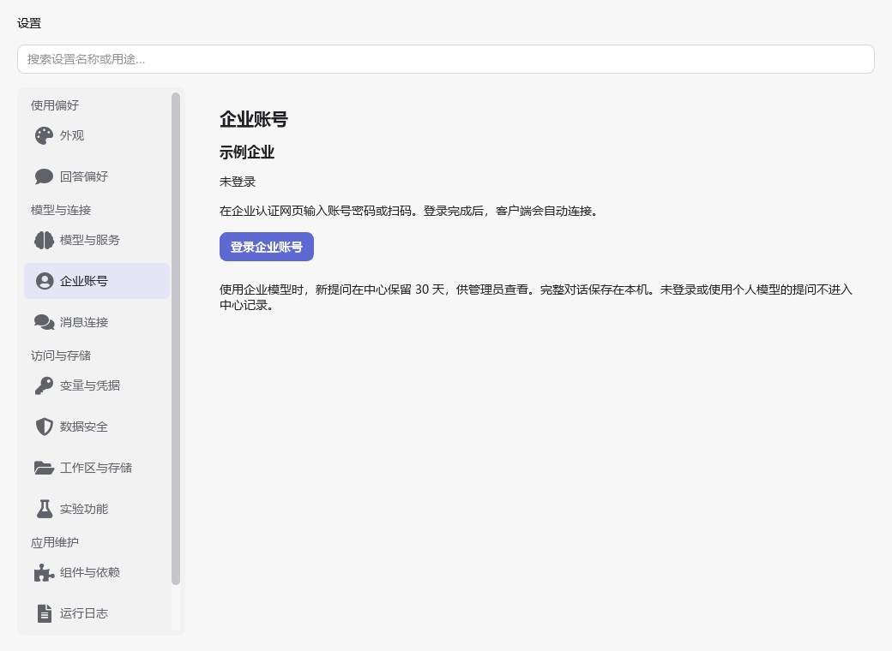

# 资料服务连接移除与升级说明

适用版本：**5.3.2**（当前工作区）。

桌面端的“资料服务连接”能力已移除。设置中的“企业账号”连接中心平台；WeKnora、腾讯文档和乐享在各自资料库页面登录、续期与退出。Skill/MCP 在自身配置页完成认证。中心平台的企业认证功能继续保留。

## 升级后如何继续

- 原本使用资料库独立登录的用户保持原状态。
- 曾使用统一连接的资料库需要在对应来源重新登录。不会迁移统一连接的密码或令牌，也不会自动启用以前保存的其他账号。
- 曾使用统一连接的 MCP/Skill 会提示重新配置。保存独立配置后，点击“测试连接”；MCP 验证成功后恢复发现与调用。Superset 在其能力设置中填写服务地址、账号、密码和登录方式。
- 仍声明 `connection_requirements` 或宿主 connections API 的旧插件需要作者更新；导入的旧 MCP `connection_ref` 会标记为需要重新配置，不能绕过认证直接执行。

## 哪些内容会保留

历史对话、已完成成果、资料引用、最近访问和上传记录保留。重新登录后不能确认身份或归属的引用需要重新选择；不会把旧引用自动转给新账号。上传结果未知时先核对原平台，不自动重传。旧认证等待任务不自动恢复。

旧连接数据库和模板保留在本机，但退出运行路径。被统一连接覆盖的原独立登录记录以原加密字节保存在资料库数据库的退役备份表；不会解密后写入普通配置。处理过程带有完成标记，重复启动不会清除新登录；失败会保留原数据并显示重试提示。

## 当前入口

- [资料库登录、引用与保存](knowledge_library.md)
- [企业账号](enterprise-platform.md)
- [Skill 与 MCP 独立配置](skill-system.md)

不再安装桌面统一认证依赖或分发 `connection_templates.json`。企业中心服务器继续使用自己的依赖和部署流程。

## 验证边界（账号连接实现阶段记录）

以下保留 5.2.5 账号连接实现阶段的历史记录，供旧发布说明引用；不代表当前版本仍支持该能力，也不表示本次重新执行了这些测试。

当时的自动化验证包含本机 HTTP OAuth 授权码/PKCE/刷新、签名 OIDC 身份校验、跨进程刷新、任务隔离、取消恢复、凭据脱敏及原功能回归。LDAP 和企业微信协议分支使用受控测试，未提供真实企业平台、LDAP 目录和企业微信租户进行实网联调。

当时连接相关 68 项测试通过；资料库、运行授权、设置页及后台交互针对性回归通过。旧配置默认模型名称的 3 项、Skill 执行授权上下文的 4 项和旧打包夹具的 2 项失败已在当时 HEAD 复现。完整构建按当时要求停止，未生成可交付发行包。
