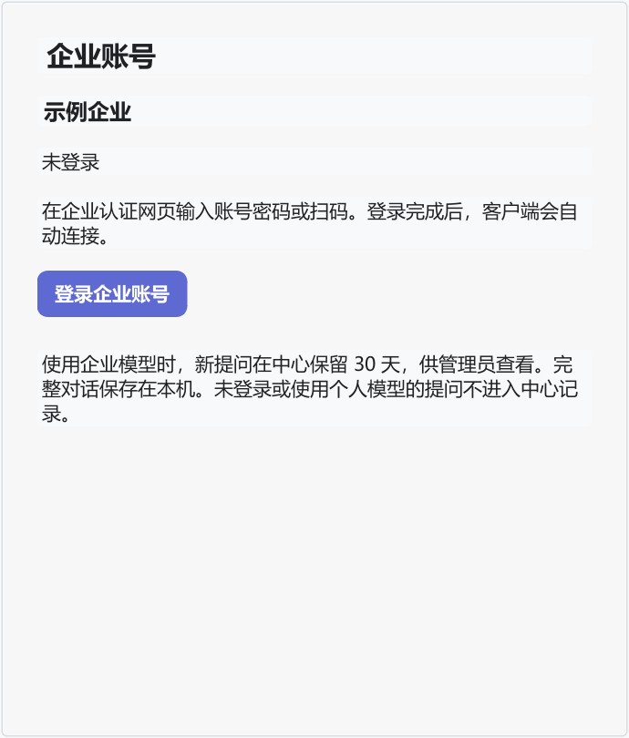
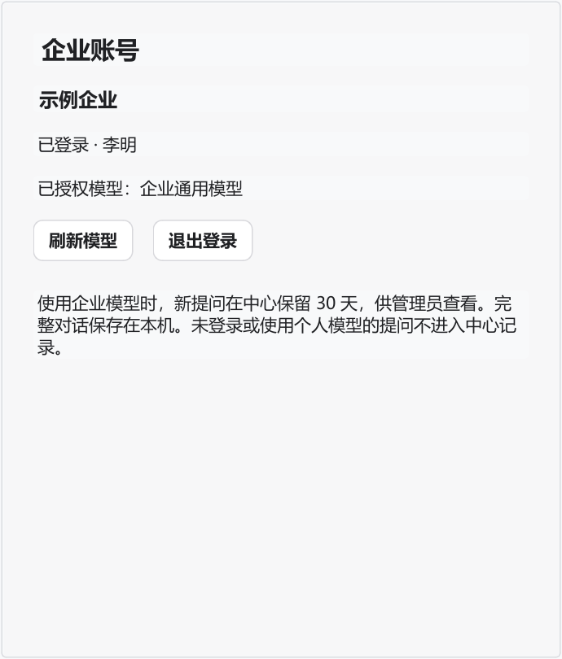
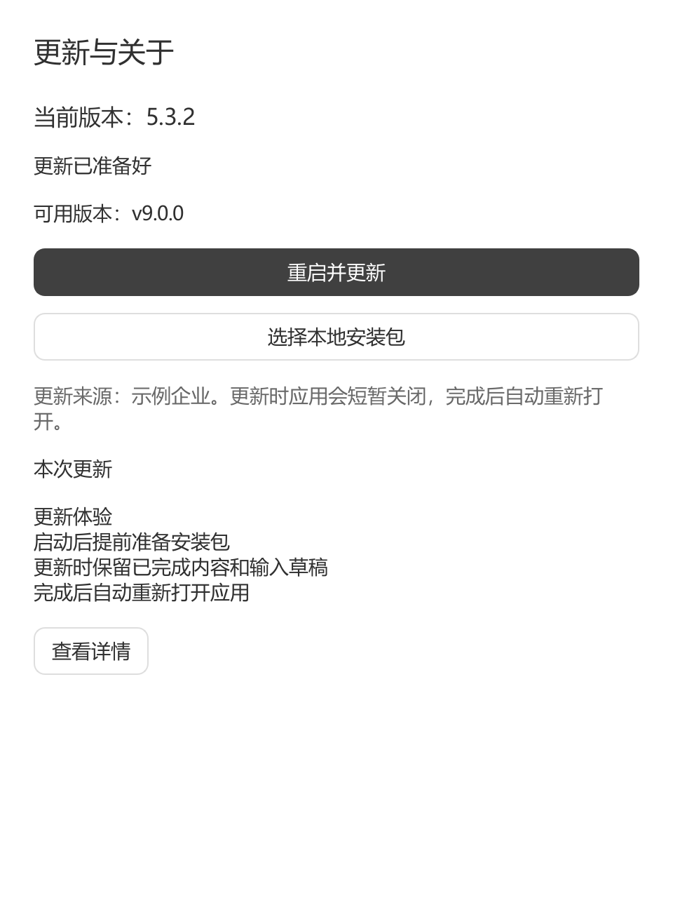
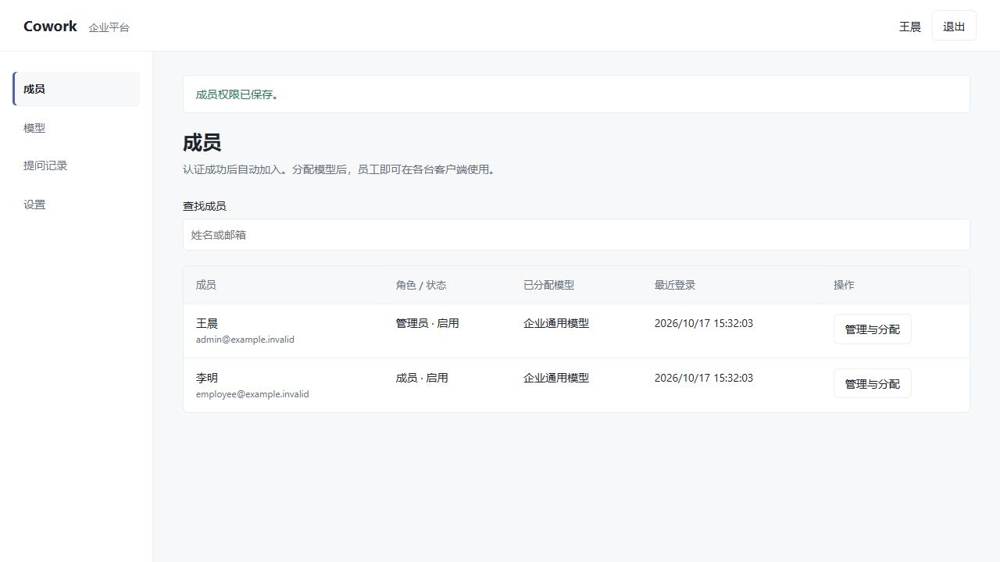
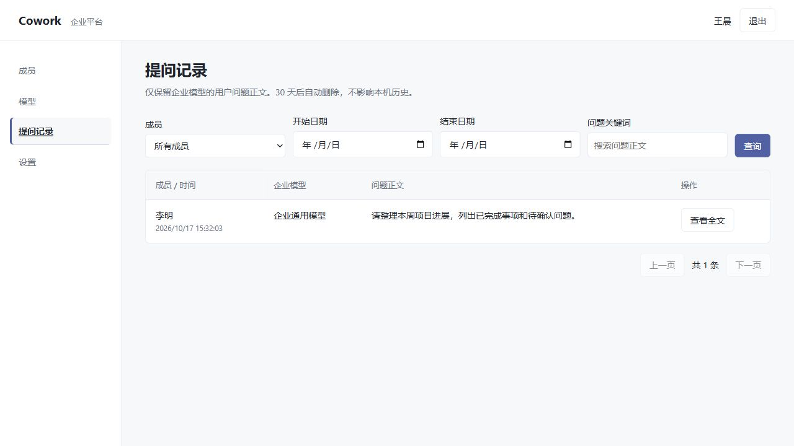
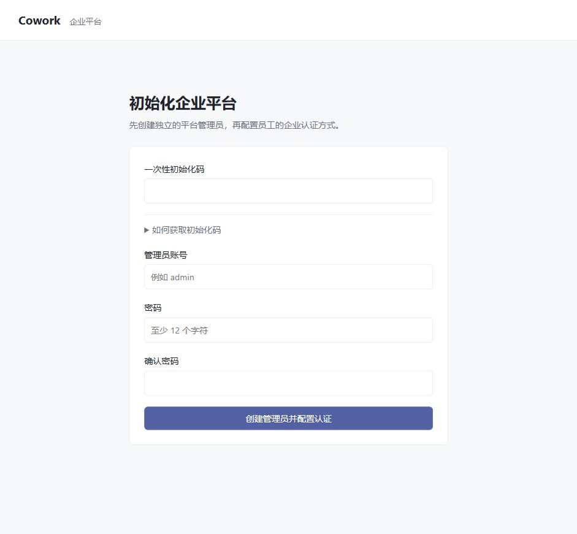
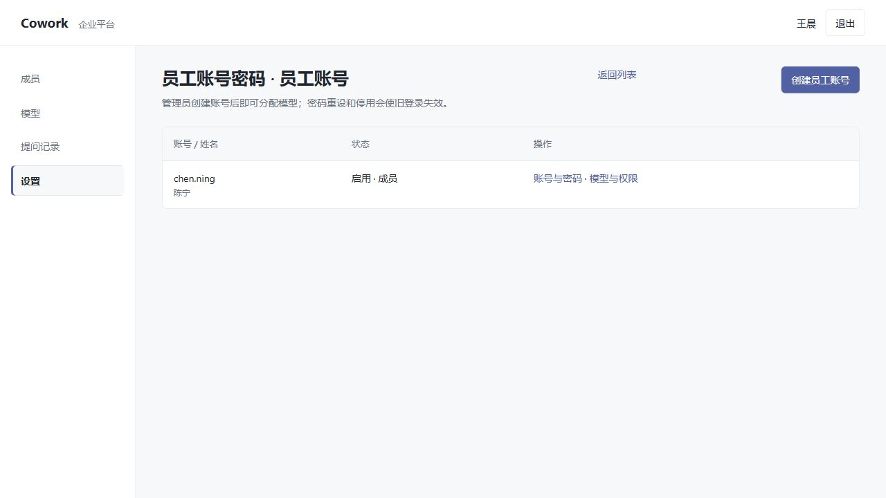

# 企业连接与模型

企业连接是可选功能。不登录时继续使用个人模型；登录后，企业模型出现在原有模型选择器中，个人模型仍可选择。完整对话保存在本机，不跨电脑同步。

## 员工开始使用

1. 从企业平台下载 Windows x64 客户端并完整解压，运行 `deepseek-cowork.exe`。
2. 首次未配置模型时，企业包会显示企业名称，可选择“前往企业登录”或“暂不登录”。“设置 → 企业账号”只提供一个“登录企业账号”入口，无需选择服务或填写协议配置。
3. 点击后在企业认证网页输入账号密码或扫码；二维码由企业认证系统提供。仅配置 LDAP 时，在中心的网页登录页输入目录账号密码。登录完成后客户端自动取得账号和授权模型；期间可以取消。
4. 首次登录默认没有企业模型，需管理员分配。分配后点击“刷新模型”。
5. 在聊天的模型选择器选择带企业名称的模型，正常发送提问。

会话凭据由本机 Windows DPAPI 保护；供应商模型密钥只保存在中心。企业版启动后会读取平台公开的推荐版本并提前下载更新，无需登录；模型和账号访问仍需员工主动登录。

资料库账号在对应资料库页面管理；第三方 Skill/MCP 使用自身配置。企业账号仅连接中心平台，不接管这些独立账号。

## 提问记录的范围

只有使用企业模型新提交的问题正文进入中心，供平台管理员查看，中心首次接收后保留 30 天。个人模型、未登录内容、旧历史、回答、工具结果和附件不进入提问记录。继续提问会新增记录；重试、重新生成和工具循环不会重复记录同一提交，也不延长留存期限。

中心代理需要转发本轮模型所需的上下文，但不把完整上下文保存为提问记录。中心到期删除不影响本机历史；本机编辑或删除也不回删管理员提问记录。[团队空间](team-spaces.md)独立保存用户明确分享的计划、资料和成果，不适用提问正文的 30 天清理。

## 恢复与更新

- 没有企业模型：请管理员分配，然后刷新授权。
- 登录过期、账号停用、模型权限或配置变化：页面或模型调用会显示原因，输入与已有输出保留。重新登录或刷新后重新发起本轮；不会自动切换为个人模型。
- 退出或切换企业账号：旧运行不能借用新账号继续调用。退出仅注销 Cowork 会话，不伪装为上游全局退出。
- 模型或网络临时失败：由现有任务控制呈现有界重试和停止，提问按同一标识去重。
- 企业客户端更新：在“应用更新”直接检查、下载所属平台的推荐版本，准备完成后从侧栏提示条或更新页点击“重启并更新”，沿用现有安装流程。管理员需要先发布并推荐 Windows x64 客户端；没有推荐版本时会显示说明。
- “选择本地安装包”继续保留，可离线升级或重装同版本。普通渠道包和其他平台包会被阻止；本机历史及已确认连接不随更新重写。企业在线更新会校验平台身份、文件大小与 SHA-256，失败后可重试或选本地包，不会切到 GitHub。
- 自行打包且不带企业连接文件的社区版使用公共服务器及 GitHub 备用源；公共地址为空时直接使用 GitHub。曾登录企业账号也不会改变此渠道。企业缓存按连接隔离，重启后先核对平台当前推荐版本，再复用匹配的安装包。公共发布规范见[自动更新规范](app-updates.md)。

## 管理员操作

“成员”中查看自动加入的员工、分配模型与默认模型，必要时停用账号。最后一位管理员不能被停用或降级。

“模型”先保存连接参数，测试实际调用，再启用与分配。模型密钥不显示在员工配置中。认证方式、发布客户端和清理状态在“设置”中管理。

“提问记录”可按成员、日期和关键词查询，查看正文；普通成员无此权限。

Linux 部署、首次管理员、OIDC/OAuth2/LDAP 参数、发布和备份规则见[企业平台部署说明](../web/platform/README.md)。

## 首次部署与平台管理员

空平台启动后访问 `/app`，网页会引导创建独立的平台管理员；无需先配置企业认证。直接填写账号和密码即可，首次创建只允许成功一次，详见[部署说明](../web/platform/README.md#首次网页初始化与管理员登录)。创建后进入“设置 → 添加认证来源”，保存 OAuth2、OIDC 或 LDAP 配置，测试登录通过后启用。员工仍使用企业账号，默认是普通成员；管理员角色由首位管理员在“成员”页面授予或收回。平台管理员可通过登录页的独立入口登录。

## 使用平台账号密码登录

管理员可在“设置 → 添加认证来源”选择“平台账号密码”，点击“保存并启用”后进入“管理员工账号”，创建员工账号与初始密码，无需测试登录。已有草稿直接启用即可。有多个认证来源时，在设置页保存“客户端统一登录方式”。随后在“模型与权限”分配员工可用模型。

员工在客户端点击“登录企业账号”，在打开的网页登录页输入管理员提供的账号密码，完成后自动回到客户端。账号与模型权限由企业平台管理，本机对话不上传或同步。

管理员可停用账号或重设密码，旧登录随即失效。新账号默认是普通成员；其他管理员角色仍须首位管理员授权。

认证来源列表提供“删除”操作，并在执行前确认。仅可删除已停用且未关联成员的来源；正在进行的登录需先结束或等待过期。若来源被指定为客户端统一登录入口，先更换入口。已关联成员的来源可停用，保留员工账号、授权与历史记录。

标准包仅允许 `_internal/config.json` 中包含空 API Key、默认 `https://api.deepseek.com` 地址和空 `disabled_skills` 列表；本地打包与平台使用同一内容校验规则。其他路径的配置文件、未知字段、重复字段、凭据或自定义值均拒绝分发。

客户端发布列表支持可恢复删除：草稿、失败、可发布或已撤下记录可确认删除，默认列表将隐藏该记录；在“显示已删除”中可恢复。安装包文件保留，恢复不自动发布或设为推荐。已发布版本先撤下；上传或生成中的记录先取消或等待完成。此操作不释放磁盘空间。

客户端企业连接接受 HTTP 和 HTTPS 地址，本机、内网和域名地址均可使用；地址不能包含凭据、查询参数或片段。本机 localhost、127.0.0.1、::1 请求直连，不经系统代理。旧客户端将 HTTP 连接显示为“企业连接无法读取”时，需要重新构建标准客户端并由平台重新生成企业包；仅修改服务端或重复下载旧包不会更新 EXE 中的校验逻辑。
