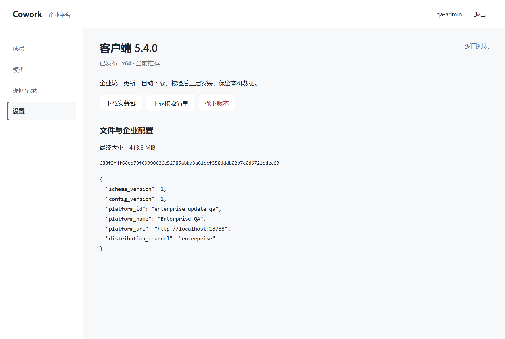

# DeepSeek Cowork 企业版

文档适用版本：**5.4.3** · [本版说明](../releases/5.4.3.md)

DeepSeek Cowork 企业版提供一套部署在企业自有 Linux 服务器（支持 `x86_64` 与 `ARM64`）上的管理后台，帮助团队集中管理组织架构、企业模型、统一能力包（Skill、MCP、专家）、协作空间、合规审计与客户端版本分发。员工在自己的 Windows 桌面端登录企业账号后，既能直接使用公司分配的资源，也能继续保留和使用本机的个人工作区与自配模型。

## 角色分工与访问入口

以下路径均相对于企业配置的公共访问地址（如 `https://cowork.example.internal`）：

| 角色 | 访问入口与日常职责 |
| --- | --- |
| **运维部署人员** | 在 Linux 服务器部署后台与数据库，通过 `/healthz` 确认服务就绪后，将后台地址 `/app` 交给管理员 |
| **超级管理员** | 首次打开 `/app` 初始化本地超级管理员账号，配置企业统一登录（账号密码 / OIDC / OAuth2 / LDAP），并任免平台管理员 |
| **平台管理员** | 打开 `/app` 选择“通过企业账号登录”，维护部门与成员、导入并授权模型与能力、查询导出合规审计、发布推荐客户端包 |
| **企业员工** | 从 `/downloads` 下载企业推荐客户端包，在桌面端“设置 → 企业账号”发起登录，即可在聊天中选用获授权的模型与能力 |

## 企业后台集中管理什么

| 管理模块 | 核心能力 |
| --- | --- |
| **成员与部门** | 建立多级部门树并设置员工归属；按部门分配的资源自动覆盖所有下级部门，员工最终可用资源取个人授权与各级部门授权的并集 |
| **企业模型** | 统一配置模型服务（API Key 保存在服务端，不下发到员工电脑），支持在模型详情直接分配部门或成员，也可为员工指定默认模型 |
| **企业能力（Skill / MCP / 专家）** | 后台“企业能力”分三个标签页：支持上传 Skill ZIP、配置或导入 Streamable HTTP MCP、上传带关联 Skill 的专家 ZIP。经检查、发布并授权后，员工可在桌面端“能力”页的“企业”标签或聊天输入框“+”菜单直接选用。详见[管理员指南](admin-guide.md#企业能力与聊天审计) |
| **团队空间** | 支持成员围绕共同项目共享计划、资料、任务快照与成果，本机执行任务后再按需分享给团队 |
| **合规审计** | 按“成员 + 对话”保留最近一次符合策略的脱敏聊天请求（保留 30 天），独立保留平台管理操作记录（90 天），支持条件查询、JSON 正文展开复制与 Excel 导出 |
| **客户端发布** | 上传标准 Windows x64 安装包自动封装企业连接地址并生成专用校验清单；企业客户端无需登录即可自动检测并下载新版本，由员工确认重启安装 |

## 按你的角色开始

- **我是运维部署人员**：准备 Linux 服务器镜像、配置 HTTPS 或可信内网 HTTP、执行启动验收与备份升级 → 阅读[管理后台部署指南](deployment.md)
- **我是管理员**：初始化认证来源、配置部门与模型/能力授权、查询审计并分发客户端 → 阅读[管理员指南](admin-guide.md)
- **我是企业员工**：安装登录企业客户端、在对话中使用企业模型与能力、参与团队空间协作 → 阅读[员工指南](employee-guide.md)
