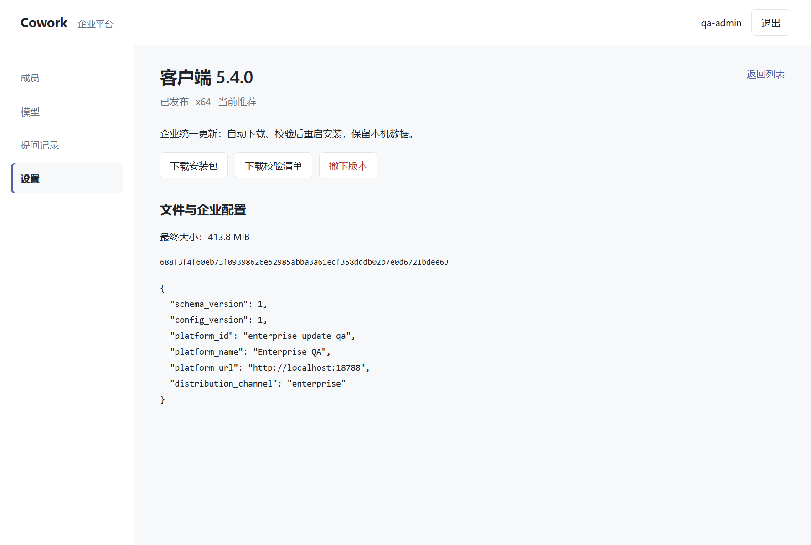

# DeepSeek Cowork 企业版管理员指南

文档适用版本：**5.4.3**

向部署人员取得企业后台地址，例如 `https://cowork.example.internal/app`。x86_64 与 ARM64 服务器提供相同的管理页面。服务器准备、证书和健康检查见[Linux 管理后台部署指南](deployment.md)。

## 初始化与成员管理

1. 首次打开后台地址 `/app`，在“创建超级管理员”填写账号和密码。
2. 在“认证与系统设置 → 添加认证来源”选择平台账号密码、OIDC、OAuth2 或 LDAP。
3. 外部认证保存草稿并完成测试登录后启用；平台账号密码可直接保存启用。
4. 在“客户端统一登录方式”选定来源，点击“保存登录入口”。在“成员与部门”创建部门，并为员工设置归属。
5. 打开“企业模型 → 添加模型”，保存连接参数、测试并启用。在模型详情点“分配部门或成员”授权。如需设置某位员工的默认模型，打开“成员与部门”，选中该员工后点“分配模型”。

超级管理员可从 `/app/administrator` 登录，在“成员与部门”向企业账号授予或收回后台权限。获授权的平台管理员在 `/app` 选择“通过企业账号登录”。员工从 Cowork 桌面端发起企业登录，在浏览器完成认证后返回 Cowork。

### 平台账号密码

启用“平台账号密码”认证来源后，在“成员与部门”点击“添加员工”，设置姓名、账号与初始密码。选中员工后可管理账号和密码、调整启用状态或分配模型。员工在 Cowork 桌面端点击“登录企业账号”，在浏览器输入账号密码后返回客户端。

### OAuth2 与 LDAP 参数

OAuth2 来源使用 `mode: "oauth2"`。在表单和高级配置中填写 `authorize_url`、`token_url`、`userinfo_url`、`client_id`、`pkce`，客户端密钥放入 secrets。

按身份服务契约设置客户端认证方式 `client_auth`、令牌请求编码 `token_encoding`、`include_redirect_uri`、用户信息请求方法及令牌传递位置。身份字段使用 `subject_token_path`、`name_path`、`email_path`，业务状态通过 `error_field`、`success_values` 映射。

LDAP 使用 `mode: "ldap"`，填写 `host`、`port`、`tls`（`ldaps` 或 `starttls`）、`base_dn`、`user_filter`（如 `(uid={username})`）、`identity_attribute`（如 `entryUUID`），按需配置 `bind_dn` 和容器内 `ca_file`。查询密码保存为 `secrets.bind_password`。

使用命令行导入或初始化企业认证的步骤见[导入认证来源](deployment.md#命令行导入认证来源)。

### 部门与资源分配

在左侧选择“成员与部门”，点击“创建部门”并选择上级部门。在成员详情选择“所属部门”并保存。部门筛选包含下级部门。新加入的 LDAP 员工首次登录后也可以设置部门。

在“企业模型”或“企业能力”的详情中打开“分配部门或成员”。员工可用范围为个人授权与所在部门、上级部门授权的并集。同一资源只出现一次。调动员工后，服务端按新的归属检查后续调用，桌面端刷新企业连接后更新模型列表。专家及其关联的 Skill、MCP 均须有权使用。

## 企业能力与聊天审计

在“企业能力”选择 Skill、MCP 或专家。对应入口分别是“上传 Skill ZIP”“添加或导入 MCP”和“上传专家 ZIP”。保存草稿后点“检查配置”，通过后点“发布版本”。在“分配部门或成员”中选择全部成员或指定部门、个人，最后点“保存授权”。

- **Skill** 上传 ZIP。包内需有 `SKILL.md`，可附带 `references/`、`scripts/` 和 `assets/` 下的文本文件。
- **专家** 上传 ZIP。包内包含 `expert.json`、`prompt.md` 和 1–8 个 `skills/<目录名>/SKILL.md`。导入会创建或更新包内的 Skill 草稿并关联给专家。先发布并授权这些 Skill，再发布、授权专家。专家也可关联已存在的 Skill 和 MCP，或指定默认企业模型。
- **MCP** 支持通过 JSON 文件导入，或填写 Streamable HTTP 服务地址和允许调用的工具。使用 Bearer 认证时，由员工在桌面企业 MCP 标签页给该服务配置凭据。

Skill 和专家的上传页提供可直接导入的示例模板。包内文件使用 UTF-8 文本，压缩前和压缩后均有 4 MiB 上限。

配置测试检查表单、脚本语法和所关联的能力。验证 MCP 是否可达、凭据是否有效及实际工具结果时，请让一名获授权的成员在桌面发起一次测试任务。员工发送消息时选定本轮使用的已发布版本。更新版本供后续轮次使用。停用或撤销授权会阻止之后的模型和工具调用，员工可以查看已有聊天和成果。

### 查询审计与导出 Excel

打开“合规审计”，选择“聊天请求”或“平台操作”。可组合成员、起止时间和关键词，点“查询”后再点“导出 Excel”。工作簿包含所有符合当前查询的记录及筛选条件。筛选按浏览器本地时间输入，结束时间包含所选的整分钟；导出时间统一为北京时间。

选中聊天请求后，详情先显示成员、模型和时间。点“展开请求正文”可在详情框内滚动阅读，点“收起请求正文”即可折叠。“复制 JSON”在折叠和展开时都能复制完整的已保存正文。Excel 导出包含审计元数据，读取正文请使用记录详情。

每个成员的每个聊天保留最近一次符合规则的请求，保留 30 天。请求中已有的文字上下文随之保存。审计副本省略认证凭据和内嵌文件数据，超过 4 MiB 时保留记录信息并标明正文未保存。“平台操作”独立保留 90 天。

管理员可在“审计设置”中启用“记录使用自配模型的企业任务请求”。默认关闭，修改从后续任务生效。个人任务使用自配模型时仍按个人使用规则运行。

## 客户端分发

分发目标为 Windows x64 Electron 客户端，按企业发行身份提供推荐版本；账号、模型授权和团队空间独立于客户端发行格式。

先构建标准桌面 ZIP，再由中心校验、封装为企业包，最后由管理员发布推荐。源码版本号、本地构建和员工可下载的推荐版本应分别核对。

Windows 标准客户端按[构建说明](../technical-design.md#构建与发布)生成 ZIP 和 `latest-desktop-windows-x64.json` 更新清单（也可使用显式生成的审计报告）。平台管理员执行：

1. 在后台左侧打开“客户端发布”，点击“上传客户端包”，填写程序版本。
2. 上传标准 ZIP 和同次构建的更新清单，点击“校验并生成企业包”，等待状态变为“可发布”。
3. 在版本详情点击“下载安装包”和“下载校验清单”，核对后点击“发布并设为推荐”。
4. 将企业地址下的 `/downloads` 分享给员工，或直接分发生成的企业 ZIP。员工完整解压后打开 `deepseek-cowork.exe`，从 Cowork 发起企业登录，在浏览器完成认证后回到客户端。

“其他操作”中也可选择“从 GitHub 导入最新版”。中心读取正式 Release 的工作台清单，从固定版本标签下载标准 ZIP，验证并生成企业包。导入可取消，失败时会显示原因。完成后仍需管理员下载核对并发布推荐。

平台把服务器地址写入 EXE 同目录的 `enterprise_connection.json`，员工首次打开时直接使用该地址。封装后重新计算 ZIP 大小和 SHA-256。管理员及员工下载页同时提供对应企业 ZIP 的“下载校验清单”，离线更新时将两者放在同一目录。

后续升级只需管理员重复上传、校验和发布推荐版本。企业客户端通过包内地址自动检查和下载，员工可在桌面“设置 → 更新与关于”手动检查，整个更新过程无需登录企业账号或打开平台网页。个人包继续从个人更新渠道检查更新，登录企业账号后也可以使用获授权的企业资源。

当前只有 Windows x64 Electron 一个推荐版本。客户端启动约 15 秒后检查，之后每 24 小时检查，自动下载高于当前版本的推荐包；员工确认“重启并更新”后才安装。安装前重新确认推荐记录有效，已有任务须先结束。企业源失败不切换公共源。撤下只阻止新的在线下载和安装，不卸载已安装版本；离线副本无法确认撤回状态。后台目前不提供强制升级、设备清单或全员安装回执。

Qt 客户端已停止支持，旧安装不能沿用原更新入口。首次使用当前企业版须下载、完整解压并运行 Electron 企业包；本产品不维护 Qt 到 Electron 的自动迁移流程。

