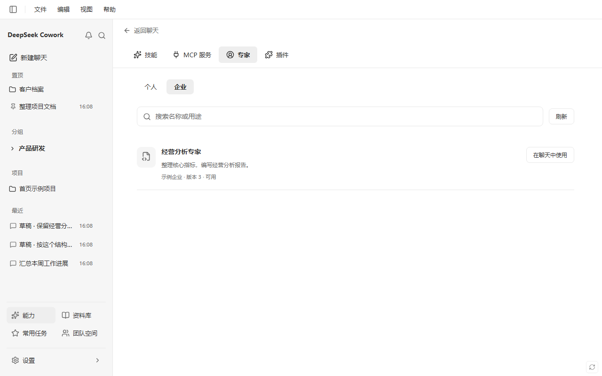

# DeepSeek Cowork 企业版员工指南

文档适用版本：**5.4.2**

企业账号提供管理员分配的模型、Skill、MCP 和专家。团队空间用来组织共同的计划、资料和成果。完成本机工作后，可以选择需要的内容发布给团队。有关管理分工、审计和客户端更新，见[企业版介绍](README.md)。

## 登录企业

1. 打开管理员分享的企业下载页（企业地址下的 `/downloads`），下载推荐版本，或使用管理员直接提供的企业 ZIP。
2. 完整解压，启动 DeepSeek Cowork，打开“设置 → 企业账号”，点击“登录企业账号”。企业包已配置平台地址。
3. 在浏览器使用企业指定的方式完成认证，再回到 Cowork。如果本机曾连接另一个企业，先核对页面显示的两个地址，再确认切换并重新登录。

使用个人安装包时，如尚未连接，可在“设置 → 企业账号”填写管理员提供的企业名称、平台标识和平台地址。登录后，聊天的模型菜单可以选择企业分配的模型，个人模型也可以继续自行配置和使用。个人安装包沿用原有更新渠道。

如果刚加入或调动部门，在“设置 → 企业账号”点击“刷新授权”，再打开模型菜单或企业能力列表。仍缺少资源时，请管理员核对你的部门归属和授权范围。[管理员指南](admin-guide.md#部门与资源分配)

## 在聊天中使用企业能力

企业包从包内平台地址获取账号可用的资源，其中包括个人授权和从所在部门、上级部门继承的授权。若某个专家提示缺少依赖，请管理员检查该专家关联的 Skill 和 MCP 是否已发布并授权给你。

打开“能力”，在“技能”“MCP 服务”或“专家”下选择“企业”，查看已获授权的能力及其版本。点击“在聊天中使用”，回到当前聊天后填写任务并发送。也可以在输入框旁的“+”菜单选择带企业来源的技能、连接器或专家。

选择企业专家后，本轮会使用专家的指引和关联的 Skill、MCP。相应能力需要分别获得授权。企业 MCP 要求访问令牌时，在对应条目点击“配置凭据”，填写并保存。凭据随当前账号和服务地址保存在本机。

可以从模型菜单选择企业模型或自配模型。团队空间使用该空间允许的模型。每次发送时确定本轮的能力版本，新发布的版本从下次发送起生效。账号切换或授权被撤回时，客户端会提示重新登录或重新选择能力，已输入的文字和本地成果仍可查看。

## 查看审计范围

支持聊天审计的企业中心按聊天保留最近一次符合规则的模型请求 30 天，后续请求覆盖前一次。请求可能包含聊天已有的文字内容。使用自配模型进行企业任务可按企业设置记录，默认关闭。审计保留请求中的文字和必要的文件引用，本地文件原件或生成的报告可由员工选择发布到团队空间。

## 共同完成任务

1. 打开“团队空间”，创建空间并邀请同事，或接受已有邀请。
2. 在“资料”上传文件，在“计划”填写分工、负责人、优先级和所选资料版本。
3. 打开计划，点击“在本机开始任务”，选择任务目录、模型和技能，填写本次目标。
4. 在原有对话界面完成工作；从空间的“我的任务”回到对应本机任务。
5. 点击“选择内容发布为成果”，检查要分享的文字、说明、文件和关联计划，再确认发布。
6. 在计划详情填写完成说明，并关联成果版本。成员通过留言继续讨论。

空间的“计划、资料、成果、动态”分别组织分工、共享文件、发布内容和协作动态；空间设置、成员管理和归档在更多菜单中。

## 更新企业客户端

企业安装包会在桌面端检查和下载管理员发布的推荐版本。下载后，在客户端确认“重启并更新”即可。更新全程无需登录企业账号或打开平台网页。使用普通版登录企业账号时，更新仍走普通版渠道。

企业下载页提供安装包及“下载校验清单”，离线更新时同时下载并放在同一目录。企业包重新封装后摘要已变化，不要搭配普通标准包的清单。企业中心只支持 Electron 工作台，旧 Qt 客户端不再接收推荐更新；首次使用当前企业版请完整解压企业包后启动。

在“设置 → 更新与关于”点击“检查更新”可立即查询推荐版本。使用离线包时，在同一页点击“选择本地安装包”。更新和失败恢复见[用户手册](../user-guide.md#应用更新与记录导出)。

如果从 Windows 5.4.0 更新时长时间停在“正在准备关闭应用”，原程序仍在运行且安装器尚未开始替换文件，可退出旧客户端，从企业下载页获取推荐 ZIP，完整解压到新目录后启动其中的 `deepseek-cowork.exe`。使用同一 Windows 账号和原用户数据目录即可继续原有聊天和草稿。
