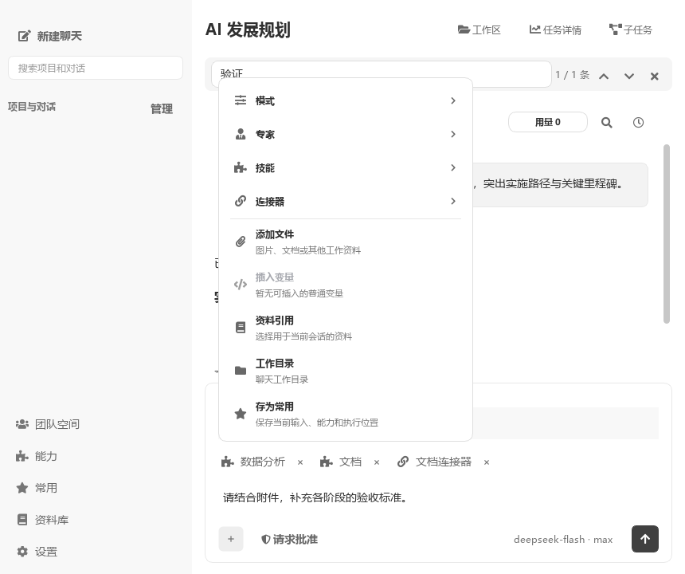
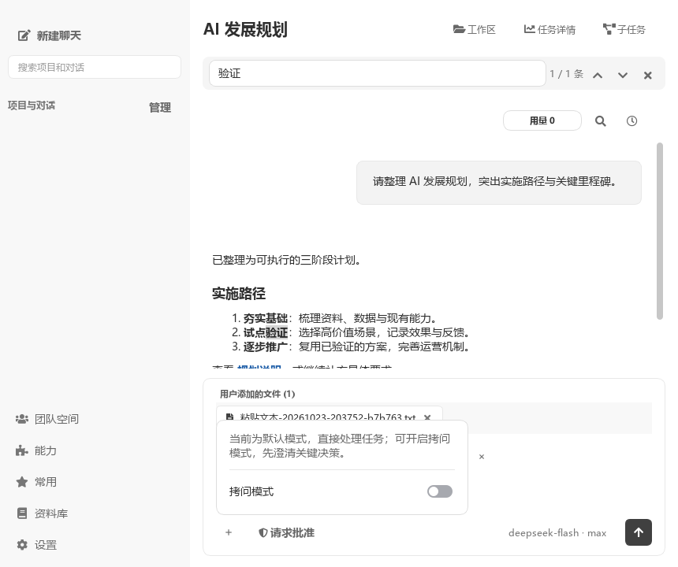
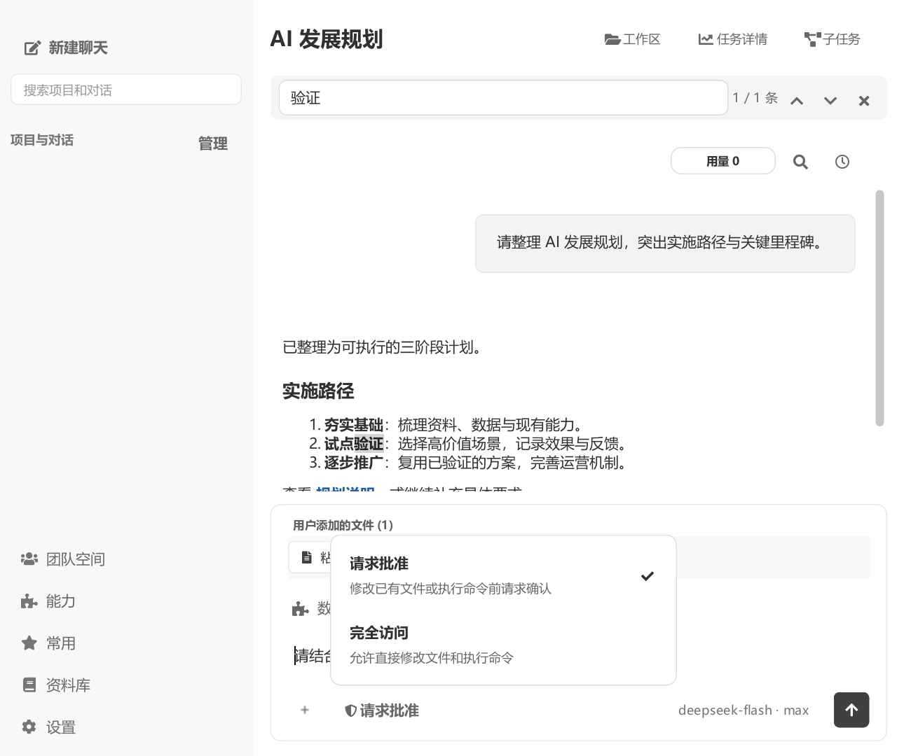

# 对话体验验证

2026-10-23，Windows / Python 3.14.2 / PySide6，使用隔离配置及合成会话，不读取个人聊天、不连接真实模型或 MCP 服务。

## 结果与范围

- 输入框底部统一为“+”、权限、模型和发送。“+”包含模式、专家、技能和连接器，以及文件、变量、资料、工作目录和存为常用；模式下切换现有拷问流程。输入区已移除 Skill 沉淀入口，回答末尾入口保留。
- 技能与连接器即时选择、独立筛选，按会话保存；标签使用中性色，可逐个移除。连接器复用既有 MCP 能力，不改变发现、连接及执行策略。
- 长粘贴达到 4,000 字符或 80 个换行时保存为 UTF-8 TXT 附件，完整保留原文；写入失败保留输入。测试覆盖正文构造、会话切换与移除附件。
- 标题点空白保存且未变化不写库；历史提问改为时钟入口；Ctrl+F 搜索可见消息，按消息跳转，加载旧分页并高亮匹配，不读取隐藏内部消息，不改写历史。
- PowerShell 长提示路径仅改变显示，实际目录和输出不变；实测中文、空格和很长的目录名称。Git Bash 通过 PROMPT_DIRTRIM 缩短提示；未做真实 Git Bash / PowerShell 7 的本轮交互验收。
- 100% / 150% Qt 缩放分别生成常规、附件、搜索、740×620 小窗口、菜单和深色预览截图；权限双行文字完整可见。取消主题预览后确认保存配置未变化。
- 系统提示词、开发者指令、工具定义及顺序没有改动；TXT 复用已有附件路径，能力分类复用已有选择字段，稳定请求前缀不变。

## 页面耗时

最终截图脚本顺序执行，100% 缩放下的本机样本如下。首次初始化仍有成本，这些结果不代表所有真实数据的固定耗时。

| 操作 | 耗时 |
| --- | ---: |
| 设置首次打开 | 860.3 ms |
| 设置再次打开 | 7.9 ms |
| 从资料库返回设置 | 8.2 ms |
| 资料库首次打开 | 179.4 ms |
| 资料库再次打开 | 4.0 ms |
| 两条示例消息的会话切换 | 47.3 ms |

原实现分析中设置反复打开约 800 ms；定位到重复构建与构建后换父控件，修复后复用页面并在配置变化时失效。原始结果见 [100%](navigation-1x.json) 和 [150%](navigation-1.5x.json)。

## 复现

```powershell
$env:QT_QPA_PLATFORM = 'offscreen'
$env:COWORK_EXTERNAL_BACKGROUND_SERVICES = '0'
$env:APPDATA = Join-Path $env:TEMP 'cowork-chat-experience-qa'
$env:LOCALAPPDATA = $env:APPDATA
.venv/Scripts/python.exe -X utf8 -m pytest test/test_chat_experience.py test/test_workspace_presentation.py -q
.venv/Scripts/python.exe -X utf8 -m pytest test/test_conversation_linear_interactions.py -k 'skill_picker or composer_add_popover or product_action_row or product_popover' -q
.venv/Scripts/python.exe -X utf8 -m pytest test/test_conversation_render.py test/test_history_paging.py test/test_long_context_attachments.py test/test_theme_service.py -q
.venv/Scripts/python.exe -X utf8 -m pytest test/test_main_workspace_linear.py -k 'toolbar_reflows or session_switch_after_sidebar_cycle' -q
foreach ($scale in @('1', '1.5')) {
    $env:QT_SCALE_FACTOR = $scale
    .venv/Scripts/python.exe -X utf8 -W ignore scripts/verify_chat_experience.py
}
```

以上相关测试分别 21、10、39、2 项通过，合计 72 项，另有 6 个参数子用例。语法编译和 `git diff --check` 通过。

补充旧测试的限制：`test_chat_scroll_regressions.py` 有两项纯文本滚轮断言失败，使用 HEAD 原版 main.py 在独立进程中复现；`test_linear_management_navigation.py` 的三项选定用例在夹具阶段引用已不存在的 `SettingsDialog.start_app_update`，HEAD 中也无该方法。整份 `test_conversation_linear_interactions.py` 在既有控件销毁用例提前退出，本轮只把上述相关菜单子集计为通过。没有修改这些无关流程，也不宣称全仓回归通过。未执行打包应用、系统级 Windows 显示缩放人工验收或真实模型请求。







