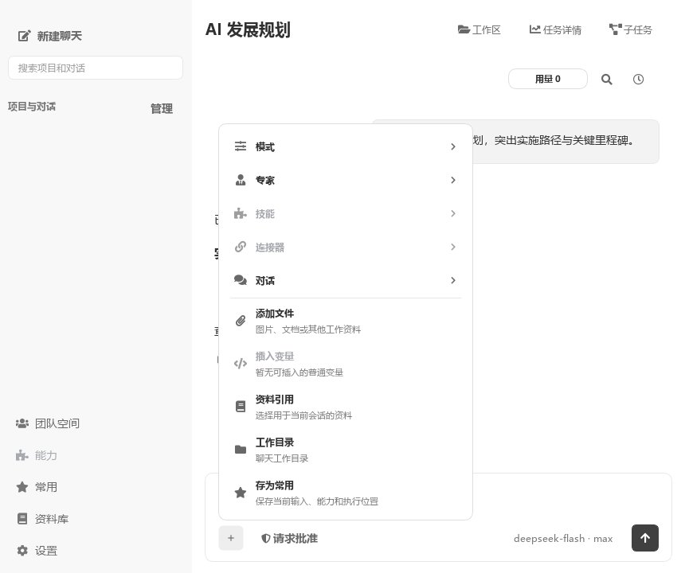
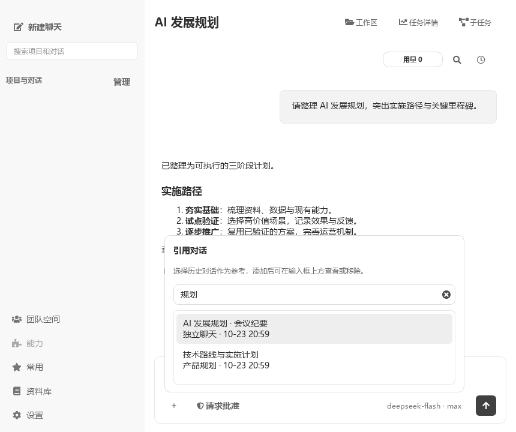
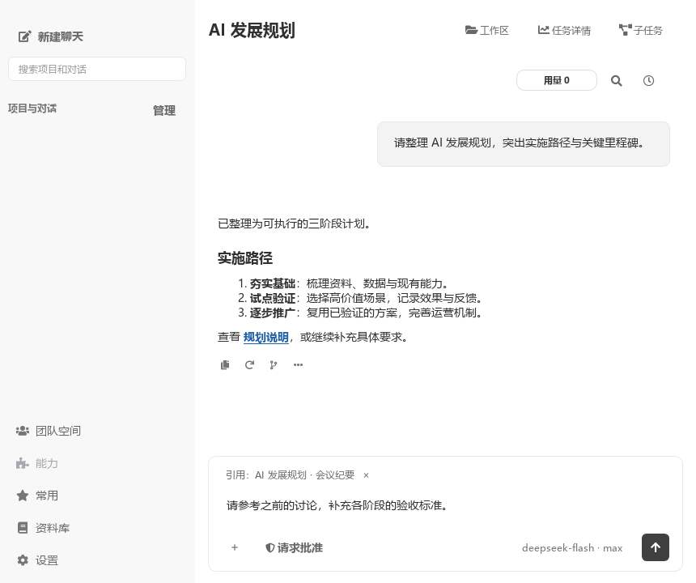
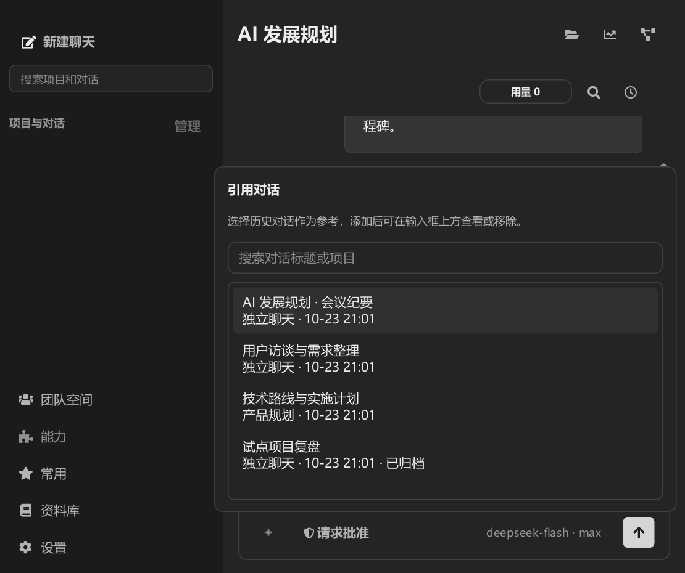

# 从“+”引用历史对话

2026-10-23，Windows / Python 3.14.2 / PySide6。使用隔离配置与合成历史对话，不读取个人聊天，不连接真实模型。

- “+ → 对话”复用 `@` 的历史搜索、引用标签、草稿持久化与发送时快照逻辑；没有改变模型系统前缀、工具定义或顺序。
- 按对话标题或项目名搜索，同项目优先，包含跨项目及归档对话；点选或回车添加，重复选择去重。搜索结果变化时浮层自动收缩，保持与“+”入口对齐。
- 验证已输入正文及光标保留、引用快照原文可读、会话切换与过期回调隔离、移除引用、读取失败后保留草稿并重试，以及原有 `@` 触发与草稿变化保护。
- 引用草稿的延迟保存随退出流程暂停；最终快照由退出流程保存，退出失败恢复原定时器。
- 100% / 150% Qt 缩放各生成分类菜单、列表、搜索、空结果、添加后状态、740×620 小窗口及深色预览。检查弹层边界、文字完整性；取消主题预览后保存配置不变。

相关回归：`test_chat_experience.py`、`test_conversation_actions.py`、`test_worker_lifecycle.py` 共 56 项通过，另有 4 个子用例；分类菜单与共享浮层相关子集 10 项通过。合计 66 项，语法编译和 `git diff --check` 通过。未执行打包应用、系统级 Windows 显示缩放人工验收或真实模型请求。

测试中曾出现关闭等待超时：连续 Qt 等待未让后台 Python 保存线程及时推进。夹具改为处理 Qt 事件并短暂让出 Python 执行，仍使用 5 秒截止时间，再执行完整回归通过。未改动产品的等待时限或保存成功判断。

## 复现

在临时配置目录中执行，避免读取日常应用数据：

```powershell
@'
import os, tempfile
with tempfile.TemporaryDirectory(prefix='cowork-reference-tests-') as temp:
    os.environ.update(APPDATA=temp, LOCALAPPDATA=temp, QT_QPA_PLATFORM='offscreen', COWORK_EXTERNAL_BACKGROUND_SERVICES='0')
    import pytest
    result = pytest.main(['test/test_chat_experience.py', 'test/test_conversation_actions.py', 'test/test_worker_lifecycle.py', '-q'])
raise SystemExit(result)
'@ | .venv/Scripts/python.exe -X utf8 -

# 在相同的隔离环境中另行运行菜单子集：
# pytest.main(['test/test_conversation_linear_interactions.py', '-k',
#              'skill_picker or composer_add_popover or product_action_row or product_popover', '-q'])

foreach ($scale in @('1', '1.5')) {
    $env:QT_SCALE_FACTOR = $scale
    .venv/Scripts/python.exe -X utf8 -W ignore scripts/verify_chat_experience.py --references-only
}
```








