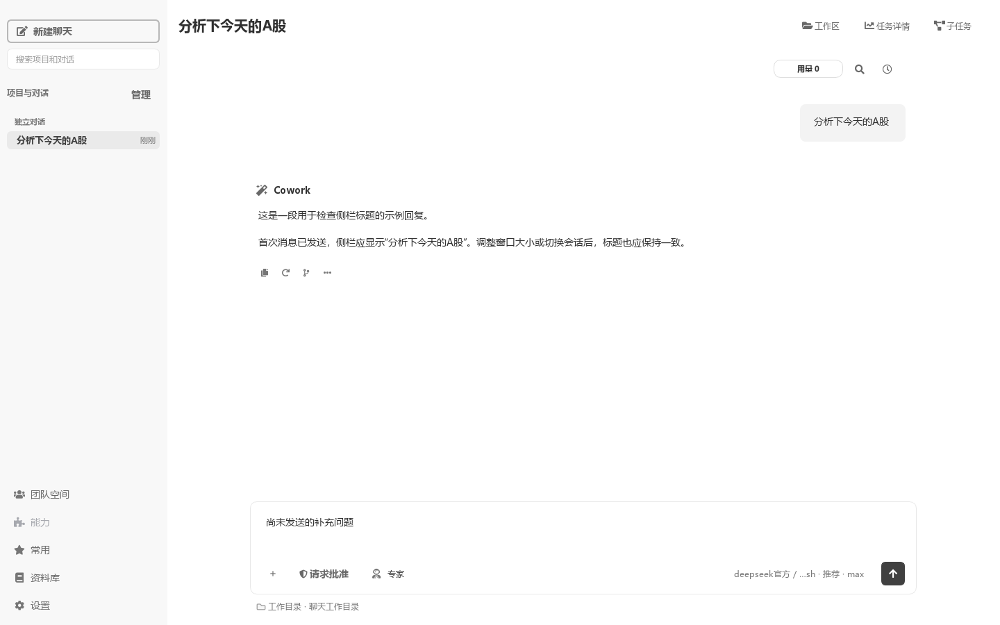
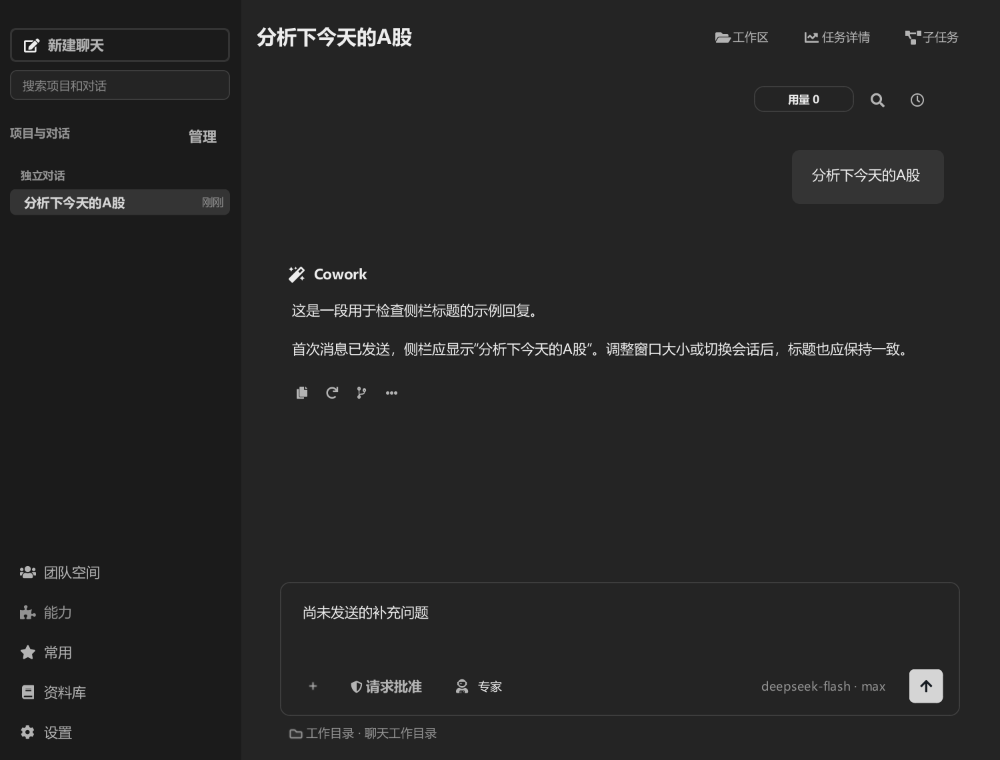

# 发送后侧栏草稿标题验证

2026-10-28。已发送并收到回复的对话仍可能显示“草稿”，根因是历史行增量更新调用 `QLabel.setText()`，只改了当前文字，没有同步 `HistoryTitleButton` 的完整标题和省略显示缓存；后续宽度变化会再次投影旧标题。改为调用现有 `set_full_title()`，保持原控件、排序和滚动更新流程。

## 验证结果

- 修复前新增回归失败：发送后悬停提示仍为“草稿 · 请同时使用所选能力分析”。修复后通过。
- `test_chat_experience.py` 与 `test_conversation_drafts.py` 共 35 项通过。新增用例经实际提交和 SQLite 保存，覆盖已有草稿行、首次发送、90／220／140 逻辑像素宽度变化、悬停提示、顶部标题、跨会话切换，并断言未重建侧栏。
- 现有主窗口长历史行和项目历史行的控件复用检查 2 项通过。另两项失败：`test_existing_history_row_moves_to_recent_position_without_rebuild` 缺少夹具中的第二个会话行；`test_first_valid_submit_projects_session_into_sidebar_before_worker_runs` 在关闭等待阶段超时。在独立测试进程恢复 `HEAD` 中旧的 `_sync_existing_history_session_row` 后，两项仍以相同原因失败，因此未将其声明为通过，也未扩大本次修复范围。
- 截图使用真实主窗口和提交／保存流程，模型执行使用替身，回复为展示样例。后续未发送输入保持在输入区，侧栏继续显示已有对话标题。浅色、深色小窗口以及取消主题预览均已检查。
- 只修改侧栏标题投影，不改变模型请求、prompt prefix、消息历史或保存协议。未修改用户实际会话数据，未验证发行包或真实模型调用。

## 截图

| 浅色，1440 × 900 逻辑像素 | 深色，1000 × 760 逻辑像素 |
| --- | --- |
|  |  |

Windows，Qt `offscreen`，逻辑 DPI 96；`QT_SCALE_FACTOR=1`／`1.5`，DPR 1／1.5。以上为离屏缩放验证，不等同于原生 Windows 系统缩放验收。环境信息见[浅色记录](sent-light-100.json)与[深色记录](sent-dark-compact-150.json)。

## 测试入口

在隔离 APPDATA／LOCALAPPDATA、`QT_QPA_PLATFORM=offscreen`、`COWORK_EXTERNAL_BACKGROUND_SERVICES=0` 下运行：

```powershell
.venv/Scripts/python.exe -X utf8 -B -m pytest test/test_chat_experience.py test/test_conversation_drafts.py -q --tb=short --disable-warnings
.venv/Scripts/python.exe -X utf8 -B -m pytest test/test_main_workspace_linear.py -q -k 'existing_history or existing_long_history or existing_project_history or first_valid_submit' --tb=short --disable-warnings
```

主窗口兼容检查额外将 `core.env_utils.get_app_data_dir`、`core.config_manager.get_app_data_dir` 和 `get_base_dir` 指向同一临时目录，避免导入仓库本地配置。首次仅设较长环境路径时曾出现 Windows 临时文件重命名路径错误；缩短并完整隔离目录后提交成功，但上述关闭等待用例仍失败。旧实现对照只在测试进程内替换方法，未回退工作区文件。
