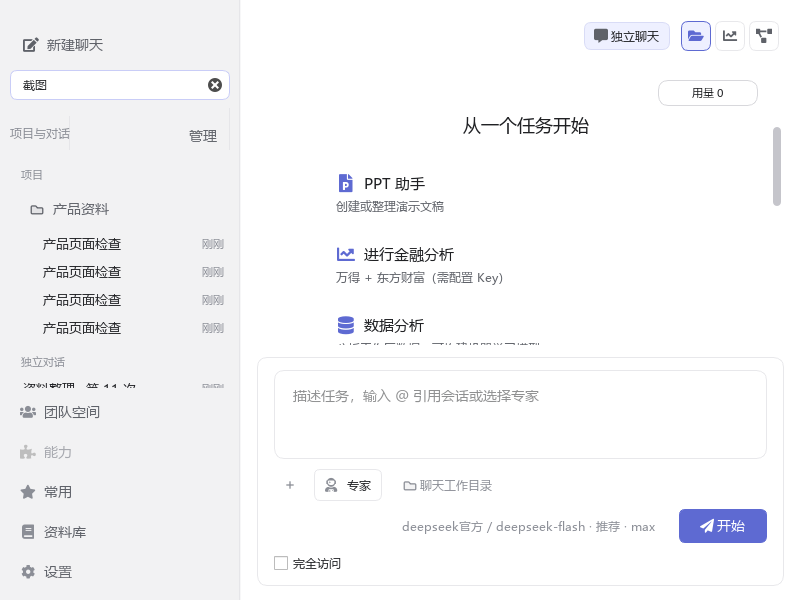
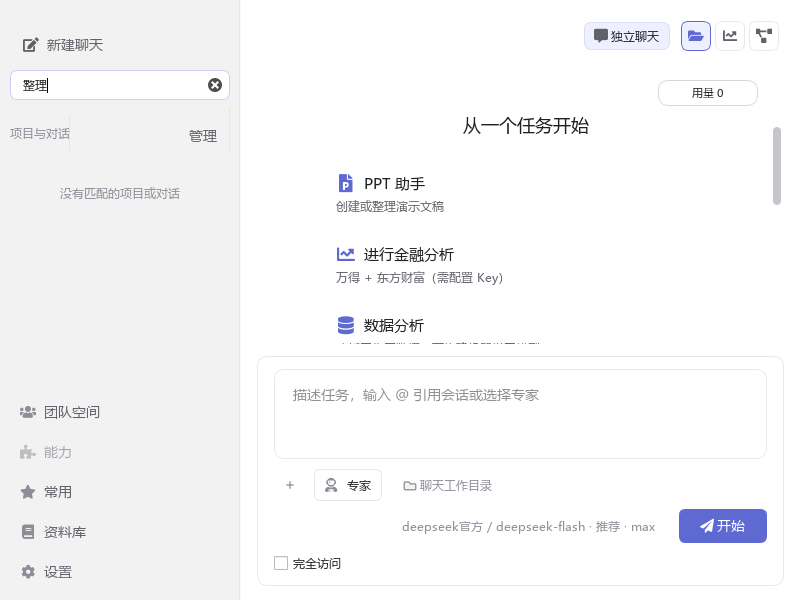
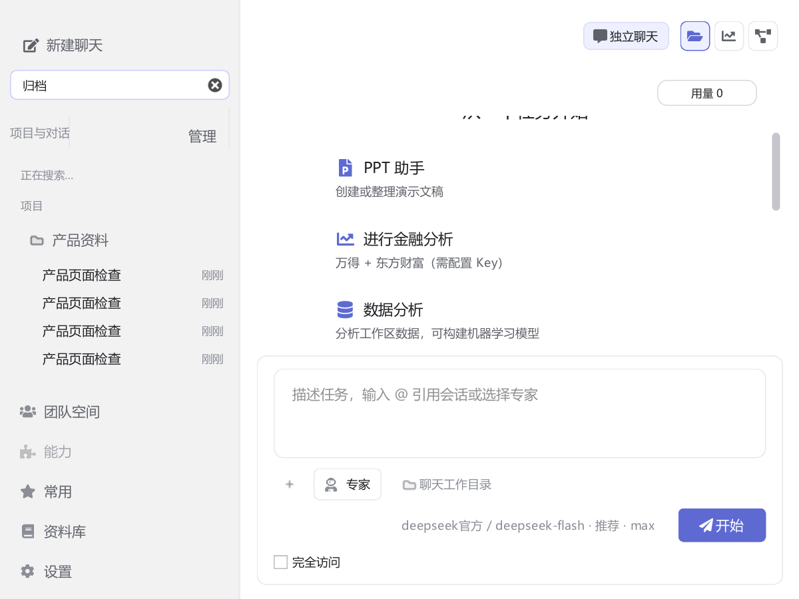
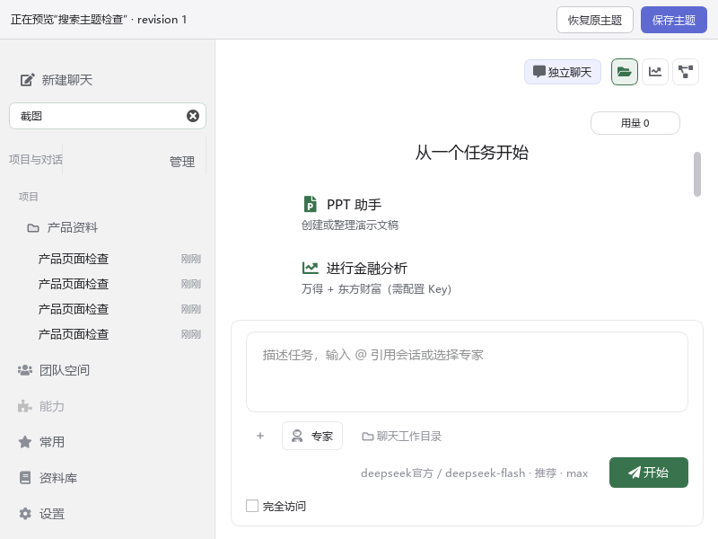

# 侧栏搜索验证

2026-10-21，在 Windows / Python 3.14.2 / SQLite 3.50.4 上验证。全部使用隔离的合成历史，不读取真实用户聊天。

## 行为

- 首次后台分批建立字符级 FTS5 索引，取消后从已提交位置继续；消息写入、更新、删除与索引维护在同一事务中完成。
- 搜索支持中文单字、双字及英文连续片段；`%`、`_`、引号按字面值匹配。正文和思考内容不会跨字段拼接匹配。旧的模型历史工具全文索引保持不变。
- 连续输入取消旧请求，仅发布最新结果；后台查询只读取命中对话的完整摘要，侧栏每批绘制 50 项。正文检索沿用最多 200 个对话的查询范围，项目名、标题匹配继续独立纳入。
- 按 Enter 重新搜索；清空恢复浏览状态。无匹配或查询未能返回结果时均显示空状态，输入保留；错误类型及 SQLite 错误码保留在诊断日志，不显示失败卡片或重试按钮。

## 性能

数据集为 1,000 个对话、24,000 条消息，原数据库约 106.88 MiB。下表为同一数据集每种查询执行 7 次的中位值，原始数据见 [benchmark.json](benchmark.json)。数据库查询时间不包含 140 ms 输入防抖和 Qt 绘制。

| 关键词 | 原查询 | 索引查询 | 索引查询及命中摘要 |
| --- | ---: | ---: | ---: |
| 图 | 120.73 ms | 2.27 ms | 6.60 ms |
| 截图 | 117.61 ms | 2.33 ms | 6.68 ms |
| 截图归档 | 116.53 ms | 2.41 ms | 7.01 ms |
| TokenQ78 | 111.80 ms | 2.77 ms | 7.20 ms |
| 不存在的关键词987654 | 116.01 ms | 2.13 ms | 5.29 ms |
| 报告（大量命中） | 63.59 ms | 60.03 ms | 69.18 ms |

首次补建约 8.92 秒，新增索引约 52.97 MiB；后续使用已有索引。固定内容的保存样本中位耗时由 4.36 ms 增至 5.39 ms。大量命中时仍需合并命中的消息，提升小于稀有词和无结果查询。以上是合成数据实测，不代表任意真实历史的固定耗时。

复现：

```powershell
.venv/Scripts/python.exe -X utf8 scripts/benchmark_history_search.py --output docs/screenshots/history-search/benchmark.json
.venv/Scripts/python.exe -X utf8 scripts/render_history_search_screenshots.py
$env:QT_SCALE_FACTOR = '1.5'
.venv/Scripts/python.exe -X utf8 scripts/render_history_search_screenshots.py
```

## 自动化与截图

搜索、消息存储、项目筛选、长上下文、保存队列及线程退出相关用例共 115 项通过，另含 15 个参数子用例。覆盖补建中断/恢复、并发保存、回滚、删除、损坏索引重建、旧请求丢弃、清空、分页、空状态和真实 Enter 按键。测试时须设置隔离的 `APPDATA`，避免构造主窗口读取本机配置。

```powershell
$env:APPDATA = (Join-Path (Get-Location) '.tmp/history-search-test-appdata')
$env:QT_QPA_PLATFORM = 'offscreen'
$env:COWORK_EXTERNAL_BACKGROUND_SERVICES = '0'
.venv/Scripts/python.exe -X utf8 -W ignore -m pytest -q test/test_sidebar_search_ui.py test/test_sidebar_search.py test/test_chat_storage_messages.py test/test_sidebar_projects.py test/test_long_context.py test/test_chat_save_queue.py test/test_worker_lifecycle.py
```

截图覆盖 100% / 150% Qt 缩放、1000×720 / 800×600 窗口、查询中、结果、空状态和可取消的主题预览。验证了预览不改写已保存主题。未执行打包应用和 Windows 系统显示缩放的人工验收。

另外两个既有的侧栏搜索/分页回归用例通过。补充批量执行 `test_main_workspace_linear.py` 时，`test_first_valid_submit_projects_session_into_sidebar_before_worker_runs` 在窗口清理阶段超时；将 `main.py` 换成 HEAD 原版加载后，按同样顺序执行前五项仍复现，单独执行该用例时原版与修改版均通过。复用已有测试 `APPDATA` 还出现过历史行缺失，改用全新隔离目录的直接相关用例通过。这里记录批量测试隔离问题，不把该批次计为通过；本次未修改与搜索无关的窗口保存/清理流程。








