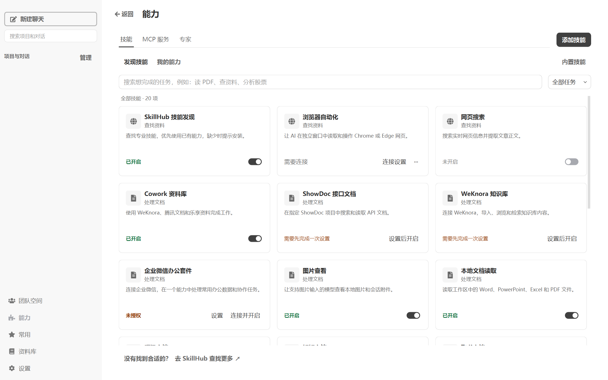
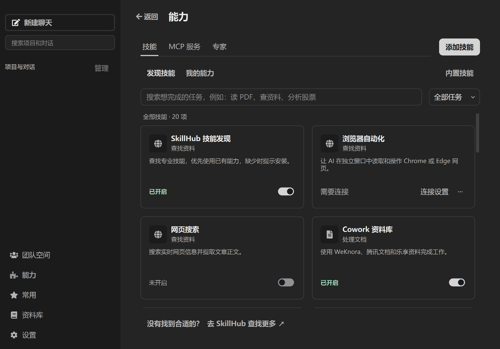
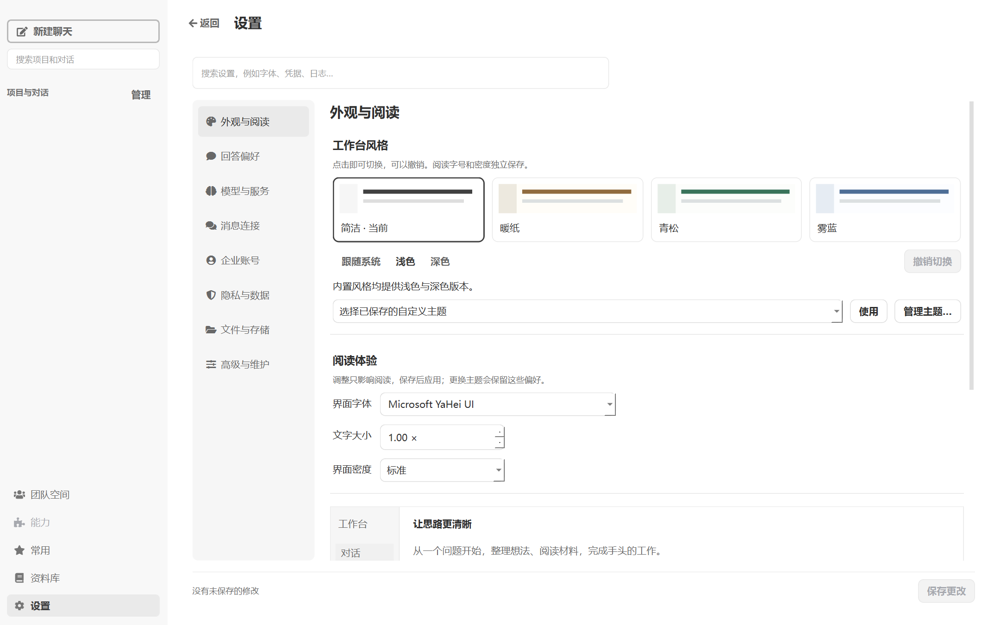
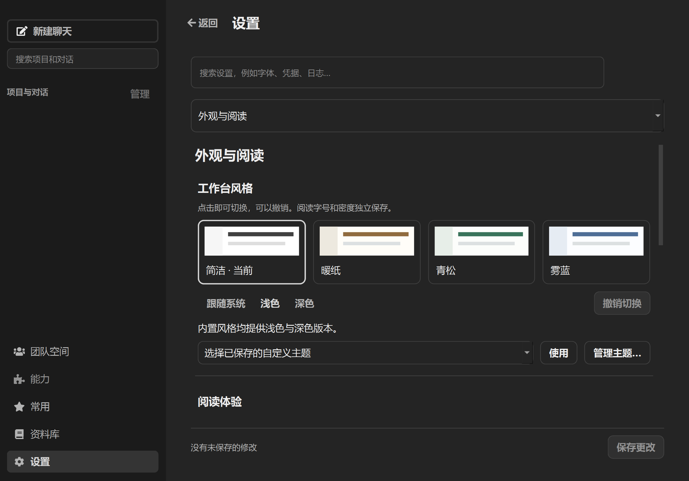
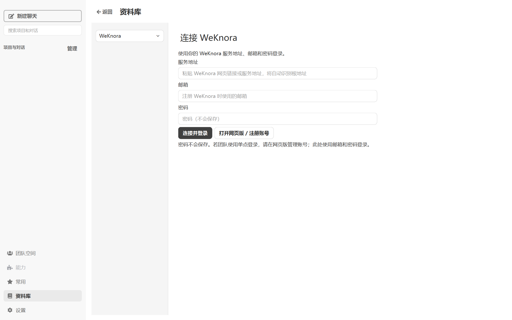
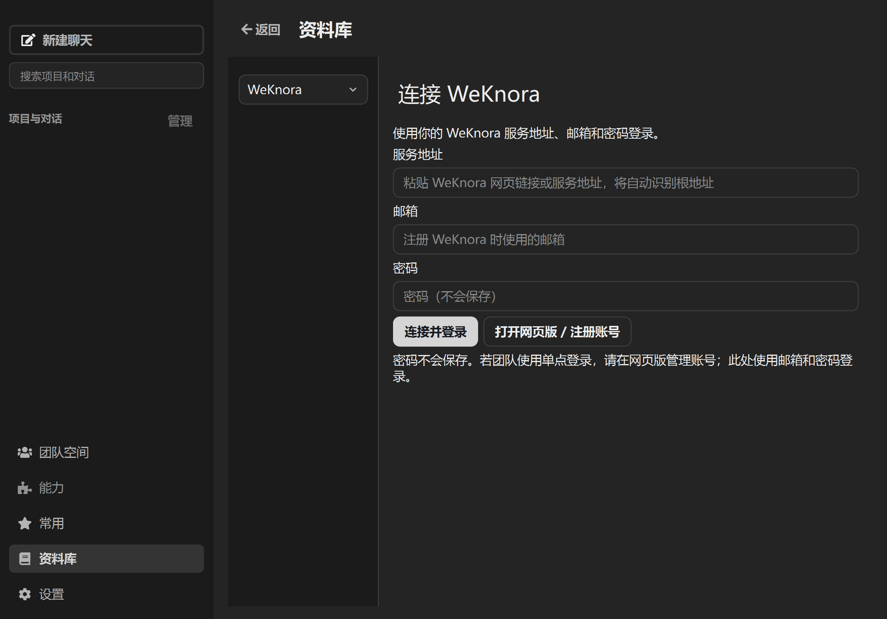
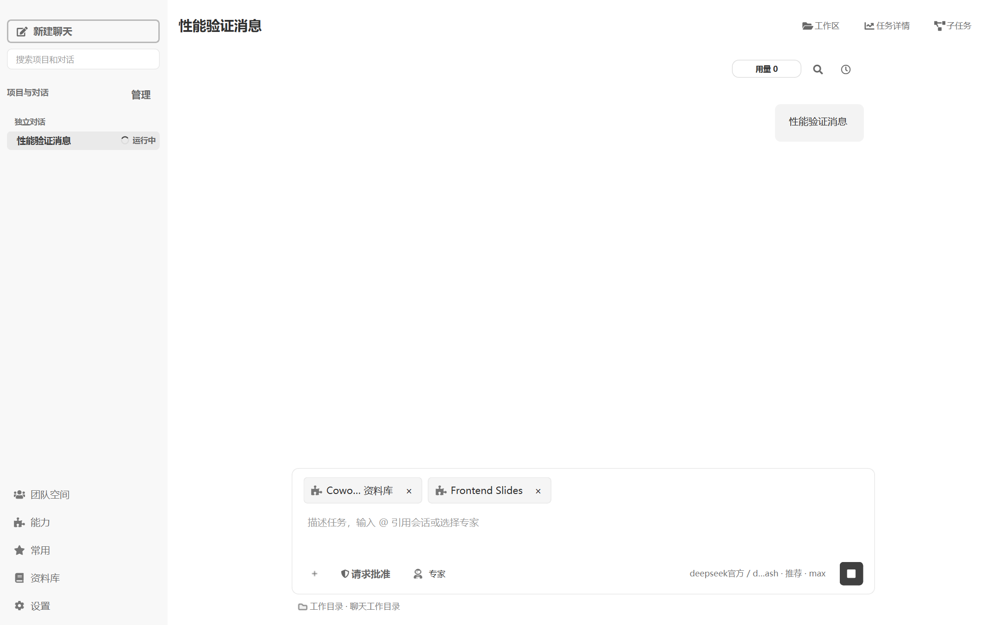
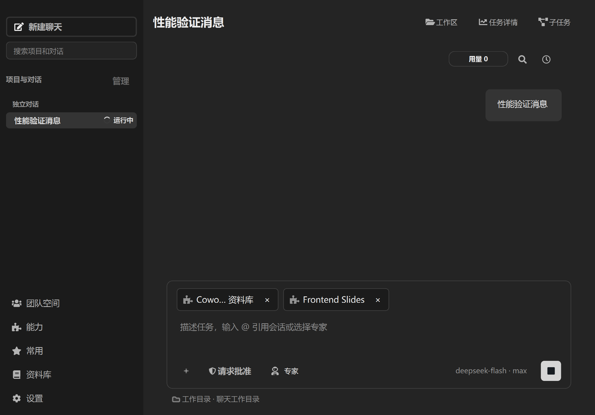

# 重复导航与闲置后响应验证（2026-10-26）

本次只减少重复计算、隐藏页面轮询和主线程同步读取。页面布局、操作入口、保存边界、历史记录、会话隔离与运行控制保持原有规则。当前正在运行的旧版 EXE 未重新打包或替换。

## 定位与修复

- 已预载技能后，`get_all_skills()` 仍会扫描目录、补读禁用技能及配置。切换会话、刷新能力标签和没有 `@` 的普通发送曾重复执行这些工作。现在由现有版本化目录快照持有独立的展示数据；安装、更新、启停、删除和配置保存仍通过原发布路径更新。展示数据返回深拷贝，不能反向修改运行时工具定义。
- 能力页重进时同步读取授权状态并重建卡片。现在复用现有后台 Worker 检查，未变化不重建；结果同时检查 manager 身份和刷新代次，失败保留现有列表并提供重新打开重试的提示。
- 设置页隐藏后，企业消息和浏览器状态仍周期性读取，且未变的通知样式和排列也重复应用。现在轮询随对应页面显隐启停，显示时立即安排刷新；用户主动保存、撤销和恢复路径保持不变。
- 嵌入的能力页从构造时使用最终父控件，避免重新挂载引起的样式遍历；相同 QSS 不重复设置。目录重建的文件扫描在发布锁外完成，UI 可以持续读取上一份完整快照。

这些变化不修改运行时系统提示词、开发者指令、工具定义及顺序、聊天历史或模型请求配置；普通文本的 mention 快路径与原解析结果逐项比较。Prompt prefix 与缓存语义保持不变。

## 测量结果

以下为同机、正式主题初始化、已预载真实内置技能、隔离 APPDATA 的离屏 cProfile 样本；不是实际用户点击延迟的保证值。`action_ms` 是入口返回时间，`with_events_ms` 另包含六轮 Qt 事件处理。表内使用相同夹具的前后样本，发送不调用模型或 daemon，但经过真实本地发送路径。

| 操作 | 修改前 action / events（ms） | 修改后 action / events（ms） |
| --- | ---: | ---: |
| 重进能力页 | 286.70 / 326.73 | 6.55 / 25.68 |
| 会话切换（第一组） | 125.35 / 154.21 | 19.80 / 29.22 |
| 普通发送 | 185.21 / 200.05 | 77.80 / 92.71 |
| 重进设置 | 3.95 / 13.26 | 4.75 / 14.41 |
| 重进资料库 | 3.22 / 6.63 | 3.69 / 7.52 |

设置和资料库的重进入口本来已经很快，不能把整个应用的卡顿都归因于这两个入口。真实运行进程的只读采样另外观察到隐藏页状态轮询、样式刷新，以及周期性的恢复扫描占用主线程。此次没有改变恢复扫描的持久化与重试协议。

最终离屏复测在闲置 15 秒后：设置 7.60 / 17.01 ms、资料库 3.09 / 6.48 ms、能力页 7.00 / 27.00 ms、会话切换 20.98 / 34.22 ms。带两个已选技能的会话切回为 43.39 / 57.95 ms，普通发送为 76.99 / 93.22 ms。后台能力刷新另有完成断言，不把入口返回误称为后台工作全部完成。

原始样本：

- [修改前](before-offscreen.json)、[同夹具修改后](after-offscreen-comparable.json)、[最终含闲置与技能选择](after-offscreen-final.json)。
- [最终离屏环境和行为检查](environment-offscreen.json)。
- [深色原生窄窗口](after-native-dark-compact.json)、[其环境与缩放](environment-dark-compact.json)。
- [最终浅色原生复测](after-native-final.json)、[其环境与检查](environment-native-final.json)：闲置 15 秒后设置、资料库、能力页入口分别为 8.36、5.42、8.63 ms。

## 验证范围与限制

已验证草稿和已选技能跨会话保留、普通消息发送、退出后从 SQLite 读回原消息、企业消息状态定时器随页面显隐启停、隐藏浏览器状态不轮询、重新显示不丢未保存选择、能力刷新完成、主题预览取消后保存配置不变。回归覆盖目录刷新失败保留旧快照、读取不等待文件扫描、过期异步结果不能覆盖新状态、重复刷新只有一个在途任务及失败后可重试。

Windows 原生窗口使用正式主题与字体。浅色 Qt scale=1 时实际 DPR=1.5；深色窄窗口 Qt scale=1.5 时实际 DPR=2.25，不能将额外 Qt 倍率称为系统缩放百分比。下图保留原有页面与操作，检查了布局和主要内容可读性。

| 浅色 | 深色窄窗口与额外缩放 |
| --- | --- |
|  |  |
|  |  |
|  |  |
|  |  |

首次创建设置及 MCP 管理页仍有约一秒的带分析器开销；本次未重构其配置编辑生命周期。一次原生浅色测量在资料库返回聊天时记录到约 472 ms 的 Qt 原生事件处理长尾，而入口仅 7.7 ms，尚不能从 Python 栈确定原因；深色、最终离屏和最终原生复测未出现相同导航长尾。最终原生全过程另记录到 FileCodeViewer 字体变化约 243 ms、QThread MetaCall 约 126 ms，样本包含初始化与主题恢复，未定位到具体阶段；脚本已补充阶段标签供后续复现。没有以平均值掩盖这些限制，也未验证真实模型网络延迟、长期闲置或所有用户数据规模。

## 复现

```powershell
.venv/Scripts/python.exe -X utf8 -B scripts/profile_ui_navigation.py --output local_development_notes/ui-perf-check --idle-seconds 15
.venv/Scripts/python.exe -X utf8 -B scripts/profile_ui_navigation.py --output local_development_notes/ui-perf-native --native --idle-seconds 15 --screenshots
.venv/Scripts/python.exe -X utf8 -B scripts/profile_ui_navigation.py --output local_development_notes/ui-perf-dark --native --scale 1.5 --dark --compact --idle-seconds 8 --screenshots
```

脚本使用临时数据目录并关闭外部后台服务、技能商店请求及浏览器组件探测；退出等待持久化与 Worker 收尾。导航数据含 cProfile 开销；脚本同时记录超过 100 ms 的外层 UI 事件类型，供后续定位原生长尾。

回归命令（测试时 APPDATA / LOCALAPPDATA 指向独立临时目录，`QT_QPA_PLATFORM=offscreen`，`COWORK_EXTERNAL_BACKGROUND_SERVICES=0`）：

```powershell
.venv/Scripts/python.exe -X utf8 -B -m pytest test/test_skill_catalog.py test/test_chat_experience.py test/test_settings_redesign.py test/test_unified_management.py test/test_wecom_ui.py -q --tb=short
.venv/Scripts/python.exe -X utf8 -B -m pytest test/test_ui_navigation_performance.py test/test_skill_catalog.py -q --tb=short
.venv/Scripts/python.exe -X utf8 -B -m pytest test/test_ui_design_system.py test/test_browser_skill_ui.py -q --tb=short
```

三组分别为 65 通过 / 2 失败（另 4 子测试通过）、16 通过 / 1 失败、23 通过 / 5 失败。去除重复目录用例，共 96 个不同用例通过、7 个失败。失败逐项用 HEAD 的相关未修改模块／类重新执行，均同样复现：声明式工具测试的执行环境不可用；企业微信用例仍期待旧“开启”文字按钮；设计系统的五项涉及无效浏览器配置目录、旧能力归属及状态文字预期、未注册中文字体、旧专家模板预期。本次没有修改这些无关产品行为，也不宣称全仓测试通过。
