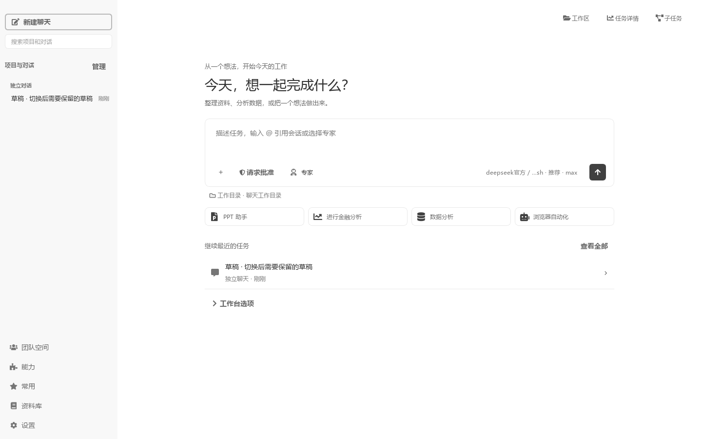
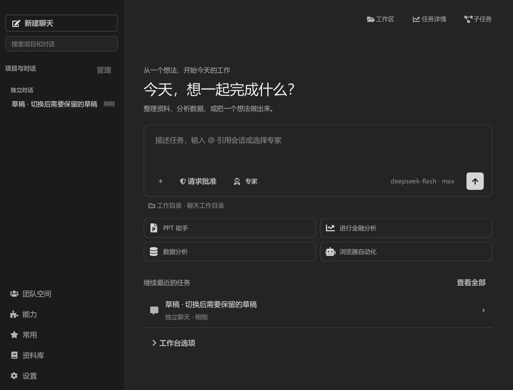
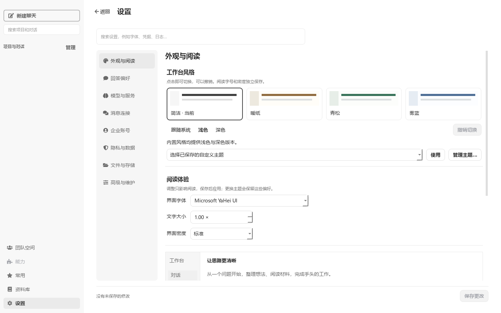
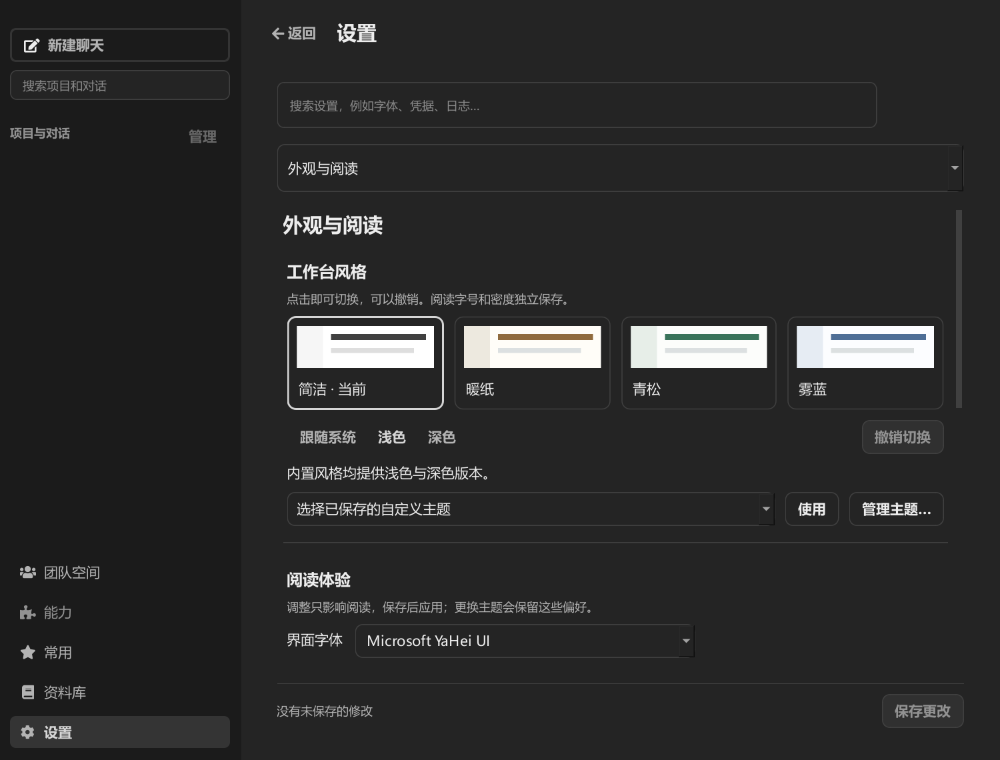

# 设置缓存、空会话与周期恢复扫描验证

2026-10-27。针对真实运行中再次打开设置耗时 1645 ms、周期恢复扫描占用主线程，以及更新／退出后出现空白“新任务”的问题。源码验证使用隔离数据，没有修改用户历史或替换正在运行的发行包。

## 修改范围

- 设置缓存只依赖设置页使用的配置，导航状态、最近工作区、计划执行记录不会使其失效。权限、默认工作区、默认模型在原控件内同步；复杂设置内容变化仍重新构建编辑器，保留已有保存、放弃和主题预览规则。
- 周期扫描在线程中只读发现候选；同一时间只有一次扫描。回到 GUI 后重新检查会话活跃状态、数据目录归属与候选记录是否变化，再走已有校验、串行恢复和确认流程。启动时完整恢复保留；并未跳过校验或引入按文件时间缓存。
- 普通保存与更新使用同一持久化队列，包含文字、附件及引用草稿；默认状态不再产生历史记录。清空实际草稿后保存清空结果，避免旧输入复活。已有纯空白行只从首页／侧栏收起，在管理页仍可访问。重复持久化修订不刷新活动时间，首页按消息活动时间排序。

## 性能结果

复用正式字体与主题，在 Qt offscreen 下运行；表中为浅色 / 深色紧凑窗口。导航入口数字包含 cProfile 开销，不能替代点击到完全可交互的端到端测量。

| 场景 | 同步入口 | 含六次事件处理 |
| --- | --- | --- |
| 导航配置变化后重进设置 | 3.56 / 4.17 ms | 14.34 / 14.30 ms |
| 权限变化后局部同步设置 | 5.07 / 5.12 ms | 22.92 / 22.39 ms |
| 闲置后再进设置 | 7.92 / 6.23 ms | 18.08 / 16.48 ms |
| 发起周期恢复扫描 | 0.77 / 0.80 ms | 18.50 / 18.45 ms |

恢复夹具新增 373 份有效记录，另有测试会话记录。后台扫描及回调完成的等待总时长为 2236.11 / 1977.65 ms；等待期间单次 `processEvents()` 最大为 0.92 / 0.96 ms。随后按 5 秒周期继续扫描，闲置 12 / 6 秒内单次事件处理最大为 2.75 / 1.42 ms。这里验证的是扫描不再阻塞 UI，未将后台总耗时冒充同步入口耗时，也不与先前用户目录的暖缓存只读扫描直接比较。

首次设置创建仍为约 1.35–1.37 秒；首次 MCP 页面约 1.21–1.23 秒。浅色能力页首次完成回调出现一次 128.34 ms 的事件长尾，深色样本未出现超过 100 ms 的事件。没有宣称所有首次加载或原生绘制卡顿已经消失。

原始数据：[浅色测量](measurements-light.json)、[浅色环境](environment-light.json)、[深色测量](measurements-dark.json)、[深色环境](environment-dark.json)。浅色 DPR=1，深色紧凑窗口 DPR=1.5，均为离屏渲染；未替代发行包、真实网络请求和长期闲置的验收。

## 界面与行为

| 浅色 | 深色紧凑窗口 |
| --- | --- |
|  |  |
|  |  |

脚本断言设置对象复用、已选技能及草稿跨会话保留、真实草稿可见、旧空白行未删除、隐藏页状态轮询停止、后台能力刷新完成、消息发送与退出后从 SQLite 读回、取消主题预览不改变保存配置。模型执行与外部后台服务使用隔离测试桩，不发送真实模型请求。

## 复现

```powershell
.venv/Scripts/python.exe -X utf8 -B scripts/profile_ui_navigation.py --output local_development_notes/ui-perf-fix-20261027-light --idle-seconds 12 --recovery-manifests 373 --screenshots
.venv/Scripts/python.exe -X utf8 -B scripts/profile_ui_navigation.py --output local_development_notes/ui-perf-fix-20261027-dark --scale 1.5 --dark --compact --idle-seconds 6 --recovery-manifests 373 --screenshots
```

自动回归使用独立 APPDATA／LOCALAPPDATA、`QT_QPA_PLATFORM=offscreen` 和 `COWORK_EXTERNAL_BACKGROUND_SERVICES=0`。覆盖设置相关和无关配置变化、真实草稿更新／恢复／清空、更新保存屏障、重复保存时间、扫描期间启动任务、过期候选、并发确认、扫描失败重试和退出时迟到回调。

最终聚焦回归：128 项测试及 2 项子测试通过，44.45 秒。兼容回归：92 项测试及 8 项子测试通过，78.41 秒；两组的 `test_conversation_actions.py` 重复执行，不累加为唯一测试数。

```powershell
$env:APPDATA = Join-Path $env:TEMP 'cowork-recovery-qa-roaming'
$env:LOCALAPPDATA = Join-Path $env:TEMP 'cowork-recovery-qa-local'
$env:QT_QPA_PLATFORM = 'offscreen'
$env:COWORK_EXTERNAL_BACKGROUND_SERVICES = '0'
.venv/Scripts/python.exe -X utf8 -B -m pytest test/test_conversation_drafts.py test/test_runtime_recovery_scan.py test/test_update_lifecycle.py test/test_chat_recovery_journal.py test/test_chat_experience.py test/test_chat_storage_messages.py test/test_runtime_journal.py test/test_history_performance.py::HistoryPerformanceTests::test_recovery_does_not_reload_loaded_session_history test/test_conversation_actions.py -q --tb=short --disable-warnings
.venv/Scripts/python.exe -X utf8 -B -m pytest test/test_settings_redesign.py test/test_default_model_settings.py test/test_conversation_actions.py test/test_worker_lifecycle.py test/test_application_exit.py test/test_chat_save_queue.py test/test_message_persistence.py test/test_conversation_integrity.py -q --tb=short --disable-warnings
```

以上环境变量仅用于独立测试进程，勿在该环境下启动日常使用的应用。未改动模型请求的 system/developer 前缀、工具定义或历史消息顺序；草稿元数据不进入已提交消息。
