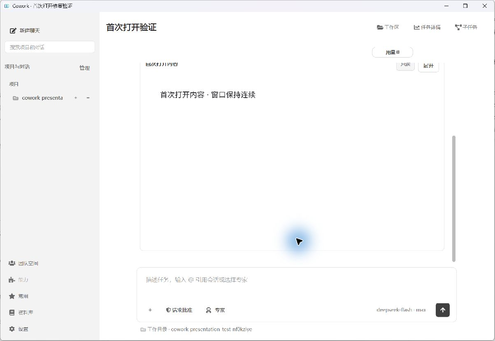
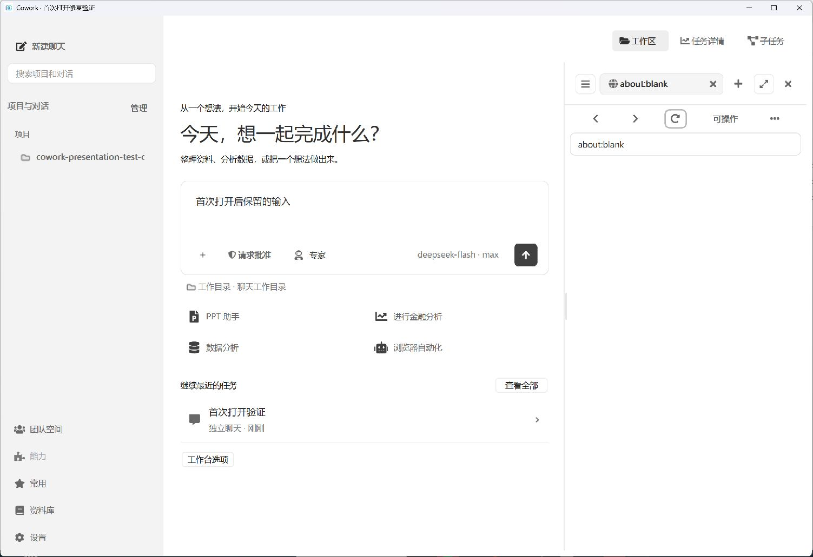

# 首次打开窗口连续性验证

2026-10-31，Windows 源码运行版本。修复首次显示 WebEngine 时主窗口临时隐藏和重建的问题；没有改变页面布局。

修复前，已显示的主窗口在首次网页预览时出现 `Hide → SurfaceAboutToBeDestroyed → WinIdChange → SurfaceCreated → WinIdChange → Show`。电脑操作首次打开历史对话时，原窗口标识失效，但进程仍在。

修复后，用电脑操作分别验证两个全新进程：

| 场景 | Qt 缩放配置 | 观察结果 |
| --- | --- | --- |
| 从首页首次打开含交互内容的历史对话 | 默认 | 内容正常显示，原窗口标识始终为 9898486，主窗口显隐与表面事件为 0 |
| 首次打开工作区，再首次加载 `about:blank` 网页 | `QT_SCALE_FACTOR=1.25` | 原窗口标识始终为 462394，主窗口显隐与表面事件为 0，未发送输入保留 |





截图只展示完成状态；连续性结论来自操作期间的原生事件记录和窗口标识检查。

自动验证：

- Windows 原生 `test/test_window_render_surface.py`：2 项通过，覆盖首次交互视图、真实 Markdown 文件预览、内容加载、窗口标识、隐藏/显示/表面重建事件及输入保留。
- `test/test_packaging_runtime.py test/test_child_window_lifecycle.py test/test_workspace_presentation.py`：19 项及 8 个子测试通过。
- 打包依赖检查已包含 `PySide6.QtQuickWidgets`；本次未执行完整发布构建，未替换正在使用的打包程序。

复现命令（先将进程级临时及应用数据目录指向 `.tmp/<任务名>/`）：

```powershell
$env:QT_QPA_PLATFORM='windows'
.venv/Scripts/python.exe -X utf8 -B -m pytest -q test/test_window_render_surface.py
$env:QT_QPA_PLATFORM='offscreen'
.venv/Scripts/python.exe -X utf8 -B -m pytest -q test/test_packaging_runtime.py test/test_child_window_lifecycle.py test/test_workspace_presentation.py
```
