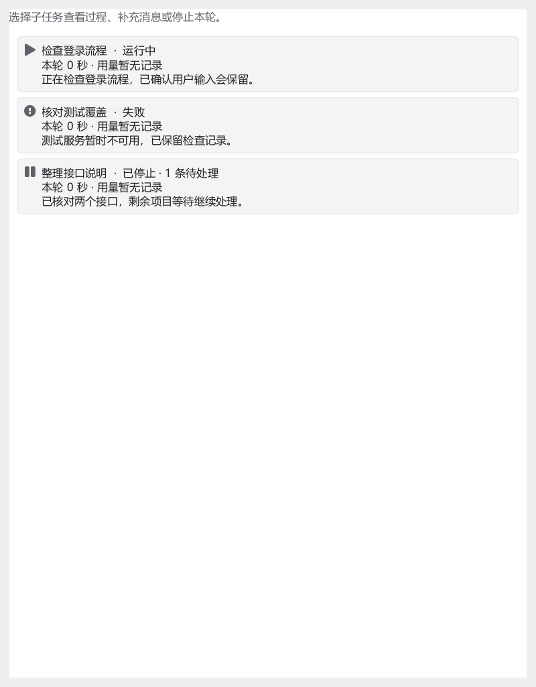
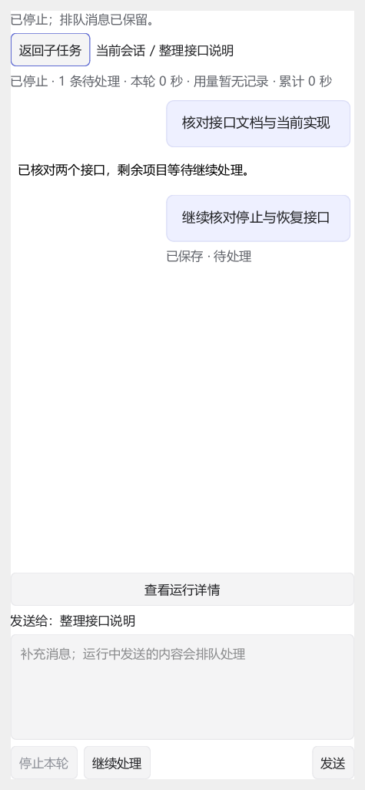

# 查看和继续子任务

父会话页头的「子任务 N · 运行中 M」打开右侧子任务列表。点击任务可以阅读独立子会话；主对话中的子任务入口也打开同一详情。后台进展不会自动弹开面板。

## 补充消息、停止和恢复

- 在标有「发送给：任务名称」的输入框补充消息。保存成功后清空编辑器；正在执行时，新消息显示「已保存 · 待处理」，按提交顺序在后续轮次处理。
- 「停止本轮」取消当前执行并暂停队列，保留输入、已展示正文、思考和工具记录。停止需要等待 Worker 退出。
- 有待处理消息时选择「继续处理」。没有待处理消息时，可以直接发送新消息开始下一轮。失败或重启中断的轮次不会自动重新执行工具。
- 保存或连接失败时保留草稿，界面显示原因。连接恢复后可以重试；同一条发送重试不会重复入队。守护进程不可用时仅显示已保存历史，不切换到本地运行。
- 永久关闭的任务、缺少运行归属的旧版记录只读；需要执行新工作时在主会话创建新的子任务。

## 阅读历史

「加载更早消息」按页读取历史。「查看运行详情」展开原始事件。切换子任务时保留草稿、滚动位置和展开状态；查看上方消息时，新进展不会强制滚到底部。

子会话输入只发送给目标任务，不复制到父会话。父级结果按原有回收方式返回，同一轮结果只接收一次。停止父会话也会停止它当时执行中的子任务，保留子会话和待处理队列。

任务列表显示状态、待处理数量、最近进展和本轮耗时；详情另显示累计耗时。结束后耗时冻结，token 使用模型服务实际提供的 usage，缺失数据显示「暂无记录」。重开历史不会自动执行，继续处理时会重新检查执行授权。

## 本次验证记录

使用项目 `.venv/Scripts/python.exe -m unittest discover -s test` 运行定向测试：`test_subagent_reliable_runtime.py` 覆盖事务回滚、幂等、FIFO、停止和迟到回调、原线程释放、重启、并发上限、结果保存失败恢复、usage 去重、分页及真实 localhost daemon 协议；`test_subagent_panel.py` 以真实聊天组件和可控 Worker 验证三个任务的失败/停止/恢复、草稿、队列、刷新、父级结果去重和截图。

截图使用 Qt offscreen，在 380 / 640 逻辑像素宽度和 125% / 150% 缩放下检查明暗主题。它验证组件布局，不代表已完成真实模型、真实工具和完整桌面窗口的人工验收；这些端到端检查仍需在实际应用中执行。
