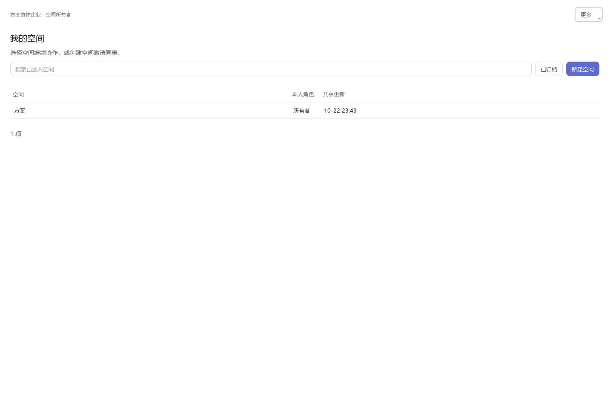
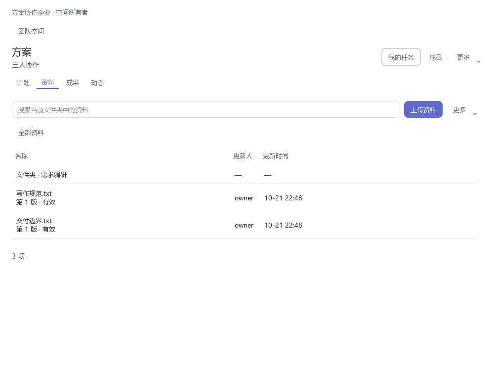
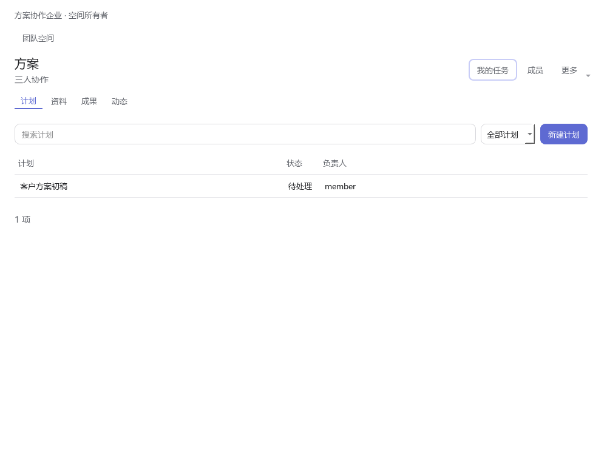
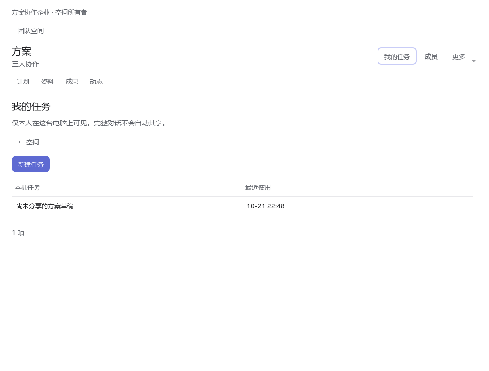
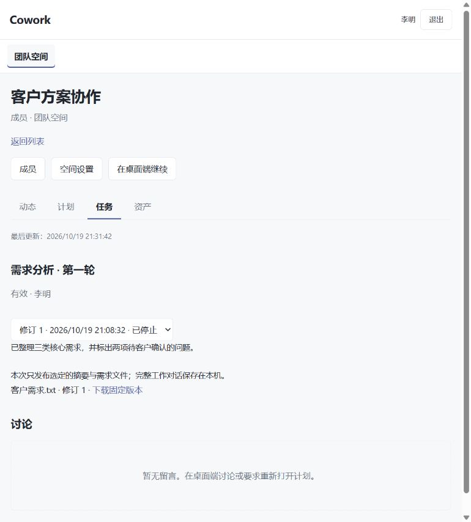
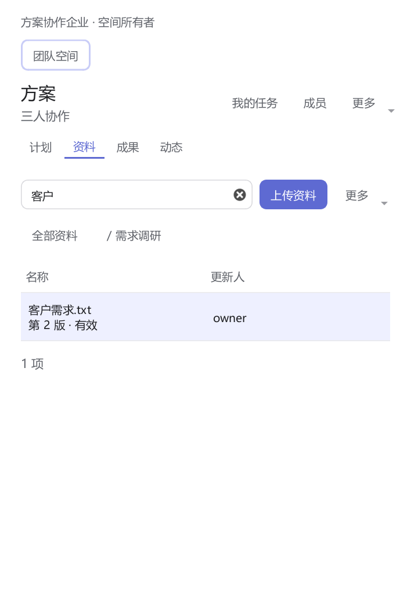

# 团队空间

团队空间把共同的分工、资料和成果保存在企业中心；任务在各自的电脑执行，完整对话保存在本机。桌面端完成协作，网页负责空间管理、查看和下载。

页面顶部同一行显示当前企业、登录账号与“更多”菜单；“我的空间”的搜索栏旁提供“已归档”和“新建空间”。窄窗口中操作自动换行。主题选择统一在“设置 → 外观与阅读”，其他页面不再显示风格菜单。

未登录时，页面集中显示企业连接或登录入口；点击主按钮即可进入“企业账号”。登录完成后返回团队空间，或点击“我已登录，刷新”。登录失效时，本机任务、已有内容和未提交草稿保留。

登录后进入“我的空间”，可新建空间、接受邀请，或搜索已加入的空间；输入后自动搜索，也可按回车立即搜索。“已归档”用于查看历史空间，“更多”中可打开空间链接或刷新列表。未加入空间、搜索无结果和连接失败会分别提示。

进入空间后，标题与“计划、资料、成果、动态”导航固定保留。首次进入默认打开计划，再次进入恢复上次页签和筛选；返回详情前的列表会恢复搜索、选择和滚动位置。已有内容先显示，再同步更新；首次没有数据时只在内容区显示占位。刷新不会清空列表，网络失败保留已有内容，并显示重试入口。

## 从一个共同任务开始

1. 在“设置 → 企业账号”登录企业员工账号，然后打开侧栏“团队空间”。没有企业模型授权也能进行人工协作。
2. 创建空间，填写名称和说明；在“成员”邀请已加入企业的同事。对方在空间列表接受邀请后加入。
3. 在“资料”上传文件，在“计划”填写任务说明、负责人、优先级，并选择资料的具体版本。点列表中的内容直接进入详情；文件夹与文件在同一列表中，使用上方路径返回上级。
4. 打开计划，点击“在本机开始任务”。首次选择一个空目录或新目录，核对模型和本次技能，填写本机任务名称及这次要完成的内容。
5. 创建后进入原有对话页面，可继续提问、停止和恢复。回到顶部“我的任务”，打开自己的本机任务，再点击“选择内容发布为成果”。勾选需要分享的文字，检查说明、文件与关联计划，确认发布。团队在“成果”查看明确共享的内容。
6. 负责人在计划详情标记完成并填写完成说明，可关联已分享的成果版本。其他成员通过留言提出修改；有状态维护权限的人填写原因后重新打开计划。

## 四个页签

| 页签 | 在这里完成什么 |
| --- | --- |
| 计划 | 按负责人和状态筛选，维护分工、输入版本及完成说明 |
| 资料 | 浏览文件夹，上传、整理资料，选择固定版本下载或用于任务 |
| 成果 | 查看成员明确发布的成果，选择快照，或发布人工整理的内容 |
| 动态 | 查看共享内容变更，打开来源、发布和查看空间留言 |

每页突出一个主要操作。空间设置、复制链接和手动刷新在顶部“更多”；资料页的“更多”提供新建文件夹。空间设置中的模型与技能规则按需展开，归档和转移所有权放在“空间管理”中。

“我的任务”与团队成果分开显示。任务标题、数量和运行状态不会自动同步到其他成员。相同账号在另一台电脑只能看到中心共享内容；本机任务须回原电脑打开。网页上的“在桌面端继续”提供空间链接，在桌面“团队空间 → 更多 → 打开空间链接”粘贴即可，不会自动启动模型。

## 目录、模型与 Skill

空间使用独立工作目录和新会话，不导入原本地项目、旧会话或旧目录文件。目录不能与已登记的本地项目、其他空间或其他账号目录重合或嵌套；Windows 路径别名也按实际位置校验。会话一旦绑定，不能改为另一空间、普通对话或另一个目录。需要不同任务时从空间创建新会话。

公司模型必须同时满足成员授权与空间允许范围。只有空间所有者可以打开个人模型开关，默认关闭。个人模型凭据保存在本机，请求直接到本人配置的服务；中心只核对空间身份、模型来源和所用共享版本。没有可用模型时仍可维护计划、上传资料或人工发布成果。

Skill 引用保存来源、标识和版本，不保存密钥或个人配置。启动页核对本机来源、版本、依赖和配置，缺失项由用户到“能力”处理，或明确确认本次不使用；不会静默换版本或自动安装。来源可填写本机 Skill 的 `source_kind`，如 `optional`、`user_extension`、`mcp`；`local` 对应用户扩展。空间选择只影响新任务，不修改全局默认模型或技能选择。

空间说明和选定资料作为任务输入附加，不替换系统提示词或工具定义。工作区记忆属于空间专用目录；个人全局记忆的读取仍按原设置，空间对话不进入自动记忆提炼。

## 分享与版本

- 发布预览只共享确认过的文字、文件和共享资料引用；完整私人对话不会自动上传。
- 运行中的任务显示阶段性成果，停止或失败的任务保留真实来源状态，不会自动显示成已完成。
- 文件新版本、成果新快照都需要明确发布。计划和任务引用固定修订，后续修改不会悄悄替换旧依据。
- 撤回成果前显示哪些附件仍被其他计划或成果引用。保留的独立资产继续按自身权限访问；撤回后的正文停止开放。已经下载到他人电脑的内容不能远程收回。

## 权限与恢复

所有者管理个人模型开关、转移所有权、归档和恢复。空间管理员维护成员及共享内容；普通成员参与计划、讨论和发布。平台管理员未加入空间时不能读取日常正文。所有者账号被停用后，平台管理员在成员详情的所有权恢复入口，将空间交给已有有效成员，必须填写原因。

| 遇到的情况 | 如何继续 |
| --- | --- |
| 中心离线或登录失效 | 输入、输出、草稿和本机文件保留；登录原账号、联网并核对权限后，由用户继续。即使个人模型服务在线，空间任务也暂停后续受控调用 |
| 权限收回、个人模型关闭、资料撤下 | 后续请求被拒绝，已完成内容保留。恢复权限、选择获准模型或重新选择输入后创建任务，不会自动换用个人模型 |
| 提交超时，结果不确定 | 核对原提交或重试原操作，沿用相同标识与冻结内容，避免重复创建。已收到明确拒绝时保留草稿供修改 |
| 两人同时修改 | 显示冲突，保留草稿；比较中心最新内容后，明确采用最新版本号再保存 |
| 上传失败或取消 | 未完整上传的文件不公开；本机所选版本和说明保留，可以重试。未发布的中心临时文件超过 24 小时后清理，重试会重新上传 |
| 空间归档 | 共享内容只读，不能新建任务或发布；本机历史和文件保留，已有任务仍按当前模型与成员权限运行。所有者恢复后继续协作 |
| 中心版本过旧或空间绑定损坏 | 给出不可继续的原因，保留历史，不把空间会话降为普通个人执行 |

草稿按企业、账号和空间隔离，离开未提交表单会提示；刷新共享数据不会覆盖当前输入。退出账号不删除原账号草稿，也不会把原提交交给新账号重试。浏览缓存只在当前登录会话使用；切换账号或登录失效后清除，旧请求不能覆盖新页面。网络中断时可查看已加载内容和本机任务，共享编辑等待连接恢复；确认权限失效或内容撤回时，停止展示对应的受保护内容。

## 部署与验证

中心升级到数据库结构版本 2，使用独立的 `team-space-files` 文件目录。单文件默认 128 MiB，每个空间默认 5 GiB，可由管理员配置。升级、备份、恢复后摘要校验见[中心部署说明](../web/platform/README.md)和[迁移说明](../web/platform/migrations/README.md)。

源码验收范围、复现命令与尚未覆盖的真实环境见[团队空间验证记录](team-spaces-validation.md)。
