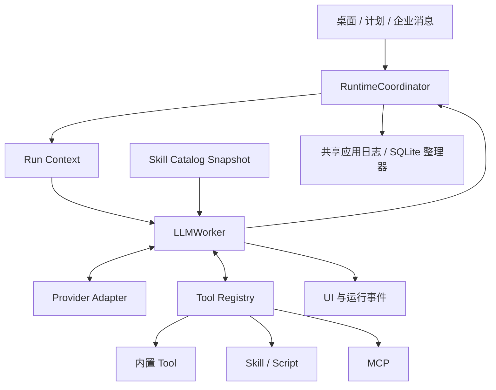
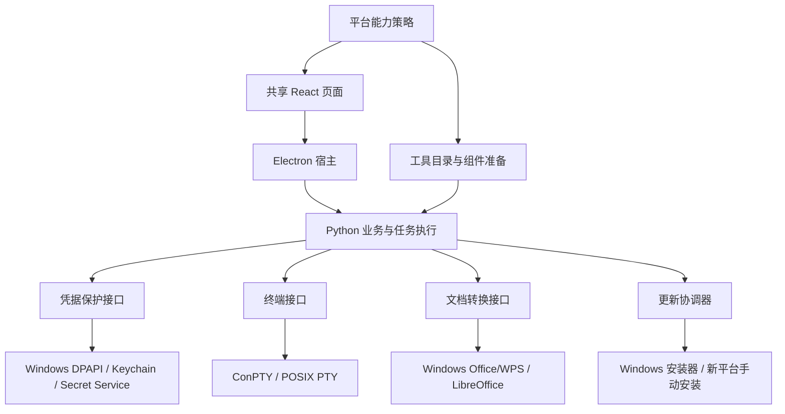
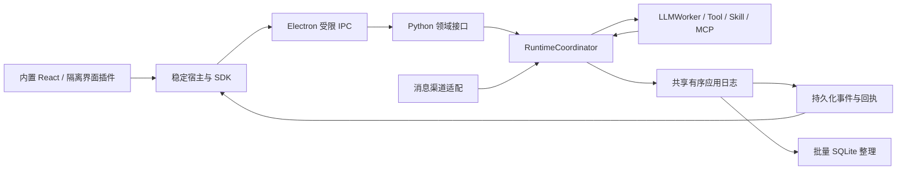
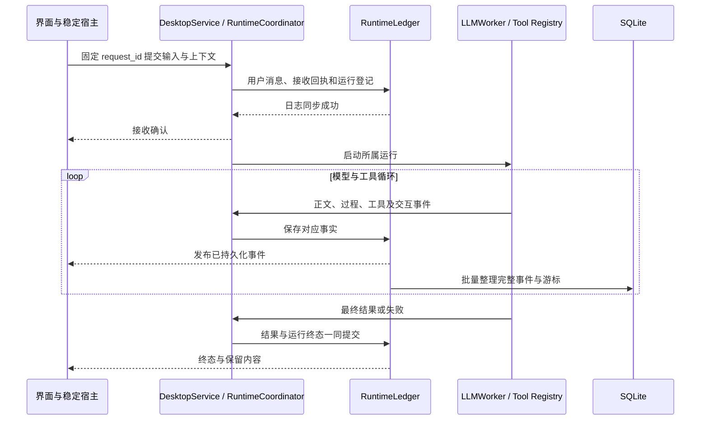

# DeepSeek Cowork 技术文档

文档适用版本：**5.4.0**

本文集中维护运行模型、能力开发、构建发布和测试入口。桌面操作见[用户手册](user-guide.md)，企业中心部署见[平台说明](../web/platform/README.md)。

## 目录

- [架构与源码入口](#架构与源码入口)
- [Electron 工作台](#electron-工作台)
- [Agent Loop 与模型协议](#agent-loop-与模型协议)
- [上下文与缓存](#上下文与缓存)
- [消息保存与界面投影](#消息保存与界面投影)
- [工具与执行授权](#工具与执行授权)
- [Skill 与 MCP 开发](#skill-与-mcp-开发)
- [工作区与交付物](#工作区与交付物)
- [后台任务与企业协作](#后台任务与企业协作)
- [主题设置与数据处理](#主题设置与数据处理)
- [构建与发布](#构建与发布)
- [开发与测试](#开发与测试)

## 架构与源码入口

桌面、常用计划、企业消息和子任务最终复用 `LLMWorker` 与 Tool Registry。每次提交确定模型、会话、工作目录、能力和运行模式，协议消息与持久化事实驱动界面展示。



| 源码入口 | 职责 |
| --- | --- |
| `main.py`、`scripts/run_desktop.py` | Electron 开发启动入口 |
| `desktop/src/`、`desktop/electron/` | React 页面、受控 IPC、原生窗口与网页宿主 |
| `core/desktop_service.py`、`core/desktop_*.py` | 本地 RPC、领域接口、提交回执、草稿与界面恢复 |
| `core/runtime_tasks.py` | 原生线程、事件、取消及退出生命周期 |
| `core/agent.py`、`core/llm/` | Agent Loop、上下文、流式事件与模型协议 |
| `core/tool_registry.py`、`core/tool_tasks.py` | 工具注册、可见性、执行及后台工具任务 |
| `core/skill_manager.py` | 能力目录、指导披露、脚本、经验与 MCP |
| `core/message_persistence.py`、`core/chat_storage.py` | 消息过滤、SQLite 保存与查询 |
| `core/runtime_coordinator.py` | 所有入口的提交、停止、运行终态、长上下文回执与恢复 |
| `core/runtime_ledger.py`、`core/runtime_stream.py` | 共享日志写入、流式批处理、SQLite 整理与有界背压 |
| `desktop/src/host/`、`desktop/src/plugins/` | 稳定状态、保存协调、SDK、默认界面和扩展点 |
| `core/daemon.py` | 消息渠道的 Socket 适配；转发同一运行核心 |
| `core/filesystem_ops.py`、`core/apply_patch.py` | 文件读取凭据与补丁提交 |
| `core/deliverable_editing.py`、`core/file_capabilities.py` | 文件能力、编辑会话与保存 |
| `core/workbench.py`、`core/workbench_transport.py` | 标签状态及桌面工具请求 |
| `desktop/src/Workspace.tsx`、`desktop/electron/browser.cjs` | 统一标签、浮动文件与任务导航、网页表面 |
| `core/document_preview.py`、`core/preview_versions.py` | Office/PDF 预览及内容版本 |
| `core/im_gateway_registry.py`、`core/im_gateway/` | 消息渠道注册与运行 |
| `core/theme_package.py`、`core/theme_service.py` | 主题包与预览事务 |
| `web/editors/` | 离线编辑器源码及分发资源 |
| `web/platform/` | 独立部署的企业中心 |

### 选型依据与不变量

这次改造同时解决界面可替换和任务生命周期独立两个问题。Electron 提供统一的网页宿主与原生桌面入口；React/TypeScript 负责可组合界面和 SDK 契约；Python 保留模型、工具、文档和连接器生态；SQLite 继续承担本机事务与历史查询。选择不以“框架更新”或“插件更多”为目标。

职责分为三层：运行事实归 Python 核心，草稿与编辑恢复归稳定宿主，布局与局部交互归界面插件。移除 Qt 后仍使用 Python 原生线程、队列和事件，不同时重写成熟业务为另一套异步框架。新增执行能力继续使用 Tool／Skill／MCP，界面插件不另建运行引擎。

验收不变量是消息可靠、过程连续、会话隔离、失败可恢复、用户可控制。替换页面不重启任务，恢复界面不回滚用户数据，模型上下文不夹带布局状态。Electron 的资源开销和平台发行验证是实际成本；共享源码不能代替 Mac／统信的构建、签名与实机验收。

### 平台适配边界

采用共享业务核心、少量平台后端和集中能力策略。消息持久化、Agent Loop、会话隔离、文件编辑和任务调度复用同一套实现；平台差异只进入系统边界。避免给每个业务对象增加平台接口，也不在不同平台维护独立 UI。



| 边界 | 代码入口与约束 |
| --- | --- |
| 原子持久化与宿主进程 | `core/platform_runtime.py`、`desktop/electron/platform.cjs`；启动时选择系统实现，复用既有进程、凭据、终端和系统路径模块 |
| 发行范围与功能限制 | `core/platform_capabilities.py`；目录、设置、依赖准备和执行同时校验，不能只隐藏按钮 |
| 敏感数据 | `core/credential_protection.py` 提供 `protect/unprotect`；Windows 原 DPAPI 格式兼容，POSIX 使用系统密钥环保存 AES-256-GCM 密钥，密文带版本与认证信息；解密缺密钥不自动生成 |
| 并发保存 | `core/file_write_locks.py`；Windows Mutex／POSIX flock 锁定稳定的路径键，不锁会被原子替换的目标 inode；支持同线程嵌套并设等待上限 |
| 终端 | `core/workbench_terminal.py` 保留公共会话生命周期，`core/posix_terminal.py` 通过独立会话和控制终端启动 Shell，避免在线程化进程里使用 `preexec_fn`；清理覆盖该终端会话的前后台进程组 |
| 外部程序 | `core/process_utils.py`；POSIX 冻结态恢复外部程序的库搜索环境，避免 PyInstaller 的动态库覆盖系统 LibreOffice |
| 运行时 | `core/runtime_manifest.py` 固定目标、下载地址和 SHA-256；在线／离线准备复用校验，tar 解压保留内部链接和执行权限并拒绝越界路径 |
| 默认字体 | `core/system_fonts.py` 枚举系统字体，`desktop/src/theme.ts` 映射正文／等宽字体和主题 token；自定义主题的显式字体仍校验，不绕过预览事务 |

非 Windows 的提示词差异限于已确认的能力范围：直接使用完整 Agent，停用能力不进入运行目录，历史向量工具不注册；语音转文字相关运行指导与技能已下线。Windows 的既有工具定义、顺序及极简启动选择不改变；不修改模型协议与历史消息格式。

企业服务端、企业专属分发和跨平台企业接入不在当前改造范围内。Mac／统信使用全新用户环境；最低 macOS 版本及统信 V25 补丁、显示服务、输入法、托盘和睡眠恢复需在目标设备验收。

## Electron 工作台

`desktop/` 包含稳定宿主、内置 React 界面插件和 Electron 原生边界。`App.tsx` 只挂载宿主、工作台插件与独立恢复入口。`core/desktop_service.py` 负责装配、协议分发和生命周期，领域操作由 `desktop_conversations`、`desktop_workbench`、`desktop_settings` 等模块处理。桌面与计划任务进程内调用 `RuntimeCoordinator`；消息渠道保留认证的跨进程适配，转交同一个核心。JSONL RPC 与渠道协议均为版本 2。运行路径不加载 Qt，PyInstaller 仅构建 `cowork-service`。



同会话命令按序执行，一个会话只有一个顶层活动运行；不同会话和子任务可以并行。核心拥有 `queued / running / stopping / completed / failed / interrupted` 状态，等待用户和重试保留为阶段信息。停止先触发目标运行的取消令牌，绕过正文积压；写入失败会单独报告，不能阻止取消。旧回调按会话与运行身份隔离。模型和网络错误沿用最多五次的可见重试，不因重连重新执行工具。

正式包启动时自动定位原数据目录；便携版优先使用可执行文件旁的 `user_data`。直接复用原配置、SQLite、附件、凭据及工作区，自定义历史目录也保持原路径；不创建 `desktop-v2`、整目录备份或路径重写。`ChatStorage` 继续负责原会话表，新运行核心仅增加 `desktop_*` / `runtime_*` 状态表及 `runtime_wal`。旧 `runtime_journal_v2` 保留原位，兼容读取层按需校验并读取记录、清单和事件；新写入走共享 WAL，事件序号从旧记录之后继续，冲突或损坏显式报错。原消息、引用和草稿不需要导入。旧版可读取同一会话库，但不能接管新版运行中任务；新旧程序须先退出再切换，不能同时写同一数据目录。

启动取得数据目录独占权并检查旧版窗口已退出，在耗时初始化前公布已认证控制端点。`starting` 报告真实阶段，完整初始化后才发送 `ready`；实际进度更新延长等待，长时间无进展则报错。重试重连现有启动进程，不新建竞争服务。启动中、失败页、菜单与托盘均可退出；完整退出保存草稿与恢复副本、停止任务并等待本应用后台结束，再清除托盘图标。窗口关闭按钮仅收起到托盘。

开发默认使用隔离目录，可用 `--data-dir` 或 `COWORK_APP_DATA_DIR` 显式选择测试数据。生产包必须使用随包服务，缺失时明确报错。前端与插件不接触数据库、认证凭据或直接模型调用。

稳定系统提示词、工具定义及其顺序、Provider 消息投影沿用现有实现。能力选择与上下文策略通过原有运行参数传递，并在任务接受时冻结；用量页面只读取观测事件。它没有为新界面增加系统提示词或插件源码前缀。

工作区中的终端由服务持有，界面切换或重连只重读带游标的缓冲输出，不重新启动 Shell。用户接管与交还更新控制版本，旧输入不能在控制权变化后执行。xterm 的 DA/DSR 协议应答经过独立白名单，不作为用户命令，避免 ConPTY 等待协议应答时阻塞输入。

内置网页由 Electron 的独立 `WebContentsView` 承载，每个对话使用单独浏览会话。Agent 请求只能消费原任务的一次性授权；操作前再次核对取消状态、控制权和页面版本。文本观察失败与截图失败分别反馈，不能把没有截图的结果用于坐标猜测。本地 HTML 通过限定目录的独立协议提供资源，不开放 Node 或任意本机文件读取。

Office 编辑器复用内置 Web 编辑器，改用限定命令的父页面桥接；保存前等待最后一版编辑快照。外部修改冲突保留草稿，“另存副本”保留原文件格式并拒绝覆盖已有文件。传输上限为 64 MiB，覆盖 25 MiB Office 文件经 base64 编码后的体积。

### 开发与 Windows 构建

准备现有 Python 依赖和固定运行时后，安装前端依赖并启动：

```powershell
npm --prefix desktop ci
npm --prefix web/editors ci
.\.venv\Scripts\python.exe scripts/run_desktop.py
# 已构建界面时可加 --no-build；--data-dir 指定隔离数据目录。
```

Windows 构建沿用 `deepseek-cowork.spec` 的依赖和资源；只使用独立服务入口，显式排除 Qt 绑定、插件和旧界面，再由 Electron Packager 组装目录。版本读取 `core/app_version.py` 的 `APP_VERSION`。

```powershell
$env:COWORK_PYTHON = (Resolve-Path .venv/Scripts/python.exe).Path
npm --prefix desktop run package:win
```

输出为 `desktop/out/DeepSeek Cowork-win32-x64/deepseek-cowork.exe`，必须保留相邻文件和 `resources/service`；同时生成 `cowork-desktop-v版本号-windows-x64.zip` 和 `latest-desktop-windows-x64.json`。打包检查排除用户数据与 Qt 运行时。应用显示名为 DeepSeek Cowork，可执行文件为 `deepseek-cowork.exe`；更新器兼容早期 Electron 包的 `Cowork.exe` 入口。Windows 旧运行日志的按需读取在文件 I/O 边界使用扩展路径，不依赖系统开启长路径策略，持久化配置仍保存普通绝对路径。新包必须带 `desktop-release.json`；更新清单使用 `app_layout: electron`，在线地址为 `updates/desktop-windows-x64/latest.json`，与旧版更新源隔离。设置页支持检查、准备本地包和重启更新，沿用校验、保存退出、替换、启动确认与回滚事务。打包不会执行签名或公开发布；Mac 与 Linux 的新宿主安装包仍待目标系统验证。

```powershell
.\.venv\Scripts\python.exe -X utf8 -m unittest discover -s test -p test_desktop_service.py -v
npm --prefix desktop test
npm --prefix desktop run build
# 在与源码无关的工作目录验证冻结服务：
$env:COWORK_TEST_DESKTOP_SERVICE = (Resolve-Path "desktop/out/DeepSeek Cowork-win32-x64/resources/service/cowork-service.exe").Path
.\.venv\Scripts\python.exe -X utf8 -m unittest discover -s test -p test_desktop_service.py -v
Remove-Item Env:COWORK_TEST_DESKTOP_SERVICE
```

### 界面插件与稳定宿主

清单 `hostApi: 2` 支持完整本地包（HTML、JS 模块、CSS、图片和字体），内容指纹覆盖整个包。内置 `cowork.workbench` 复用现有 React 组件；外部插件通过隔离 iframe 和同一领域 SDK 使用宿主能力。旧 `cowork.writing` 的 `hostApi: 1` 只保留文稿读写适配，不提供任意后端调用。

| 扩展点 | 选择规则 |
| --- | --- |
| `workbench:main` | 同时启用一个整体布局 |
| `page:<id>` | 按 chat/settings/capabilities/library/favorites/team/plugins 选择页面 |
| `panel:<id>` | 工作区、文件、任务、网页和终端；支持替换或追加 |
| `editor:<type>` | 按文件类型选择，`*` 作为显式通用编辑器 |
| `command / menu` | 稳定命令 ID；重复注册拒绝安装 |

会话、运行、草稿、文件编辑及管理表单由 `desktop/src/host/` 按稳定 ID 持有。快照和增量经过统一入口，页面卸载不清空内容。草稿沿用版本回执和发送队列；文件沿用指纹与冲突保存。表单恢复副本使用系统凭据保护，恢复副本不等于正式保存配置。

插件切换先校验并隔离预览，等待旧实例中的修改完成，保存宿主恢复状态，加载候选并确认所有扩展点就绪，最后提交选择。失败保留现有版本。候选预览只读示例内容；未就绪实例和已失效实例不能提交业务操作。停用、恢复上一版和恢复内置界面都只改变插件代码，保留用户数据。宿主恢复按钮与应用菜单独立于当前插件。

接口、能力声明、包限制和可安装示例见 [UI SDK](../desktop/sdk/README.md)。

## Agent Loop 与模型协议

最小循环围绕模型消息与工具结果推进：

```python
while not stopped:
    append_accepted_user_messages()
    apply_catalog_at_request_boundary()
    response = stream_model(messages, visible_tools)
    messages.append(response)
    if not response.tool_calls:
        persist_and_finish()
        break
    for call in response.tool_calls:
        result = execute_registered_tool(call)
        messages.append(tool_result(call.id, result))
    checkpoint_session()
```

Provider Adapter 将 Chat Completions、Responses 和 Anthropic 转换为统一的正文、thinking、工具、usage 与运行事件。工具调用聚合完成后执行，结果通过 `tool_call_id` 与原调用配对：

```text
assistant(tool_calls) → tool(A) → tool(B) → assistant(next response)
```

Responses 的原生 Items 保存在 assistant 消息协议元数据中，下一轮按协议回放。官方 DeepSeek Responses 由服务地址与协议共同识别，处理 reasoning、message、function call 和服务端搜索；标准 OpenAI Responses 保持自己的请求配置。

模型原生图片生成暂时下线。`LLMFactory` 创建模型实例时统一停用此能力，旧配置、运行快照和企业模型不再自动附加 Responses `image_generation` 工具；保存的旧配置不被改写。图片输入、普通函数工具及历史图片引用与协议回放保留。受影响模型的工具前缀会变化，后续请求重新建立对应缓存。

`core/llm/chat_completions_stream.py` 负责解析流分片，Provider 管理连接和请求，Agent 负责工具调度。这三个层次分别维护协议转换、传输和任务状态。

## 上下文与缓存

请求上下文分为稳定前缀与动态部分：

| 部分 | 内容 |
| --- | --- |
| 稳定前缀 | 系统策略、工具与交互规则、Worker 创建时冻结的长期记忆摘要、工作区根目录 `AGENTS.md` |
| 动态上下文 | 日期、工作目录、模型、运行模式、显式能力及运行快照 |
| 消息序列 | 用户输入、模型回答、工具往返、按需披露的资料与能力指导 |

工作区约定和运行环境信息在 Worker 创建时读取。工具顺序、能力目录和历史组织通过既有构造路径管理；变更这些部分时，需要评估 prompt prefix 与缓存影响。

Skill 指导使用内容哈希与目录版本管理披露。用户选定能力在本轮进入上下文，其他启用能力经 `tool_search` 发现；参考正文在需要时再读取。隐藏上下文是否持久化由统一消息规则决定，隐藏是展示属性。

`bootstrap_plugins/session.py` 管理极简首请求。适用的新对话先使用精简提示与工具，需要继续时进入完整能力路径，并沿用原始输入和附件。

超长上下文在完整会话历史之上维护当前工作集及检查点。接近有效预算时，使用独立整理请求生成检查点，提交新窗口后继续任务。`history_search`、`history_read` 按当前会话读取早期证据；完整工具结果先保存，再以摘录和消息引用进入工作集。

## 消息保存与界面投影

协议消息保持 `user / assistant / tool` 的事实顺序；`ui_timeline_v1` 表达 thinking、工具、阶段正文和补充消息的展示位置。UI 元数据在送入 Worker 时剥离，持久化过滤由 `core/message_persistence.py` 统一处理。

保存流程：

1. 一次提交的用户消息、去重回执和运行登记组成一个逻辑记录；结束输出与终态同样成组。
2. `RuntimeLedger` 在一个数据目录内共用写入者，顺序追加带校验和、游标的 JSONL。同步成功后才确认接受、更新运行投影并发布事件。
3. 后台整理器在同一个 SQLite 事务写入消息、完整过程事件、运行记录和处理游标，保持 `WAL + FULL`。
4. 数据库提交后回收已覆盖的封闭日志段；完整工具详情、思考及交互回执继续保留在数据库。SQLite 自身 WAL 由 SQLite 管理。

初始批次为 `16 ms / 64 条 / 256 KiB`。待写队列按条数与字节数限制，按会话公平取批；整理积压达到边界时对生产者施加背压。相邻文本可合并，工具、问卷与终态保留边界。历史编辑、删除、撤销和长上下文保存回执进入同一日志链路，重放不会恢复已删除内容。

历史、搜索与导出在请求开始时固定日志游标，等待 SQLite 整理到该位置后读取；等待期间界面显示状态。重启只重放完整日志并恢复数据与中断状态，不自动重做外部操作。不完整末尾记录保存诊断后截断，中间损坏明确失败，不跳过。

实时界面订阅已持久化的增量；历史分页后生成展示投影，未变消息保留对象身份。后台会话和折叠过程保留事实，按需呈现。搜索和提问导航使用持久化消息 ID。

运行中补充输入由所属任务接收，在安全节点进入消息序列。首次保存前统一补充消息的 `turn_id`、`request_id` 和接收时间，保存与 Worker 入账复用同一身份，防止结束时产生已提交账本冲突。前端按持久化事件时间展示补充消息；只在完整事件可验证正文、思考和工具调用时拆分展示，部分日志保留原有内容，显示片段不写入模型历史。问卷回执按请求与工具调用身份归位，答案来自实际提交结果。待处理队列与运行回调使用会话、运行和消息身份校验。`LLMWorker.stop()` 先发出工具取消，再处理模型流关闭；已发生的工具和消息继续按原身份保存。

### 一次对话的完整路径



接收回执丢失时按原请求查询，连接恢复不自动重发命令；同会话维持一个顶层活动运行，运行中输入通过补充进入原任务。停止先取消所属执行，再收尾保存，不能排在普通输出积压之后。进程重启恢复已保存事实并标记中断，不自动重做可能已经生效的外部操作。恢复阅读与恢复执行是两个不同边界。

### 后台工具

`core/tool_tasks.py` 为长工具维护任务身份。达到等待窗口后返回 `background_tool`、`task_id`、状态及耗时，原操作继续；模型可通过 `wait_tool` 等待或请求取消。

执行线程先保存结果，再公布完成状态。完成结果经原工具返回或隐藏的 `tool_completion` 事件交付，两条路径共用交付收据去重，界面更新原工具卡。

## 工具与执行授权

Tool Registry 保存名称、说明、JSON Schema、来源、风险属性、运行范围以及 Handler 或 MCP 映射。来源由注册根目录确定：

| 来源 | 注册类别 | 披露 |
| --- | --- | --- |
| `skills/` | `core_builtin` | 符合运行上下文的工具首轮可见 |
| `ai_skills/` | `optional` | 显式选择或按需发现 |
| 用户能力目录 | `user_extension` | 按启用、选择和发现规则处理 |
| MCP 服务 | `mcp` | 连接后注册为工具 Provider |

执行授权由宿主创建并随任务传递，单次审批绑定动作及参数。`parallel_tools` 调度独立的只读调用；文件修改、命令和交互沿各自的执行路径处理。

拷问模式在运行上下文中保存周期和轮次，使用交互检查点选择继续讨论或进入执行。模式切换由同一 Worker 更新工具集合。

### 文件工具

| 工具 | 职责 |
| --- | --- |
| `glob` / `grep` | 发现路径、定位文本 |
| `text_file_read` | 解码读取文本并建立完整读取凭据 |
| `apply_patch` | 普通文本的创建、修改、移动与删除 |
| `workspace_rename_path` / `workspace_delete_path` | 目录级操作 |

读取凭据记录 SHA-256、编码、BOM 和换行风格。`apply_patch` 使用统一函数 Schema，先解析全部操作、校验路径和读取凭据，再完成确认与逐项提交。已有文件经同目录临时文件及 `os.replace` 发布，新文件采用拒绝覆盖的提交方式。

## Skill 与 MCP 开发

**Tool 是执行面，Skill 是指导与经验包，MCP 是外部工具连接方式。** 专家在同一运行循环上绑定角色、模型和能力范围。

### 包结构与元数据

```text
example-skill/
  SKILL.md
  skill.json
  impl.py
  references/
  scripts/
  assets/
  experience/entries.jsonl
```

`SKILL.md` 维护工作流程；Cowork 原生能力通过 `skill.json` 描述展示、配置、工具及运行元数据。Tool Handler 可绑定到 `impl.py:function`，首次调用时延迟导入；脚本通过 `script_entries` 声明，由 `run_skill_script` 执行。

`SkillCatalogService` 将目录编译为不可变快照，UI 与 daemon 各自使用快照。任务提交建立轻量运行视图，创建、更新或启停能力后通过 `SkillChangeEvent` 发布变更，Worker 在模型请求边界应用新目录。

### 配置与依赖

`config_fields` 支持 `text`、`secret`、`select`，以及必填、默认值、选项、条件规则、帮助信息和声明的环境变量。配置保存在 `skill_configs`，执行时注入对应字段。

`DependencyCoordinator` 以 Skill 和依赖哈希组织隔离环境准备；相同请求合并处理，保存准备状态。能力目录发现、实现导入与依赖准备分别进行。

### MCP

独立 MCP 服务保存自身连接与认证配置。托管 MCP 由 Skill 的 `mcp_server_presets` 声明，支持 stdio 与 Streamable HTTP，保存时展开 `{{ENV_NAME}}` 并关联 `source_skill`。`runtime: skill_python` 使用所属 Skill 的 Python 环境。

远端工具统一进入 Tool Registry，继续使用宿主执行授权、结果协议和运行事件。

### 安装与分发

本地文件夹和 ZIP 经结构、路径及内容校验后原子发布。标准 Agent Skill 保留上游指导并添加本地索引。

远程安装流程先生成固定来源、commit、摘要和配置的预览，确认后发布同一快照。SkillHub 使用公开目录与官方 ZIP，`.skillhub.json` 记录来源及安装基线。

能力需要额外授权时，由清单引用受信任 Provider ID，例如 `authorization.provider=wecom_cli`。Provider 在隔离位置完成授权与身份检查，再发布凭据。

### 经验与会话沉淀

结构化经验保存于 `experience/entries.jsonl`，包含方法、工具、任务类别、来源和时间。无具体 Skill 归属时使用 `general-experience`。

“沉淀为 Skill”先提取用户选定会话范围并生成可编辑的复用分析，再生成草稿；发布前检查 Schema、证据引用、敏感内容、资源路径、Python AST 和目标 revision。指导、脚本和经验在同一包中组织。

## 工作区与交付物

每个会话保存工作目录和文件身份。`core/file_capabilities.py` 为预览、编辑和文件链接提供共同注册表，`core/deliverable_editing.py` 维护编辑会话、内容快照及事务保存。

文件保存通过临时文件重新解析、上一版备份和原子替换完成，内容 SHA-256 用于判断外部修改。UI 共用离开守卫；编辑内容由独立会话维护。

`WorkbenchStore` 按聊天保存文件、网页和终端标签。提交消息时，通过 `submission_context` 保存标签元数据，并以隐藏运行上下文传入当前任务。网页 Profile、文件编辑器和终端分别管理各自实例。

网页通过 `core/browser_backend.py` 保存后端选择与运行租约。桌面桥接按会话、run_id 和请求 ID 领取工具请求，网页观察版本与控制权用于后续动作校验。

终端使用 ConPTY／POSIX PTY 和离线 xterm.js，后台线程读取，UI 分批呈现；Windows Job 或 POSIX 会话管理所属进程。Office 预览通过后台 helper 或可选 LibreOffice 生成阅读副本，`core/preview_versions.py` 按内容版本组织缓存，界面通过显式刷新加载新内容。

写作页在会话中维护标题、正文和恢复副本，首次保存创建 Markdown 文件。富编辑器使用隔离 iframe 与限定命令的父页面桥接，前端资源由 `web/editors/` 构建并随应用分发。

## 后台任务与企业协作

### daemon、常用与子任务

daemon 托管 Worker 和事件流。常用项保存 prompt、能力与执行位置，schedule 附加触发方式，运行历史记录每次任务。

计划消息投递通过独立持久化作业处理：最终回答保存后入队，渠道网关消费作业并记录分段回执。任务终态与投递终态分别保存。

`SessionAgentManager` 为子任务维护独立运行上下文与消息队列，父会话接收汇总结果，子会话保存完整过程。

### 消息、资料和企业中心

`core/im_gateway_registry.py` 用 `ProviderSpec` 注册消息渠道及其配置、启动和交付能力。

本地资料库按已登记项目及聊天工作目录汇总文件，按规范路径去重并排除已归档项目，不搬动原文件；添加到聊天复用附件提交边界。远程资料库通过各来源适配器访问 WeKnora、腾讯文档和乐享。任务提交时绑定来源、身份和选定资料范围；目录和正文缓存按身份与授权代次组织。

企业中心采用 FastAPI、PostgreSQL 和同源静态页面，处理认证、模型授权与代理、提问记录、客户端分发及团队空间。空间共享对象保存在中心，本机任务在桌面运行。服务部署和配置见[企业平台说明](../web/platform/README.md)。

## 主题设置与数据处理

主题包使用 Schema、资产清单及稳定 Surface/Component ID。`preview_id + revision` 标识用户预览的候选，确认后提交已保存主题；界面使用统一 token 和共享控件。

设置保存按配置、记忆和外观分区处理。配置使用 `batch_save`，记忆按作用域写入，外观提交主题状态并刷新界面。管理表单将浏览位置、保存基准和实际修改分开：切换消息渠道不会改变启停配置；新草稿只恢复相对基准的修改字段。缺少可信基准的旧消息连接草稿由用户主动恢复或丢弃，不自动覆盖已保存配置。密码不写入持久化恢复副本。

`VariableStore` 独立保存变量，敏感值通过共享凭据保护接口加密。`lookup_app_variable` 按明确名称和授权读取变量。资料库和脱敏映射复用该接口，企业账号在本轮继续沿用 Windows 实现。

数据安全宿主位于 `core/data_security.py`，插件位于 `bundled_plugins/data_security/`，提供任务策略、能力检查、请求投影和参数处理。启用后在附件展开与 SDK 发送之间处理用户及工具文本副本，会话令牌映射独立保存。

## 构建与发布

### 桌面发行包

构建命令见[项目首页](../README_CN.md#构建发行包)。`core/app_version.py` 的 `APP_VERSION` 是代码版本来源；升版同步 `desktop/package.json`、`desktop/package-lock.json` 的根包版本、现行手册声明与版本说明，不修改依赖包自身的版本。历史发布说明保持原貌。

开发态读取仓库资源，PyInstaller onedir 冻结态从 `sys._MEIPASS` 读取随包资源。运行时准备脚本获取固定版本的 Git、ripgrep 与组件；spec 扫描动态 Skill 的 `core.*` 导入并加入 hidden imports。编辑器分发资源位于 `web/editors/dist/`。

`desktop/scripts/package.mjs` 构建前端、编辑器和冻结 Python 服务，生成完整目录、ZIP 与 `latest-desktop-windows-x64.json`。随后调用 `scripts/package_release.py` 审计 Electron 宿主、冻结服务、运行时、许可证、空白默认配置及两份离线编辑器的一致性；通过后生成确定性 ZIP 和带 `app_layout: electron` 的更新清单。审计报告仅在显式传入 `--report` 时生成。语音转文字技能、组件与打包脚本已下线；技能发现拒绝旧版残留的同名技能，历史音频文件和转写结果不删除。Word/PPT 预览由可选 LibreOffice 组件生成 PDF，通过会话绑定的异步任务发布。Windows x64 组件使用固定版本、大小与 SHA-256 校验，MSI 管理提取到应用数据目录，验证启动后原子发布，不设置系统关联。预览使用独立源文件副本与用户配置目录，缓存按源指纹及渲染程序版本隔离；取消、转换失败或源版本变化均显式报错，不转用文本预览。

### 更新清单

新版 Windows 更新清单与旧 Qt 包隔离，必须标记 `app_layout: electron`。Mac／统信的新版构建与更新交付尚未完成，不能复用旧平台安装包或进入 Windows 自动安装流程；尚无对应发行物时明确提示当前平台安装包未发布。

普通版读取公共更新地址；地址为空时使用 GitHub。企业版通过所属中心的推荐版本接口取得安装包。

静态公共服务器的目录为：

```text
updates/desktop-windows-x64/latest.json
updates/desktop-windows-x64/cowork-desktop-v5.4.0-windows-x64.zip
```

清单字段如下：

| 字段 | 值或来源 |
| --- | --- |
| `schema_version` | `1` |
| `app_layout` | `electron` |
| `version` | `APP_VERSION`，不带 `v` |
| `target_os` / `arch` | `windows` / `x64` |
| `filename` | `cowork-desktop-v版本号-windows-x64.zip` |
| `size` / `sha256` | ZIP 实际字节数和 SHA-256 |
| `notes` | 构建脚本中的发行摘要；公开发布前同步正式版本说明 |

发布顺序为：确定版本与说明 → 构建 EXE → 打包并审计 → GitHub Release 附加 ZIP 和清单 → 公共服务器上传同一 ZIP → 原子替换清单。GitHub 标签采用 `v版本号`。

更新协调器负责检查、下载和包准备，设置页与侧栏订阅其状态。用户触发安装后，独立安装器与主应用握手，主应用完成保存并退出，安装器替换文件并等待新版本启动确认。

### Mac 与统信原生构建

本轮交付范围为 Windows。Mac 与统信保留共享业务和平台边界，Electron 安装包、签名、公证和更新仍需在目标系统实现与验收；Linux 容器检查不能替代统信实机验收。

Mac／统信的新宿主发行流程尚待实现。构建应在目标 CPU 和系统进行，组合 Python 服务与对应 Electron 运行时，沿用运行时清单的来源和摘要校验；旧发行流程可通过 Git 历史查阅。

每个目标桌面的验收应覆盖首次启动、网页编辑器、中文输入、默认／自定义主题、凭据锁定与解锁、文件并发保存、终端停止与退出、Office 可选转换、后台任务、更新保留数据。底层平台测试入口为 `test/test_cross_platform.py` 和 `test/test_platform_integration.py`；真实 POSIX 项在 Windows 跳过，不能把跳过结果作为目标平台已通过验收。

## 开发与测试

测试使用仓库 `.venv`，安装运行依赖后按需安装 pytest：

```powershell
.\.venv\Scripts\python.exe -m pip install pytest
```

开发检查先设置临时目录及独立配置，避免使用日常账号、会话和工作目录：

```powershell
$taskRoot = Join-Path (Get-Location) '.tmp/local-tests'
New-Item -ItemType Directory -Force -Path "$taskRoot/temp", "$taskRoot/appdata", "$taskRoot/localappdata" | Out-Null
$env:TEMP = "$taskRoot/temp"
$env:TMP = "$taskRoot/temp"
$env:APPDATA = "$taskRoot/appdata"
$env:LOCALAPPDATA = "$taskRoot/localappdata"
$env:PYTHONDONTWRITEBYTECODE = '1'
$env:PYTHONUTF8 = '1'
$env:COWORK_EXTERNAL_BACKGROUND_SERVICES = '0'
$env:COWORK_QA_ROOT = $taskRoot
.\.venv\Scripts\python.exe -X utf8 -B -m pytest --collect-only -q -p no:cacheprovider test/test_desktop_service.py test/test_desktop_management.py test/test_desktop_workbench.py
```

按改动选择相应测试组：

| 范围 | 入口 |
| --- | --- |
| 文档结构、链接、图片与版本 | `scripts/check_docs.py`、`test/test_documentation.py` |
| 消息与运行 | `test/test_desktop_service.py`、`test/test_desktop_reconnect.py`、`test/test_runtime_tasks.py`、`test/test_runtime_ledger.py`、`test/test_subagent_reliable_runtime.py` |
| 历史、项目与界面 | `test/test_desktop_upgrade.py`、`desktop/tests/drafts.test.mjs`、`desktop/tests/runtime.test.mjs`、`desktop/tests/host.test.mjs`、`desktop/tests/plugins.test.mjs`、`desktop/tests/plugin-page.test.mjs` |
| 文件、网页与编辑器 | `test/test_desktop_workbench.py`、`test/test_desktop_management.py`、`desktop/tests/files.test.mjs`、`desktop/tests/editor-bridge.test.mjs` |
| 模型与能力 | `test/test_desktop_management.py`、`test/test_tool_registry.py`、`test/test_skill_system_v2.py` |
| 打包与更新 | `test/test_package_release.py`、`test/test_package_default_config.py`、`test/test_packaging_runtime.py`、`test/test_desktop_upgrade.py`、`test/test_update_coordinator.py`、`test/test_updater.py`；冻结服务集成入口见上文 |
| 企业中心 | `test/test_enterprise_platform.py`、`test/test_enterprise_deployment.py`、`test/test_enterprise_client.py` |

文档检查覆盖当前手册、UI SDK、维护规范、本地链接及明确列出的源码路径。跨代码和文档的维护跳过仅用于纯文档任务的保护路径检查：

```powershell
.\.venv\Scripts\python.exe -X utf8 -B scripts/check_docs.py --skip-protected-diff
.\.venv\Scripts\python.exe -X utf8 -B -m pytest -q -p no:cacheprovider test/test_documentation.py
git diff --check
```

Electron 前端测试在 `desktop/` 运行 `npm test`，以该目录为工作目录；端到端服务测试需要设置 `COWORK_PYTHON`。实际窗口另行检查布局、输入与保存恢复。Python 测试使用原生线程和事件接口，界面行为通过现行 Electron 测试验收。截图、性能与诊断工具输出到 `.tmp/<任务名>/`；正式配图经审阅后进入 `docs/images/`，测试结果在任务交付中报告，不保存历史验证报告。

当前回归范围不再包含退役 Qt smoke 入口与 WebEngine 性能选项。默认配置审计使用 Electron 的 `resources/service/_internal/config.json`，继续拒绝私有配置、旧路径和大小写变体；验证禁止打包 Qt 的负向测试仍保留。Anthropic 真实 SDK 的请求快照／团队模型集成用例，以及真实 Electron 浏览器交互夹具已暂时移除，留待后续专项处理。已知 SDK 初始化兼容问题和浏览器点击后页面结果未变化的问题尚未修复，剩余测试通过不代表这两项能力通过验收。

`PYTHONUTF8=1` 同时传给子进程；仅给父解释器加 `-X utf8` 不会自动改变子进程编码。前端开发需要带 npm 的 Node.js；若依赖已经安装，也可用随包 Node 直接执行 `node --test tests/*.test.mjs`，不要把精简运行时误认为完整 npm 开发环境。版本号与文档编辑完成后再运行一致性检查，避免测试进程读到混合的新旧版本。

本地并发与持久化压力使用确定性模型输出和真实文件工具，包含子任务及慢界面消费者；它不代表真实模型或网络吞吐：

```powershell
.venv/Scripts/python.exe -X utf8 -B scripts/benchmark_runtime.py --sessions 1 --children --slow-ui-ms 5
.venv/Scripts/python.exe -X utf8 -B scripts/benchmark_runtime.py --sessions 8 --children --slow-ui-ms 5
.venv/Scripts/python.exe -X utf8 -B scripts/benchmark_runtime.py --sessions 32 --children --slow-ui-ms 5
```

输出包括接收回执、首段输出、停止、重启读取、队列峰值、日志大小及 SQLite 事务数。每次使用独立 `.tmp/benchmark_runtime/` 数据，`--source` 可选择基线源码覆盖目录。事务量需要结合完整过程是否进入 SQLite 解释，不能把未保存事实的少写入计为优化。崩溃、磁盘失败和历史修订由运行日志回归测试覆盖。
