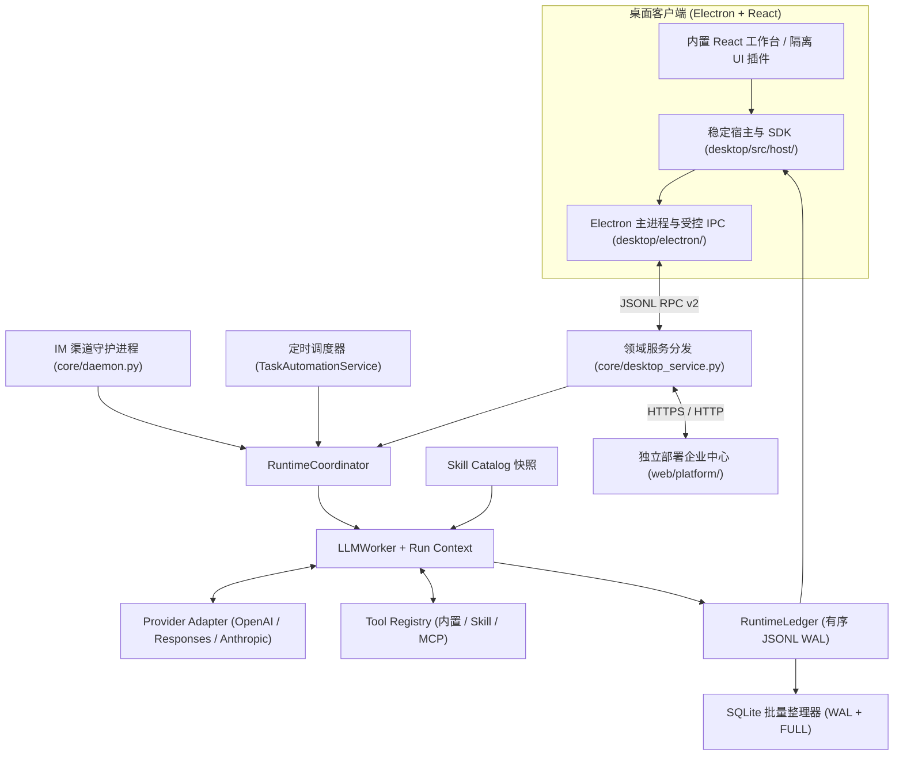
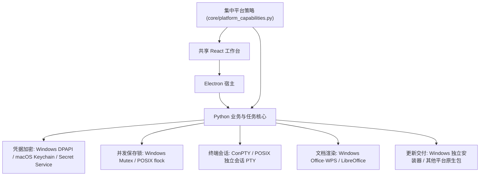
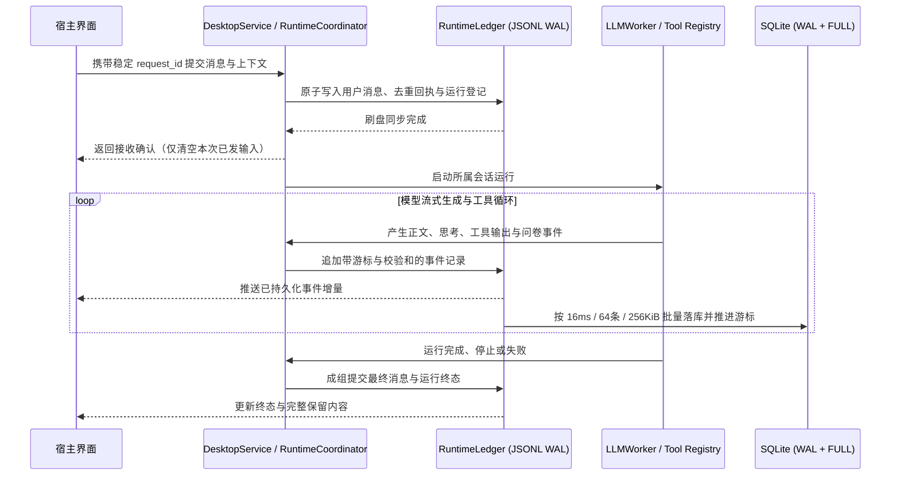

# DeepSeek Cowork 技术文档

文档适用版本：**5.4.3**

本文面向核心开发者与扩展维护者，从全局视角说明 DeepSeek Cowork 如何接收任务、构造模型请求、调度工具、持久化运行事实并在桌面与企业端交付成果。日常桌面操作见[用户手册](user-guide.md)，界面插件开发见 [UI SDK](../desktop/sdk/README.md)，企业服务端安装见[企业部署指南](enterprise/deployment.md)，历次版本演进见[发布记录](releases/index.md)。

全文按自顶向下的**六层架构**组织：

1. [系统全景与架构不变量](#系统全景与架构不变量)：进程拓扑、源码职责地图、三层状态归属与跨平台系统边界
2. [Electron 宿主、会话运行与持久化链路](#electron-宿主会话运行与持久化链路)：宿主生命周期、Agent Loop、上下文缓存、有序账本（WAL）与实时观测
3. [Skill 与 MCP 开发](#skill-与-mcp-开发)：统一工具注册与授权、能力包快照与安装、长期记忆/经验系统与多媒体异步任务
4. [工作区、编辑器与交付物引擎](#工作区编辑器与交付物引擎)：文件事务保存、Office/PDF 渲染与独立审稿、本轮文件记录 vs Git 差异、网页/终端/沙箱表面
5. [自动化调度与企业协同平台](#自动化调度与企业协同平台)：常用任务调度、IM 渠道网关、资料库适配与企业中心（部门授权、能力分发、合规审计）
6. [构建与发布](#构建与发布)：开发与 Windows 打包审计、增量更新与安装器回滚事务、退役兼容边界与分类测试矩阵

---

## 系统全景与架构不变量

### 1. 全局运行拓扑与源码地图

桌面交互、定时计划、消息渠道（IM）与子任务共享同一个 Python 运行核心（`RuntimeCoordinator` + `LLMWorker` + `Tool Registry`）。每次任务在接收时锁定会话、工作目录、模型、能力快照与权限模式；前端界面完全由已持久化的运行事实与事件增量驱动。



核心源码按职责分层如下：

| 层次 | 关键源码路径 | 核心职责 |
| --- | --- | --- |
| **宿主与前端界面** | `main.py`、`scripts/run_desktop.py` | 开发环境启动与进程装配入口 |
| | `desktop/electron/main.cjs`、`desktop/electron/browser.cjs` | 原生窗口、单实例锁、受控协议（`cowork-local:` / `cowork-plugin:` / `cowork-editor:`）与内置网页视图 |
| | `desktop/src/host/`、`desktop/src/plugins/` | 稳定状态持有、草稿与表单恢复协调、UI SDK 2 宿主实现与内置工作台插件 |
| | `desktop/src/Workspace.tsx`、`web/editors/` | 统一工作区标签、文件/任务/子任务分栏，以及随包分发的离线富文本/表格编辑器 |
| | `core/theme_package.py`、`core/theme_service.py` | 声明式主题包校验、字体/Token 映射与预览激活事务 |
| **运行调度与持久化** | `core/desktop_service.py` | 本地认证 JSONL RPC 生命周期与领域模块（会话、工作台、设置、连接、更新）装配 |
| | `core/runtime_coordinator.py`、`core/runtime_tasks.py` | 多入口任务提交、取消令牌、终态收敛、长上下文整理回执与原生线程生命周期 |
| | `core/agent.py`、`core/llm/` | Agent Loop、流式分片解析（`core/llm/chat_completions_stream.py`）、多模型协议适配与上下文组装 |
| | `core/runtime_ledger.py`、`core/runtime_stream.py` | 数据目录单写者 JSONL WAL、流式批处理、SQLite 异步整理与有界背压 |
| | `core/message_persistence.py`、`core/chat_storage.py` | UI 元数据剥离、协议消息过滤、SQLite 会话历史读写与全文索引 |
| **工具、能力与文件引擎** | `core/tool_registry.py`、`core/tool_tasks.py`、`core/tool_output.py` | 工具注册、可见性过滤、长耗时后台任务与独立流式输出日志 |
| | `core/skill_manager.py`、`core/skill_install.py`、`core/skill_package.py` | 能力快照编译、按需指导披露、统一来源安装与原子校验发布 |
| | `core/filesystem_ops.py`、`core/apply_patch.py` | 文本编码识别、局部精确上下文匹配与原子补丁写入 |
| | `core/file_capabilities.py`、`core/deliverable_editing.py` | 文件类型能力注册、编辑会话指纹与防冲突事务保存 |
| | `core/turn_files.py`、`core/workspace_changes.py` | 文件锁内的本轮改动快照库（`turn_files.sqlite`）与内置 Git 工作树实时差异查询 |
| | `core/document_preview.py`、`core/preview_versions.py`、`core/document_review.py` | Office/WPS/LibreOffice 页面渲染、版本化缓存与独立模型视觉版式审阅 |
| | `core/workbench.py`、`core/workbench_transport.py` | 工作区网页/终端标签状态与桌面工具双向桥接 |
| **自动化、资料与企业端** | `core/daemon.py`、`core/im_gateway_registry.py`、`core/im_gateway/` | IM 渠道跨进程 Socket 适配、五渠道 Provider 注册与计划结果投递 |
| | `core/local_library.py`、`core/desktop_connections.py` | 本地公共/项目资料库、远程知识库（WeKnora / 腾讯文档 / 乐享）与桌面企业连接 |
| | `core/enterprise_capabilities.py`、`core/enterprise_capability_runtime.py`、`core/enterprise_chat_audit.py` | 桌面端企业能力目录、请求级版本挂载与本地脱敏审计上传队列 |
| | `web/platform/` | 独立部署的企业管理中心（FastAPI + PostgreSQL + 同源静态管理后台） |

### 2. 三层职责分离与五条核心不变量

架构围绕**“界面可安全替换、任务生命周期独立”**设计，避免为换框架而重写成熟 Python 业务逻辑：

- **三层状态归属**：
  1. **Python 运行核心**：唯一持有会话历史、模型协议、工具执行与数据库事务事实（不依赖 Qt，纯原生线程、队列与事件驱动；PyInstaller 仅打包独立后端服务 `cowork-service`）。
  2. **Electron + React 稳定宿主**：按稳定会话/文件 ID 持有未发送输入、编辑器草稿、表单恢复副本与运行订阅，切换页面或重载插件不清空用户正在编辑的内容。
  3. **UI SDK 2 界面插件**：仅组合展示与交互扩展点，不直接接触 SQLite、认证凭据或模型网络请求，也不维护第二套发送队列。
- **五条不可破坏的不变量**：**消息可靠、过程连续、会话隔离、失败可恢复、用户可控制**。替换或恢复界面不重启后台任务，恢复内置界面不回滚用户数据，界面布局状态绝不混入发给模型的上下文。

### 平台适配边界

跨平台采用“共享全部业务核心 + 薄系统适配层 + 集中能力策略”，不在业务对象中散落平台分支，也不维护多套前端 UI：



| 系统边界 | 实现入口与工程约束 |
| --- | --- |
| **宿主与原子持久化** | `core/platform_runtime.py`、`desktop/electron/platform.cjs`；启动时按系统绑定进程管理、系统路径与原子替换实现 |
| **平台能力门控** | `core/platform_capabilities.py`；界面展示、目录编译、依赖准备与工具执行同步校验，严禁只隐藏前端按钮而放开后端入口 |
| **敏感凭据保护** | `core/credential_protection.py` 提供统一 `protect / unprotect`；Windows 兼容 DPAPI，POSIX 在系统密钥环中保存 AES-256-GCM 主密钥（密文带版本与认证标签，密钥环不可用时显式报错，绝不降级明文或自动重生密钥） |
| **跨进程文件写锁** | `core/file_write_locks.py`；Windows Mutex / POSIX `flock` 锁定规范化路径键而非会被 `os.replace` 替换的目标 inode，支持同线程重入与超时上限 |
| **终端进程组** | `core/workbench_terminal.py` 维护公共会话生命周期，`core/posix_terminal.py` 使用独立会话与控制终端启动 Shell（避免多线程进程调用不安全的 `preexec_fn`），关闭时完整回收前后台进程组 |
| **外部程序动态库隔离** | `core/process_utils.py`；POSIX 冻结态启动外部程序（如系统 LibreOffice）前恢复干净的动态库搜索路径，防止 PyInstaller 内置库污染外部进程 |
| **随包运行时与字体** | `core/runtime_manifest.py` 固定各平台运行时下载地址与 SHA-256（tar 解压保留内部符号链接与执行位并拒绝路径越界）；`core/system_fonts.py` 与 `desktop/src/theme.ts` 负责跨平台字体枚举与回退映射 |

非 Windows 环境下默认直接使用完整 Agent（不启用 Windows PowerShell 极简启动，不注册退役组件或未启用能力），模型协议与历史存储格式与 Windows 完全一致。企业客户端分发当前仅面向 Windows x64。

---

## Electron 宿主、会话运行与持久化链路

### 1. 数据目录、启动时序与宿主恢复

- **原位复用数据目录**：正式安装包启动时自动定位本机原数据目录（便携模式优先使用可执行文件同级的 `user_data`，源码开发默认使用隔离目录，可通过 `--data-dir` 或 `COWORK_APP_DATA_DIR` 指定）。直接原位读写既有 `config.json`、SQLite 会话库、附件与工作区，不新建 `desktop-v2` 副本或重写历史路径。启动时获取数据目录独占锁，新旧版本切换须先正常退出原进程。
- **非阻塞启动与技能预热**：服务在耗时初始化前先公布认证控制端点并实时上报 `starting` 阶段，数据库与运行账本恢复完毕后发出 `ready`。窗口启动进入新聊天首页（同窗口重载则恢复当前会话），首帧绘制完成后在后台异步预热 `SkillCatalogService`（首次触发技能菜单或发任务也会按需共享同一次加载快照），大幅缩短首屏等待。
- **本机输入恢复与附件隔离**：未发送的文字和附件由 Electron 宿主按会话保存在本机恢复存储中（新建聊天自动携带未发草稿，切换已有聊天恢复各自输入，收到服务端接收回执后仅清空本次已提交部分）。新上传、拖入或粘贴的附件统一复制到聊天历史目录下的 `attachments/<conversation_id>/uploads`，不再向用户的项目工作目录写入 `attachments` 文件夹；历史旧附件原路径继续兼容可读。表单恢复副本通过系统凭据接口加密暂存，与正式点击“保存”的配置严格区分。
- **工作区任务与子任务分栏**：工作区将主运行详情（`任务`标签）与子 Agent 协作（`子任务`标签）拆分为独立视图状态。主对话时间线中的子任务分组由既有协作工具调用投影生成；子任务详情复用 `AssistantTurn` 组合 `agent.get` 的工具活动与保存消息，支持通过 `SubagentControl` 独立发送补充（失败重试复用原 `message_id` 防重）、停止或继续，关闭标签不终止后台执行。
- **UI SDK 2 与创造模式试跑**：`hostApi: 2` 插件运行在无联网、无 Node 权限的沙箱 `iframe` 中，整包内容计算指纹（扩展点覆盖 `workbench:main`、`page:<id>`、`panel:<id>`、`editor:<type>`、`toolbar:chat` 及 `command / menu`）。创造模式在独立设计会话中向 `interface/` 提交补丁后，宿主在隐藏预览环境中绑定包指纹完成渲染、交互检查与截图并回传给同一轮任务；用户点击“应用”时通过宿主保存协调器原子切换，失败保留原界面，独立恢复入口始终可用。详见 [UI SDK](../desktop/sdk/README.md)。

### 2. Agent Loop 与多协议适配

每次顶层会话同一时刻最多维持一个活动运行（不同会话及子任务可并行），状态机覆盖 `queued → running → stopping → completed / failed / interrupted`。核心执行循环如下：

```python
while not stopped:
    append_accepted_user_messages()
    apply_catalog_at_request_boundary()
    response = stream_model(messages, visible_tools)
    messages.append(response)
    if not response.tool_calls:
        persist_and_finish()
        break
    for call in response.tool_calls:
        result = execute_registered_tool(call)
        messages.append(tool_result(call.id, result))
    checkpoint_session()
```

- **协议归一与无损回放**：`Provider Adapter` 将 OpenAI Chat Completions、OpenAI / DeepSeek Responses 与 Anthropic Messages 统一转换为内部正文、`reasoning_content`、工具调用、用量与运行事件；工具聚合完毕后执行并通过 `tool_call_id` 严格配对。Responses 协议的原生 Items 保存在 assistant 消息元数据中供下一轮按原协议回放；官方 DeepSeek Responses 根据服务地址与协议自动识别推理、函数调用与服务端搜索特性。
- **取消优先与有界网络重试**：用户点击停止时立即触发目标运行的取消令牌（绕过正文流积压，先取消活跃工具进程树再关闭模型流），并将已完成部分持久化。模型与网络瞬时错误最多进行 5 次可见重试，绝不因重连而重复执行已生效的工具调用。

### 上下文与缓存

模型请求上下文严格划分为三段，最大化服务端 KV Cache 命中率，同时绝不为缓存牺牲工具可见性准确性或会话隔离：

| 分段 | 包含内容与生命周期 |
| --- | --- |
| **稳定前缀（Stable Prefix）** | 系统核心策略、通用工具与交互规则、Worker 创建时冻结的长期记忆摘要、工作目录根下的 `AGENTS.md`（指用户项目内的约定文件，与开发本仓库使用的根 `AGENTS.md` 互不相干） |
| **动态运行上下文** | 当前日期、工作目录、所选模型、运行模式、显式勾选的能力及标签页提交摘要 |
| **有序消息序列** | 用户消息、模型回复、工具调用与返回、以及按需追加披露的资料与技能指导 |

- **按需技能披露（防前缀抖动）**：内置技能目录按确定性名称顺序生成摘要；标记为 `prompt_disclosure: full_on_match` 的内置技能在匹配任务时，通过追加式账本消息注入正文（按内容哈希去重，能力停用时追加停用事件而非改写历史消息），避免把所有技能全文塞进系统提示词导致缓存频繁失效。用户未显式勾选的可选技能通过 `tool_search` 按需发现，`references/` 参考文件由模型按路径按需读取。
- **首轮极简启动与 1M 超长上下文**：
  - `bootstrap_plugins/session.py` 在 Windows 下对符合条件的官方 DeepSeek 普通新对话采用精简提示词与最小工具集快速完成首轮响应；一旦需要完整工作台能力即无缝移交主循环，保留全部原始输入与附件。
  - 桌面主对话默认启用 `1M` 上下文目标（可在用量详情切为 `300K` 或关闭）。当工作集接近有效预算时，发起独立整理请求生成摘要检查点（输出额度在截断时可按剩余空间动态上调至 `16,384` tokens，落盘检查点须通过 `4,096` tokens 校验，网络重试与修复共享最多 3 次额度）；早期原始证据仍保存在完整会话历史中，可通过 `history_search` / `history_read` 按会话隔离调阅。

### 3. 消息账本（RuntimeLedger）与界面投影

为兼顾高频流式事件低延迟与崩溃零丢数，持久化采用**“单写者顺序 JSONL WAL + 后台批量 SQLite 事务整理”**架构：



- **崩溃恢复与读取一致性**：历史读取、全文搜索与记录导出在开始时锁定当前账本游标，等待 SQLite 整理器追平该游标后再查询；已覆盖的封闭 WAL 段在事务提交后自动回收。进程异常重启时仅重放完整账本记录并将会话标为 `interrupted`，**绝不自动重跑可能已产生外部副作用的工具**（末尾半条损坏记录留存诊断后截断，中间记录损坏显式报错不静默跳过）。
- **运行中补充（Steer）与分页归位**：运行中发出的补充要求在首次落盘前即绑定统一的 `turn_id`、`request_id` 与接收时间戳，前端按 `ui_timeline_v1` 事件时序将其穿插展示在真实发生位置（展示切分不篡改底层模型协议历史）。长对话向上分页加载时，未变消息保持稳定对象引用，历史执行过程与耗时按轮次身份精确归位，不会错挂到最新回复下方。

### 4. 后台长工具、实时输出与观测

- **长工具无缝转后台**：`core/tool_tasks.py` 为耗时超过前台等待窗口的工具分配稳定 `task_id` 并返回 `background_tool` 状态，底层线程继续执行；模型后续调用 `wait_tool` 等待或取消时，前端将其合并展示在同一条原工具记录中，并通过交付收据确保原路返回与异步完成通知严格去重。
- **独立流式输出日志**：`core/tool_output.py` 为 Python（无缓冲模式）、JavaScript、Shell 与依赖安装按“会话 + 运行 + 调用 ID”维护独立 JSONL 日志。增量解码落盘后生成最多 `8 行 / 8 KiB` 的预览检查点供前端展开区每 `250 ms` 轻量读取（右侧详情按 `64 KiB` 分段读取，单次日志默认上限 `50 MiB` 可由 `COWORK_TOOL_LOG_BYTES` 调整，超限仅停止写盘并继续排空管道保留真实退出码），从而避免将海量终端输出刷入会话消息库。大型工具返回同样自动归档，供模型通过 `text_file_read` 的 `next_offset` 分段按需读取。
- **观测与界面自动联动**：内置网页首次由当前会话任务创建时发布带会话与运行身份的 `browser_opened`，由常驻宿主判断是否自动展开工作区（用户手动收起或切换标签后不再强行打断）。用量浮窗由 `desktop/src/usageMetrics.ts` 基于观测事件独立计算实时速率、服务端上报 Token 与同次请求的本地上下文估算，不介入模型请求构造。

---

## Skill 与 MCP 开发

**核心分工：Tool 是统一执行面，Skill 是工作流指导与经验资产包，MCP 是外部工具接入协议，专家（Expert）是在同一运行循环上绑定的角色提示词与能力子集。**

### 1. 工具注册表、执行授权与原子文件工具

`Tool Registry` 统一管理所有工具的 Schema、风险等级、可见范围与执行处理器，按注册来源分为四类：

| 来源目录 / 通道 | 注册类别 | 上下文可见性规则 |
| --- | --- | --- |
| `skills/` | `core_builtin` | 满足当前平台与运行上下文的内置工具首轮立即可用 |
| `ai_skills/` | `optional` | 用户显式选择，或启用后经 `tool_search` 按需发现 |
| 用户与企业能力目录 | `user_extension` | 按启用状态、会话选择或企业本轮绑定快照注入 |
| MCP 服务连接 | `mcp` | 握手连接成功后映射为标准工具 Provider，共用同一套审批与日志链路 |

- **执行授权与模式切换**：宿主为每次运行签发授权策略（`请求批准`模式下单次审批精确绑定工具动作与参数摘要；`完全访问`模式下在当前系统用户权限内直接放行）。`parallel_tools` 仅并行调度互不干扰的只读工具。拷问模式（内置 `cowork.grilling`）在运行上下文中维护讨论轮次与问卷确认检查点，确认执行后由同一 Worker 原位解锁执行工具集。
- **精确文件补丁（`apply_patch`）**：文本发现与读取由 `glob`、`grep`、`text_file_read` 承担；文本新建、局部修改、移动与删除统一走 `apply_patch`（目录级重命名/删除使用 `workspace_rename_path` / `workspace_delete_path`）。`apply_patch` 先全量解析并校验目标路径，局部修改基于原文上下文唯一匹配，严格保留原文件编码、BOM 与换行符风格，并在最终 `os.replace` 提交前核对预检以来的外部并发写冲突（新建文件默认拒绝覆盖同名已有文件）。

### 2. Skill 包结构、快照目录与安装分发

```text
example-skill/
  SKILL.md                 # 核心流程指导（含 YAML 头信息 name / description）
  skill.json               # 可选：原生工具绑定、配置表单、依赖与展示元数据
  impl.py                  # 可选：Python 工具实现（首次调用时延迟导入）
  references/              # 按需读取的详细参考文档
  scripts/                 # 通过 script_entries 声明并由 run_skill_script 执行的脚本
  assets/                  # 模板原件与静态资源
  experience/entries.jsonl # 经用户审阅沉淀的专项经验条目
```

- **不可变目录快照与隔离依赖**：`SkillCatalogService` 将全量技能编译为不可变快照供 UI 与后台无锁读取；安装、编辑或启停技能触发 `SkillChangeEvent`，正在运行的 Worker 在下一个模型请求边界平滑切换新快照。内置 `documents`（Office/PDF 读写）、`presentations`（可编辑 PPTX）、`data-analysis`（口径核验、统计计算与干净内核 `.ipynb` 顺序执行）与 `visualize`（主题自适应交互卡片）共享随包 Python 环境；第三方技能的额外包由 `DependencyCoordinator` 按技能与依赖哈希在独立环境中合并安装。
- **MCP 接入**：独立 MCP 保存各自连接与认证信息；随技能分发的托管 MCP 在 `skill.json` 的 `mcp_server_presets` 中声明（支持 `stdio` 与 `Streamable HTTP`，自动展开 `{{ENV_NAME}}` 变量，设 `runtime: skill_python` 时复用所属技能的隔离 Python 环境）。
- **统一安装器**：`core/skill_install.py` 统一解析本地文件夹/ZIP、HTTPS Git 仓库（固定真实 commit）与直接 ZIP/Markdown 地址，在临时副本完成解析后交由 `core/skill_package.py` 做路径安全与结构校验并原子发布（同名冲突拒绝覆盖，批量安装部分失败时保留原技能完好，安装成功与“待完成连接配置”状态分开报告）。SkillHub 安装通过 `.skillhub.json` 记录上游来源基线；需要外部身份授权的技能通过受信任 `authorization.provider` 在隔离流程中签发凭据。

### 3. 长期记忆、自主经验与“沉淀为 Skill”

- **自主经验更新**：执行阶段模型验证出值得跨轮次复用的项目惯例或避坑结论时，可调用内置 `update_experience(scope, experience, previous_experience?)` 将其合并写入项目或全局长期记忆摘要的“可复用经验”小节（精确去重或更新旧条，拷问阶段只读，创造模式设计会话与普通无项目聊天不会污染全局或原项目记忆）。底层与人工编辑、“从历史更新”共用 `MemoryStore` 文件锁、内容比对防覆盖与原子备份，修改从下一轮任务生效。
- **会话沉淀为 Skill**：用户触发“沉淀为 Skill”后，系统先提取选定消息范围生成可编辑的复用分析与技能草稿，点击保存前依次校验 JSON Schema、敏感凭据泄露、资源相对路径、Python AST 语法与目标技能 `revision`，支持创建新技能或向已有可编辑技能安全追加方法与模板资产。

### 多媒体技能

多媒体能力（`ai_skills/multimedia/`）作为可选技能运行，图片生成/编辑、视频生成与视频理解分别绑定独立的模型服务配置（保存在 `skill_configs.multimedia.bindings`，API Key 始终留在加密的模型渠道配置中，绝不进入技能提示词、任务记录或工具返回）：

- **宿主租约与精确重试边界**：`core/desktop_media.py` 与 `core/multimedia/` 基于 `DesktopJobs` 管理异步生成与恢复租约。未配模型时保存 `needs_configuration` 快照，补齐配置后通过 `media.continue` 原位续跑；仅在 Agnes 视频服务明确返回未接单的 `video_queue_full` 时自动重试最多 3 次，普通 `5xx`、网络超时或缺少服务端回执绝不盲目重发生成请求（防止重复扣费）。轮询查询瞬时错误最多连续重试 5 次（单轮等待上限 10 分钟），下载瞬时失败最多重试 3 次并通过 `.part` 临时文件原子落盘。
- **连续视频归位与流式播放**：每次视频创建持久化所属 `tool_call_id` 与 SQLite 记录版本号；前端按“会话 + 轮次 + 创建调用”将多段视频卡片精确挂载回各自发起的回复下方（历史未分页载入时先在工作区“任务”标签兜底展示，载入后自动归位）。成片预览通过宿主受控的 `cowork-local:` 协议按需签发临时地址，完整支持 HTTP `Range` 分段流播放，收起卡片或卸载组件时立即释放文件流句柄。

---

## 工作区、编辑器与交付物引擎

### 1. 文件编辑事务、原生表面与代码沙箱

- **统一文件能力与防冲突保存**：`core/file_capabilities.py` 统一注册各扩展名的预览与编辑方式，`core/deliverable_editing.py` 维护会话级编辑快照。保存文件时经临时文件校验、上一版备份与原子替换完成，利用内容 `SHA-256` 检测磁盘外部并发修改（冲突时完整保留编辑器内草稿并提示用户处理，不静默覆盖）。写作页草稿持久保存在会话状态中，首次显式保存时才在工作目录创建文件；内置富文本与表格编辑器通过受限命令桥与宿主通信（单次传输上限 `64 MiB`）。
- **终端与双模式浏览器**：
  - 终端由后端服务持久持有，前端切页重连按游标拉取缓冲输出而不重启 Shell；用户“接管 / 交还”递增 `control_revision` 阻断过期的 AI 输入，xterm 的 `DA / DSR` 终端查询应答走独立白名单以防阻塞 ConPTY。
  - 浏览器默认使用按会话隔离的 Electron `WebContentsView` 内置网页，也可通过启用 BrowserSkill 切换至外部 Chrome / Edge（新任务启动时固定后端租约，运行中不混用）。内置自动化将**“动作已派发”**与**“后续页面等待结果”**解耦：等待超时不自动重发点击或提交；确实无法确认派发状态时仅冻结当前标签页的后续写输入，仍允许读取观察或由用户手动接管核实。
- **隔离代码预览与内联可视化**：
  - `desktop/electron/snippets.cjs` 在完全断网、禁导航、无 Node 与宿主接口的独立沙箱中运行用户主动点击预览的 HTML / 原生 JavaScript 代码块（单段上限 `256 KB`、同屏最多 16 个实例、前台无响应 `10 秒` 自动熔断，输出与报错仅作临时界面状态，不写入消息库）。
  - Visualize 使用 `core.inline_visualization` 封装交互片段（上限 `2 MiB`、持久化筛选状态 `64 KiB`），由 `desktop/src/theme.ts` 注入当前主题色板变量并在切换明暗/主题时派发 `cowork:themechange` 事件无刷新重绘。

### 2. Office/PDF 页面渲染与独立模型审稿

- **快照渲染与进程安全**：`document_render` 读取一次源文件生成不可变快照，按“文件指纹 + 渲染器版本 + 阅读参数”隔离缓存转换出的 PDF 与页面图片（由独立进程 PDFium 转图，阅读端采用离线 PDF.js 与随包字体，用户手动点击刷新前不打断当前阅读位置）。`core/office_renderers.py` 在 Windows 下按注册表与位数发现本机 Microsoft Office / WPS（不在应用启动时预激活 COM；转换只关闭本次临时文档副本，绝不强杀用户已打开的办公软件进程；WPS 按套件串行且不篡改用户共享配置），缺少本机办公套件时支持一键校验安装提取版 LibreOffice。Excel 额外提供 `excel_options` 区分**区域阅读**（按实际列宽智能分片、保留合并单元格组并重复指定标识列/标题行）与**打印预览**。
- **独立视觉审稿预算与证据链**：`core/document_review.py` 复用当前会话所选模型与授权发起独立的看图审稿请求（每批细节最多 4 页、长边 `2000 px`，跨页总览最多将 24 页合成为 4 张图且不替代细节页计数；Responses 协议等待匹配的 `response.completed` 完整正文解析页码与问题）。单轮任务跨文件共享 **24 次请求、80 页次、6 分钟及累计像素/Token 上限**（用量未知时停止继续追加请求）。送审原图摘要、覆盖页码与结论保存在 `browser_previews/sessions/` 下供阅读器底部“检查记录”核查；AI 修改办公文档默认通过 `document_copy` 在 `.cowork/office-drafts/` 创建任务副本（此设计为防误改原件的工作流保护，并非操作系统级文件沙箱）。

### 3. 本轮文件记录 vs Git 工作目录变更

系统同时提供两套严格隔离的文件差异机制，互不冒充数据源：

| 维度 | 本轮文件记录（`core/turn_files.py`） | Git 工作目录变更（`core/workspace_changes.py`） |
| --- | --- | --- |
| **展示位置** | 每轮 AI 回复下方的“本轮文件”卡片及只读“文件记录”面板 | 工作区顶栏打开的实时“变更”标签及编辑器内“显示更改” |
| **采集机制** | Worker 线程绑定固定运行归属，在应用内置写入/补丁/删除/移动的文件锁内精确抓取前后快照（非 Git 普通文件夹同样可用；无明确写入证据的自由 Shell 脚本不靠猜测硬凑归属） | 调用随包 Git 只读对比当前工作目录相对 `HEAD`（无提交时对比空树）的已暂存、未暂存与未忽略新文件，反映磁盘实时全貌（含外部软件修改） |
| **存储与配额** | 独立存于历史目录 `turn_files.sqlite`，单版本上限 `2 MiB`、单轮压缩正文 `16 MiB`、全局 `256 MiB`（超额按时间淘汰最早已结束任务的正文，永久保留文件清单、增删行数统计与清理原因说明；超过 20,000 行的超大文本标记 `diff_limit`） | 不落盘历史副本，按需实时读取并随文件保存自动刷新 |
| **上下文隔离** | 纯界面只读投影，不进入模型消息历史，不影响稳定 Prompt Prefix | 纯界面只读查询，不进入模型消息历史 |

---

## 自动化调度与企业协同平台

### 1. 常用任务调度、消息网关与资料库

- **持久防重调度（`TaskAutomationService`）**：`task-automation` 的 7 个工具、`favorites.*` 桌面 RPC 与后台 `DesktopScheduler` 共用同一服务实例，通过 `revision` 拦截并发编辑冲突。定时点到达时，先原子写入 `task_id + scheduled_at` 领取记录，再创建独立会话走标准提交流程（应用重启后核对真实状态，绝不重放结果未明的外部任务）。新计划保存标准 IANA 时区（随包携带 `tzdata`，正确处理夏令时跳过、重复时刻单次执行与月末天数对齐，旧计划兼容保留 `local`）。任务完成后，消息渠道通知进入独立的持久化投递队列分段发送，任务终态与投递终态分开记录。
- **跨进程 IM 渠道与子任务**：`core/im_gateway_registry.py` 通过 `ProviderSpec` 统一注册飞书、钉钉、企业微信、QQ 与微信渠道，由 `core/daemon.py` 经认证本地接口转发至同一 `RuntimeCoordinator`；`SessionAgentManager` 为子任务维护独立上下文与收件队列，父会话只接收精炼汇总，子会话保留完整工具轨迹。
- **本地与云端资料库**：`core/local_library.py` 管理独立于项目的公共资料库（含应用内回收站整批还原）并按规范路径去重汇总未归档项目目录；WeKnora、腾讯文档与腾讯乐享适配器在任务提交时绑定账号身份与选定范围，缓存按授权代次严格隔离。

### 2. 企业管理中心、部门授权与合规审计

独立部署在 Linux 服务器上的企业中心（`web/platform/`，基于 FastAPI + PostgreSQL）统一承载身份认证（本地账号密码 / OIDC / OAuth2 / LDAP）、多级部门授权、模型代理、企业能力仓库、合规审计、团队空间与客户端分发：

- **部门树并集授权与能力分发**：`web/platform/server/departments.py` 计算多级部门继承关系，员工可用模型与能力取**个人直接授权与所在部门、全部上级部门授权的并集**。管理员上传的 Skill / 专家 ZIP 由 `web/platform/server/capability_packages.py` 在内存中完成无解压安全校验（拒绝路径穿越、符号链接、加密包、私钥凭据及超过 `4 MiB` 的内容，专家包支持随附 1–8 个关联 Skill 草稿）。发送消息时，`core/enterprise_capabilities.py` 锁定本轮已发布能力版本并由 `core/enterprise_capability_runtime.py` 注入运行环境；企业 Streamable HTTP MCP 的员工个人 Bearer 令牌仅加密保存在桌面本机。
- **脱敏最新请求审计**：`core/enterprise_chat_audit.py` 在客户端请求发出前剥离认证凭据、密钥文本与所有内嵌文件/媒体二进制数据（单条净化后上限 `4 MiB`，超限仅上报元数据并标记正文未保存），写入本地加密 SQLite 待传队列（最多缓存 64 个会话，按指数退避重试，**队列只重传审计副本，绝不重放模型推理请求**，且严格校验企业身份代次防串号）。服务端 `web/platform/server/chat_audit.py` 按“成员 + 会话”保留最新一条记录 **30 天**，平台管理操作记录独立保留 **90 天**，支持多维检索、JSON 正文折叠复制与 Excel 导出。

---

## 构建与发布

### 开发与 Windows 构建

准备 Python 虚拟环境与随包运行时后，安装前端及离线编辑器依赖即可启动开发桌面：

```powershell
npm --prefix desktop ci
npm --prefix web/editors ci
node desktop/node_modules/electron/install.js
.\.venv\Scripts\python.exe scripts/run_desktop.py
# 前端无改动时可加 --no-build 快速启动；可用 --data-dir 指定隔离测试数据目录
```

> **开发与打包关键约束**：
> - Electron 的 npm 依赖包与二进制运行时分离，`npm ci` 后必须执行 `node desktop/node_modules/electron/install.js` 完成摘要校验安装。
> - Electron 启动后端服务时通过 `COWORK_ELECTRON_EXE` 传入自身路径，`run_node_code` 仅对目标子进程局部设置 `ELECTRON_RUN_AS_NODE=1` 复用宿主 Node.js 运行时，不污染 Python、Bash 或桌面主进程环境。
> - 随包 Python 环境（`python_env`）通过 `requirements-data-analysis.txt` 锁定完整科学计算、绘图、Notebook 与 Office/PDF 处理依赖。BrowserSkill 固定为 `0.5.0`，升级时须同步 `core/browser_skill_component.py`、`resources/browser_skill/bundle.json`、`scripts/fetch_runtimes.ps1`、`deepseek-cowork.spec` 与 `scripts/package_release.py` 五处的版本号及 SHA-256。

在 Windows 构建机生成正式发行包的完整命令：

```powershell
powershell -ExecutionPolicy Bypass -File .\scripts\fetch_runtimes.ps1
$env:COWORK_PYTHON = (Resolve-Path .venv/Scripts/python.exe).Path
# 若默认输出目录有程序正在运行，可先指定新输出目录：$env:COWORK_PACKAGE_OUT_DIR = (Join-Path (Get-Location) 'dist/desktop-release')
npm --prefix desktop run package:win
```

打包完成后，建议在与源码仓库无关的工作目录对冻结后端服务执行端到端回归：

```powershell
.\.venv\Scripts\python.exe -X utf8 -m unittest discover -s test -p test_desktop_service.py -v
npm --prefix desktop test
npm --prefix desktop run build
$env:COWORK_TEST_DESKTOP_SERVICE = (Resolve-Path "desktop/out/DeepSeek Cowork-win32-x64/resources/service/cowork-service.exe").Path
.\.venv\Scripts\python.exe -X utf8 -m unittest discover -s test -p test_desktop_service.py -v
Remove-Item Env:COWORK_TEST_DESKTOP_SERVICE
```

### 1. 确定性打包审计、更新清单与安装器事务

- **单一版本源与出包审计**：`core/app_version.py` 中的 `APP_VERSION` 是唯一代码版本源（升版同步更新 `desktop/package.json`、`desktop/package-lock.json` 根版本、现行文档版本声明及 `docs/releases/版本号.md`，不动历史发布记录）。`desktop/scripts/package.mjs` 组装前端、离线编辑器与冻结 Python 服务后，调用 `scripts/package_release.py` 在隔离目录实测随包 Python 科学计算/图表/文档导入，审计宿主结构、运行时摘要、许可证与空白默认配置（严禁夹带个人配置或退役的 Qt / 旧技能残留，ZIP 顶层目录固定为 `Cowork` 且内部路径控制在 185 个 UTF-16 代码单元以内），最终输出确定性 `cowork-desktop-v版本号-windows-x64.zip` 与 `latest-desktop-windows-x64.json`（其中 `app_layout: "electron"`，`notes` 自动写入对应版本说明全文）。
- **公共源与企业源更新隔离**：
  - 个人标准包优先查询公共更新地址（`updates/desktop-windows-x64/latest.json`），网络不可达时回退 GitHub Releases（共享最多 5 次网络重试，版本、字节数与 SHA-256 严格锁定，清单或哈希不符立即中止）。
  - 企业客户端根据安装目录内的 `enterprise_connection.json` 锁定更新源（免登录检查下载，安装前二次向企业中心确认该推荐版本未被撤下，失败绝不串入公共源）。企业后台离线部署包由 `scripts/package_enterprise.py` 独立构建 Linux `amd64` 镜像并生成 `deployment.json` 与 `SHA256SUMS`。
- **增量准备与独立安装器回滚状态机**：
  1. `core/desktop_update_payload.py` 对比目标 ZIP 清单与本地现存文件，仅解压准备有差异的文件并持久化缓存（重启后自动核验复用；选择同版本本地 ZIP 则逐项校验修复损坏文件）。
  2. 用户点击“重启并更新”后，宿主生成安装事务 ID，保存全部草稿与恢复副本，关闭新任务入口并启动独立安装器进程。宿主每 `250 ms` 轮询握手，**最多等待 30 秒确认安装器就绪**（超时或用户点击取消则安全终止准备进程并恢复当前版本正常使用）。
  3. 握手成功后写入持久 `commit` 并退出主程序；安装器等待主进程完全释放文件（最长 45 秒，全程使用 Windows 扩展路径与独占访问检查），完成备份与原子替换后拉起新版本，通过单实例锁回传校验新窗口与后端服务版本一致后自动清理备份并退出。若新版未能就绪，自动回滚旧版并将诊断原因写入更新页，无法自动恢复时保留可见恢复窗口供用户重试或释放安装锁。

### 2. 历史兼容与退役资源边界

历史数据库记录、用户配置与已生成文件按原存储边界长期兼容可读，但不再激活已下线的旧执行链路：

- **模型原生生图停用**：`LLMFactory` 统一关闭聊天主模型的原生 `image_generation` 附加工具（不改写用户已保存的旧配置文件，视觉看图输入与历史图片消息回放正常保留）；图片与视频生成统一由可选的 `multimedia` 技能通过标准工具调用独立配置的服务完成。
- **内置技能归一与退役组件**：旧 `document-reader` 由内置 `documents` 取代；旧 `favorites-manager` 在运行配置中自动归一为 `task-automation`，原常用任务与计划无缝保留。早期专属 PPT 助手模式、内置 Frontend Slides / Huashu Design / Guizang PPT 以及旧语音转文字技能均已下线（打包审计拒绝残留旧资源，打开历史 PPT 助手会话时提示后续按普通对话处理）。

### Mac 与统信原生构建

Apple Silicon macOS 与统信 UOS V25（`x86_64`）复用全部业务核心与前文[平台适配边界](#平台适配边界)，其 Electron 原生打包、签名公证与系统级安装流程须在对应真实硬件与目标操作系统上构建和验收（容器测试或 Windows 下跳过的 POSIX 用例不能替代目标机实测）。实机验收须逐项覆盖：首次启动、离线富文本/表格编辑器、中文输入法、明暗与自定义主题、系统密钥环加解密、并发文件保存锁、POSIX 终端启停清理、LibreOffice 页面预览、后台长任务以及覆盖升级后的数据完整保留。

### 3. 开发与测试验证

在本地运行自动化测试前，先将临时目录与应用数据目录指向仓库 `.tmp/` 下的隔离空间（符合仓库卫生规范，且绝不触碰本机日常使用的真实聊天库与凭据）：

```powershell
# 首次测试按需安装 pytest：.\.venv\Scripts\python.exe -m pip install pytest
$taskRoot = Join-Path (Get-Location) '.tmp/local-tests'
New-Item -ItemType Directory -Force -Path "$taskRoot/temp", "$taskRoot/appdata", "$taskRoot/localappdata" | Out-Null
$env:TEMP = "$taskRoot/temp"
$env:TMP = "$taskRoot/temp"
$env:APPDATA = "$taskRoot/appdata"
$env:LOCALAPPDATA = "$taskRoot/localappdata"
$env:PYTHONDONTWRITEBYTECODE = '1'
$env:PYTHONUTF8 = '1'
$env:COWORK_EXTERNAL_BACKGROUND_SERVICES = '0'
$env:COWORK_QA_ROOT = $taskRoot
```

按改动影响面运行对应测试集：

| 验证领域 | 测试入口 |
| --- | --- |
| **文档版本、链接、配图与源码路径** | `scripts/check_docs.py`、`test/test_documentation.py` |
| **会话运行、账本与子任务可靠性** | `test/test_desktop_service.py`、`test/test_desktop_reconnect.py`、`test/test_runtime_tasks.py`、`test/test_runtime_ledger.py`、`test/test_subagent_reliable_runtime.py` |
| **草稿恢复、宿主状态与 UI 插件** | `test/test_desktop_upgrade.py`、`desktop/tests/drafts.test.mjs`、`desktop/tests/runtime.test.mjs`、`desktop/tests/host.test.mjs`、`desktop/tests/plugins.test.mjs`、`desktop/tests/plugin-page.test.mjs` |
| **工作区文件、差异、阅读器与网页** | `test/test_desktop_workbench.py`、`test/test_document_render.py`、`test/test_document_review.py`、`desktop/tests/files.test.mjs`、`desktop/tests/turn-files.test.mjs`、`desktop/tests/pdf-reader.test.mjs`、`desktop/tests/editor-bridge.test.mjs`、`desktop/tests/browser.test.mjs` |
| **图片、Mermaid 与多媒体任务** | `desktop/tests/attachments.test.mjs`、`desktop/tests/mermaid.test.mjs`、`desktop/tests/media-preview.test.mjs`、`test/test_multimedia.py` |
| **模型协议、工具注册与 Skill 系统** | `test/test_desktop_management.py`、`test/test_tool_registry.py`、`test/test_skill_system_v2.py`、`test/test_skill_catalog.py` |
| **打包审计与更新回滚事务** | `test/test_package_release.py`、`test/test_package_default_config.py`、`test/test_packaging_runtime.py`、`test/test_update_coordinator.py`、`test/test_updater.py` |
| **企业管理平台、客户端与部署** | `test/test_enterprise_platform.py`、`test/test_enterprise_capability_packages.py`、`test/test_enterprise_deployment.py`、`test/test_enterprise_client.py` |
| **跨平台底层适配** | `test/test_cross_platform.py`、`test/test_platform_integration.py` |

完成文档或版本号更新后，执行以下命令校验全仓链接、标题锚点、图片引用与空白格式：

```powershell
.\.venv\Scripts\python.exe -X utf8 -B scripts/check_docs.py --skip-protected-diff
.\.venv\Scripts\python.exe -X utf8 -B -m pytest -q -p no:cacheprovider test/test_documentation.py
git diff --check
```

评估运行核心与 SQLite 账本在多会话并发及慢速 UI 消费场景下的吞吐与延迟基线时，可执行确定性本地压测（测试数据自动隔离在 `.tmp/benchmark_runtime/`）：

```powershell
.\.venv\Scripts\python.exe -X utf8 -B scripts/benchmark_runtime.py --sessions 1 --children --slow-ui-ms 5
.\.venv\Scripts\python.exe -X utf8 -B scripts/benchmark_runtime.py --sessions 8 --children --slow-ui-ms 5
.\.venv\Scripts\python.exe -X utf8 -B scripts/benchmark_runtime.py --sessions 32 --children --slow-ui-ms 5
```
