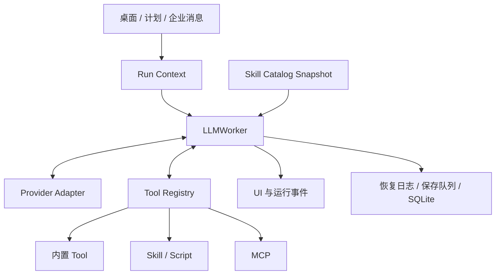
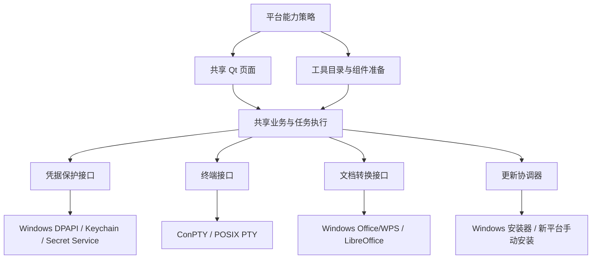
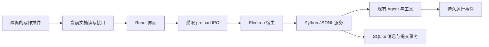

# DeepSeek Cowork 技术文档

文档适用版本：**5.3.3**

本文集中维护运行模型、能力开发、构建发布和测试入口。桌面操作见[用户手册](user-guide.md)，企业中心部署见[平台说明](../web/platform/README.md)。

## 目录

- [架构与源码入口](#架构与源码入口)
- [Electron 工作台](#electron-工作台)
- [Agent Loop 与模型协议](#agent-loop-与模型协议)
- [上下文与缓存](#上下文与缓存)
- [消息保存与界面投影](#消息保存与界面投影)
- [工具与执行授权](#工具与执行授权)
- [Skill 与 MCP 开发](#skill-与-mcp-开发)
- [工作区与交付物](#工作区与交付物)
- [后台任务与企业协作](#后台任务与企业协作)
- [主题设置与数据处理](#主题设置与数据处理)
- [构建与发布](#构建与发布)
- [开发与测试](#开发与测试)

## 架构与源码入口

桌面、常用计划、企业消息和子任务最终复用 `LLMWorker` 与 Tool Registry。每次提交确定模型、会话、工作目录、能力和运行模式，协议消息与持久化事实驱动界面展示。



| 源码入口 | 职责 |
| --- | --- |
| `main.py`、`ui/` | 桌面页面、会话呈现、输入与工作区 |
| `core/agent.py`、`core/llm/` | Agent Loop、上下文、流式事件与模型协议 |
| `core/tool_registry.py`、`core/tool_tasks.py` | 工具注册、可见性、执行及后台工具任务 |
| `core/skill_manager.py` | 能力目录、指导披露、脚本、经验与 MCP |
| `core/message_persistence.py`、`core/chat_storage.py` | 消息过滤、SQLite 保存与查询 |
| `core/chat_save_queue.py`、`core/chat_recovery_journal.py` | 异步保存和版本化恢复日志 |
| `core/daemon.py` | 后台 Worker、连接及事件流 |
| `core/filesystem_ops.py`、`core/apply_patch.py` | 文件读取凭据与补丁提交 |
| `core/deliverable_editing.py`、`core/file_capabilities.py` | 文件能力、编辑会话与保存 |
| `core/workbench.py`、`core/workbench_transport.py` | 标签状态及桌面工具请求 |
| `ui/browser_workbench.py`、`ui/browser_panes.py` | 文件、网页与终端表面 |
| `core/document_preview.py`、`core/preview_versions.py` | Office/PDF 预览及内容版本 |
| `core/im_gateway_registry.py`、`core/im_gateway/` | 消息渠道注册与运行 |
| `core/theme_package.py`、`core/theme_service.py` | 主题包与预览事务 |
| `web/editors/` | 离线编辑器源码及分发资源 |
| `web/platform/` | 独立部署的企业中心 |

### 平台适配边界

采用共享业务核心、少量平台后端和集中能力策略。消息持久化、Agent Loop、会话隔离、文件编辑和任务调度复用同一套实现；平台差异只进入系统边界。避免给每个业务对象增加平台接口，也不在不同平台维护独立 UI。



| 边界 | 代码入口与约束 |
| --- | --- |
| 发行范围与功能限制 | `core/platform_capabilities.py`；目录、设置、依赖准备和执行同时校验，不能只隐藏按钮 |
| 敏感数据 | `core/credential_protection.py` 提供 `protect/unprotect`；Windows 原 DPAPI 格式兼容，POSIX 使用系统密钥环保存 AES-256-GCM 密钥，密文带版本与认证信息；解密缺密钥不自动生成 |
| 并发保存 | `core/file_write_locks.py`；Windows Mutex／POSIX flock 锁定稳定的路径键，不锁会被原子替换的目标 inode；支持同线程嵌套并设等待上限 |
| 终端 | `core/workbench_terminal.py` 保留公共会话生命周期，`core/posix_terminal.py` 通过独立会话和控制终端启动 Shell，避免在线程化 Qt 进程里使用 `preexec_fn`；清理覆盖该终端会话的前后台进程组 |
| 外部程序 | `core/process_utils.py`；POSIX 冻结态恢复外部程序的库搜索环境，避免 PyInstaller 的动态库覆盖系统 LibreOffice |
| 运行时 | `core/runtime_manifest.py` 固定目标、下载地址和 SHA-256；在线／离线准备复用校验，tar 解压保留内部链接和执行权限并拒绝越界路径 |
| 默认字体 | 未配置字体时，新平台使用 Qt 系统正文／等宽字体；自定义主题的显式字体仍校验，不绕过预览事务 |

非 Windows 的提示词差异限于已确认的能力范围：直接使用完整 Agent，停用能力不进入运行目录，历史向量工具不注册，语音指导明确仅支持主动配置的远程接口。Windows 的既有工具定义、顺序及极简启动选择不改变；不修改模型协议与历史消息格式。

企业服务端、企业专属分发和跨平台企业接入不在当前改造范围内。Mac／统信使用全新用户环境；最低 macOS 版本及统信 V25 补丁、显示服务、输入法、托盘和睡眠恢复需在目标设备验收。

## Electron 工作台

`desktop/` 是独立的 React / TypeScript 界面和 Electron 宿主。`core/desktop_service.py` 以 UTF‑8 JSONL 提供本地 RPC，`core/desktop_store.py` 在现有消息数据库旁增加提交记录与视图状态。Python 服务继续复用 `DaemonState`、`LLMWorker`、Provider、Tool Registry 和文件编辑服务，暂以 `QCoreApplication` 驱动既有 Worker 信号，不创建 Qt 界面。



消息和提交记录在同一个 `BEGIN IMMEDIATE` 事务提交，使用请求标识与内容指纹防止重复接受；SQLite 使用 WAL 和 FULL 同步。运行事件独立落盘，已提交的事件仍保留，以恢复中断片段、用量和问卷记录。界面刷新不重启 Worker；切换聊天只改变展示和草稿。插件版本应用不重启运行中的任务。事件日志目前随对话保留，尚未做长期归档压缩。

新版默认数据目录与原版隔离。显式 `COWORK_APP_DATA_DIR` 可用于测试；不得把新旧进程指向同一数据目录。模型设置导入不复制旧工作目录、历史路径或企业登录状态。Python 内部回环通道使用启动时随机凭据，前端和插件拿不到该凭据。生产包必须使用随包服务，服务缺失时明确报错，不改用开发机的 Python。

稳定系统提示词、工具定义及其顺序、Provider 消息投影沿用现有实现。能力选择与上下文策略通过原有运行参数传递，并在任务接受时冻结；用量页面只读取观测事件。它没有为新界面增加系统提示词或插件源码前缀。

### 开发与 Windows 构建

准备现有 Python 依赖和固定运行时后，安装前端依赖并启动：

```powershell
npm --prefix desktop ci
.\.venv\Scripts\python.exe scripts/run_desktop.py
# 已构建界面时可加 --no-build；--data-dir 指定隔离数据目录。
```

Windows 构建沿用 `deepseek-cowork.spec` 的依赖和资源；构建脚本以 `COWORK_BUILD_DESKTOP_SERVICE=1` 选择独立服务入口，再由 Electron Packager 组装目录。版本读取 `core/app_version.py` 的 `APP_VERSION`。

```powershell
$env:COWORK_PYTHON = (Resolve-Path .venv/Scripts/python.exe).Path
npm --prefix desktop run package:win
```

输出为 `desktop/out/Cowork-win32-x64/Cowork.exe`，必须保留相邻文件和 `resources/service`。目前只组装 Windows x64 目录包，尚未接入正式发布、签名和自动更新；Mac 与 Linux 的新宿主安装包仍待目标系统验证。

```powershell
.\.venv\Scripts\python.exe -X utf8 -m unittest discover -s test -p test_desktop_service.py -v
npm --prefix desktop test
npm --prefix desktop run build
# 在与源码无关的工作目录验证冻结服务：
$env:COWORK_TEST_DESKTOP_SERVICE = (Resolve-Path desktop/out/Cowork-win32-x64/resources/service/cowork-service.exe).Path
.\.venv\Scripts\python.exe -X utf8 -m unittest discover -s test -p test_desktop_service.py -v
Remove-Item Env:COWORK_TEST_DESKTOP_SERVICE
```

### 写作插件接口

插件由 `manifest.json` 与单文件 `index.html` 构成。清单声明 `id`、`name`、语义版本 `version`、`hostApi: 1`、`entry: "index.html"` 和能力列表。当前提供 `document.read` / `document.edit`；默认写作槽使用 `cowork.writing`。更广泛的插件贡献点尚未实现。

宿主用只允许脚本的 sandbox iframe 和独立 `cowork-plugin:` 页面加载内容，禁止网络、原生接口和任意文件访问。插件发送 `{channel: "cowork-plugin-v1", id, method, params}`，宿主回复 `{channel: "cowork-host-v1", id, result, error}`。`ready` 获取初始文稿；`document.read` 读取当前文稿；`document.change` 更新草稿；`document.save` 通过原子保存与文件指纹冲突检查写入；`document.render` 返回宿主生成的安全 GFM 预览。主题变更通过 `theme` 事件传递。

预览与安装使用同一份已校验快照；预览后继续改源码不会偷偷改变待安装内容。版本存储以内容摘要定位，应用通过原子索引替换完成；恢复版本不替换用户文稿。预览使用独立内存文稿和相同接口，不具备真实文件的保存权限。

## Agent Loop 与模型协议

最小循环围绕模型消息与工具结果推进：

```python
while not stopped:
    append_accepted_user_messages()
    apply_catalog_at_request_boundary()
    response = stream_model(messages, visible_tools)
    messages.append(response)
    if not response.tool_calls:
        persist_and_finish()
        break
    for call in response.tool_calls:
        result = execute_registered_tool(call)
        messages.append(tool_result(call.id, result))
    checkpoint_session()
```

Provider Adapter 将 Chat Completions、Responses 和 Anthropic 转换为统一的正文、thinking、工具、usage 与运行事件。工具调用聚合完成后执行，结果通过 `tool_call_id` 与原调用配对：

```text
assistant(tool_calls) → tool(A) → tool(B) → assistant(next response)
```

Responses 的原生 Items 保存在 assistant 消息协议元数据中，下一轮按协议回放。官方 DeepSeek Responses 由服务地址与协议共同识别，处理 reasoning、message、function call 和服务端搜索；标准 OpenAI Responses 保持自己的请求配置。

图片生成是模型的显式能力配置。Responses 的 `image_generation` 工具加入既有工具序列，生成图片校验后写入会话附件目录，消息保存本地图片引用与协议调用标识。

`core/llm/chat_completions_stream.py` 负责解析流分片，Provider 管理连接和请求，Agent 负责工具调度。这三个层次分别维护协议转换、传输和任务状态。

## 上下文与缓存

请求上下文分为稳定前缀与动态部分：

| 部分 | 内容 |
| --- | --- |
| 稳定前缀 | 系统策略、工具与交互规则、Worker 创建时冻结的长期记忆摘要、工作区根目录 `AGENTS.md` |
| 动态上下文 | 日期、工作目录、模型、运行模式、显式能力及运行快照 |
| 消息序列 | 用户输入、模型回答、工具往返、按需披露的资料与能力指导 |

工作区约定和运行环境信息在 Worker 创建时读取。工具顺序、能力目录和历史组织通过既有构造路径管理；变更这些部分时，需要评估 prompt prefix 与缓存影响。

Skill 指导使用内容哈希与目录版本管理披露。用户选定能力在本轮进入上下文，其他启用能力经 `tool_search` 发现；参考正文在需要时再读取。隐藏上下文是否持久化由统一消息规则决定，隐藏是展示属性。

`bootstrap_plugins/session.py` 管理极简首请求。适用的新对话先使用精简提示与工具，需要继续时进入完整能力路径，并沿用原始输入和附件。

超长上下文在完整会话历史之上维护当前工作集及检查点。接近有效预算时，使用独立整理请求生成检查点，提交新窗口后继续任务。`history_search`、`history_read` 按当前会话读取早期证据；完整工具结果先保存，再以摘录和消息引用进入工作集。

## 消息保存与界面投影

协议消息保持 `user / assistant / tool` 的事实顺序；`ui_timeline_v1` 表达 thinking、工具、阶段正文和补充消息的展示位置。UI 元数据在送入 Worker 时剥离，持久化过滤由 `core/message_persistence.py` 统一处理。

保存流程：

1. 有效提交写入带 revision 与校验和的恢复日志。
2. 内存会话及侧栏更新，`ChatSaveWorker` 合并同会话待保存版本。
3. SQLite 事务写入摘要与消息。
4. 保存确认后 acknowledge 对应恢复日志。

历史读取与预分组在后台进行，主线程据消息列表建立 render spans。正文优先创建，过程和工具详情按展开状态加载；提问导航与搜索使用持久化消息身份定位。

运行中补充输入由所属任务接收，在安全节点进入消息序列。待处理队列与运行回调使用会话、运行和消息身份校验。`LLMWorker.stop()` 先发出工具取消，再处理模型流关闭；已发生的工具和消息继续按原身份保存。

### 后台工具

`core/tool_tasks.py` 为长工具维护任务身份。达到等待窗口后返回 `background_tool`、`task_id`、状态及耗时，原操作继续；模型可通过 `wait_tool` 等待或请求取消。

执行线程先保存结果，再公布完成状态。完成结果经原工具返回或隐藏的 `tool_completion` 事件交付，两条路径共用交付收据去重，界面更新原工具卡。

## 工具与执行授权

Tool Registry 保存名称、说明、JSON Schema、来源、风险属性、运行范围以及 Handler 或 MCP 映射。来源由注册根目录确定：

| 来源 | 注册类别 | 披露 |
| --- | --- | --- |
| `skills/` | `core_builtin` | 符合运行上下文的工具首轮可见 |
| `ai_skills/` | `optional` | 显式选择或按需发现 |
| 用户能力目录 | `user_extension` | 按启用、选择和发现规则处理 |
| MCP 服务 | `mcp` | 连接后注册为工具 Provider |

执行授权由宿主创建并随任务传递，单次审批绑定动作及参数。`parallel_tools` 调度独立的只读调用；文件修改、命令和交互沿各自的执行路径处理。

拷问模式在运行上下文中保存周期和轮次，使用交互检查点选择继续讨论或进入执行。模式切换由同一 Worker 更新工具集合。

### 文件工具

| 工具 | 职责 |
| --- | --- |
| `glob` / `grep` | 发现路径、定位文本 |
| `text_file_read` | 解码读取文本并建立完整读取凭据 |
| `apply_patch` | 普通文本的创建、修改、移动与删除 |
| `workspace_rename_path` / `workspace_delete_path` | 目录级操作 |

读取凭据记录 SHA-256、编码、BOM 和换行风格。`apply_patch` 使用统一函数 Schema，先解析全部操作、校验路径和读取凭据，再完成确认与逐项提交。已有文件经同目录临时文件及 `os.replace` 发布，新文件采用拒绝覆盖的提交方式。

## Skill 与 MCP 开发

**Tool 是执行面，Skill 是指导与经验包，MCP 是外部工具连接方式。** 专家在同一运行循环上绑定角色、模型和能力范围。

### 包结构与元数据

```text
example-skill/
  SKILL.md
  skill.json
  impl.py
  references/
  scripts/
  assets/
  experience/entries.jsonl
```

`SKILL.md` 维护工作流程；Cowork 原生能力通过 `skill.json` 描述展示、配置、工具及运行元数据。Tool Handler 可绑定到 `impl.py:function`，首次调用时延迟导入；脚本通过 `script_entries` 声明，由 `run_skill_script` 执行。

`SkillCatalogService` 将目录编译为不可变快照，UI 与 daemon 各自使用快照。任务提交建立轻量运行视图，创建、更新或启停能力后通过 `SkillChangeEvent` 发布变更，Worker 在模型请求边界应用新目录。

### 配置与依赖

`config_fields` 支持 `text`、`secret`、`select`，以及必填、默认值、选项、条件规则、帮助信息和声明的环境变量。配置保存在 `skill_configs`，执行时注入对应字段。

`DependencyCoordinator` 以 Skill 和依赖哈希组织隔离环境准备；相同请求合并处理，保存准备状态。能力目录发现、实现导入与依赖准备分别进行。

### MCP

独立 MCP 服务保存自身连接与认证配置。托管 MCP 由 Skill 的 `mcp_server_presets` 声明，支持 stdio 与 Streamable HTTP，保存时展开 `{{ENV_NAME}}` 并关联 `source_skill`。`runtime: skill_python` 使用所属 Skill 的 Python 环境。

远端工具统一进入 Tool Registry，继续使用宿主执行授权、结果协议和运行事件。

### 安装与分发

本地文件夹和 ZIP 经结构、路径及内容校验后原子发布。标准 Agent Skill 保留上游指导并添加本地索引。

远程安装流程先生成固定来源、commit、摘要和配置的预览，确认后发布同一快照。SkillHub 使用公开目录与官方 ZIP，`.skillhub.json` 记录来源及安装基线。

能力需要额外授权时，由清单引用受信任 Provider ID，例如 `authorization.provider=wecom_cli`。Provider 在隔离位置完成授权与身份检查，再发布凭据。

### 经验与会话沉淀

结构化经验保存于 `experience/entries.jsonl`，包含方法、工具、任务类别、来源和时间。无具体 Skill 归属时使用 `general-experience`。

“沉淀为 Skill”先提取用户选定会话范围并生成可编辑的复用分析，再生成草稿；发布前检查 Schema、证据引用、敏感内容、资源路径、Python AST 和目标 revision。指导、脚本和经验在同一包中组织。

## 工作区与交付物

每个会话保存工作目录和文件身份。`core/file_capabilities.py` 为预览、编辑和文件链接提供共同注册表，`core/deliverable_editing.py` 维护编辑会话、内容快照及事务保存。

文件保存通过临时文件重新解析、上一版备份和原子替换完成，内容 SHA-256 用于判断外部修改。UI 共用离开守卫；编辑内容由独立会话维护。

`WorkbenchStore` 按聊天保存文件、网页和终端标签。提交消息时，通过 `submission_context` 保存标签元数据，并以隐藏运行上下文传入当前任务。网页 Profile、文件编辑器和终端分别管理各自实例。

网页通过 `core/browser_backend.py` 保存后端选择与运行租约。桌面桥接按会话、run_id 和请求 ID 领取工具请求，网页观察版本与控制权用于后续动作校验。

终端使用 ConPTY／POSIX PTY 和离线 xterm.js，后台线程读取，UI 分批呈现；Windows Job 或 POSIX 会话管理所属进程。Office 预览通过后台 helper 或可选 LibreOffice 生成阅读副本，`core/preview_versions.py` 按内容版本组织缓存，界面通过显式刷新加载新内容。

写作页在会话中维护标题、正文和恢复副本，首次保存创建 Markdown 文件。富编辑器使用 QWebEngine 与 QWebChannel，前端资源由 `web/editors/` 构建并随应用分发。

## 后台任务与企业协作

### daemon、常用与子任务

daemon 托管 Worker 和事件流。常用项保存 prompt、能力与执行位置，schedule 附加触发方式，运行历史记录每次任务。

计划消息投递通过独立持久化作业处理：最终回答保存后入队，渠道网关消费作业并记录分段回执。任务终态与投递终态分别保存。

`SessionAgentManager` 为子任务维护独立运行上下文与消息队列，父会话接收汇总结果，子会话保存完整过程。

### 消息、资料和企业中心

`core/im_gateway_registry.py` 用 `ProviderSpec` 注册消息渠道及其配置、启动和交付能力。

资料库通过各来源适配器访问 WeKnora、腾讯文档和乐享。任务提交时绑定来源、身份和选定资料范围；目录和正文缓存按身份与授权代次组织。

企业中心采用 FastAPI、PostgreSQL 和同源静态页面，处理认证、模型授权与代理、提问记录、客户端分发及团队空间。空间共享对象保存在中心，本机任务在桌面运行。服务部署和配置见[企业平台说明](../web/platform/README.md)。

## 主题设置与数据处理

主题包使用 Schema、资产清单及稳定 Surface/Component ID。`preview_id + revision` 标识用户预览的候选，确认后提交已保存主题；界面使用统一 token 和共享控件。

设置保存按配置、记忆和外观分区处理。配置使用 `batch_save`，记忆按作用域写入，外观提交主题状态并刷新界面。

`VariableStore` 独立保存变量，敏感值通过共享凭据保护接口加密。`lookup_app_variable` 按明确名称和授权读取变量。资料库和脱敏映射复用该接口，企业账号在本轮继续沿用 Windows 实现。

数据安全宿主位于 `core/data_security.py`，插件位于 `bundled_plugins/data_security/`，提供任务策略、能力检查、请求投影和参数处理。启用后在附件展开与 SDK 发送之间处理用户及工具文本副本，会话令牌映射独立保存。

## 构建与发布

### 桌面发行包

构建命令见[项目首页](../README_CN.md#构建发行包)。`core/app_version.py` 的 `APP_VERSION` 是代码版本来源。

开发态读取仓库资源，PyInstaller onedir 冻结态从 `sys._MEIPASS` 读取随包资源。运行时准备脚本获取固定版本的 Git、ripgrep 与组件；spec 扫描动态 Skill 的 `core.*` 导入并加入 hidden imports。编辑器分发资源位于 `web/editors/dist/`。

`scripts/package_release.py` 读取当前版本说明，生成完整 ZIP、审计报告及 `latest.json`。语音组件使用单独的 `scripts/package_speech_to_text_component.py --offline` 打包入口。

### 更新清单

Mac／统信使用相同版本、大小和 SHA-256 校验字段，但清单和安装包按目标隔离：`updates/macos-arm64/latest.json` 对应 `deepseek-cowork-v版本号-macos-arm64.dmg`，`updates/linux-x64/latest.json` 对应 `deepseek-cowork-v版本号-linux-x64.deb`。GitHub 附件名为 `latest-macos-arm64.json`／`latest-linux-x64.json`。下载后不进入 Windows 解包和自动安装流程；尚无对应发行物时明确提示当前平台安装包未发布。

普通版读取公共更新地址；地址为空时使用 GitHub。企业版通过所属中心的推荐版本接口取得安装包。

静态公共服务器的目录为：

```text
updates/windows-x64/latest.json
updates/windows-x64/deepseek-cowork-v5.3.3.zip
```

清单字段如下：

| 字段 | 值或来源 |
| --- | --- |
| `schema_version` | `1` |
| `version` | `APP_VERSION`，不带 `v` |
| `target_os` / `arch` | `windows` / `x64` |
| `filename` | `deepseek-cowork-v版本号.zip` |
| `size` / `sha256` | ZIP 实际字节数和 SHA-256 |
| `notes` | `docs/releases/版本号.md` 的内容 |

发布顺序为：确定版本与说明 → 构建 EXE → 打包并审计 → GitHub Release 附加 ZIP 和清单 → 公共服务器上传同一 ZIP → 原子替换清单。GitHub 标签采用 `v版本号`。

更新协调器负责检查、下载和包准备，设置页与侧栏订阅其状态。用户触发安装后，独立安装器与主应用握手，主应用完成保存并退出，安装器替换文件并等待新版本启动确认。

### Mac 与统信原生构建

在目标 CPU 和系统构建，不使用 Windows 交叉打包。建议使用 Python 3.12 的独立构建环境；基础工具运行时固定为 Python Build Standalone 3.12.16、Node 24.14.1、ripgrep 15.1.0。其发布地址和哈希统一在运行时清单，更新清单时须同步验收原生依赖。Mac 与统信的构建／签名／安装结果仍待各自目标桌面确认，Linux 容器检查不能替代统信实机验收。

```bash
python3.12 -m venv .venv
.venv/bin/python -m pip install -r requirements.txt 'PySide6==6.10.1' 'PySide6-Addons==6.10.1'
.venv/bin/python scripts/posix_release.py prepare
.venv/bin/python scripts/posix_release.py build
.venv/bin/python scripts/posix_release.py package
```

构建缓存统一位于 `.tmp/native-build/<目标>/`，正式安装包与清单位于 `dist/`。`prepare --offline /路径/组件包` 从该目录读取清单中的固定归档，并从 `wheels/` 安装该平台的文档工具依赖，禁止联网；在线和离线归档使用同一 SHA-256。`build` 使用原生 spec，复制完整的独立运行时并保留符号链接；Windows spec 与发行流程独立保留。

Mac 的开发构建可使用临时签名；正式 `package` 必须提供 `COWORK_CODESIGN_IDENTITY` 和已配置到钥匙串的 `COWORK_NOTARY_PROFILE`，依次签名内部程序与 Bundle、生成 DMG、提交公证并附加票据。统信构建机需要 `dpkg-deb`，DEB 安装到 `/opt/deepseek-cowork` 并提供桌面入口。不要将签名密钥或公证凭据写入仓库，也不要将构建成功视为发布验收通过。

每个目标桌面的验收应覆盖首次启动、WebEngine 编辑器、中文输入、默认／自定义主题、凭据锁定与解锁、文件并发保存、终端停止与退出、Office 可选转换、后台任务、更新保留数据。新平台测试入口为 `test/test_cross_platform.py` 和 `test/test_platform_integration.py`；前者的真实 POSIX 项在 Windows 跳过。

## 开发与测试

测试使用仓库 `.venv`，安装运行依赖后按需安装 pytest：

```powershell
.\.venv\Scripts\python.exe -m pip install pytest
```

开发检查先设置临时目录及独立配置，避免使用日常账号、会话和工作目录：

```powershell
$taskRoot = Join-Path (Get-Location) '.tmp/local-tests'
New-Item -ItemType Directory -Force -Path "$taskRoot/temp", "$taskRoot/appdata", "$taskRoot/localappdata" | Out-Null
$env:TEMP = "$taskRoot/temp"
$env:TMP = "$taskRoot/temp"
$env:APPDATA = "$taskRoot/appdata"
$env:LOCALAPPDATA = "$taskRoot/localappdata"
$env:PYTHONDONTWRITEBYTECODE = '1'
$env:QT_QPA_PLATFORM = 'offscreen'
$env:COWORK_EXTERNAL_BACKGROUND_SERVICES = '0'
$env:COWORK_QA_ROOT = $taskRoot
.\.venv\Scripts\python.exe -X utf8 -B -m pytest --collect-only -q -p no:cacheprovider test
```

按改动选择相应测试组：

| 范围 | 入口 |
| --- | --- |
| 文档结构、链接、图片与版本 | `scripts/check_docs.py`、`test/test_documentation.py` |
| 消息与运行 | `test/test_conversation_integrity.py`、`test/test_conversation_linear_interactions.py`、`test/test_conversation_render.py` |
| 历史、项目与界面 | `test/test_history_paging.py`、`test/test_history_performance.py`、`test/test_chat_workspace.py` |
| 文件与编辑器 | `test/test_deliverables.py`、`test/test_browser_workbench.py`、`test/test_deliverable_editor_web.py` |
| 模型与能力 | `test/test_model_configuration_flow.py`、`test/test_tool_registry.py`、`test/test_skill_runtime.py` |
| 打包与更新 | `test/test_package_release.py`、`test/test_packaging_runtime.py`、`test/test_updater.py` |
| 企业中心 | `test/test_enterprise_platform.py`、`test/test_enterprise_deployment.py`、`test/test_enterprise_client.py` |

例如文档维护使用：

```powershell
.\.venv\Scripts\python.exe -X utf8 -B scripts/check_docs.py
.\.venv\Scripts\python.exe -X utf8 -B -m pytest -q -p no:cacheprovider test/test_documentation.py
git diff --check
```

原生窗口、Office、浏览器和进程生命周期使用对应的 `scripts/smoke_*.py` 或专用检查工具；这些入口按实际环境单独运行。截图、性能与诊断工具默认输出到 `.tmp/<脚本名>/`；`COWORK_QA_ROOT` 可指定本次任务的临时根目录，`--output` 等原有参数可指定具体结果位置。正式配图经审阅后进入 `docs/images/`，测试结果在任务交付中报告，不保存历史验证报告。
