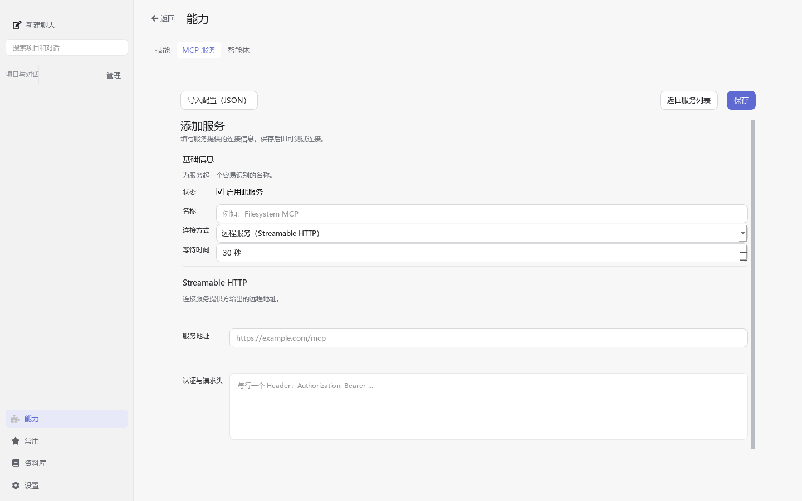
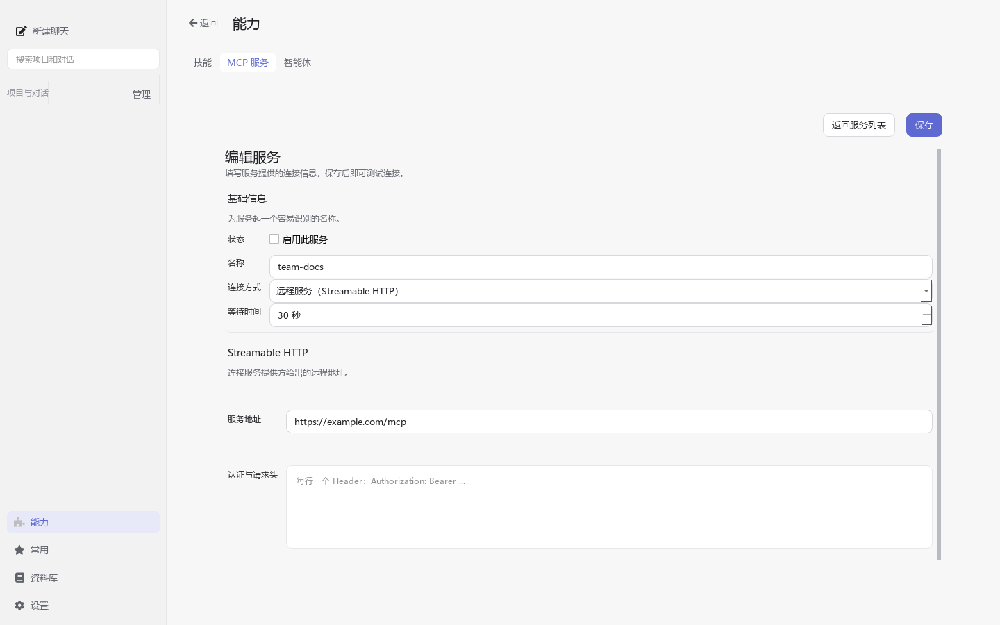
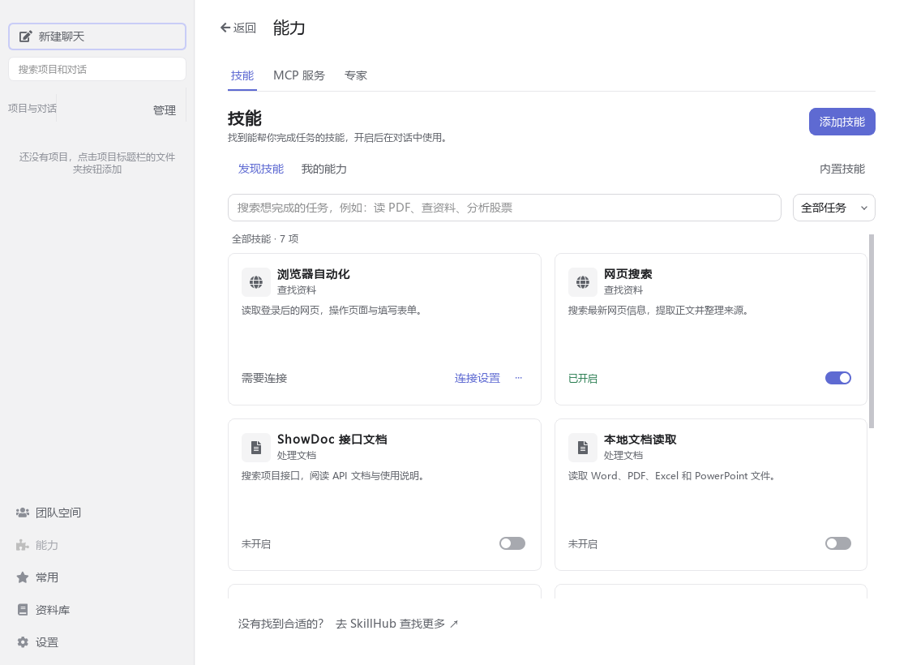
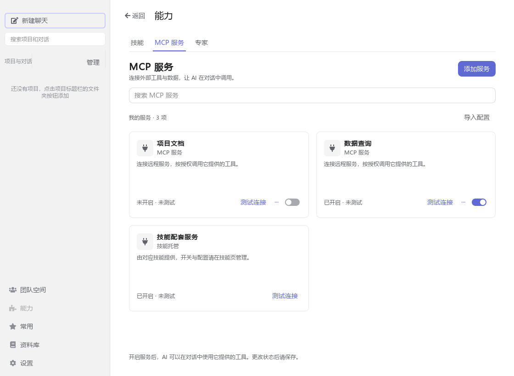
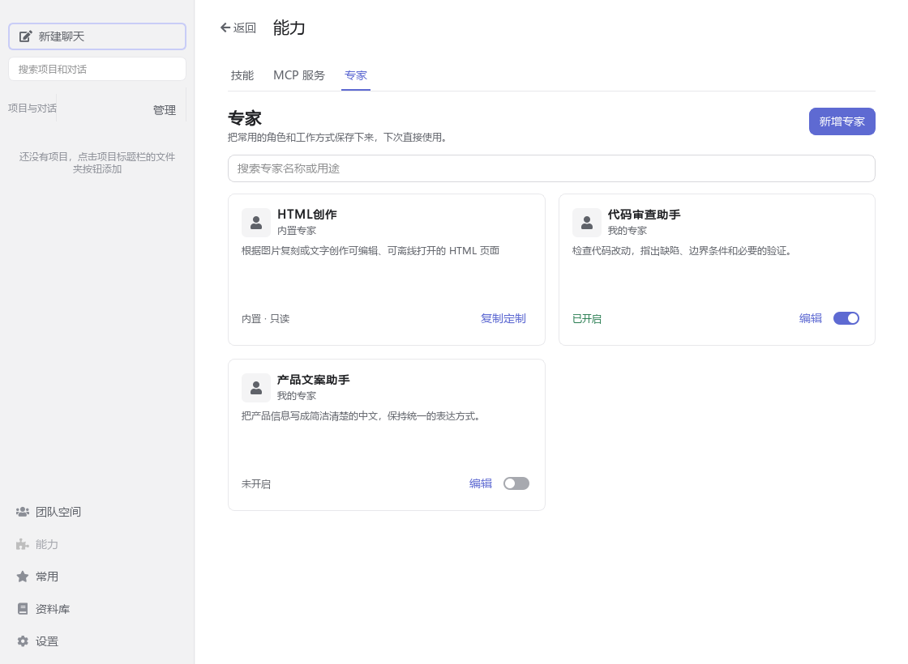
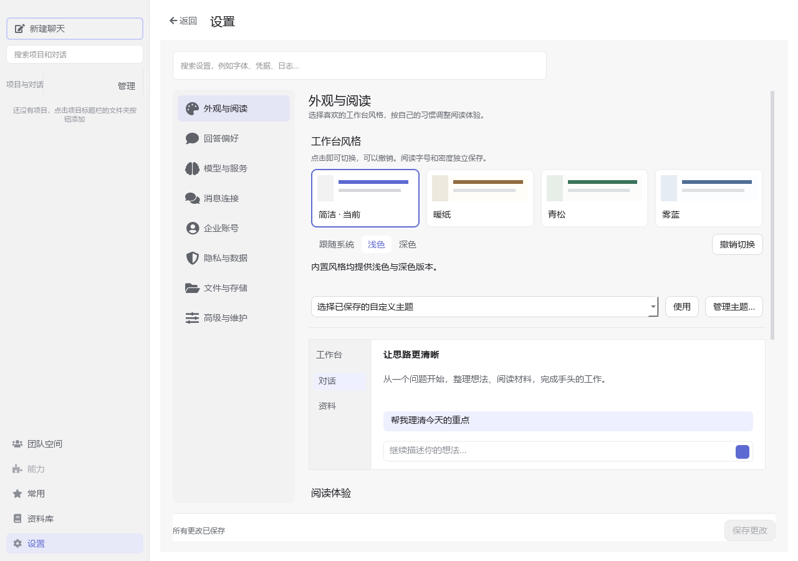
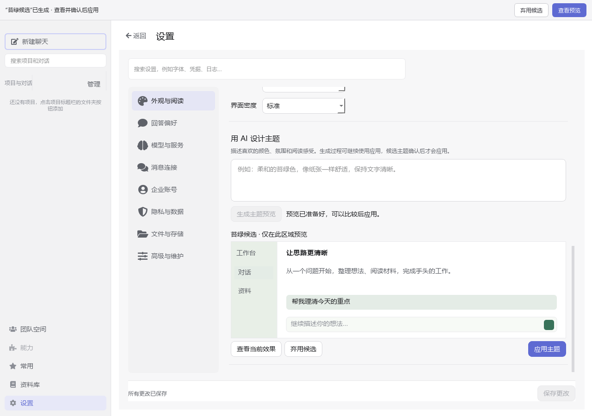
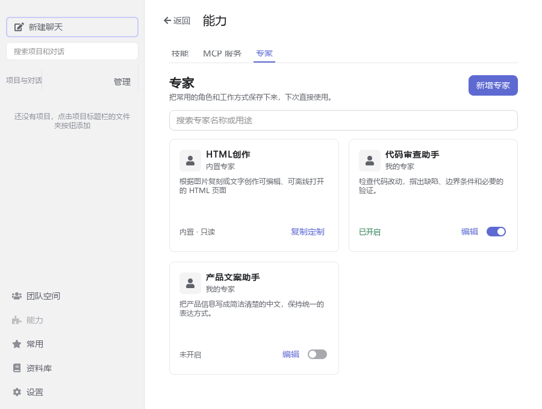

# 设置、能力与项目管理

适用版本：**5.3.0**

## 能力

顶部依次为“技能、MCP 服务、专家”，三页使用相同的卡片：上方显示名称、来源与用途，下方显示状态和操作。卡片随窗口宽度自动排列为一到四列。

技能页以“发现技能 / 我的能力”为常用入口，可搜索任务或从“全部任务”下拉菜单筛选场景；底部“去 SkillHub 查找更多”进入在线目录，保留分类、排序、版本选择、安装与刷新功能。

- **内置技能**：在右上角进入，采用与技能列表相同的卡片，支持搜索和查看详情。内置内容只读，不出现在个人技能维护列表中。
- **我的能力**：管理自己安装或导入的技能。右上角“添加技能”沿用原有导入流程。“开发与诊断”不再作为首页入口。
- **MCP 服务**：点击卡片名称编辑连接，直接点击“测试连接”检查当前配置；卡片的“···”菜单提供编辑、删除和测试详情。列表上方与“添加服务”页均保留导入 JSON 入口。新服务默认显示 Streamable HTTP；导入时根据连接类型和 URL 自动选择对应表单，本地命令仍使用 stdio。已开启不代表测试成功；测试结果绑定被检查的服务及配置，配置变化后显示“未测试”。由技能托管的服务需在对应技能中修改，卡片不提供独立开关或删除操作。
- **专家**：浏览名称、用途和状态，点击名称查看详情；自建专家可直接编辑或切换启用状态，进入编辑页后可复制、删除。内置专家只读，可点击“复制定制”创建自己的版本，不写入自建专家配置。通过对话底部“专家”或 `@ → 选择专家` 使用，选择会持续作用于本会话的后续消息。

MCP 和自建专家的卡片开关属于待保存修改，页面出现统一的保存与放弃操作；离开时仍可选择保存、放弃或继续编辑。技能卡片开关沿用立即保存规则。所有开关同时显示文字状态，并支持键盘操作。

MCP 编辑页的返回和保存固定在表单上方。页面顶部返回优先退出当前编辑层级。没有修改时直接返回；有修改时选择保存、放弃或继续编辑，保存失败保留输入。

在添加页导入 JSON 后，会打开本次导入的首个可编辑服务，直接检查服务地址和认证信息；多个服务会一并加入待保存列表，点击“保存”后生效。JSON 格式有误时保留原文供修改；取消导入保留已填写的表单。包含 URL、没有本地启动命令且曾被误识别为 stdio 的配置会恢复为 Streamable HTTP。

以上卡片截图使用隔离的示例数据。小窗口、显示缩放、编辑返回及主题预览检查见[能力卡片验证](screenshots/capability-cards/README.md)。

## 项目与对话

侧栏标题旁的“管理”菜单包含完整管理页、添加项目及原有整理、排序操作。完整管理页有“项目、对话、记忆、归档”四个页面。

项目和对话列表双击或按 Enter 打开，右键使用原有管理菜单；完整路径可通过悬停查看。项目菜单也可以直接进入项目记忆。

置顶的项目和对话集中显示在侧栏“置顶”区域。置顶不改变所属项目、文件路径或历史数据；取消置顶后回到原分组，并按当前排序规则排列。项目下单独置顶的对话在普通分组中不重复显示。

侧栏“搜索项目和对话”支持项目名、对话标题、消息正文及思考内容中的连续片段，包括中文单字、双字和英文片段。首次使用时在后台建立本地索引，后续随消息增删改自动维护。搜索期间可以继续输入，列表只接收最新关键词的结果；按 Enter 可重新搜索，清空输入恢复原浏览范围。

搜索结果每次显示 50 项，通过“显示更多结果”继续查看。没有返回结果时显示“没有匹配的项目或对话”，保留搜索词，不额外弹出搜索失败提示。性能测量、截图和验证边界见[侧栏搜索验证](screenshots/history-search/README.md)。

## 设置与保存

设置采用八个侧栏入口：外观与阅读、回答偏好、模型与服务、消息连接、企业账号、隐私与数据、文件与存储、高级与维护。搜索名称或用途后按 Enter 进入对应页面，也能直接定位“凭据”“日志”等子页。窄窗口中导航收为下拉选择。记忆和归档仍在项目管理，MCP 和专家仍在能力。

“隐私与数据”包含数据安全、变量与凭据；“高级与维护”包含实验功能、组件与依赖、运行日志、更新与关于。原有菜单和快捷入口会定位到新的分类与子页。

“数据安全”按需启用并通过统一保存生效；企业账号与各资料库的登录由各自页面独立完成，详见[数据安全](data-security.md)和[资料库](knowledge_library.md)。

“企业账号”的[企业连接](enterprise-platform.md)用于企业统一认证和模型授权。企业客户端的更新入口打开中心下载页，再使用本地 ZIP 更新；未连接企业的普通客户端保持原更新流程。

换肤统一从“设置 → 外观与阅读”进入：风格卡片可立即切换简洁、暖纸、青松、雾蓝，也可选择已保存的自定义主题，并撤销上一次切换。阅读字体、字号和密度独立保存；切换风格不会覆盖正在编辑的阅读设置、回答偏好或聊天输入。

“用 AI 设计主题”复用普通对话流程，在独立的“主题设计”对话中运行。描述保留在输入框，可停止或查看过程；生成候选时只更新页面内的示例，比较后点击“应用主题”才改变整个应用。“弃用候选”保持当前主题。示例展示配色、阅读与背景，完整组件布局以实际应用效果为准。主题编辑器仍通过“管理主题…”进入，保留导入、导出、图片与高级编辑功能。

“实验功能”提供默认关闭的[超长上下文](long-context.md)。勾选启用后可选择 30 万（300k）或 100 万（1m）tokens，开启、关闭和切换长度均通过“保存设置”保存，也可撤销更改。页面显示已保存状态；未保存的开关或长度在离开时进入统一确认流程，保存失败保留选择。下次开始任务时使用新设置，当前运行保持启动时设置。

切换设置分类或子页会保留草稿，底部“保存更改”保存参与统一保存的设置；离开设置区域时，未保存内容进入确认流程。没有修改时隐藏“放弃更改”。保存失败保留输入，可修正后重试。实验功能、账号登录、凭据管理、安装、测试和启动等操作继续按各自页面的保存或执行边界处理；这些独立操作不会被取消编辑撤销。快捷换肤立即保存，主题候选预览则必须明确应用。

本轮浅色界面、缩放、换肤性能与回归范围见[设置界面验证](screenshots/settings-redesign/README.md)。

“更新与关于”只订阅应用级更新协调器。启动完成约 10 秒后提前检查并准备最新安装包；切换设置页面不会取消或重复下载。更新页按当前版本、状态、操作和本次更新排列，主操作随状态显示“检查更新”“立即更新”或“重试”。在线缓存只保留最新一份完整 ZIP；本地包支持同版本重装。安装前使用独立的任务停止与保存确认，普通退出保留后台任务的规则不变。详细流程见[用户指南](user-guide.md#25-更新应用和下载日志)，缩放和主题截图见[更新界面验证](guides/update-ui/README.md)。

## 常用操作与失败恢复

- “完全访问”（上帝模式）位于输入区域底部；悬停说明勾选后可直接修改文件、执行代码，且所有对话复用。开启或关闭立即保存，只影响之后启动的任务。
- SkillHub 列表可使用缓存；打开详情会获取最新发布信息。默认版本取 `latestVersion`，安装前再次核对，版本变化时提示重新选择。“刷新 SkillHub”主动更新列表。
- “我的能力 → 管理 → 修改名称”支持中文显示名称，技能标识及目录名保持不变；“沉淀为 Skill”也支持中文名称。
- 专家和 MCP 表单无修改时直接返回；有修改时选择保存、放弃或继续编辑。保存失败保留输入；放弃只恢复该能力的配置。
- 资料库连接、阅读与上传见[资料库](knowledge_library.md)，其中三种来源使用各自的授权方式。

## 资料库版本兼容

本轮对照 WeKnora 0.6.3、0.7.2、0.8.0 官方源码核对登录、刷新令牌和空间切换契约。切换空间通过服务端签发对应空间的令牌；旧任务引用仍保留原空间，切换后请求会明确要求切回再重试，避免用另一空间的令牌读取资料。旧版没有文档文件夹接口时，先核实资料库可访问，再显示全部资料并说明文件夹不可用。

源码依据：[0.6.3 登录接口](https://github.com/Tencent/WeKnora/blob/v0.6.3/internal/handler/auth.go)、[0.7.2 登录响应](https://github.com/Tencent/WeKnora/blob/v0.7.2/internal/handler/dto/auth.go)、[0.8.0 登录接口](https://github.com/Tencent/WeKnora/blob/v0.8.0/internal/handler/auth.go)、[SkillHub 下载接口](https://github.com/Tencent/skillhub/blob/main/docs/api/skills.md)。未连接三个版本的完整部署环境验证，不能将接口适配视为全部功能联调通过。

## 历史验证范围（管理界面实现阶段）

前一轮进行了管理行为及普通/小窗口离屏截图检查。最新反馈修订进行了语法检查及 15 项针对性检查（5 项技能/缓存、8 项管理行为、2 项资料库身份与令牌），均通过。按用户要求未重新编译、打包或运行完整产品测试；该阶段旧截图已由用户指南同场景截图替代；此处保留原验证边界，不表示本次重新运行了界面测试。未完成打包后的 Windows 原生交互、125%/150% 显示缩放和全部外部服务联调；这些项目留待编译后的产品实测，不作为已通过项目。
## 企业账号与资料库登录

“设置 → 企业账号”用于中心平台登录；各资料库管理自身账号，Skill/MCP 使用自己的配置。桌面统一资料服务连接已移除，不再分发连接模板。原独立登录保持有效；旧统一连接用户需重新配置，见[升级说明](account-connections.md)。

专家卡片与 HTML 创作入口示例：

