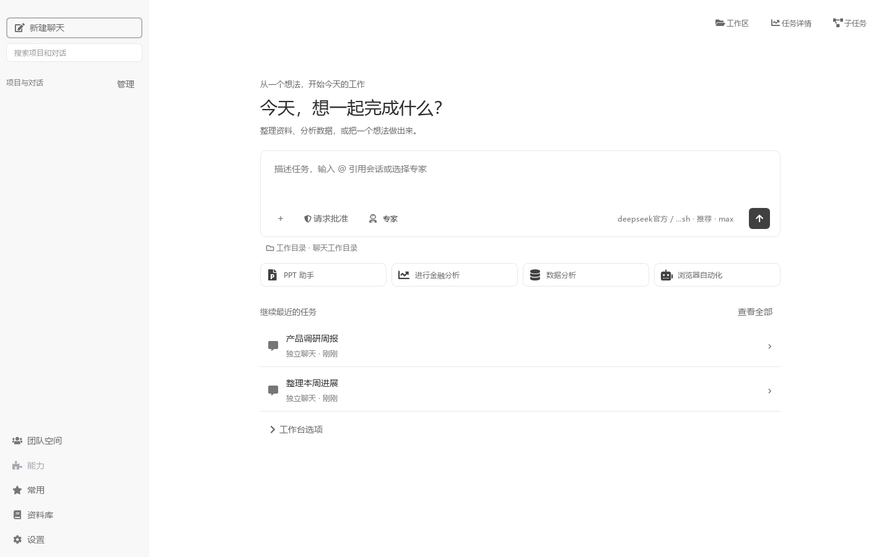
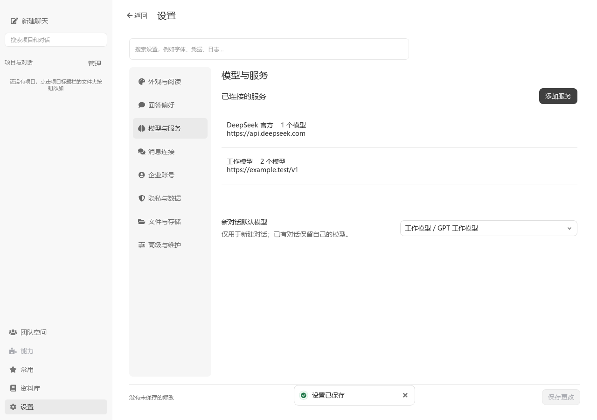
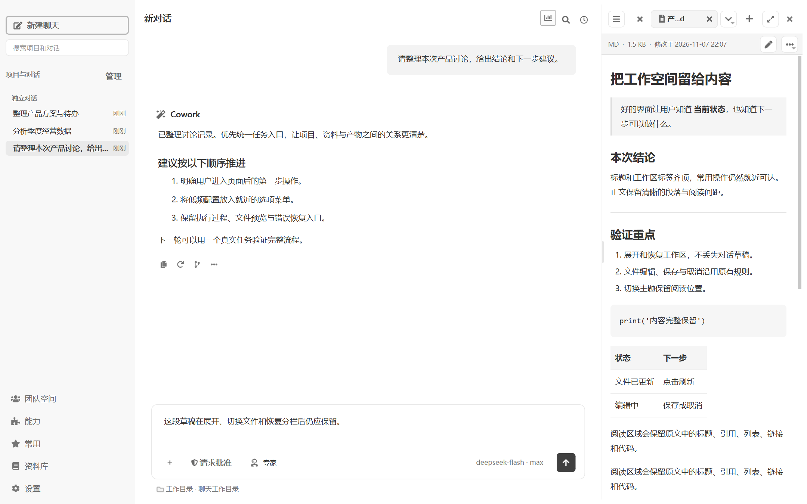
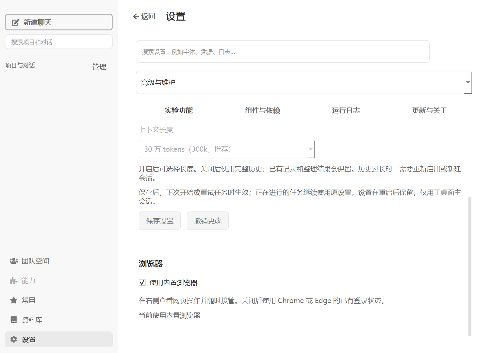
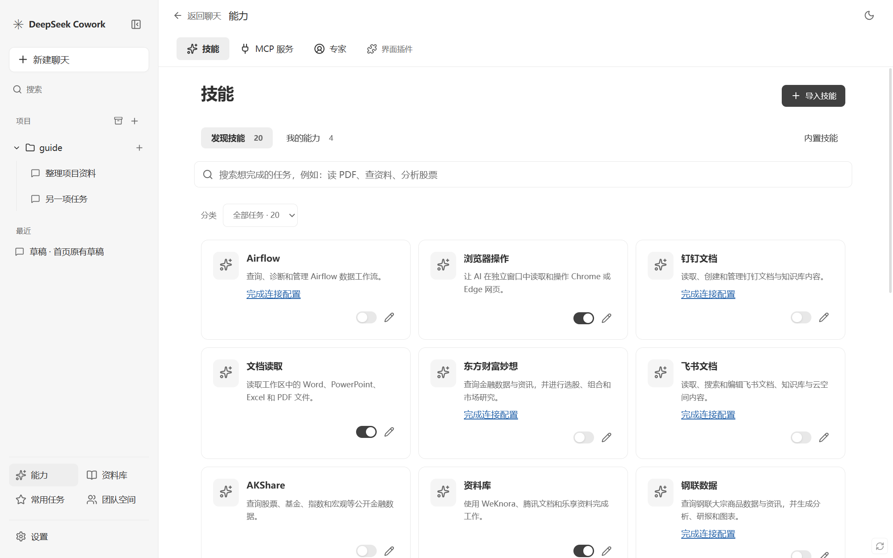
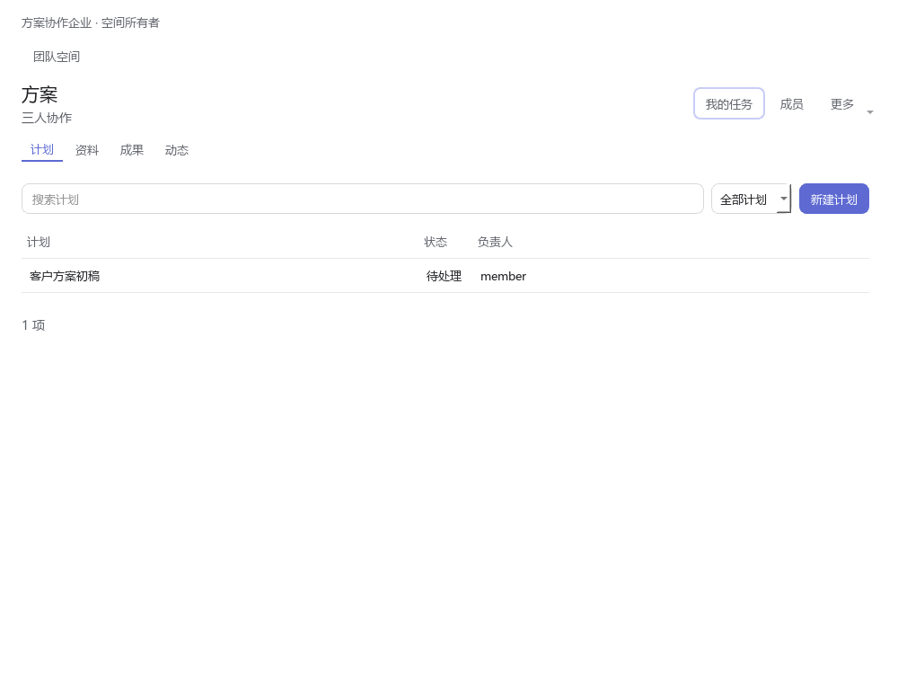
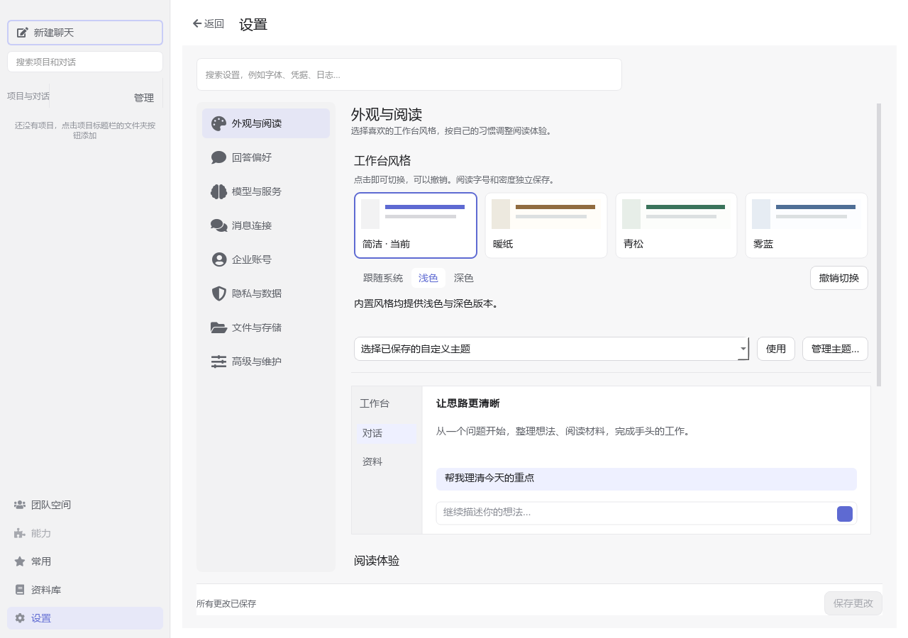

# DeepSeek Cowork 用户手册

文档适用版本：**5.3.3**

从配置模型、完成第一项任务，到处理文件、使用资料库和复用工作流程。安装与源码启动见[项目首页](../README_CN.md)，平台部署见[企业平台说明](../web/platform/README.md)。

## 目录

- [开始第一项任务](#开始第一项任务)
- [配置模型与服务](#配置模型与服务)
- [组织项目与对话](#组织项目与对话)
- [发送消息与控制任务](#发送消息与控制任务)
- [查看执行过程与子任务](#查看执行过程与子任务)
- [使用工作区与文件](#使用工作区与文件)
- [制作文档和演示](#制作文档和演示)
- [管理技能连接器与专家](#管理技能连接器与专家)
- [使用资料库](#使用资料库)
- [企业账号与团队空间](#企业账号与团队空间)
- [常用任务与消息连接](#常用任务与消息连接)
- [个性化与设置](#个性化与设置)
- [应用更新与记录导出](#应用更新与记录导出)
- [常用快捷操作](#常用快捷操作)

## 开始第一项任务

1. 从项目发布页下载 Windows ZIP，完整解压后运行 `deepseek-cowork.exe`。
2. 在首次启动的“快速启用 DeepSeek”中填写 API Key，完成验证与模型同步；也可稍后到设置中添加服务。
3. 点击“新建聊天”，输入一个明确要求，例如“把以下讨论整理成结论和待办”，再粘贴内容或添加文件。
4. 核对输入区的模型、专家、权限和工作目录，发送要求。
5. 阅读最终回答，打开生成文件，继续补充修改要求。

首页提供快捷入口与最近任务；开始对话后，输入区固定在底部。切换对话时可以继续各自的草稿。

## 配置模型与服务

从“设置 → 模型与服务”进入服务总览。聊天输入区的模型菜单也提供“配置新模型”入口。

1. 点击“添加服务”，选择“账号登录”或“填写 API Key”。
2. 账号登录方式先填写 sub2api / New API 站点地址并识别站点，再输入账号信息；按站点提示完成验证码步骤。
3. 勾选账号中的密钥，点击“获取所选密钥的模型”；需要新密钥时使用“创建 Cowork 专用密钥”。API Key 方式直接填写服务地址与密钥。
4. 勾选模型并点击“添加所选模型”，或在服务详情中手动添加模型。
5. 在模型行编辑协议、图片能力、推理档位及高级参数，点击“测试当前配置”。
6. 选择“新对话默认模型”，点击“保存更改”。从聊天进入配置时，可使用“返回对话并使用”切回原会话。

服务详情可按密钥或分组查看模型，提供编辑、测试和批量操作；连接信息在“编辑连接”中维护。测试与保存是两个独立动作，切换服务和设置分类时保留设置草稿。

## 组织项目与对话

独立聊天使用自己的文件目录。处理已有项目时，在空对话输入框下方选择项目，或通过侧栏“管理 → 添加项目”登记目录。

侧栏按项目和独立聊天组织记录。点击标题或聚焦后按 `F2` 改名，`Enter` 保存，`Esc` 取消；右键菜单提供置顶、整理和归档等操作。完整管理页集中管理项目、对话、记忆和归档。

“搜索项目和对话”可查找项目名、标题及历史内容。输入关键词后选择结果，通过“显示更多结果”继续浏览。对话内使用 `Ctrl+F` 搜索，或点击时钟图标打开“历史提问”，定位到要阅读的提问。

在输入区“+ → 对话”或 `@` 选择器中添加其他对话作为参考。发送后，引用标签可查看发送时的引用内容，并提供打开来源对话的入口。

## 发送消息与控制任务

### 添加上下文

“+”菜单提供文件、资料、模式、专家、技能、连接器和对话入口。文件可从资源管理器拖入或粘贴，剪贴板图片也可以直接粘贴。输入区直接显示已选的对话、附件、能力和资料名称，可逐项移除。标签同时带类型文字与图标；默认用灰蓝区分对话、灰紫区分技能和连接器、青绿区分资料，附件保持中性灰，颜色随主题适配。

长文本粘贴会按输入区规则转换成文本附件。任务要求尽量写明目标、来源、输出形式和保存位置，例如：

> 阅读这两份方案，按成本、实施时间和维护工作量比较，先给建议，再把对比表保存到当前工作目录。

### 选择执行授权

点击输入区的权限入口，选择“请求批准”或“完全访问（上帝模式）”。请求批准模式下，涉及许可的动作会显示审批卡；展开详情核对动作后作出选择。权限设置作为之后启动任务的默认值。

需要先讨论任务时，在“+ → 模式”选择拷问模式，回答问题并检查阶段总结，然后明确选择开始执行或继续讨论。

### 补充、停止与编辑

任务运行时可以继续输入和发送补充要求。输入区有待发送内容时主按钮用于发送补充，没有内容时用于停止；编辑补充期间，“+”菜单仍可停止当前任务。

鼠标移到已发送的提问上可编辑或复制。编辑时可点击“添加附件”，也可拖入或粘贴文件、图片，并逐项移除附件；粘贴长文本会沿用聊天框规则转为 TXT 附件。编辑内容与底部输入框的草稿独立，取消不改变原消息，保存失败会保留当前编辑内容。

编辑后使用“保存并重新生成”（`Ctrl+Enter`），按确认窗口说明处理后续对话；`Esc` 取消编辑。回答末尾提供复制、重新生成、分支和更多操作。

### 回答问卷

AI 提问时，在对话内逐题选择选项或填写其他回答，再点击统一的“提交回答”。提交后可通过“已提交 N 项回答 · 查看”阅读回执。推荐项的预选状态仍可修改。

## 查看执行过程与子任务

在回答中展开执行过程，阅读“深度思考”、阶段说明和工具记录；点击工具详情查看参数与结果。工具记录中的文件路径可直接打开对应文件。

5.3.3 的右上角提供三个入口：

| 入口 | 用途 |
| --- | --- |
| 工作区 | 文件、网页、终端和写作页面 |
| 任务详情 | 执行上下文、调用记录与技术详情 |
| 子任务 | 独立子会话、进展和任务操作 |

“执行上下文”展示当前会话的项目、资料、专家、能力和工作目录，展开完整内容后可复制原文；调用记录用于定位某一次工具调用。

在子任务列表选择任务后，可以阅读其独立对话，在“发送给：任务名称”输入框追加要求，使用“停止本轮”或“继续处理”控制工作。“加载更早消息”读取历史，“查看运行详情”展开事件。

点击“用量”查看当前会话的模型用量、缓存输入与上下文组成，展开详情可复制统计。

## 使用工作区与文件

### 查找和预览

1. 打开右侧“工作区”，点击目录按钮，在“交付物”或“工作区文件”中查找文件。
2. 按名称搜索，使用类型和排序筛选，点击文件打开标签。
3. 使用文件菜单打开系统应用、显示资源管理器位置或复制路径。
4. 文件内容发生变化时，点击预览区的“刷新”加载新版。

文件、网页和终端共用标签栏。右上角展开按钮可以扩大工作区；展开后点击固定的“对话”标签回到完整消息区，再恢复分栏。

### 编辑并保存

文件提供编辑入口时，点击铅笔进入编辑，修改后保存或另存。离开未保存内容时，按提示选择保存、放弃或取消。

HTML 提供“编辑内容”和“编辑源码”；内容编辑用于修改页面文字与排版，源码入口用于修改完整 HTML 及关联资源。Word 的文字与修订视图可选择正文、脚注或尾注，打开修订面板逐项接受或拒绝修订，再保存文件。

### 新建写作页

点击标签栏“+ → 新增页面”，填写标题和正文。工具栏提供标题、加粗和斜体，更多菜单包含列表、链接、撤销与重做。点击“保存”或按 `Ctrl+S`，首次填写文件名，确认所属工作目录后保存为 Markdown。

写作页面可随会话继续编辑；已保存文件再次打开后继续使用写作页。需要查看源码时，从更多菜单进入预览与源码编辑。

### 网页与终端

新标签页可以输入网址、搜索词，或打开 Git Bash、PowerShell 终端。网页工具栏提供导航、查找、缩放、下载及外部打开。

可以直接要求 AI“分析右侧打开的网页”或“检查当前终端结果”。发送时会附带当前聊天的标签状态，AI 再按任务读取内容。

网页使用“接管”，终端使用“接管终端”切换操作方；终端右键菜单还提供“停止当前命令”和“接管并停止当前命令”。终端支持选择复制、粘贴、命令历史和字号调整。

### 浏览器自动化

默认使用内置浏览器，在右侧网页标签查看操作过程并随时接管；已有明确的浏览器选择会保留。在“设置 → 高级与维护 → 实验功能”关闭“使用内置浏览器”，可使用 Chrome 或 Edge 中已有的登录状态。外部浏览器首次连接按页面指引完成，之后应用会在开始任务时检查连接并准备配套更新。

浏览器暂时无法操作时，本轮会结束并保留已有内容，点击“继续任务”重新检查连接并继续未完成的工作。已完成的操作应先核实，不重复执行。点击停止会终止后续执行，浏览器的后台恢复不妨碍继续聊天。

切换浏览器时，正在进行的任务会先完成，可从状态旁的“查看任务”进入对应聊天。已结束任务由应用自动处理；恢复未成功时，打开使用过的浏览器后点击“重试连接”，或取消切换。技术原因收在“详情”中。页面只在修改选项或连接失败时显示相应的保存、重试操作。

## 制作文档和演示

### Word 与 PDF

先提供源资料、读者、篇幅和格式要求。可以让 AI 直接生成文件，也可以从回答末尾“生成办公稿”开始，检查工作稿后通过“生成文件…”导出 DOCX 或 PDF，再打开最终文件阅读。

### PPT 助手

从首页快捷入口或助手选择入口打开 PPT 助手，填写受众、汇报目的、页数和素材。选择 PPTX 时添加模板原文件，选择 HTML 演示时说明页面比例和风格。完成后逐页检查并继续修改。

### 语音转文字

在组件设置准备语音转文字组件或配置相应服务，再添加录音并提出转写要求。可以同时要求整理说话人、摘要和待办，检查结果后保存为文件。

## 管理技能连接器与专家

能力页分为“技能、MCP 服务、专家”。

### 技能与 SkillHub

在“发现技能”按任务搜索或筛选能力，查看用途并开启。底部的 SkillHub 入口提供在线目录、版本详情和安装；安装后到“我的能力”配置并开启。

“添加技能”用于导入本地技能，技能详情提供更新、导出和删除。输入区“+ → 技能”可显式选择本会话使用的能力。

### MCP 服务

添加服务时选择 Streamable HTTP 或 stdio，填写服务地址或启动命令，也可导入 JSON。检查认证信息，保存后使用“测试连接”。输入区将 MCP 称为“连接器”，可从“+ → 连接器”选择。

### 专家、记忆与经验

在专家页查看角色和用途，可创建专家或复制已有专家进行定制。通过输入区的“专家”或 `@` 选择后，继续在当前会话中使用。

全局与项目记忆在“管理 → 记忆”维护。任务形成可复用方法后，在回答的“更多 → 沉淀为 Skill”中选择会话范围，检查复用分析，选择创建、合并指导或追加经验，再确认保存技能草稿。

## 使用资料库

### 连接来源

打开侧栏“资料库”，选择来源并连接：

| 来源 | 连接步骤 |
| --- | --- |
| WeKnora | 填写服务地址、邮箱和密码，连接后选择工作空间 |
| 腾讯文档 | 打开授权页面，用 QQ 或微信完成授权，返回点击“已完成授权” |
| 乐享知识库 | 从官方配置页取得企业标识和 Token，填写后连接 |

左下角“账号与设置”管理当前来源的账号和工作空间。

### 阅读与引用

选择目录或搜索资料，点击条目阅读。单份资料使用“和 Agent 一起用”，多份资料勾选后使用“添加到…”，选择当前对话、新对话或项目。回到输入区核对资料标签，再发送任务。悬停可查看完整名称和来源，点击标签打开本对话的资料管理浮层；取消保留原选择，应用后从下一次提交生效。点击资料标签的“×”可直接移除，并通过提示中的“撤销”恢复；已有新的资料调整时，不覆盖新选择。

资料标签表示本对话选择的资料范围，不代表 AI 已经读取或在回答中引用了它。调整资料不改变已发送的消息或正在运行的任务。

### 保存成果

从本地文件或交付物选择“保存到资料库…”，核对文件、来源、资料库和文件夹后上传。在“上传记录”查看提交与解析状态，在目标目录打开文件确认结果。

## 企业账号与团队空间

### 登录企业

企业客户端在“设置 → 企业账号”提供“登录企业账号”。在打开的认证页面完成登录后返回客户端，刷新模型并从聊天模型菜单选择企业分配的模型。

平台管理员通过网页维护成员和模型授权，部署及管理操作见[企业平台说明](../web/platform/README.md)。

### 共同完成任务

1. 打开“团队空间”，创建空间并邀请同事，或接受已有邀请。
2. 在“资料”上传文件，在“计划”填写分工、负责人、优先级和所选资料版本。
3. 打开计划，点击“在本机开始任务”，选择任务目录、模型和技能，填写本次目标。
4. 在原有对话界面完成工作；从空间的“我的任务”回到对应本机任务。
5. 点击“选择内容发布为成果”，检查要分享的文字、说明、文件和关联计划，再确认发布。
6. 在计划详情填写完成说明，并关联成果版本。成员通过留言继续讨论。

空间的“计划、资料、成果、动态”分别组织分工、共享文件、发布内容和协作动态；空间设置、成员管理和归档在更多菜单中。

## 常用任务与消息连接

### 保存常用任务

打开“常用 → 新建常用”，填写名称、任务内容、能力和执行位置，保存后点击“开始”。需要自动执行时展开定时设置，选择日期、周期或 Cron，并保存启用。

“立即运行计划”用于按计划路径启动；“运行历史”集中查看任务及消息投递状态。点击名称编辑内容，行末更多菜单提供历史和删除操作。

### 连接消息渠道

在“设置 → 消息连接”选择飞书、钉钉、企业微信、QQ 或微信。扫码渠道按手机提示确认，表单渠道填写对应连接信息并启动。

常用计划需要发送结果时，启用“发送到企业消息”，生成并复制完整绑定消息，在目标聊天中发送，再使用“立即运行计划”检查投递。

## 个性化与设置

设置侧栏集中提供外观与阅读、回答偏好、模型与服务、消息连接、企业账号、隐私与数据、文件与存储、高级与维护。可以搜索设置名称或用途，按 Enter 定位。表单修改按页面的“保存更改”提交。

### 外观与 AI 主题

在“外观与阅读”选择简洁、暖纸、青松、雾蓝或已保存的自定义主题，调整字体、字号和密度。“管理主题…”提供导入、导出、图片及高级编辑。

“用 AI 设计主题”打开主题设计对话。说明颜色、阅读和布局偏好，比较页面内候选，选择“应用主题”或“弃用候选”。

### Visualize

在技能页开启 Visualize，在对话中说明要比较的方案、可调条件和希望看到的结果。生成后使用视图中的筛选器、按钮或参数控件继续探索，也可以要求 AI 调整内容。

### 数据安全与凭据

在“隐私与数据”打开数据安全设置，选择需要的风险检查、凭证提醒或文本令牌化功能；令牌化还需选择数据类别，随后保存。

变量与凭据在同一区域维护。填写变量名称和值，敏感项按页面选项设置是否允许 AI 读取。

### 超长上下文与极简启动

在“高级与维护 → 实验功能”启用超长上下文，选择 300k 或 1m 档位并保存。在用量浮窗查看当前工作集与累计用量。

DeepSeek 官方服务的极简启动在模型编辑页“高级设置”中管理。修改模型配置后保存，再开始新任务。

## 应用更新与记录导出

应用会后台检查更新。安装包准备完成后，可从侧栏“重启并更新”进入安装流程，也可到“设置 → 高级与维护 → 更新与关于”检查更新或选择本地安装包。安装前按提示处理正在运行的任务与未保存内容。

“高级与维护 → 组件与依赖”用于查看组件状态、检测和准备所需组件。

运行日志在“高级与维护 → 运行日志”查看，按时间、来源或关键词筛选，通过“导出日志…”保存 TXT。对话更多菜单可以下载或复制聊天记录；任务详情中的请求记录可用于查看或导出最近一次 AI 请求。

## 常用快捷操作

| 操作 | 方式 |
| --- | --- |
| 当前对话搜索 | `Ctrl+F`，`Enter / Shift+Enter` 切换命中，`Esc` 关闭 |
| 修改对话标题 | 点击标题或聚焦后按 `F2`，`Enter` 保存、`Esc` 取消 |
| 历史提问编辑 | 悬停提问后点击编辑，`Ctrl+Enter` 保存并重新生成 |
| 添加引用或专家 | 输入 `@` 或打开输入区“+”菜单 |
| 保存写作页 | `Ctrl+S` |
| 网页缩放 | `Ctrl++`、`Ctrl+-`、`Ctrl+0` |
| 终端复制与粘贴 | `Ctrl+Shift+C`、`Ctrl+Shift+V`，或右键菜单 |

架构、能力开发和构建命令见[技术文档](technical-design.md)，版本变化见[发布记录](releases/index.md)。
