# DeepSeek Cowork 用户手册

文档适用版本：**5.4.3**

你可以把 DeepSeek Cowork 当作一个能读资料、跑代码、改文件的桌面搭档：**你交代目标并提供参考资料，它在本地执行任务，你随时跟进过程，最后在右侧工作区检查、修改并保存成果。**

本手册按这套真实工作顺序编排，不需要先把所有设置看懂才能开始：

- **一、快速上手**：[开始第一项任务](#开始第一项任务) · [认识工作台](#认识工作台) · [配置模型与服务](#配置模型与服务)
- **二、日常对话与任务跟进**：[组织项目与对话](#组织项目与对话) · [发送消息与控制任务](#发送消息与控制任务) · [查看执行过程与子任务](#查看执行过程与子任务)
- **三、查看文件与制作成果**：[使用工作区与文件](#使用工作区与文件) · [制作文档和演示](#制作文档和演示) · [使用多媒体](#使用多媒体) · [使用资料库](#使用资料库)
- **四、扩展能力与自动化**：[管理技能、连接器与专家](#管理技能连接器与专家) · [常用任务与消息连接](#常用任务与消息连接) · [企业账号与团队空间](#企业账号与团队空间)
- **五、个性化、更新与排障**：[个性化与设置](#个性化与设置) · [应用更新与记录导出](#应用更新与记录导出) · [常用快捷操作](#常用快捷操作) · [Mac 与统信的功能范围](#mac-与统信的功能范围)

升级用户可先看 [5.4.3 版本说明](releases/5.4.3.md)；源码运行与构建见[项目首页](../README_CN.md)，企业服务端安装见[部署指南](enterprise/deployment.md)。

---

## 开始第一项任务

第一次打开应用，只需要走通“配好模型 → 发一个具体任务 → 查看生成的文件”三步；技能、定时任务和界面定制都可以后面按需再开。

1. **解压并启动**：将下载的 Windows 发行压缩包完整解压，打开解压后的 `Cowork` 文件夹，双击 `deepseek-cowork.exe`（请保持文件夹内所有文件原位，不要把 `exe` 单独拖到桌面；若系统提示路径过长，换一个层级较浅的目录解压即可）。
2. **连接模型**：打开左下角“设置 → 模型与服务”添加 API Key 或登录模型站点；如果你所在团队部署了企业版，也可以到“设置 → 企业账号”[登录企业账号](enterprise/employee-guide.md#登录企业)直接使用分配好的模型。详细步骤见[配置模型与服务](#配置模型与服务)。
3. **新建对话并选目录**：点击左上角“新建聊天”。如果要处理电脑里某个现成文件夹，在输入框下方选择或新建项目；只是临时处理一份文件时不用选，系统会为这条聊天准备独立的工作目录。
4. **添加资料并说清目标**：把参考文件拖进输入框（或点左下角“+ → 添加文件”），像交代同事一样写明**要参考什么、按什么口径处理、输出什么格式**。例如：

   > 阅读这两份方案，按成本、实施周期和后期维护工作量做对比。先在对话里给出选型建议，再把对比表保存成 Excel 放到当前工作目录。

5. **检查成果并继续微调**：消息发出后可以实时看它的处理步骤。回答里出现生成的文件时，点击文件名就能在右侧工作区打开预览或直接修改；哪里不满意，接着发消息补充要求即可。

> **不用担心草稿丢失**：还没发出去的文字和附件会自动保存在本机。此时点“新建聊天”会把草稿带过去；切换到其他旧对话再切回来，各自的输入内容都会原样保留；万一网络波动导致发送失败，写好的内容也不会被清空。

---

## 认识工作台

主界面分为左、中、右三栏：**左侧侧栏**管理项目与历史对话，**中间对话区**用来提问和查看执行过程，**右侧工作区**用来阅读和编辑文件、打开内置网页、运行终端或查看详细任务记录。

每次启动应用默认进入新聊天首页。输入框下方可以直接切换项目，也提供“金融分析”“数据分析”“浏览器自动化”和“创造模式”快捷入口。界面打开后会在后台自动加载技能列表，加载期间技能菜单会显示读取提示，不影响直接打字聊天。

| 你想做什么 | 入口在哪里 |
| --- | --- |
| 搜索历史对话、项目或快捷操作 | 侧栏品牌旁的放大镜，或按 `Ctrl+K` |
| 查看有哪些聊天正在后台运行 | 侧栏品牌旁的铃铛图标（收起侧栏后位于窗口右上角） |
| 附加文件、引用资料、选用技能或插入变量 | 聊天输入框左下角的“+”按钮 |
| 切换执行权限、专家角色或对话模型 | 聊天输入框底部工具栏 |
| 打开文件、网页、终端或查看任务详情 | 对话右上角的分栏图标（工作区），或直接点击回答里的文件名 |
| 查看 Token 消耗速度与上下文占用 | 对话右上角的柱状图图标（用量统计） |
| 管理技能、整理资料库、设常用任务、进团队空间 | 侧栏底部的“能力 / 资料库 / 常用任务 / 团队空间” |
| 修改模型、连接渠道、调整外观或检查更新 | 侧栏最底部的“设置” |

- **自由调整布局**：进入设置或管理页后，点左上角“返回聊天”即可回到刚才的对话。侧栏和右侧工作区的分隔线都可以用鼠标拖动调宽，也可以在聚焦分隔线后用左右方向键微调、按 `Home` 恢复默认宽度。
- **收起窗口与彻底退出**：窗口顶部保留“文件 / 编辑 / 视图 / 帮助”菜单，空白标题栏可拖动窗口。**点击右上角“×”只是把窗口收起到系统托盘，后台正在跑的任务不会中断**；如果要彻底关闭软件，请点顶部菜单“文件 → 退出应用”，或右键系统托盘图标选择“退出应用”（退出前会自动保存草稿并停止运行中的任务）。
- **开箱即用的本地环境**：Windows 完整安装包已内置 Python 及常用的文档、数据分析运行库，无需自己在电脑上装 Python 或 Node.js。预览 Word 和 PPT 页面时优先使用你电脑上已有的 Microsoft Office 或 WPS，没装办公软件时也可按提示一键安装独立运行的 LibreOffice。

---

## 配置模型与服务

打开“设置 → 模型与服务”（或在聊天输入框右下角点开模型列表，点底部的“管理对话模型”）。已配置的服务会分组展示，当前默认模型带有勾选标记；点服务右侧的铅笔图标可以编辑，点“⋯ → 删除服务”可以移除整组配置。

### 添加模型服务的两种方式

1. **填写 API Key（最常用）**：
   - 点击右上角“填写 API Key”，输入服务名称、服务类型（`OpenAI 兼容` 或 `Anthropic`）、接口地址（如 `https://api.deepseek.com`）和 API Key。
   - 点击“获取模型”自动拉取列表，勾选需要的模型后点“添加 N 个模型”（也可以点“手动添加”自己填模型标识）。
   - 按需调整每个模型的接口协议（`Chat Completions`、`Responses` 或 `Anthropic Messages`）、默认推理深度、是否“支持图片输入”或“支持工具调用”，展开“上下文与生成设置”可设上下文上限、最大输出与温度。
   - 点“测试当前配置”验证连通性，最后点击右下角**“保存服务”**生效。
2. **账号登录（适用于 sub2api / New API 聚合站点）**：
   - 点击右上角“账号登录”，填入站点地址识别后输入账号密码（如有验证码按提示完成）。
   - 勾选已有令牌并点击“获取所选密钥的模型”，或者直接点“创建 DeepSeek Cowork 专用密钥”，选好模型后保存即可。

保存服务后，在模型列表中点击某个模型右侧的**“使用”**，即可将它设为新对话的默认模型；每条已有对话也可以在自己的输入框右下角单独切换模型和推理深度。

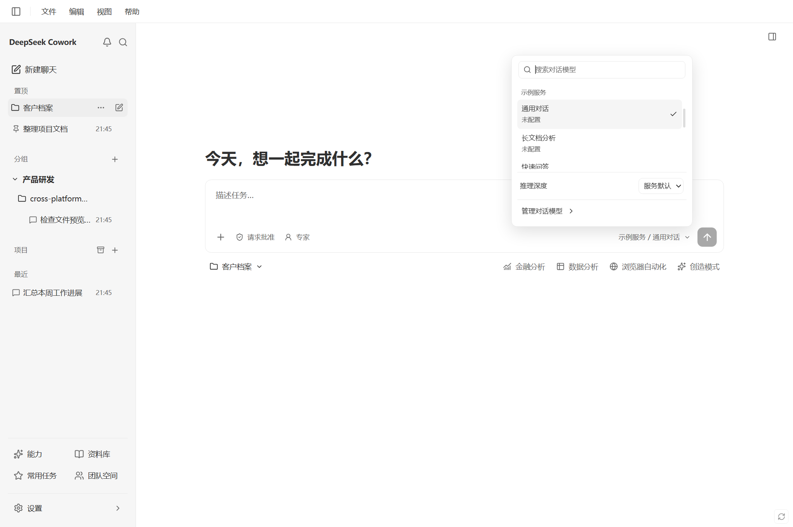

> **图片能力与删除说明**：
> - 让聊天模型直接看图（例如截图问答）时，需在该模型配置中勾选“支持图片输入”。主聊天模型的原生生图开关目前已停用；如果要生成或编辑图片、生成视频，请前往[使用多媒体](#使用多媒体)单独绑定图片/视频模型。
> - 删除模型服务只会清除本机保存的配置与密钥，**不会去云端注销你的 API Key，也不会删除已有的聊天记录和生成文件**。如果该服务同时被“多媒体”技能引用，删除前弹窗会明确提示影响范围；删除当前默认模型前需先指定替代的默认模型。

### 超长上下文与极简启动

- **长对话自动整理**：新装应用默认开启 `1M` 上下文目标。当长对话累积的内容快要接近模型窗口上限时，后台会自动把较早的对话整理成摘要检查点，完整历史记录仍原样保留在会话库中。你可以在对话右上角“用量统计 → 详情”里将下次目标改为 `300K`、`1M` 或 `未启用`。
- **新对话极简启动**：在 Windows 下使用官方支持的 DeepSeek 对话模型开始普通新聊天时，首轮会自动采用轻量提示词快速响应；一旦任务需要调用完整工作台工具，会自动无缝切换到完整能力模式，无需手动开关。

---

## 组织项目与对话

日常使用时，只需按“这件事是不是围绕同一个本地文件夹长期推进”来决定用**独立聊天**还是**项目**：

| 概念 | 一句话理解 |
| --- | --- |
| **聊天** | 一次具体任务的对话记录，独立保存消息、草稿和运行状态 |
| **项目** | 把围绕同一个文件夹的多条聊天归拢在一起，新建聊天时自动使用该文件夹作为工作目录 |
| **工作目录** | AI 读写文件的默认文件夹；独立聊天用自带目录，项目聊天用项目绑定的本地文件夹 |
| **工作区** | 聊天右侧的分栏面板，用来看文件、改代码、开网页、跑终端和查任务详情 |
| **资料库** | 跨聊天复用常用参考文档（本地文件或企业云文档）的地方 |

### 选择或创建项目

在首页输入框下方点击文件夹按钮，可以搜索并切换到已有项目，也可以选“不在项目中工作”（即独立聊天）；输入框里还没发出的文字和附件会自动跟着带过去。已经在进行的聊天，同样可以点击输入框左下方的“工作目录”切换文件夹。

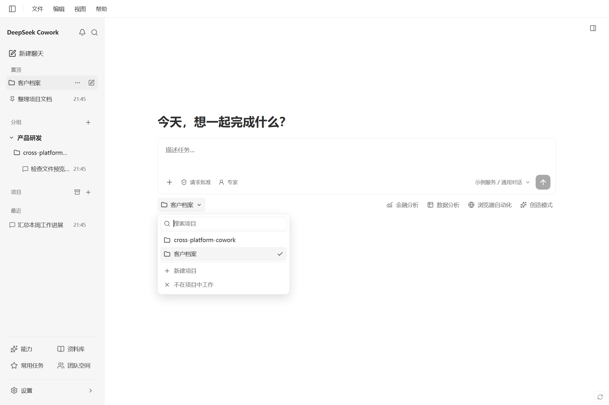

点首页项目菜单里的“新建项目”或侧栏“项目”旁的“+”，有两种建法：
- **只填项目名称**：应用会在本机数据目录的 `project_workspaces` 下自动建一个专属文件夹。
- **关联本机文件夹…**：直接绑定你电脑上现有的代码库或业务文件夹，项目名默认取文件夹名，也可自由修改。

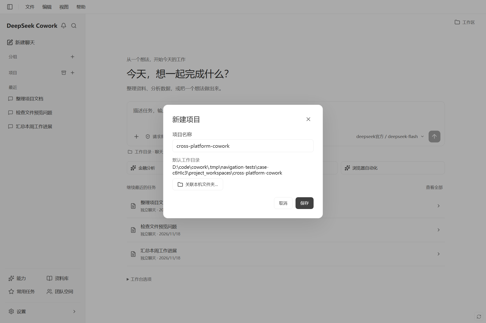

把鼠标移到侧栏某个项目上：点最右侧的**写字图标**可立即在该项目下新建聊天；点**“⋯”**可以在资源管理器中打开文件夹，或修改项目名称与绑定的目录（改目录只影响之后新建的聊天，旧聊天仍保持各自原来的目录）。

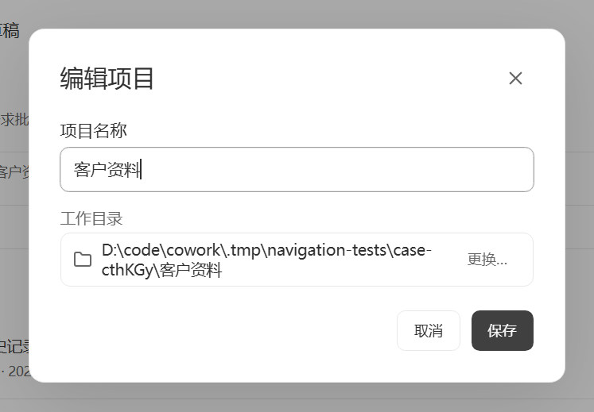

### 分组、置顶与归档

侧栏的分组和置顶只用来整理列表视图，**不会移动你硬盘上的任何文件**：

- **自定义分组**：点侧栏“分组”旁的“+”，输入组名按 `Enter` 即可创建。你可以把常用的项目和独立聊天直接用鼠标长按拖进分组，也可以点条目右侧的“⋯ → 移到分组”。
- **置顶常用项**：在项目或聊天的“⋯”菜单里点“置顶项目 / 置顶聊天”，它会固定在侧栏最上方，随时可取消置顶。
- **归档旧工作**：做完的项目或聊天可在“⋯”菜单中选择归档（聊天也可选择“移到回收站”）。点侧栏“项目”旁的归档盒图标，随时可以查看并恢复已归档的内容。

### 搜索对话与跨对话引用

- **全局搜索（`Ctrl+K`）**：点击侧栏顶部的放大镜或按 `Ctrl+K`，输入关键词即可同时搜聊天标题、历史消息正文和项目名称，上方可按“全部 / 聊天 / 项目 / 操作”筛选。点中聊天直接跳转，点中项目则在该项目下新建对话。首次建立历史索引时若需短暂准备，弹窗会自动等待并在就绪后显示结果。
- **引用其他对话**：如果新任务需要参考之前某次聊天的结论，点击输入框“+ → 对话”（或在输入框里敲 `@`）勾选那条历史对话即可。发送后消息上方会挂着引用标签，方便日后核对当时参考了哪条记录。

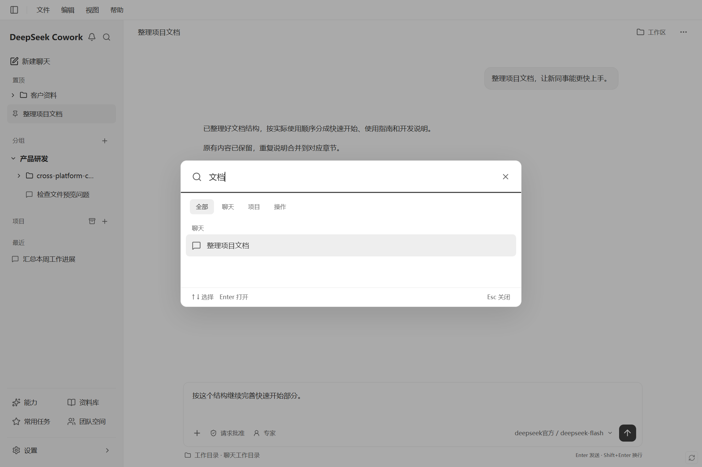

---

## 发送消息与控制任务

### 添加文件、资料、能力与变量

点击输入框左下角的**“+”**按钮（或敲 `@` 呼出快捷面板），可以为本轮任务补充各种上下文：

- **添加文件与图片**：支持点“+ → 添加文件”、直接把文件拖进输入框，或直接 `Ctrl+V` 粘贴截图与文件。若一次性粘贴超过 4,000 字或 80 行的超长文本，输入框会自动把它转成 `.txt` 附件，保持输入区清爽。
- **边看边引资料库**：点“+ → 浏览资料库”会在右侧工作区直接打开资料库面板，方便一边看对话一边勾选参考文档。
- **选用专家、技能与连接器**：专家每次单选，技能与连接器（即已配置的 MCP 服务）支持多选。选好后会以小标签显示在输入框上方，点标签名字可随时重选，点“×”移除。
- **插入常用变量**：点“+ → 插入变量”可将你在设置里存好的常用文本变量以 `${变量名}` 形式插入输入框。

> **小提示**：消息发出后，当时选中的附件、资料、技能和对话引用都会记录在这条提问气泡上方。注意这些标签代表“本轮允许参考的范围”，AI 会按任务需要去读取具体内容。

点击输入框、对话气泡或执行步骤里的图片缩略图，可以打开大图预览窗（支持缩放、左右方向键切图、右键复制图片和 `Esc` 关闭）。如果当前聊天模型不支持直接看图，但你启用并配置了“多媒体”图片服务，图片仍可作为文件交给工具处理；否则系统会保留你写好的草稿并提示先切换到支持视觉的模型。

### 选择执行授权

输入框底部提供了权限与任务推进方式开关，改动后会作为后续任务的默认设置：

- **执行权限（`请求批准` / `完全访问`）**：
  - `请求批准`：涉及需要许可的操作时，聊天里会先弹出审批卡，你可以展开看清具体命令或修改内容后再决定是否放行。
  - `完全访问`：允许 AI 在当前系统用户权限范围内直接连续执行操作，适合你信任且希望一气呵成的本地任务。
- **任务模式（`直接推进` / `拷问模式` / `创造模式`）**：
  - 默认是`直接推进`。如果任务需求还比较模糊、希望 AI 先帮你把方案问清楚再动手，可以在“+ → 模式”里选**“拷问模式”**（输入框底部会出现胶囊提示，发送前点“×”可随时取消）。开启后 AI 会先通过提问和你对齐细节、给出阶段总结，等你明确确认开始执行后再真正改文件。
  - `创造模式`专门用来定制软件界面与主题，详见[创造模式：界面、主题与插件](#创造模式界面主题与插件)。这两种模式都可以在“能力 → 插件”中按需启用或停用。

### 补充、停止与编辑

- **运行中随时插话补充**：AI 正在干活时，你不需要干等或先按停止——直接在输入框打字并点击发送，你的补充要求会按真实时间穿插进当前执行流程，AI 会在下一个安全节点读到并接着往下做。
- **随时停止任务**：任务运行且输入框为空时，右下角主按钮会变成**停止**按钮（如果你正在输入框里打字写草稿，也可以点左下角“+ → 停止当前任务”，写了一半的草稿会安全保留）。停止后已生成的内容和文件都会保留。
- **修改已发出的提问**：鼠标悬停到之前的提问气泡上，点铅笔图标即可重新编辑文字、增删附件（已绑定的技能快照也会保留），点**“保存并重新回答”**就会从这一步重新往下生成（原对话中已经落盘的文件不会被删掉）；按 `Esc` 或点“取消”则放弃修改。AI 回复底部同样提供复制、重新生成、从此处创建新分支对话，以及“⋯”菜单里的**“生成办公稿”**和**“沉淀为 Skill”**。

### 回答问卷

当任务需要你拍板做选择（尤其是在拷问模式或复杂方案确认时），对话中会直接展开交互问卷：

- 单选题可直接点选（焦点在选项上时也可按数字键快选），多选题支持勾选多项，也可以直接在文本框补充自己的想法，选好后点击**“提交回答”**才会发出。
- 多道题可折叠或逐题展开，底部实时显示答题进度；若有漏填会自动定位到未答题目。提交成功后，你的选择会清晰地留在对应步骤下方方便回看。

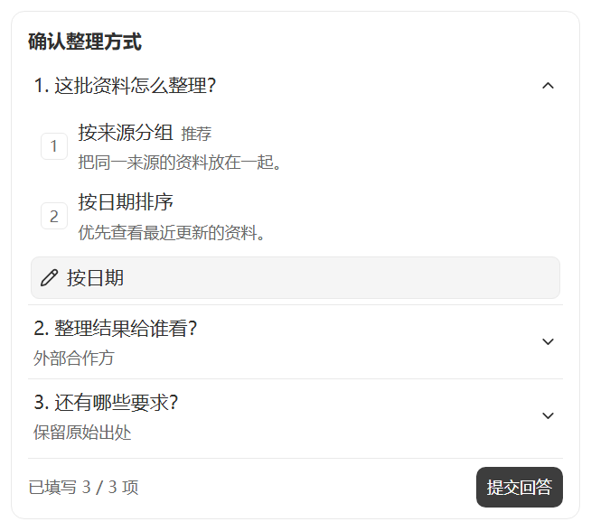

---

## 查看执行过程与子任务

### 看懂时间线与实时工具输出

消息发出后，提问下方会实时展示本轮任务的执行时间线（任务跑完后重新打开旧对话时，已结束的过程默认折叠为“用时 XX”，点一下即可展开，让长对话更好读）：

- **深度思考与阶段进展**：展开过程后，可以顺着时间线看模型的思考过程（支持单独折叠或一键复制思考原文）以及每一步调用的工具。点击工具步骤里的文件路径可直接打开该文件。
- **代码与命令实时输出**：当 AI 运行 Python、JavaScript、Shell 命令或安装依赖包时，点击工具标题即可展开实时输出窗口（默认收起，展开后自动显示最新 8 行输出，不会抢占外层聊天的鼠标滚轮）。想看完整输出日志、传入参数或报错退出码时，点击右侧的**“详情”**即可分段查阅或打开日志文件位置。
- **长耗时任务不刷屏**：单个命令运行超过 120 秒时会在后台继续跑，AI 继续等待同一次任务不会在界面上刷出多条重复记录；想终止整轮工作时直接点输入框右下角的停止按钮即可。
- **看图记录快照**：AI 调用看图工具检查页面或图片后，时间线会显示“已查看 N 张图片”，点开就能看到它当时实际读取的图片缩略图。

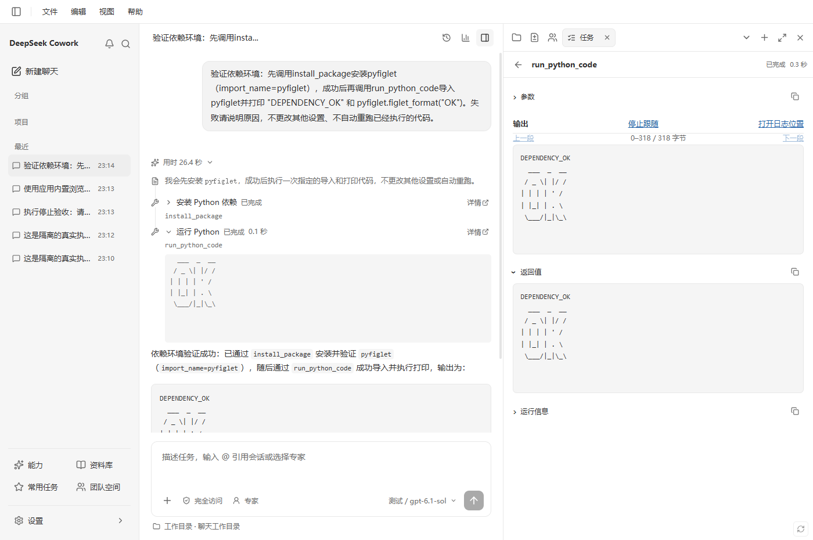

当对话很长时，顶部提供“更早的消息”按需向上加载，历史执行过程始终准确挂在各自所属的那轮回复上方。把鼠标悬停在提问或回复底部，可以看到操作栏与发送时间（悬停时间显示完整日期）。

### 任务标签、子任务与多对话跟进

对话右上角和右侧工作区提供了完整的任务检视与多线协作入口：

| 位置 | 名称 | 能帮你做什么 |
| --- | --- | --- |
| 对话右上角 | **历史提问**（时钟图标） | 列出当前对话里你问过的所有问题，点一下直接跳回那条消息位置 |
| 对话右上角 | **用量统计**（柱状图图标） | 打开紧凑浮窗查看生成速度、Token 用量和本对话涉及的文件 |
| 对话右上角 | **工作区**（分栏图标） | 展开或收起右侧工作区 |
| 工作区新标签页 (`+`) | **任务**标签 | 查看本轮每一次工具调用记录，或在“执行上下文”里核对本轮配置与最近一次发给模型的完整请求原文 |
| 工作区新标签页 (`+`) | **子任务**标签 | 查看 AI 拆出的并行子任务列表，点进单个子任务独立看过程、发补充要求、停止或继续 |
| 侧栏顶部铃铛 | **运行任务**浮窗 | 跨项目一眼看清所有正在后台跑的对话，支持一键跳转、看详情或单独停止某条任务 |

- **跟进和指挥子任务**：当复杂工作被拆成多个子任务时，既可以在主对话时间线里点开子任务分组，也可以在右侧工作区打开独立的**“子任务”**标签。每个子任务都有自己的对话流和底部输入框——你可以单独给某个子任务补充要求、暂停它，或者在中断后点“继续”，关闭标签也不会停掉后台运行。
- **排查请求上下文**：在工作区“任务 → 执行上下文”里，不仅能看到当前对话选了什么模型、目录和能力，还能点“查看完整请求”复制最近一次实际发往模型服务的请求原文（从旧工具点进来时顶部会提示“正在查看历史任务”，点“返回当前任务”可切回最新状态）。

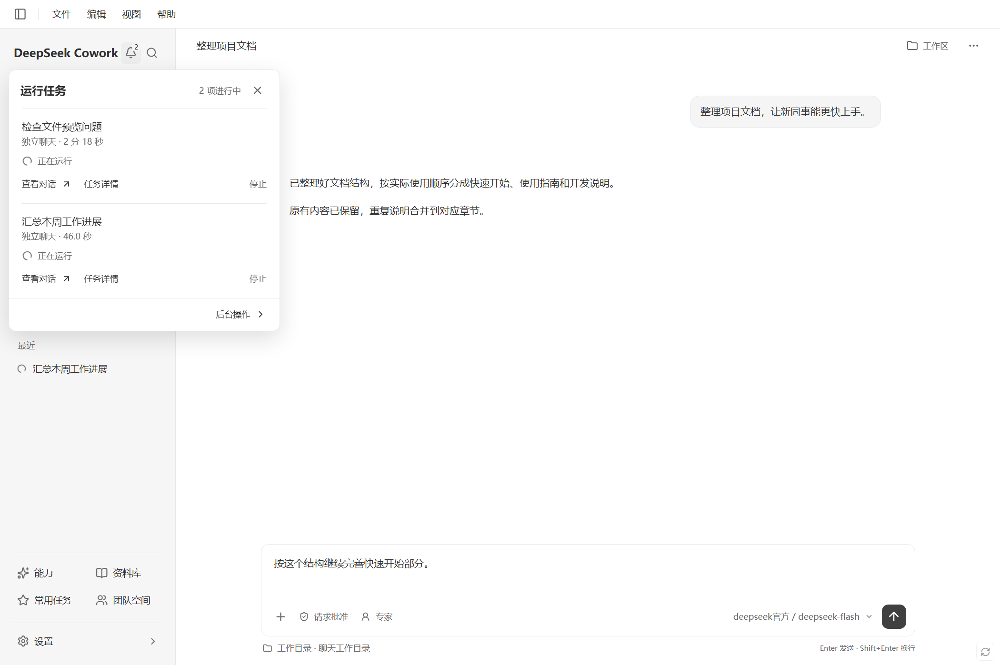

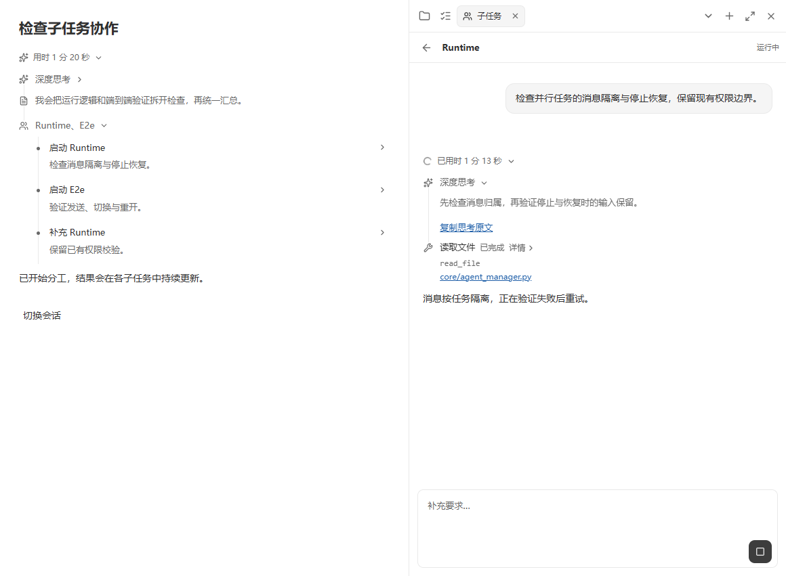

### 查看用量与上下文

关心速度、Token 消耗或长对话容量时，点击对话右上角的柱状图图标即可打开**用量统计**浮窗（软件会记住开关状态；当你展开右侧工作区看文件时浮窗会自动让出空间，收起工作区后再恢复）：

- **概览页**：直观展示实时生成速度、本轮输入输出 Token、整条对话累计消耗及缓存命中率。
- **文件页**：汇总当前对话已加载消息里发过的附件和生成的文件，点一下直接打开。
- **详情页**：展示实时速度曲线、最近一次请求的上下文组成估算，以及长对话自动整理开关（**“下次目标”**可选 `300K`、`1M` 或 `未启用`，点保存后从下一轮生效）。

---

## 使用工作区与文件

右侧工作区是你查看、编辑和管理交付成果的主阵地。打开空工作区（或点击工作区顶栏的 **`+`** 打开“新标签页”），上方可以进入**任务**和**子任务**，下方可以直接输入网址打开**内置网页**、点**新增页面**写文稿，或者选好类型打开**终端**。

### 查找和预览

- **浏览工作目录文件**：点击工作区左上角的文件夹图标打开**工作区文件**面板（可点图钉图标将面板固定在左侧），支持在当前目录按文件名搜索、进入子文件夹或刷新列表，点击任意文件即可在标签页中打开。若绑定的本地文件夹后来被改名或移走，面板会提示原因并提供“重试”或“重新选择目录”（切换目录前需先停止当前对话正在运行的任务）。
- **管理多个标签页**：文件、网页、终端、变更记录和草稿审阅共用同一排标签栏。打开的标签较多时，点标签栏右侧的向下箭头**“全部标签页”**，即可搜索文件名、路径或网址快速跳转；点最大化按钮可全屏展开工作区（展开后左侧固定保留“对话”标签方便随时切回）。
- **看懂回复下方的“本轮文件”卡片**：每当 AI 创建、修改、删除或在回答中明确引用了文件，回复下方都会出现一张紧凑的文件汇总卡（显示文件数与增删行数，默认展示前 3 个，可展开全部）：
  - 带改动记录的文件：点右侧箭头（或卡片右上角的**“查看变更”**）会在工作区打开只读的“本轮文件记录”，对比这一轮修改前后的具体内容，里面也可点“打开当前文件”跳去继续编辑。
  - 普通引用文件：点一下直接在工作区打开硬盘上的当前文件。
- **聊天附件不污染项目目录**：你在聊天框添加、拖入或粘贴的参考附件，统一存放在应用历史目录下的会话专属空间里，**不会在你的代码库或项目文件夹里额外生成 `attachments` 文件夹**。

### 编辑并保存

不同格式的文件打开后会自动匹配对应的阅读器或编辑器，顶部操作栏统一放置文件名、常用切换按钮与更多菜单（“在资源管理器中打开”“复制路径”“用本机应用打开”“重新载入文件”）：

- **代码与配置文件**：Python、TypeScript/JavaScript、Java、JSON、YAML、CSS、SQL 等源码提供行号、语法高亮、代码折叠、查找替换与行跳转（更多菜单内可开启自动换行）。只有真正改了内容才会亮起“保存”按钮（支持 `Ctrl+S` 保存、`Ctrl+Z` 撤销），保存时保持原文件的编码与换行符格式不变，切换标签页也不会丢草稿。
- **Markdown 与 HTML**：Markdown 默认以舒适的排版预览打开，点顶栏的**“编辑 / 预览”**即可原位切换并保存。HTML 默认渲染页面效果，点**“编辑”**就能直接在页面上改文字、标题和列表，切回**“预览”**确认无误后保存（编辑期间页面脚本自动暂停，保存后恢复原样）。

- **Word、PPT 与 PDF 连续阅读**：
  - Word（`.docx`）和 PPT（`.pptx`）默认调用你电脑上的 Microsoft Office 或 WPS 生成高保真页面预览；如果没装办公软件，也可以在底栏“渲染方式”里切换或一键安装独立的 LibreOffice（约 356 MiB，不会篡改系统的默认文件打开关联）。老旧二进制格式（如 `.doc`/`.ppt`）无法安全转换时会提示直接用本机软件打开。
  - 所有文档和 PDF 共用离线阅读器：默认开启**连续阅读**和**适应宽度**（也可切为“单页查看”），支持左侧页面缩略图、页码跳转、`Ctrl+F` 查找文字、划选复制，以及按住 `Ctrl` 滚轮围绕鼠标位置无级缩放。顶栏右侧的**阅读亮度**滑块只柔和调暗屏幕显示，不会改动原文件颜色。
  - 需要修改文档时，点顶栏的**“打开应用编辑”**直接唤起本机 Office/WPS；改完保存后，工作区顶部会温和提示“文件已更新”，等你点**“刷新”**才加载新页面，并停留在刚才读到的页码位置。
- **Excel 表格编辑与宽表页面阅读**：
  - 打开 `.xlsx` 默认进入可直接修改保存的**表格**视图；点顶栏的**“页面阅读”**即可切换到阅读模式。
  - 页面阅读提供两种方式：默认的**`区域阅读`**会把超宽表格按合适宽度自动拆成好读的分片，点“阅读范围”还能指定工作表、单元格区域、每页重复显示的标识列（如 `A:B`）和标题行（如 `1:2`）；切换到**`打印预览`**则按原表设定的打印区域和分页展示。阅读调整只作用于预览副本，不会改乱你在表格里的未保存内容。
- **查看版式检查记录**：让 AI 检查过文档或幻灯片排版后，点阅读器左下角的**“检查记录”**就能看到本轮实际检查了哪几页、每页的审阅结论以及当时送审的页面原图，点击页码可直接跳到对应页核查。

### 新建写作页

想随手记笔记或起草 Markdown 文稿时，点击工作区标签栏“`+` → 新增页面”即可直接开写。顶部一行就能填文件名、切换预览、调用标题/加粗/列表格式。**没点保存前它只是当前对话里的草稿，不会往文件夹里生成空文件，关掉软件重开也能接着写**；按下 `Ctrl+S` 或点“保存”时，才会真正写入当前工作目录。

### 对比“本轮文件记录”与“Git 工作目录变更”

工作台提供两套互补的文件改动视图，分工非常清楚：

| 你想看什么 | 从哪里打开 | 记录范围与特点 |
| --- | --- | --- |
| **这一轮对话 AI 改了什么** | 回复下方文件卡片的**“查看变更”** | 按应用实际确认的文件写入记录前后对比，**普通文件夹（非 Git 仓库）也能用**；单文件上限 2 MiB、单轮 16 MiB、总空间 256 MiB（满额后自动清理最早已结束任务的正文，但保留改动文件清单与增删行数统计） |
| **当前整个 Git 仓库改了什么** | 工作区顶栏左上方差异图标**“查看工作目录变更”**（打开`变更`标签） | 使用内置 Git 实时对比当前目录相对最近一次提交（`HEAD`）的全部改动（含你在外部编辑器自己改的文件）；已打开的文件还可在顶栏点**“显示更改 / 隐藏更改”**原位切换差异视图 |

> **严谨边界**：如果 AI 运行了一段复杂的自由 Shell 脚本、没有经过应用内置的文件读写通道，系统不会靠猜时间或扫全盘去硬凑“本轮变更”；需要核对整仓磁盘现状时，直接看 Git 的“变更”标签最准确。

### 网页与终端

在新标签页输入网址可打开**内置网页**，选终端类型点“打开终端”可启动本机 **Git Bash 或 PowerShell**。

- 你在聊天时可以直接说“帮我总结右边打开的这篇网页”或“看看右侧终端刚才报了什么错”，AI 会根据当前对话打开的标签读取内容。
- 当 AI 正在操作网页或终端时，你随时可以点顶栏的**“接管” / “接管终端”**（终端右键菜单还支持“停止当前命令”和“接管并停止当前命令”）把控制权拿回来手动登录或输入命令，处理完再交还给 AI 接着做。

### 浏览器自动化

让 AI 自动操作网页有两种方式，按场景二选一即可（正在跑的任务保持启动时的浏览器不变，新任务按最新开关生效）：

- **内置浏览器（默认开启，免配置）**：开箱即用，自带独立浏览环境，即使把窗口切到后台或最小化也能正常截图、填表、点击和上传下载；当需要你手动扫码或登录时，点“接管”即可。
- **外部 Chrome / Edge（通过 BrowserSkill 操作你日常在用的浏览器）**：适合需要复用你现有浏览器登录态的场景。打开“能力 → 技能 → BrowserSkill（外部浏览器）”，勾选**“启用 BrowserSkill”**，按页面指引点击“准备或修复组件”，在 Chrome 或 Edge 扩展管理页开启开发者模式并加载页面显示的扩展目录（当前配套版本为 `0.5.0`，升级后记得在浏览器扩展页点一次刷新），最后点**“检查连接”**确认就绪即可。若外部浏览器没连上，任务会明确提示原因，不会偷偷切回内置浏览器。

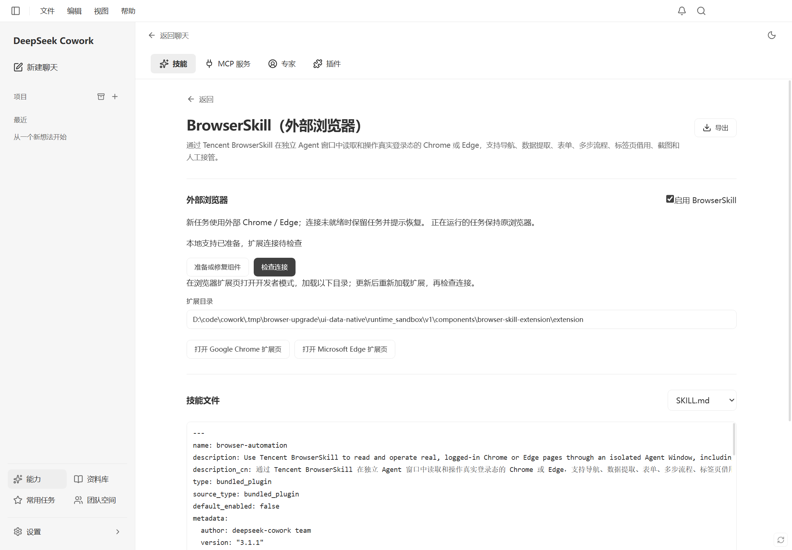

---

## 制作文档和演示

无论是写报告、做 PPT 还是分析 Excel 数据，都可以在同一个对话里串起来完成——比如先让 AI 核对清洗 Excel 表格，再生成交互图表，最后汇总成一份排版整齐的 Word 或 PPT 汇报稿。

### Word 与 PDF

直接上传参考素材，说明目标读者、篇幅和格式要求（有现成 Word 模板时一并拖进去，AI 会优先沿用原模板的页面设置与标题样式）；也可以在任意一轮长回答下方点“⋯ → 生成办公稿”转成 Word。需要导出 PDF 时在对话中直接说明即可。

AI 修改现有办公文档时，**默认先复制一份修改稿再编辑，不会直接覆盖你的原文件**（若任务中你授权执行了通用 Python 或命令行脚本，脚本仍按当前执行权限访问工作目录）。生成完成后，你可以要求 AI 对重点页或复杂排版页做视觉版式检查。

### 制作演示文稿

在对话中交代汇报对象、核心结论、大致页数和风格（有母版模板可附上 `.pptx` 原件，想做网页演示也可指定生成 HTML 幻灯片）。内置演示文稿能力默认输出可编辑的宽屏 `.pptx`，支持新建、套用模板或只改你指定的几页，并优先检查中文换行、图表留白与图片比例。

### 分析数据

把 Excel、CSV 或已连接的资料交给 AI，说明你想对比的指标、时间段和业务问题。内置数据分析流程会先帮你核对数据粒度、空值、重复行和统计口径（残月、退款、零值等边界会单独说明，缺少关键字段会如实指出，绝不用假数据硬凑结论），再给出计算结果。

同一份核验过的数据结果可以直接输出为文字结论、交互看板、Word 报告、PPT 或完整的 Jupyter Notebook（`.ipynb` 会在随包内置的干净 Python 内核中从头依序运行并保存真实图表与输出，无需自己安装 JupyterLab）。

### 绘制流程图

AI 回复中的 `mermaid` 代码块会自动渲染为清晰的可缩放流程图（支持适应宽度、放大缩小和一键复制源码；生成过程中先展示代码，输出闭合后自动成图）。

### Visualize

内置的 **Visualize（交互可视化）** 默认随时可用，无需手动勾选技能。当你希望动态对比不同参数方案、筛选图表维度或拆解指标结构时，直接在对话里提出要求，生成的交互卡片就会直接嵌在回复里供你点击筛选和探索，并自动适配浅色、深色或自定义主题。

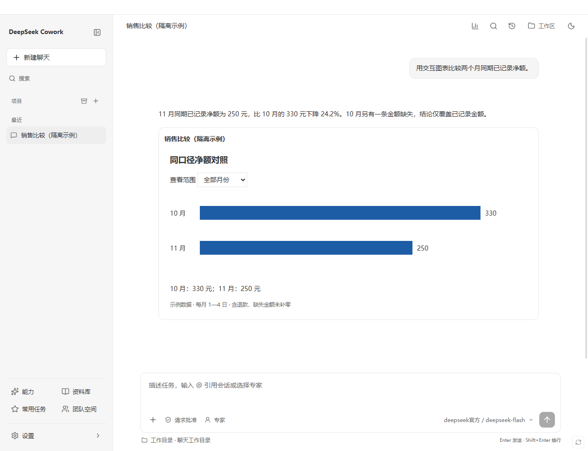

### HTML 与 JavaScript 代码预览

回复中带有 `html`、`js` / `javascript` 标记的代码块默认展示源码；等代码生成完毕后，点击代码块顶部的**“预览”**或**“运行 / 输出”**，就能在当前位置直接跑起自包含网页或查看脚本控制台输出（支持一键复制、重新运行与停止预览）。

> **安全边界**：代码预览运行在完全隔离的本地沙箱中，不联网、不加载外部在线脚本，也无法访问你的本地文件或终端；单段代码若连续 10 秒无响应会自动停止并保留源码。

### 审阅工具草稿

当你从回答底部点“⋯ → 生成办公稿 / 沉淀为 Skill”（或让 AI 提交草稿供你审阅）时，聊天里会出现任务进度卡，完成后在右侧工作区打开对应的审阅标签页：

- **审阅办公稿**：可选择基于本轮回答、整轮任务或自定义文字生成 Word、PPT 或 Excel。生成后直接在工作区预览（Excel 可直接在线编辑），满意后点击**“保存到项目”**正式落盘（不会覆盖同名旧文件）。
- **审阅 Skill 草稿**：将刚才对话里跑通的好方法提炼成可复用的技能包。你可以在右侧直接修改技能说明、勾选要附带的模板或脚本文件，确认无误后点**“保存到我的技能”**（既可新建技能，也可追加更新已有的自建技能）。

---

## 使用多媒体

图片生成/编辑、视频生成和视频理解由**单独绑定的多媒体专用模型**负责执行，而日常聊天主模型负责理解你的创作意图并调度它们（音频暂不包含在内）。只需配置一次，以后在普通聊天里直接开口就能用。

### 配置并开始使用

1. 打开侧栏“能力 → 技能”，找到**“多媒体”**点“配置模型”。
2. 在图片生成、视频生成、视频理解对应行选择已有模型，或点“添加模型…”直接填入服务地址与 API Key（常用平台如 Agnes、火山方舟、OpenAI 兼容网关会自动匹配协议）。
3. 点击**“保存并启用”**，再点“去聊天使用”回到对话，直接描述你想画的图、想改的图或想生成的视频即可。
4. 如果你先在聊天里提了生成要求但还没配好对应模型，对话里会留下一张带**“配置模型”**按钮的任务卡；点进去补齐配置再回来点**“继续任务”**就能接着跑，不用重新打字发送。

> **素材小贴士**：做视频理解时请提供模型服务可访问的视频链接；使用参考图生成视频时，火山方舟支持直接引用当前工作目录里的本地图片，Agnes 接口则需要提供公网图片链接。

### 查看进度与恢复任务

生成的图片和视频默认保存在当前工作目录的 `media` 文件夹下。当你连续生成多段视频时，**每段视频的排队进度、成片播放器和操作按钮都会稳稳留在发起它的那条回复下方**，你可以放心继续往下聊或切去别的对话（如果是很早之前的消息还没向上翻出来，也可以先在工作区“任务”标签里看到）。

- 成片就绪后点**“展开成片”**即可直接播放，点击正文里的文件名也会定位并展开播放器。
- 如果服务端明确提示拒单可重试，点原卡片的**“重试生成”**；如果只是网络中断或本地成片不小心被移走，点**“刷新状态”**或**“重试下载”**就能取回原来的成片，**不会重复发起生成请求**。点“停止等待”仅停止本机轮询或下载，不会撤回远端已在渲染的作业。

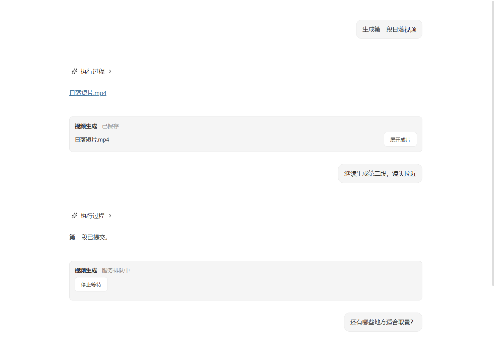

---

## 使用资料库

如果你有一批经常要给 AI 参考的规范、产品文档或云端知识库，放到**资料库**里最省心——既能从侧栏底部点“资料库”集中整理，也能在聊天时点输入框“+ → 浏览资料库”在右侧边看边添加。

左上角下拉框可随时切换四种来源：**本地资料库**、**WeKnora**、**腾讯文档**和**腾讯乐享**；点“最近”能快速找回刚看过的目录和文件。

### 本地资料库

- **公共资料**：不绑定具体项目，任何对话都能随时取用。拖入或“添加文件”会复制一份到应用数据目录（`library/public`），不影响你原位置的文件；支持直接在里面新建 Markdown、纯文本和子文件夹，支持右键剪切、复制、粘贴、按 `F2` 重命名，按 `Del` 删除的文件会先进入公共资料回收站，支持随时撤销或整批还原。
- **项目资料**：自动汇总你所有未归档项目的工作目录，无需搬运文件就能跨项目搜索、预览（支持 Markdown、文本、HTML、PDF 和图片直接阅读）并一键“添加到当前对话”。

### 连接与引用云端资料库

切换到远程来源后按提示完成一次连接，之后就能浏览目录、搜索预览，并支持勾选多份文档（按住 `Shift` 连选、`Ctrl+A` 全选）甚至引用整个知识库/空间加入当前对话：

| 云端来源 | 连接方式与支持能力 |
| --- | --- |
| **WeKnora** | 填写服务地址、邮箱和密码；支持按共享空间或知识库浏览预览，有写权限时还可新建/编辑手工文档或上传本地文件 |
| **腾讯文档** | 在浏览器打开授权页确认后回客户端点“已完成授权”；支持浏览与搜索“个人文件”和“协作空间”并引用正文 |
| **腾讯乐享** | 填写企业标识与访问令牌；支持按团队、知识库及子页面层级浏览和引用文章，有权限时支持上传文件 |

上传大文件到云端知识库后，可在“设置 → 后台操作”查看上传进度；需要删除云端原生文档时点“在原平台打开”处理即可。

---

## 管理技能、连接器与专家

点击侧栏底部的**“能力”**，顶部共有**技能、MCP 服务、专家、插件**四个标签页；其中“技能”“MCP 服务”和“专家”页面上方还支持在**“个人”**与**“企业”**来源之间一键切换。

### 一张表分清该用哪种能力

| 你的需求 | 选哪个 | 怎么用 |
| --- | --- | --- |
| 读改 Office/PDF、做 PPT、分析数据、画交互图 | **内置技能** | 默认常驻开启，直接在聊天里提要求即可 |
| 接入多媒体、外部浏览器或特定行业工作流 | **可选 / 自建技能（Skill）** | 在“能力 → 技能”中开启或导入，缺配置时点“完成连接配置” |
| 让 AI 调用外部现成的工具接口服务 | **MCP 服务**（输入框称**连接器**） | 在“能力 → MCP 服务”添加并测试，聊天时可从“+ → 连接器”勾选 |
| 固定一套说话风格、审阅标准和常用技能组合 | **专家** | 在“能力 → 专家”创建或复制定制，聊天时点“专家”或敲 `@` 选用 |
| 改变工作台布局、配色主题或开关拷问/创造模式 | **插件** | 在“能力 → 插件”或创造模式中预览并启用 |

### 技能与 SkillHub

“技能”页分为**发现技能**、**我的能力**和**内置技能**三栏：

- **在线发现与本地导入**：除了开关现成技能，点击底部的 **SkillHub** 入口可浏览在线技能市场并一键安装；点右上角**“导入技能”**可导入本地 `.zip` 技能包。你甚至可以直接在聊天里发一个 GitHub 仓库地址或技能包路径让 AI 帮你校验安装。
- **把文件做成模板 Skill**：如果你有一份排版固定的周报或合同范本，可以直接在聊天里说“把这份文件做成可复用的模板 Skill”，AI 会把参考原件和使用说明一起打包存进“我的能力”，以后换新内容就能直接套用。
- **在输入框快速调整**：聊天时点“+ → 技能”可显式指定本对话要用的技能；已选中的技能或连接器显示在输入框上方，直接点标签名字就能再次展开列表增删勾选。若不确定某个能力为什么没生效，也可以直接在聊天里问“为什么某某技能不能用”，AI 会帮你检查开关和配置状态并给出跳转入口。

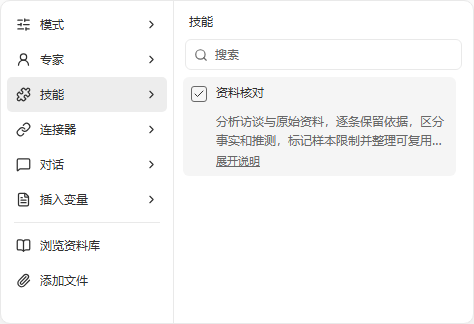

### MCP 服务

点击“能力 → MCP 服务 → 新建”，连接方式支持**本机程序（`stdio`）**和 **`Streamable HTTP`** 远程服务。如果你手头已有现成的 JSON 配置片段，展开顶部的**“导入 JSON”**直接粘贴或选择文件，点“解析并填入”就能自动填好表单（含多个服务时会列出来让你点选），核对环境变量或认证头后点**“保存”**，即可在列表页点“测试连接”。

### 专家、记忆与经验

- **使用与定制专家**：应用内置了**“HTML创作”**等开箱即用的专家（可根据参考图或文字描述制作精美、可离线打开的网页），在聊天输入框点“专家”或输入 `@` 就能切换。想改内置专家的提示词时，在“能力 → 专家”里点开它，点击**“复制为自建专家”**即可自由修改提示词并勾选它专属的可用技能。

- **长期记忆与自动经验积累**：
  - 在“设置 → 长期记忆”中可以分别查看和编辑**全局记忆**与各个**项目的专属记忆**，也可点击“从历史更新”让模型帮你从近期对话中提炼新事实（生成草稿后由你核对保存）。
  - 日常做任务时，如果 AI 摸索并验证出了一条值得以后复用的经验（例如某个项目的特殊构建参数或数据口径），它会自动把这条经验记入对应项目或全局摘要中，从下一轮任务开始生效，无需每次手动调教。
  - 当一整套复杂做法值得长期固化下来时，在回答底部点“⋯ → 沉淀为 Skill”，审阅后保存到“我的能力”即可。

---

## 常用任务与消息连接

### 保存常用任务与定时计划

对于每周汇总周报、定时巡检数据或固定技能组合的日常工作，打开侧栏**“常用任务 → 新建”**保存起来即可反复使用：

- **一键手动运行**：填好名称、任务内容（如果只想存一组常用技能搭配，任务内容可以留空，点打开后会直接进入选好技能的新对话）和工作目录。保存后在列表右侧点**“运行”**就会立即开始执行。
- **设置定时自动执行**：在编辑页开启**“定时执行”**，支持按每天、每周（可多选周几）、每月、固定分钟间隔、单次指定时间或 Cron 表达式运行，默认跟随本机时区（也可指定如 `Asia/Shanghai`），还能单独为定时计划写一套区别于手动运行的指令。你也可以直接在聊天里对 AI 说“每周一早上 9 点帮我整理这个项目的周报”，它会自动帮你建好计划。
- **查看运行记录与测试投递**：定时任务要求应用保持运行（点右上角“×”收起到托盘即可）；关机期间错过的计划会在**“运行记录”**标签里标为“已错过”，点击记录名称就能跳进当时的对话看结果。在任务列表点“⋯ → 执行一次计划”可以立即按定时配置（含消息渠道投递）试跑一次，不影响原有的定时排期。

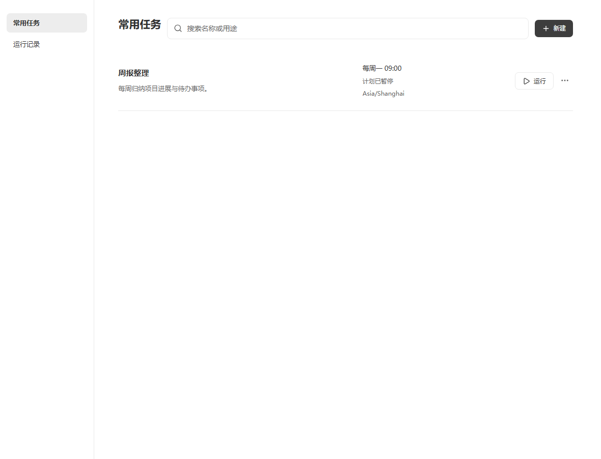

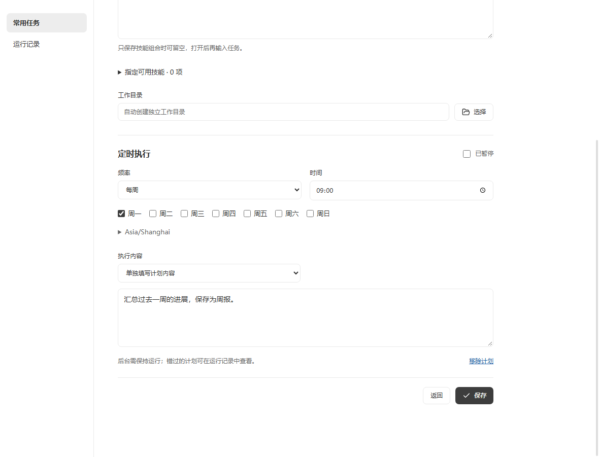

### 连接消息渠道

想在手机或办公软件里直接给本机 Cowork 发指令、或者接收定时任务的汇报结果，打开**“设置 → 消息连接”**，顶部支持切换查看 **飞书、钉钉、企业微信、QQ、微信** 五种渠道：

1. 点击顶部分段按钮切换你想配置的渠道（仅切换查看不会改动现有运行状态）。
2. 按页面提示扫码配对，或填写机器人连接凭证（不常用的高级参数收在“更多选项”中）。
3. 勾选**“接收此渠道消息”**并点击底部**“保存”**，即可启用该渠道（同一时间启用一个接收渠道，切换保存后原渠道自动停收）。

---

## 企业账号与团队空间

如果你所在的公司或团队部署了企业中心，在“设置 → 企业账号”登录后即可直接使用部门或管理员分配给你的企业模型、企业 Skill、企业 MCP 和企业专家，并在侧栏“团队空间”中查看团队计划、共享资料、创建空间任务和沉淀协作成果。

完整的登录步骤、企业能力使用方式、聊天合规审计范围说明及企业客户端升级方式，请查阅[企业版员工指南](enterprise/employee-guide.md)。

---

## 个性化与设置

点击侧栏最下方的**“设置”**，左侧导航栏按用途清晰分为 **12 个页面**（顶部搜索框输入关键词可快速筛选左侧设置项）：

- **界面与偏好**：`外观与阅读`、`回答偏好`
- **连接与协作**：`模型与服务`、`消息连接`、`企业账号`
- **安全、存储与记忆**：`数据安全`、`变量与凭据`、`文件与存储`、`长期记忆`
- **诊断与维护**：`运行日志`、`更新与关于`、`后台操作`

其中`文件与存储`用于修改默认工作区、新建独立聊天的存放根目录，以及一键打开本机应用数据目录；`回答偏好`可填写你希望 AI 长期保持的沟通语气与习惯。

### 创造模式：界面、主题与插件

如果你只想快速切换浅色或深色外观，点窗口顶部菜单**“视图 → 切换浅色 / 深色”**即可。如果你想更换配色主题、调整字体字号与紧凑度，甚至让 AI 照着你的想法重新设计一套工作台界面，可以从“设置 → 外观与阅读 → 打开创造模式”（或首页输入框下方的“创造模式”）进入设计工作台：

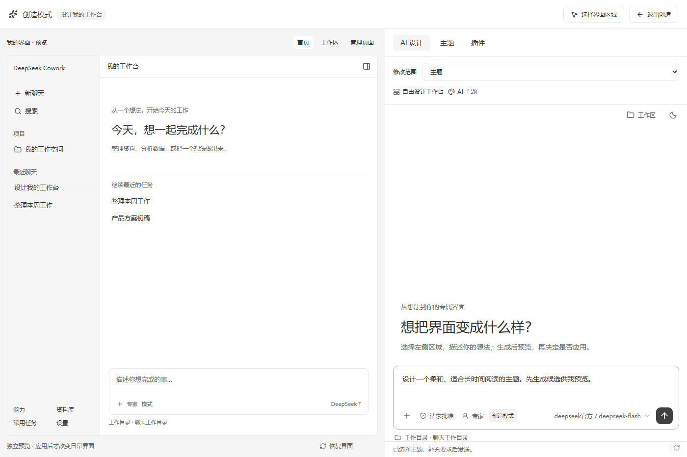

- **换主题与调阅读排版**：在右侧切到**“主题”**页，可预览并一键应用内置的简洁、暖纸、青松、雾蓝等主题，自由调整界面字体、代码字体、字号缩放（90%–150%）和界面密度（舒适 / 标准 / 紧凑），也支持导入或导出 `.cowork-theme` 主题包。
- **让 AI 设计界面并安全试跑**：在**“AI 设计”**页，选好想改的区域（如整个界面、侧栏、顶部栏或输入区），用自然语言描述你想要的效果。AI 提交新界面后，系统会自动在左侧用示例对话做隔离试跑和按钮检查，通过后才展示出来供你预览体验；只有你点击**“应用”**后才会变成日常界面，正在跑的后台任务和未发草稿完全不受影响。
- **管理插件与一键恢复**：在“能力 → 插件”（或创造模式的“插件”页）可以开关模式插件、通过“添加本地插件”加载自定义界面包，或导出源码二次修改（开发说明见 [UI SDK](../desktop/sdk/README.md)）。万一自定义插件显示不理想，随时点击右下角常驻的**“界面恢复与诊断”**或顶部菜单**“帮助 → 恢复内置界面”**即可瞬间切回默认工作台。

### 数据安全与凭据

- **数据安全**（“设置 → 数据安全”）：开启后可按需勾选风险检查、凭证提醒或敏感文本令牌化脱敏，并指定需要保护的数据类别，底部支持“查看处理记录”。
- **变量与凭据**（“设置 → 变量与凭据”）：用来集中保存重复使用的项目编号、服务地址（选`普通文本`，可在聊天输入框“+ → 插入变量”引用）或敏感密钥（选`敏感凭据`，本机加密存储，并可单独控制是否“允许 AI 读取内容”）。误删或改错时还支持一键“恢复上一版”。

---

## 应用更新与记录导出

### 检查、安装更新与失败恢复

Windows 完整安装包启动约 15 秒后会自动在后台检查更新（持续运行期间每 24 小时检查一次），你也可以随时打开**“设置 → 更新与关于”**点“检查更新”，或点“选择本地安装包”离线选择新版 `.zip` 升级（选同版本压缩包可用来校验并修复缺失损坏的程序文件；企业客户端更新说明见[更新企业客户端](enterprise/employee-guide.md#更新企业客户端)）。

1. **无感后台准备**：发现新版本后，应用只会比对并准备有变化的文件，准备期间你可以照常聊天干活，也可以随时取消。准备就绪后，侧栏左下角“设置”上方会浮现**“重启并更新”**提示。
2. **安全替换与回滚**：点击“重启并更新”时，应用会先确认没有正在运行的对话任务、自动存好所有未发草稿与编辑状态，再启动独立安装器（等待安装器就绪最长 30 秒，超时会自动取消并让你继续正常使用当前版本）。替换完成后确认新版窗口顺利打开才清理备份；万一替换中途出错会自动恢复原版本，并在“更新与关于”保留具体原因。

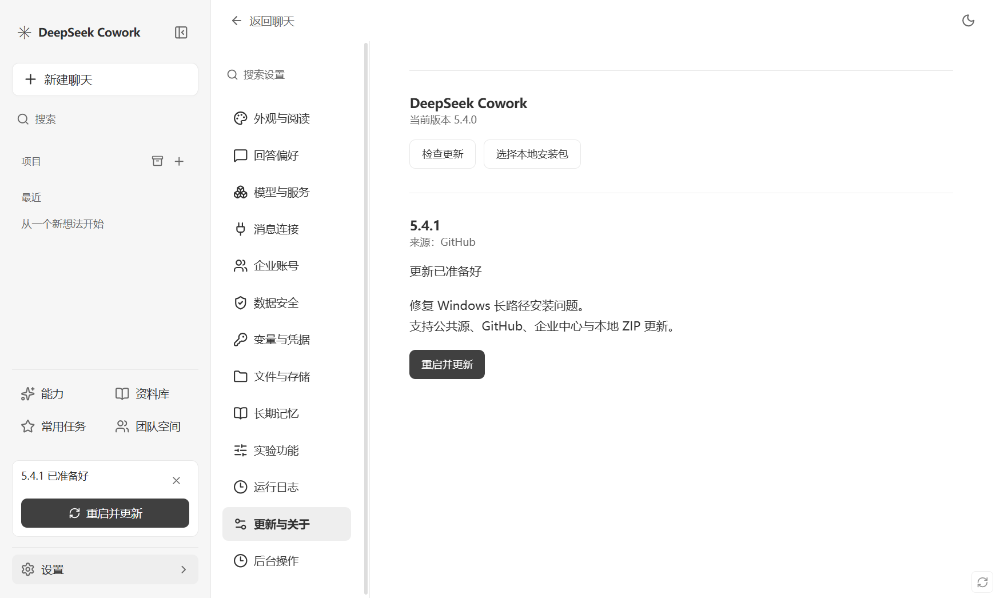

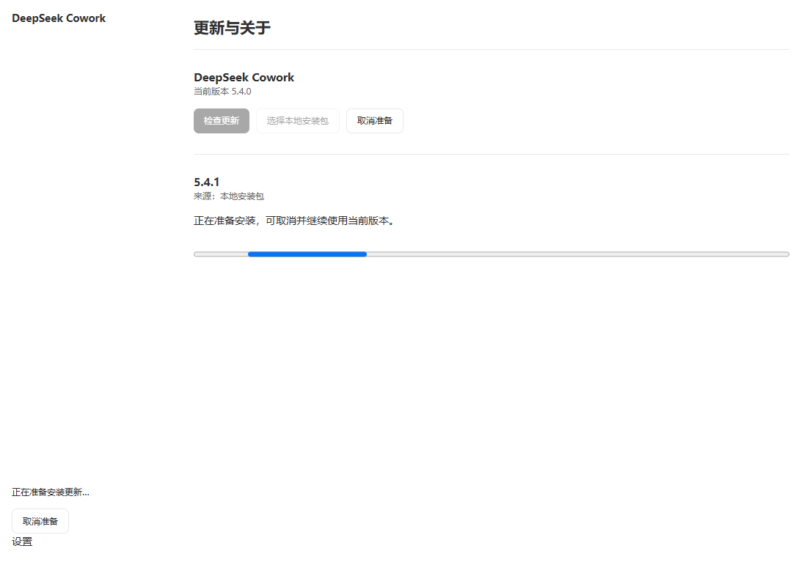

> **遇到旧版反复提示“安装器准备超时”怎么办？**
> 先正常退出当前应用，直接把下载的完整新版 `.zip` 解压到一个**新的空文件夹**，再打开里面的 `deepseek-cowork.exe` 即可（千万不要只把几个散文件拷进旧目录覆盖）。标准安装会自动沿用你原来的配置、聊天记录和附件；如果你之前用的是便携模式（旧程序同级目录下有 `user_data` 文件夹），先备份一份，再把整个 `user_data` 文件夹复制到新程序旁边再启动即可。

### 导出记录与查看日志

- **导出聊天记录**：打开需要备份的对话，点击窗口顶部菜单**“文件 → 导出当前聊天…”**即可保存；单条提问或回答也可直接点气泡下方的复制图标。
- **查询与导出运行日志**：打开“设置 → 运行日志”（或顶部菜单“帮助 → 打开诊断日志”），可按今天 / 最近 7 天及关键词查看日志，或点“导出日志”保存为 `.log` 文件用于排查问题。启动阶段若无法进入主界面，启动页也直接提供“查看诊断日志”与“重试”按钮。
- **查看后台操作记录**：文件上传到云知识库、拉取模型、准备组件等异步任务，都可以在“设置 → 后台操作”里搜索、筛选状态、展开查看最近 300 条带时间戳的过程日志并一键复制，正在进行的操作也可直接取消。

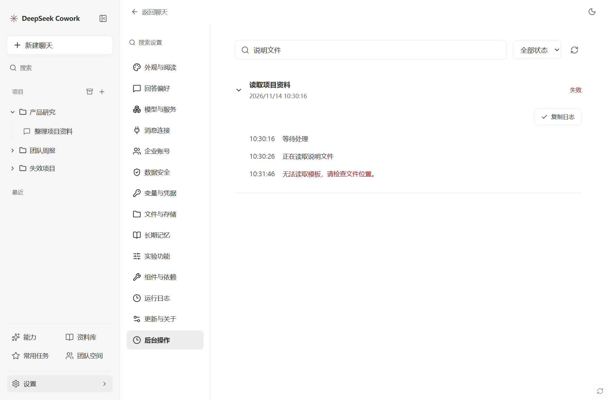

### 从旧版升级的功能变更说明

升级后所有原有的聊天记录、定时任务和本地生成文件均完整保留，以下几个早期旧入口已整合或下线：

- **文档与常用任务技能整合**：旧 `document-reader` 技能已由内置 `documents` 取代；旧常用任务管理技能已统一并入内置 `task-automation`，原有任务与定时计划无缝沿用。
- **实验开关下线**：原“设置 → 实验功能”已移除；浏览器自动化默认使用内置浏览器，之前已安装的 BrowserSkill 组件仍保留在技能页供随时开启。
- **旧版专属 PPT 助手与语音转写下线**：早期独立的 PPT 助手模式及内置的 Frontend Slides、Huashu Design、Guizang PPT 已下线（普通 PPTX 的读取、生成、套模板和连续预览全部正常保留；打开当年的旧 PPT 助手对话时底部会提示后续按普通对话继续处理）。旧版语音转文字技能已下线，历史音频与转写文字保留，当前多媒体技能暂不包含音频转写。

### 常见问题速查

| 遇到的情况 | 怎么处理最快 |
| --- | --- |
| 消息发送失败 | 输入框草稿会自动保留，看一眼红色报错提示（如模型欠费、断网或不支持看图），调好后直接重点发送 |
| 视频提示未配模型或下载失败 | 直接在原回复下方的视频卡上点“配置模型 → 继续任务”或“重试下载”，**不要重新发一遍生成消息** |
| 保存文件时提示外部修改冲突 | 当前编辑内容都留着，先核对硬盘上是不是被别的软件改过，按需另存副本或重新载入 |
| Word / PPT 预览打不开页面 | 在预览区点“重新检测”（排查本机办公软件是否有弹窗卡住），切换“渲染方式”安装 LibreOffice，或点“打开应用编辑”直接看原件 |
| 外部 Chrome / Edge 连不上 | 打开“能力 → 技能 → BrowserSkill”，确认浏览器已开启扩展并点“检查连接” |
| 自定义界面插件显示异常 | 点击窗口右下角“界面恢复与诊断”或顶部菜单“帮助 → 恢复内置界面”一键还原 |

---

## 常用快捷操作

也可随时通过顶部菜单“帮助 → 键盘快捷键”查看核心热键：

| 操作 | 快捷方式 |
| --- | --- |
| 全局搜索聊天、项目与快捷操作 | `Ctrl+K`（`↑ / ↓` 选择，`Enter` 打开，`Esc` 关闭） |
| 新建聊天 / 新建项目 | `Ctrl+N` / `Ctrl+O` |
| 显示或隐藏左侧侧栏 | `Ctrl+Shift+S` |
| 打开设置 | `Ctrl+,` |
| 重新载入界面 | `Ctrl+R` |
| 发送消息 / 输入框内换行 | `Enter` 发送 / `Shift+Enter` 换行 |
| 引用历史对话或选择专家 | 在聊天输入框输入 `@`，或点击左下角“`+`” |
| 保存当前代码、Markdown 或写作页 | `Ctrl+S` |
| 代码编辑器与 Office/PDF 阅读器内查找 | 在对应编辑或阅读区域按 `Ctrl+F` |
| Office/PDF 阅读器与内置网页缩放 | `Ctrl++` 放大、`Ctrl+-` 缩小、`Ctrl+0` 适应宽度/重置（阅读器还支持 `Ctrl + 滚轮`） |
| 本地公共资料库文件重命名 / 删除 | 选中条目按 `F2` 重命名 / 按 `Del` 移入资料回收站 |
| 终端内复制与粘贴 | `Ctrl+Shift+C`、`Ctrl+Shift+V`，或鼠标右键菜单 |

系统架构、能力开发与打包流程详见[技术文档](technical-design.md)（开发依赖见[开发与 Windows 构建](technical-design.md#开发与-windows-构建)），各版本演进见[发布记录](releases/index.md)。

---

## Mac 与统信的功能范围

本手册的操作截图与安装包说明均以 **Windows x64** 正式版为准。Apple Silicon Mac 与统信 UOS V25（`x86_64`）共享同一套核心源码，但其桌面安装包构建、签名与实机验收仍在进行中（Intel Mac、统信 V20 / ARM / 龙架构及 Windows ARM64 不在支持计划内）。

在非 Windows 桌面环境下运行时：对话、项目、文件编辑和定时任务核心一致；默认使用内置浏览器、POSIX 终端与关键词历史搜索，Office 页面预览使用本机安装的 LibreOffice；敏感凭据分别通过 macOS Keychain 或 Linux Secret Service 桌面密钥环加密保护（跨系统迁移数据目录时需重新填写 API Key，密钥环不可用时会明确报错，绝不降级为明文存储）。详见[平台适配说明](technical-design.md#平台适配边界)与[原生构建](technical-design.md#mac-与统信原生构建)。
