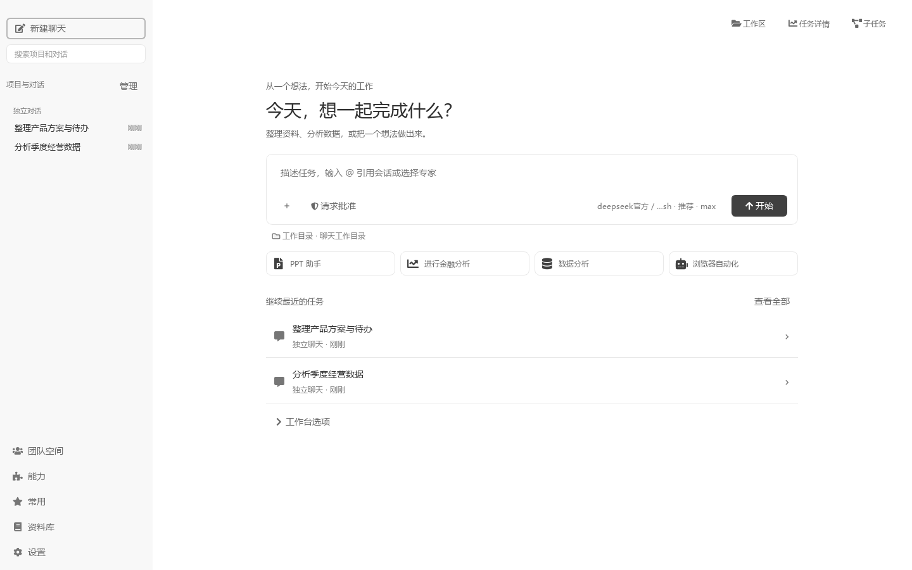
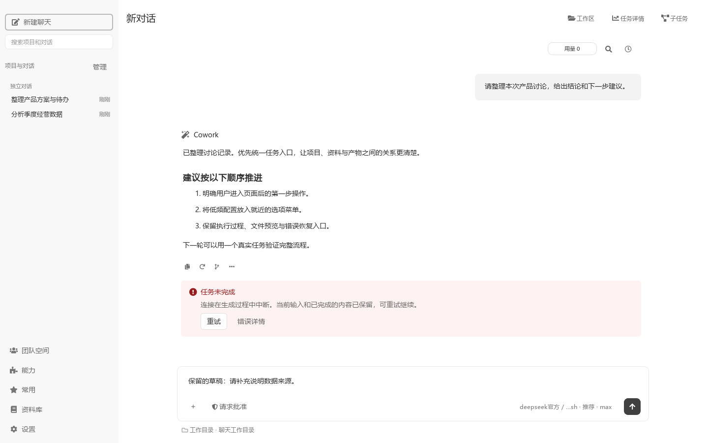
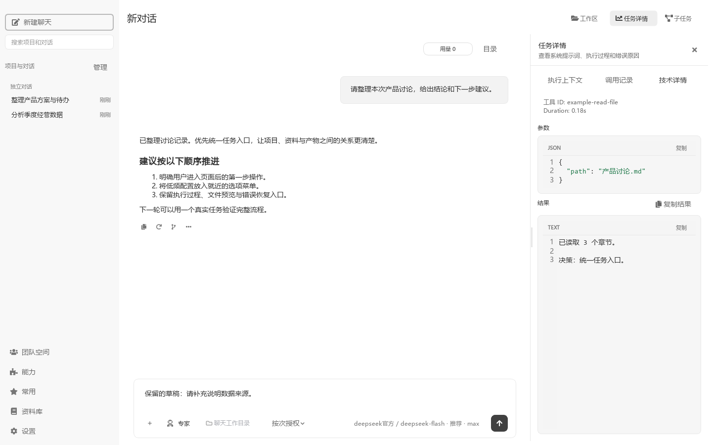

# 工作台界面与操作入口

首页、对话和管理页面共用主题颜色、字体与控件。默认采用柔和的中性色；已选择的其他主题继续生效。

## 开始和继续任务

新对话的输入区位于首页标题下方，尚未开始对话时不显示左上角的“新对话”标题。可以直接描述任务，使用四个快捷入口，或继续最近的两项任务。最近任务显示名称、所属项目和更新时间；“查看全部”进入现有对话管理页。“工作台选项”保留主题定制和工具箱入口。



进入对话后，输入区固定在底部，消息在中间独立滚动。切换对话保留各自草稿。点击顶部标题或聚焦后按 `F2` 可改名，`Enter` 或鼠标左键点击别处保存、`Esc` 取消；没有修改时直接退出编辑，保存失败会保留原名称并提示原因。

输入区的“+”提供“模式、专家、技能、连接器、对话”分类，以及文件、资料引用等操作。鼠标悬停分类片刻或点击，会在箭头旁展开子菜单，父菜单保持可见；可以直接切换分类。上下方向键选择分类，右方向键展开，`Esc` 收起当前子菜单，点击外部关闭整组菜单。

专家、技能、连接器和历史对话均可搜索，MCP 在输入区称为“连接器”。“对话”按标题或项目搜索；选中后保留草稿并显示现有引用标签，发送时沿用 `@` 的引用快照流程。选择技能或连接器后，立即在输入框上方逐个显示中性色标签，点击“×”移除。应用专家选择后，输入区底部显示当前专家标签，点击可切换，点“×”恢复普通助手；每次使用一位专家，选择按会话保存。底部工具栏保持单行。“模式”提供仅作用于下一项任务的拷问开关。权限入口提供“请求批准 / 完全访问”，仍是所有对话之后启动任务的默认设置，详见[执行授权](GOD_MODE.md)。

工作目录固定显示在输入框外侧下方，悬停查看完整路径。空对话可点击选择已有项目或添加项目；已有内容、任务运行中或空间会话仍按原规则限制切换，目录保持可见并说明原因。长名称在窄窗口中省略显示。


粘贴达到 4,000 字符或 80 个换行的长文本时，自动保存为当前会话的 UTF-8 TXT 附件，保留完整原文和已有草稿，随后可继续输入任务要求；保存失败时原文留在输入框。短文本继续直接粘贴。

“用量”保留完整用量浮窗；时钟图标“历史提问”可以跳到某次提问。搜索图标或 `Ctrl+F` 打开当前对话搜索，包含尚未展开的历史消息；每条命中消息记一项，`Enter / Shift+Enter` 切换下一条 / 上一条，`Esc` 关闭，切换会话清空搜索。链接使用可区分的颜色、下划线与加粗。回答末尾保留复制、重新生成、分支和更多操作，悬停图标可查看说明。

用户提问的时间、编辑和复制在鼠标悬停时显示，移开后隐藏。回答显示 Cowork 或当前专家名称，思考过程继续使用现有折叠方式。多文件回复默认显示 3 项及总数量，可展开、收起，点击文件沿用现有预览。失败提示集中展示实际原因，以及当前可用的重试和错误详情入口。

已发送消息的附件和引用对话显示在气泡顶部，使用带图标的标签，多项自动换行。长文件名从中间省略并保留扩展名，悬停查看完整名称与路径。点击文件继续使用原有打开或图片预览方式；点击对话标签查看发送时的引用快照，旁边的跳转图标打开来源对话。分支中的历史引用保留“历史引用”提示，只打开来源，不代表已带入快照。编辑消息时标签保持可见，输入区的添加、移除和发送操作不变。





## 查看文件、执行过程和子任务

右上角提供三个入口：

- **工作区**：文件、网页和终端沿用同一组标签；目录按钮打开原有浮动文件目录。文件预览铺满可用区域，原有编辑、保存、查找和更多操作继续可用。
- **任务详情**：包含“执行上下文、调用记录、技术详情”。上下文先展示当前会话的项目、引用资料、专家与能力、工作目录；展开“完整执行上下文”查看最近实际请求的原文。“复制全量”始终复制完整内容。调用记录仍可进入参数和结果详情。
- **子任务**：查看与控制已有子任务，保留其独立对话、补充要求、停止和恢复入口。


终端的长路径提示会适当省略：PowerShell 保留根目录与当前目录，Git Bash 保留末尾目录。实际工作目录和命令输出保持完整；可用 `Get-Location` 或 `pwd` 查看完整路径。




## 管理页面与小窗口

团队空间、能力、常用任务、资料库和设置保留原有信息结构及操作，使用统一主题。设置页复用已打开页面；配置发生变化后重新加载，未保存内容仍按原流程确认。输入区操作统一从“+”进入，右侧面板内容可滚动，深色主题也使用同一套布局。

能力页将标题与添加入口集中在顶部，技能、MCP 服务和专家沿用原有切换与配置流程。卡片收紧留白，按窗口宽度重排。

设置页采用白色内容区和浅灰分类导航，具体颜色服从当前主题。搜索显示可点击的设置项与所在分类，点击或按 `Enter` 定位；向下键进入结果列表，`Esc` 清空搜索。主题风格之后直接展示字体、文字大小和密度，效果示例放在阅读设置后面。即时切换主题、保存阅读偏好及取消 AI 主题预览继续沿用各自的保存边界。


切换技能、专家、历史对话或资料库来源时，选择列表和连接表单保持在主窗口内。相关控件在构造时就归属于页面，避免短暂闪出带系统标题栏的空白小窗口。检查范围和 Windows 原生窗口验证记录见[子控件窗口检查](screenshots/child-window-audit/README.md)。

| 页面 | 浅色截图 | 深色与 150% 缩放截图 |
| --- | --- | --- |
| 首页 | [查看](images/focused-workspace/home-light-100.png) | [查看](images/focused-workspace/home-dark-150-compact.png) |
| 团队空间 | [查看](images/workspace-redesign/team_spaces-light-100.png) | [查看](images/workspace-redesign/team_spaces-dark-150-compact.png) |
| 能力 | [查看](images/focused-workspace/capabilities-light-100.png) | [查看](images/focused-workspace/capabilities-dark-150-compact.png) |
| 常用任务 | [查看](images/workspace-redesign/favorites-light-100.png) | [查看](images/workspace-redesign/favorites-dark-150-compact.png) |
| 资料库 | [查看](images/workspace-redesign/knowledge-light-100.png) | [查看](images/workspace-redesign/knowledge-dark-150-compact.png) |
| 设置 | [查看](images/focused-workspace/settings-light-100.png) | [查看](images/focused-workspace/settings-dark-150-compact.png) |

截图使用隔离的示例数据；团队空间、资料库展示未连接状态。它们验证界面布局，不代表已验证外部账号登录、网络服务或真实模型运行。

## 复现界面检查

在仓库根目录执行：

```powershell
.venv/Scripts/python.exe -X utf8 -B scripts/render_workspace_ui_screenshots.py --mode light
.venv/Scripts/python.exe -X utf8 -B scripts/render_workspace_ui_screenshots.py --mode dark --scale 1.5 --compact
.venv/Scripts/python.exe -X utf8 -B scripts/render_workspace_ui_screenshots.py --message-context
.venv/Scripts/python.exe -X utf8 -B scripts/render_workspace_ui_screenshots.py --message-context --mode dark --scale 1.5 --compact
```

脚本使用临时配置和 Qt 离屏窗口，不读取个人会话、不调用模型；结束时检查主题预览未写入已保存配置。

仅复查首页、聊天展示、能力和设置的本轮调整：

```powershell
.venv/Scripts/python.exe -X utf8 -B scripts/render_workspace_ui_screenshots.py --focused
.venv/Scripts/python.exe -X utf8 -B scripts/render_workspace_ui_screenshots.py --focused --scale 1.5 --compact
.venv/Scripts/python.exe -X utf8 -B scripts/render_workspace_ui_screenshots.py --focused --mode dark --scale 1.5 --compact
.venv/Scripts/python.exe -X utf8 -B -m pytest -q -s test/test_workspace_presentation.py test/test_conversation_runtime_fixes.py test/test_settings_redesign.py test/test_chat_experience.py test/test_settings_ui_styles.py test/test_theme_settings_ui.py test/test_capability_cards.py
```

`--focused` 将截图保存到 `images/focused-workspace/`，覆盖默认、用户消息悬停、多文件、失败和设置搜索状态；普通窗口为 1440×900，紧凑窗口为 760×760。故障截图使用隔离的模拟错误，不代表真实模型请求失败。

本轮相关测试 75 项及 9 个子测试通过；补充检查中，用户消息悬停、失败重试及既有思考展示等 7 项通过。`test_completed_live_turn_folds_process_and_can_expand_it_again` 仍有一处旧断言失败：它要求展开执行过程时同时展开各阶段的思考详情，而当前实现保留各阶段的折叠状态。使用 `HEAD:main.py` 的原始 `AssistantTurnGroup` 与 `ChatBubble` 复现了同一失败，本轮按要求保留现有思考交互。
