# 工作台界面与操作入口

首页、对话和管理页面共用主题颜色、字体与控件。默认采用柔和的中性色；已选择的其他主题继续生效。

## 开始和继续任务

新对话的输入区位于首页标题下方，尚未开始对话时不显示左上角的“新对话”标题。可以直接描述任务，使用四个快捷入口，或继续最近的两项任务。最近任务显示名称、所属项目和更新时间；“查看全部”进入现有对话管理页。“工作台选项”保留主题定制和工具箱入口。

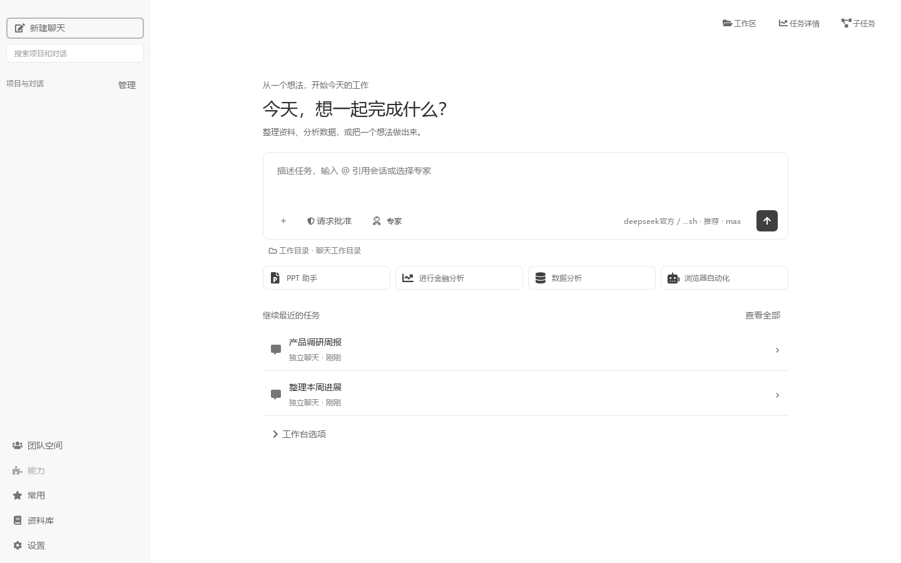

首页标题上下保留简短引导，输入框默认高度缩短约 20%；输入多行内容时沿用原有自动增高方式，清空后恢复紧凑高度。快捷入口、最近任务和输入区工具栏的操作保持不变；展开“工作台选项”后，以两行入口访问主题设计和工具包设置。

进入对话后，输入区固定在底部，消息在中间独立滚动。切换对话保留各自草稿。点击顶部标题或聚焦后按 `F2` 可改名，`Enter` 或鼠标左键点击别处保存、`Esc` 取消；没有修改时直接退出编辑，保存失败会保留原名称并提示原因。

尚未发送的新任务在侧栏显示“草稿 · 内容摘要”；首次发送成功后改为对话标题，悬停提示同步更新，调整窗口宽度或切换会话后仍保持。已有对话中的后续未发送输入会继续保留，不会把对话标题改成“草稿”。[发送后标题验证](screenshots/draft-title-20261028/README.md)。

输入区的“+”提供“模式、专家、技能、连接器、对话”分类，以及文件、资料引用等操作。鼠标悬停分类片刻或点击，会在箭头旁展开子菜单，父菜单保持可见；可以直接切换分类。上下方向键选择分类，右方向键展开，`Esc` 收起当前子菜单，点击外部关闭整组菜单。

专家、技能、连接器和历史对话均可搜索，MCP 在输入区称为“连接器”。“对话”按标题或项目搜索；选中后保留草稿并显示现有引用标签，发送时沿用 `@` 的引用快照流程。选择技能或连接器后，立即在输入框上方逐个显示中性色标签，点击“×”移除。应用专家选择后，输入区底部显示当前专家标签，点击可切换，点“×”恢复普通助手；每次使用一位专家，选择按会话保存。底部工具栏保持单行。“模式”提供仅作用于下一项任务的拷问开关。权限入口提供“请求批准 / 完全访问”，仍是所有对话之后启动任务的默认设置，详见[执行授权](GOD_MODE.md)。

工作目录固定显示在输入框外侧下方，悬停查看完整路径。空对话可点击选择已有项目或添加项目；已有内容、任务运行中或空间会话仍按原规则限制切换，目录保持可见并说明原因。长名称在窄窗口中省略显示。

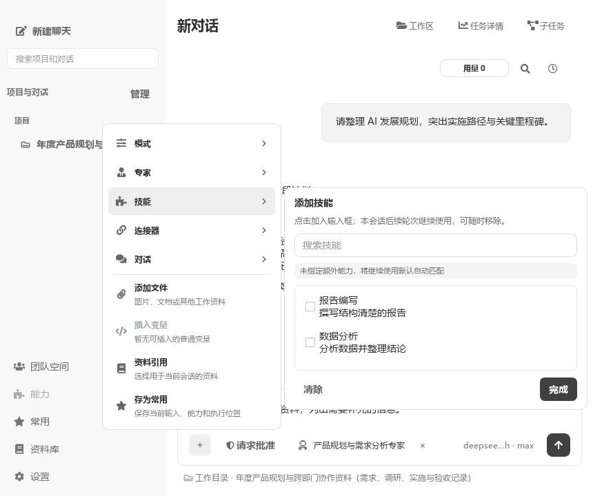

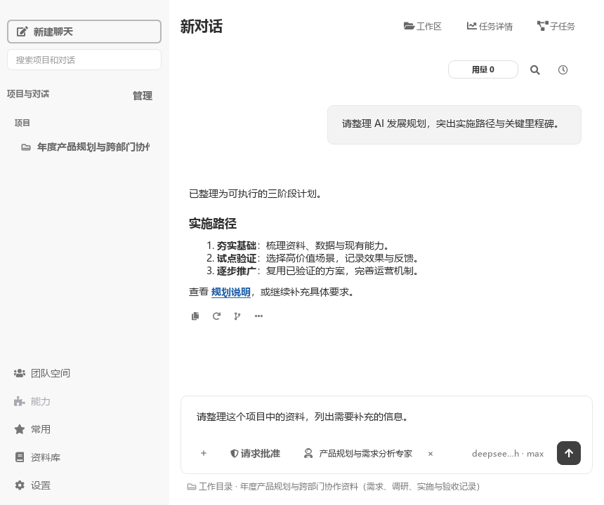

粘贴达到 4,000 字符或 80 个换行的长文本时，自动保存为当前会话的 UTF-8 TXT 附件，保留完整原文和已有草稿，随后可继续输入任务要求；保存失败时原文留在输入框。短文本继续直接粘贴。

“用量”保留完整用量浮窗；时钟图标“历史提问”可以跳到某次提问。搜索图标或 `Ctrl+F` 打开当前对话搜索，包含尚未展开的历史消息；每条命中消息记一项，`Enter / Shift+Enter` 切换下一条 / 上一条，`Esc` 关闭，切换会话清空搜索。链接使用可区分的颜色、下划线与加粗。回答末尾保留复制、重新生成、分支和更多操作，悬停图标可查看说明。

用户提问的时间、编辑和复制在鼠标悬停时显示，移开后隐藏。回答显示 Cowork 或当前专家名称，思考过程继续使用现有折叠方式。多文件回复默认显示 3 项及总数量，可展开、收起，点击文件沿用现有预览。失败提示集中展示实际原因，以及当前可用的重试和错误详情入口。

已发送消息的附件和引用对话显示在气泡顶部，使用带图标的标签，多项自动换行。长文件名从中间省略并保留扩展名，悬停查看完整名称与路径。点击文件继续使用原有打开或图片预览方式；点击对话标签查看发送时的引用快照，旁边的跳转图标打开来源对话。分支中的历史引用保留“历史引用”提示，只打开来源，不代表已带入快照。编辑消息时标签保持可见，输入区的添加、移除和发送操作不变。

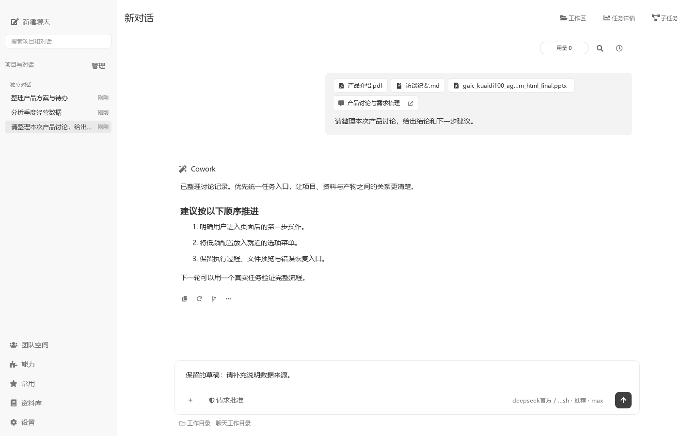

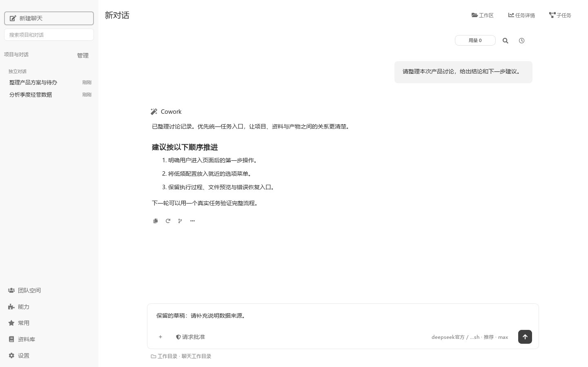

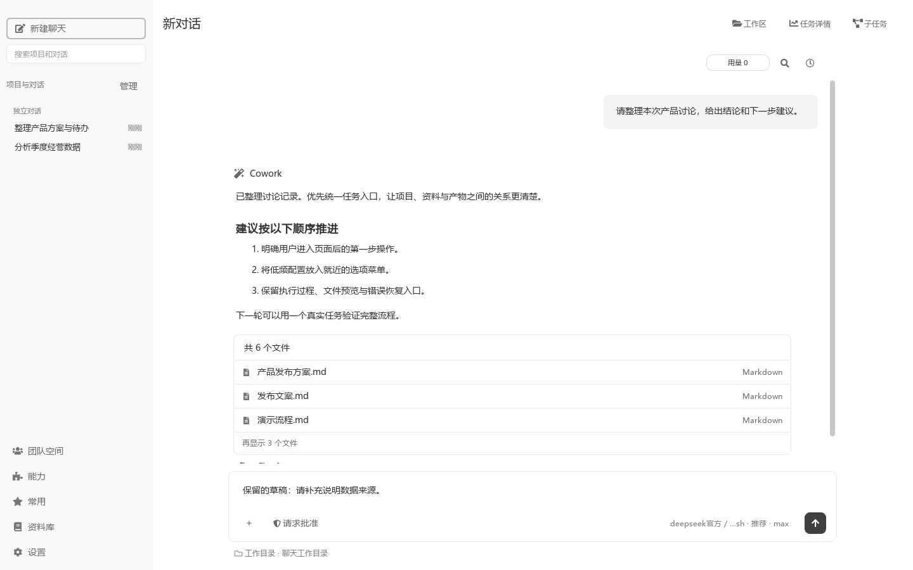

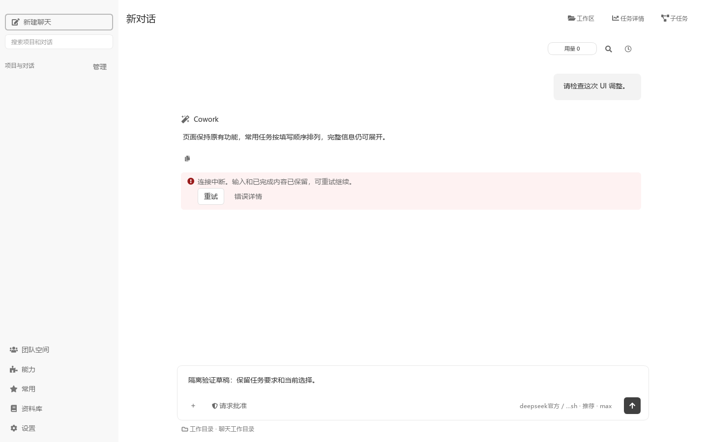

用量浮窗始终限制在应用可用窗口内，内容较长时滚动阅读。“复制全部统计”复制完整统计原文，展开与否不影响复制范围。

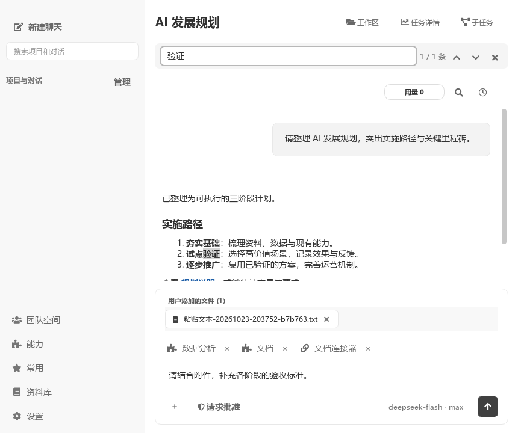

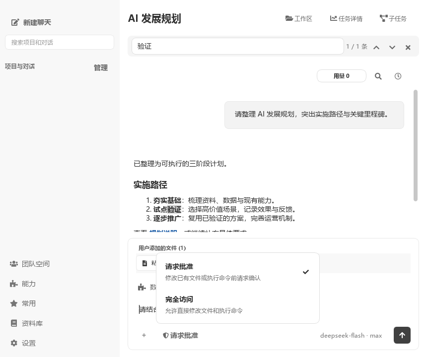

## 回答 AI 的问题

一组问题显示在同一个提问区，默认展开第一题。其他题目显示当前答案摘要，点击标题即可展开修改；选择后不会自动跳题。

普通问卷按 AI 将推荐项放在首位的约定，标出“推荐”并默认选中。可以直接点击“提交回答”采用这组答案，也可以改选或填写“其他回答”；填写文字会取消该题原有选择。仅预选不会提交，完全不操作也不会超时自动采用答案。拷问模式中“确认并执行”等执行决策仍需主动选择。

题目较长时在提问区内滚动，底部保留问题数量、采用推荐的数量和统一提交入口。提交失败会保留输入并提供“重试提交”；取消或任务结束后，可查看和复制当前未提交的回答。

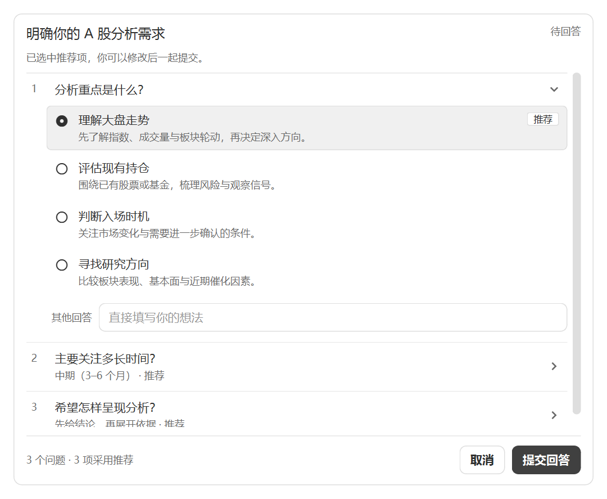

收到成功确认后，表单缩成“已提交 N 项回答 · 查看”。点击“查看”展开实际提交的答案，再次点击收起；回执在重新打开历史和折叠执行过程后仍可查看，不增加重复聊天消息。


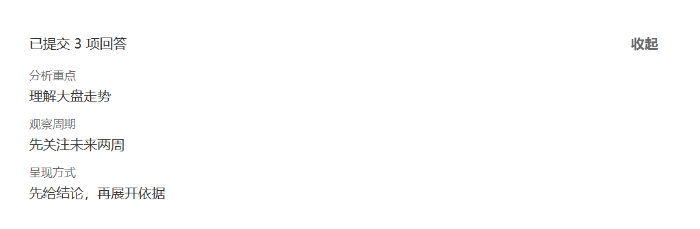

[窄宽浅色](assets/conversation-runtime/questionnaire-light-small-1x.png)、[窄宽深色与额外缩放](assets/conversation-runtime/questionnaire-dark-small-1.5x.png)、[失败重试](assets/conversation-runtime/questionnaire-retry-1x.png)。验证使用 Windows 原生 Qt 组件与隔离示例数据：系统缩放 150%，`QT_SCALE_FACTOR=1` 时 DPR 为 1.5，额外设置 `1.5` 后 DPR 为 2.25；主题预览取消后画面和保存配置恢复。未调用真实模型或外部账号。

复现：`.venv/Scripts/python.exe -X utf8 -B scripts/render_conversation_runtime_screenshots.py --questionnaire`，设置 `QT_QPA_PLATFORM=windows`，分别使用 `QT_SCALE_FACTOR=1` / `1.5`。自动检查见 `test/test_questionnaire_interactions.py`、`test/test_interaction_lifecycle.py` 和 `test/test_interaction_skill.py`，包含统一提交、重试、取消、键盘、历史保存与重载、跨会话隔离和终态通知时序。

2026-10-28 验证：问卷及交互生命周期、工具路由、相关会话回归与主题共 81 项及 29 个子测试通过。扩展的 4 个拷问集成用例因既有 `_ConfigStub` 缺少 `get_god_mode()` 在初始化时失败；另一个内联可视化用例期望 1 个卡片、实际为 0，使用 HEAD 中的原始 `main.py` 与测试文件同样复现。没有修改这些无关业务或测试夹具，不据此声明全仓测试通过。

## 查看文件、执行过程和子任务

右上角提供三个入口：

- **工作区**：文件、网页和终端沿用同一组标签；目录按钮打开原有浮动文件目录。文件预览铺满可用区域，原有编辑、保存、查找和更多操作继续可用。
- **任务详情**：包含“执行上下文、调用记录、技术详情”。上下文先展示当前会话的项目、引用资料、专家与能力、工作目录；展开“完整执行上下文”查看最近实际请求的原文。“复制全量”始终复制完整内容。调用记录仍可进入参数和结果详情。
- **子任务**：查看与控制已有子任务，保留其独立对话、补充要求、停止和恢复入口。

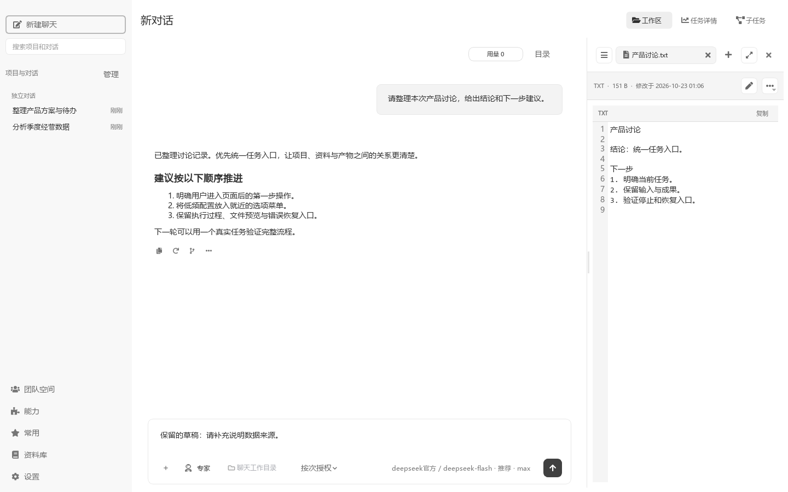

终端的长路径提示会适当省略：PowerShell 保留根目录与当前目录，Git Bash 保留末尾目录。实际工作目录和命令输出保持完整；可用 `Get-Location` 或 `pwd` 查看完整路径。

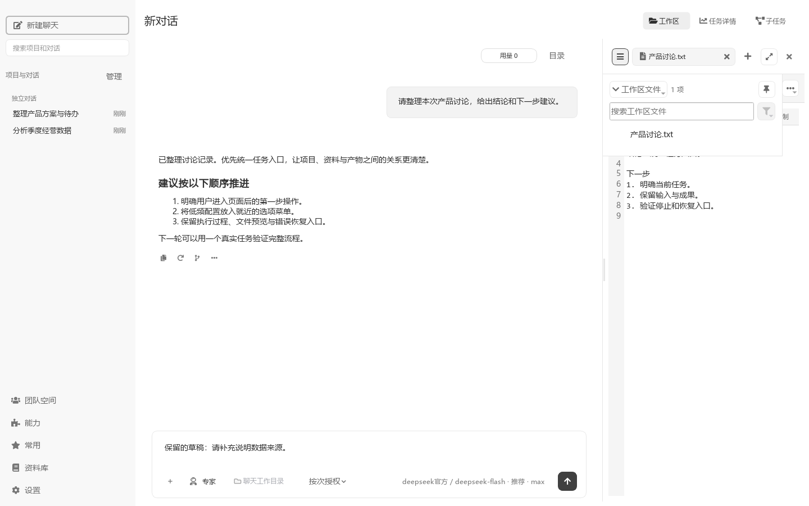

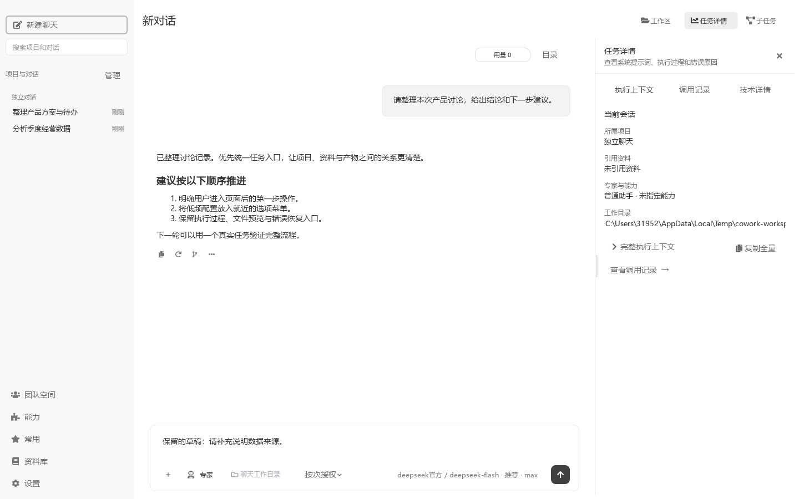

尚未选择调用时，“技术详情”显示查看调用记录的入口；选中后显示完整参数和结果，切换会话清除上一会话的详情。

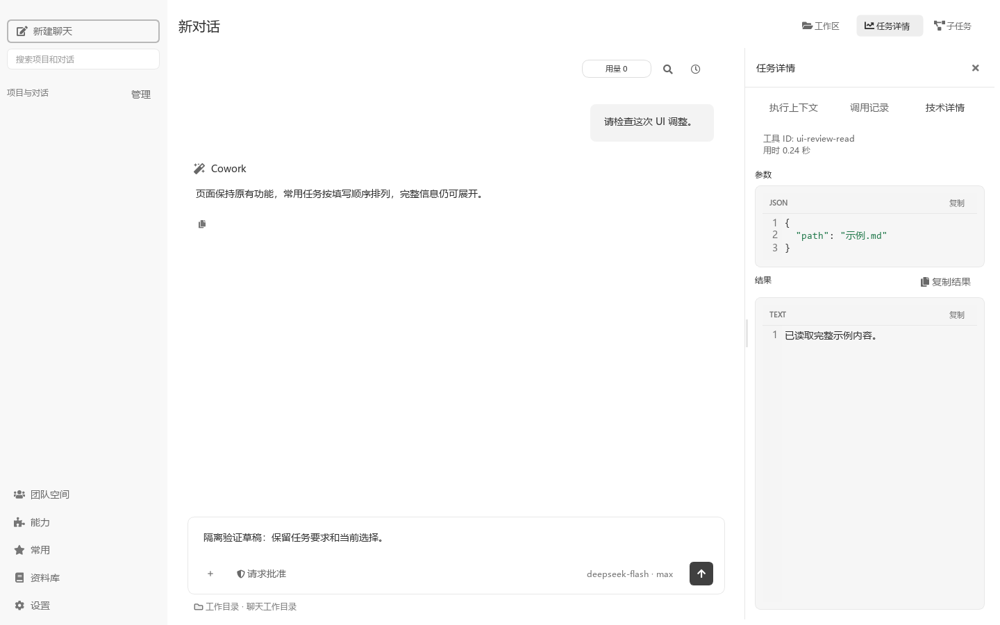

## 管理页面与小窗口

团队空间、能力、常用任务、资料库和设置保留原有信息结构及操作，使用统一主题。设置页复用已打开页面；配置发生变化后重新加载，未保存内容仍按原流程确认。输入区操作统一从“+”进入，右侧面板内容可滚动，深色主题也使用同一套布局。

能力页将标题与添加入口集中在顶部，技能、MCP 服务和专家沿用原有切换与配置流程。卡片收紧留白，按窗口宽度重排。

常用任务编辑按任务内容、能力、运行设置、定时与消息发送的顺序纵向填写。定时设置使用内容区全宽，保存与取消固定在顶部；项目选择、六种时间规则、独立运行内容、消息绑定和历史入口继续保留。

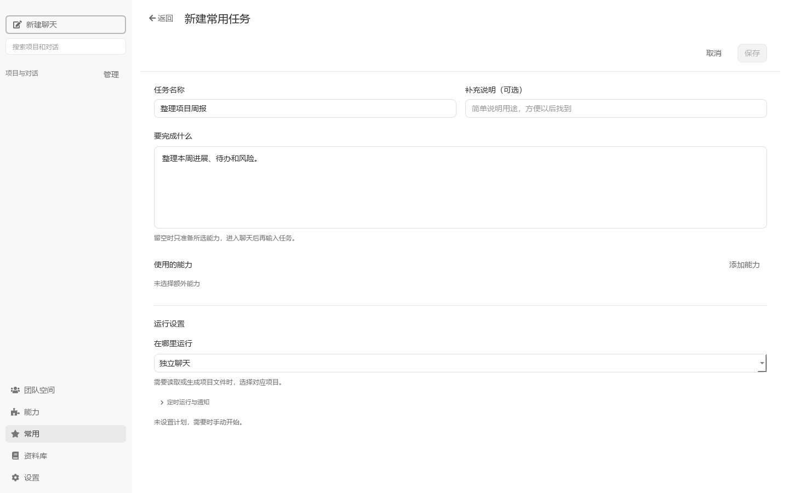

本次界面调整、保留功能清单及实际验证边界见[UI 复核记录](screenshots/ui-review-20261025/README.md)。

设置页采用白色内容区和浅灰分类导航，具体颜色服从当前主题。搜索显示可点击的设置项与所在分类，点击或按 `Enter` 定位；向下键进入结果列表，`Esc` 清空搜索。主题风格之后直接展示字体、文字大小和密度，效果示例放在阅读设置后面。即时切换主题、保存阅读偏好及取消 AI 主题预览继续沿用各自的保存边界。

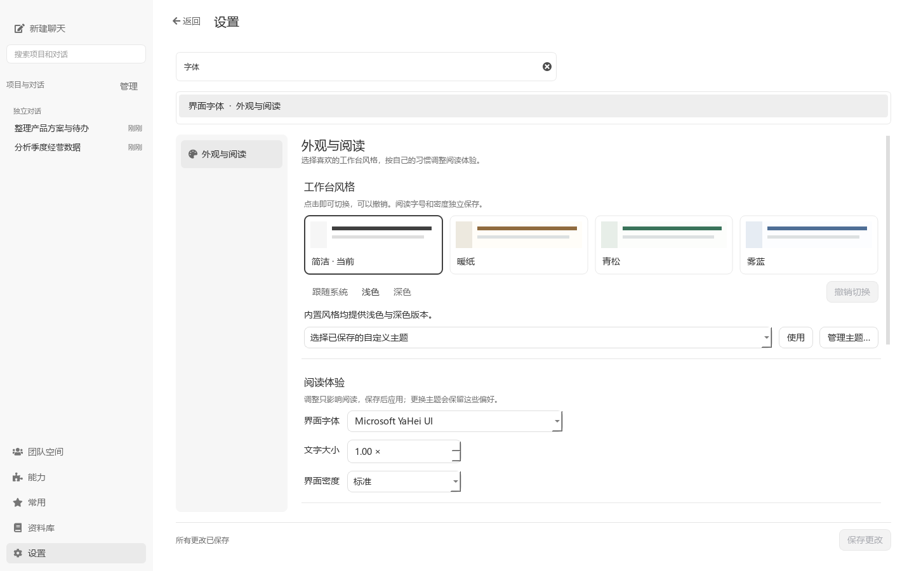

切换技能、专家、历史对话或资料库来源时，选择列表和连接表单保持在主窗口内。相关控件在构造时就归属于页面，避免短暂闪出带系统标题栏的空白小窗口。检查范围和 Windows 原生窗口验证记录见[子控件窗口检查](screenshots/child-window-audit/README.md)。

| 页面 | 浅色截图 | 深色与 150% 缩放截图 |
| --- | --- | --- |
| 首页 | [查看](images/focused-workspace/home-light-100.png) | [查看](images/focused-workspace/home-dark-150-compact.png) |
| 团队空间 | [查看](images/workspace-redesign/team_spaces-light-100.png) | [查看](images/workspace-redesign/team_spaces-dark-150-compact.png) |
| 能力 | [查看](images/focused-workspace/capabilities-light-100.png) | [查看](images/focused-workspace/capabilities-dark-150-compact.png) |
| 常用任务 | [查看](images/workspace-redesign/favorites-light-100.png) | [查看](images/workspace-redesign/favorites-dark-150-compact.png) |
| 资料库 | [查看](images/workspace-redesign/knowledge-light-100.png) | [查看](images/workspace-redesign/knowledge-dark-150-compact.png) |
| 设置 | [查看](images/focused-workspace/settings-light-100.png) | [查看](images/focused-workspace/settings-dark-150-compact.png) |

截图使用隔离的示例数据；团队空间、资料库展示未连接状态。它们验证界面布局，不代表已验证外部账号登录、网络服务或真实模型运行。

## 复现界面检查

### 模型选择与配置

模型选择浮层底部提供“配置新模型”，无配置或无搜索结果时仍可进入。点击外部或按 `Esc` 收起，不抢占刚点击控件的焦点。“设置 → 模型与服务”先展示服务总览，顶部提供“添加服务”。服务详情用一行标题和返回箭头定位，地址位于标题下方；“编辑连接”“管理接入密钥”和删除集中放入“更多”。模型数量、手动添加和获取模型位于同一栏；点击模型名称或右侧箭头进入编辑，测试保留轻量文字入口。勾选后显示删除或批量配置，不再重复单个模型的编辑按钮。新对话默认模型单独配置。

新增服务使用同一个页内流程：账号登录或填写 API Key → 选择密钥 → 获取并选择模型 → 加入设置草稿。sub2api / New API 支持站点识别、密码登录与 TOTP，多个密钥按账号归为服务、按密钥和分组筛选。创建远端密钥是独立页面步骤，创建不确定时只能先核对；取消本地接入不删除远端密钥。部分失败保留已完成结果并提供逐个重试。站点能力未提供与明确不支持分开显示，不推断模型名、不自动调用模型。

每一步只保留一个返回入口，并保留当前输入与选择；前往站点和放弃接入位于“更多”，需要网页验证时直接显示前往站点入口。登录表单按内容高度靠上排列，服务名称为末尾选填项；密钥列表上方放刷新和创建，下方只突出获取模型。模型编辑页只展示当前模型、所属服务和表单；站点声明就地折叠，未确认的调用方式及读取失败仍直接显示。保存继续使用页面底部统一的“保存更改”。

两个接入入口都支持直接粘贴登录页、仪表盘或控制台地址，例如 `https://example.com/login`、`https://example.com/dashboard` 和 `https://example.com/proxy/console/token`。应用去掉这些已知页面路径、查询参数和页面片段，保留 `/proxy` 这类部署前缀；手动填写的自定义 API 路径继续保留。模型行按实际配置显示图片理解、图片生成和推理；站点未声明能力或协议时分别显示“能力信息未提供”和“调用方式未确认”。

模型表单只使用页面底部“保存更改”；失败保留草稿，切换服务保留草稿，离开设置走统一确认。保存后的“返回对话并使用”绑定进入配置时的对话，不会自动更改其他对话或默认模型。

| 状态 | 实际 Qt 截图 |
| --- | --- |
| 选择模型与配置入口 | [查看](images/model-services-refinement-20261030/picker.png) |
| 服务总览 | [查看](images/model-services-refinement-20261030/services-overview.png) |
| 站点识别与登录 | [识别](images/model-services-refinement-20261030/service-connect.png) · [登录](images/model-services-refinement-20261030/service-sign-in.png) |
| 密钥选择与创建 | [选择](images/model-services-refinement-20261030/service-keys.png) · [创建](images/model-services-refinement-20261030/service-key-create.png) |
| 部分失败与重试 | [浅色](images/model-services-refinement-20261030/service-partial-failure.png) · [深色](images/model-services-refinement-20261030/service-partial-failure-dark.png) |
| 多密钥服务 | [模型选择](images/model-services-refinement-20261030/service-model-selection.png) · [服务详情](images/model-services-refinement-20261030/service-multiple-keys.png) |
| 模型列表 | [查看](images/model-services-refinement-20261030/model-list.png) |
| 服务连接展开 | [查看](images/model-services-refinement-20261030/service-connections.png) |
| 小窗口模型列表 | [查看](images/model-services-refinement-20261030/model-list-narrow.png) |
| 深色模型列表 | [查看](images/model-services-refinement-20261030/model-list-dark.png) |
| 页内编辑 | [查看](images/model-services-refinement-20261030/editor.png) |
| 小窗口 | [查看](images/model-services-refinement-20261030/editor-narrow.png) |
| 原生窗口叠加 Qt 1.5 倍缩放、底部 | [查看](images/model-services-refinement-20261030/native/editor-narrow-bottom-150.png) |
| 深色主题 | [查看](images/model-services-refinement-20261030/editor-dark.png) |
| 未保存的主题候选 | [查看](images/model-services-refinement-20261030/editor-theme-preview.png) |
| 校验错误与输入保留 | [查看](images/model-services-refinement-20261030/editor-validation.png) |

```powershell
.venv/Scripts/python.exe -X utf8 -B scripts/render_model_configuration.py
$env:QT_SCALE_FACTOR='1.5'
.venv/Scripts/python.exe -X utf8 -B scripts/render_model_configuration.py
Remove-Item Env:QT_SCALE_FACTOR
.venv/Scripts/python.exe -X utf8 -B -m pytest -q test/test_gateway_accounts.py test/test_gateway_setup.py test/test_model_configuration_flow.py test/test_model_catalog_and_onboarding.py test/test_default_model_settings.py
```

截图脚本使用隔离配置和模拟站点接口，不发起真实模型请求。覆盖识别、登录、创建密钥、部分失败、重试、导入与保存，并验证原对话切换、其他会话与默认模型不变、主题候选不落盘、无游离窗口、无水平溢出。滚到底部必须看到测试操作，防止隐藏表单把当前页面撑出空白。默认使用 Qt 离屏窗口，`QT_SCALE_FACTOR` 不等同于 Windows 系统缩放。本站点接入的接口契约与验收范围见[验证记录](gateway-model-services-validation.md)。

页面调整后的模型配置、默认模型及目录导入回归共 51 项及 5 个子测试通过，另复查新增的模型行操作与切换设置保留草稿。覆盖保存重试、多个模型一次保存、原会话绑定、主题选项提交与撤销；未调用真实模型服务。变更文档的本地链接检查通过；全量 `scripts/check_docs.py` 仍被 9 份文档的 `5.3.0` 版本标记拦住，当前 `APP_VERSION` 为 `5.3.1`，已用 `HEAD` 核对这些旧标记在本次修改前存在。

DeepSeek 官方模型默认极简启动的后续验证：`test/test_agent_bootstrap.py`、`test/test_model_catalog_and_onboarding.py`、`test/test_default_model_settings.py`、`test/test_model_configuration_flow.py` 共 68 项及 48 个子测试通过；补充复查旧配置与默认模型生成时使用对应服务地址。覆盖任意官方模型名、官方地址校验、缺省启用、已保存关闭值保留、首轮转完整能力、消息保留及失败恢复。设置页截图见 `images/model-configuration/deepseek-minimal-default.png` 与 `deepseek-minimal-narrow.png`，同脚本包含 150% Qt 缩放版本；未发起真实模型请求。

### 其他工作台页面

在仓库根目录执行：

```powershell
.venv/Scripts/python.exe -X utf8 -B scripts/render_workspace_ui_screenshots.py --mode light
.venv/Scripts/python.exe -X utf8 -B scripts/render_workspace_ui_screenshots.py --mode dark --scale 1.5 --compact
.venv/Scripts/python.exe -X utf8 -B scripts/render_workspace_ui_screenshots.py --message-context
.venv/Scripts/python.exe -X utf8 -B scripts/render_workspace_ui_screenshots.py --message-context --mode dark --scale 1.5 --compact
```

脚本使用临时配置和 Qt 离屏窗口，不读取个人会话、不调用模型；结束时检查主题预览未写入已保存配置。

仅复查首页、聊天展示、能力和设置的本轮调整：

```powershell
.venv/Scripts/python.exe -X utf8 -B scripts/render_workspace_ui_screenshots.py --focused
.venv/Scripts/python.exe -X utf8 -B scripts/render_workspace_ui_screenshots.py --focused --scale 1.5 --compact
.venv/Scripts/python.exe -X utf8 -B scripts/render_workspace_ui_screenshots.py --focused --mode dark --scale 1.5 --compact
.venv/Scripts/python.exe -X utf8 -B -m pytest -q -s test/test_workspace_presentation.py test/test_conversation_runtime_fixes.py test/test_settings_redesign.py test/test_chat_experience.py test/test_settings_ui_styles.py test/test_theme_settings_ui.py test/test_capability_cards.py
```

`--focused` 将截图保存到 `images/focused-workspace/`，覆盖默认、用户消息悬停、多文件、失败和设置搜索状态；普通窗口为 1440×900，紧凑窗口为 760×760。故障截图使用隔离的模拟错误，不代表真实模型请求失败。

本轮相关测试 75 项及 9 个子测试通过；补充检查中，用户消息悬停、失败重试及既有思考展示等 7 项通过。`test_completed_live_turn_folds_process_and_can_expand_it_again` 仍有一处旧断言失败：它要求展开执行过程时同时展开各阶段的思考详情，而当前实现保留各阶段的折叠状态。使用 `HEAD:main.py` 的原始 `AssistantTurnGroup` 与 `ChatBubble` 复现了同一失败，本轮按要求保留现有思考交互。
