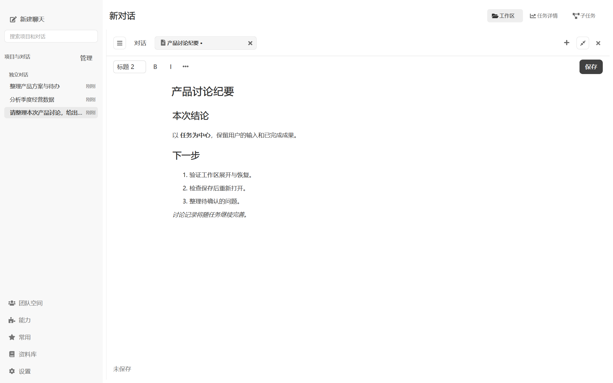
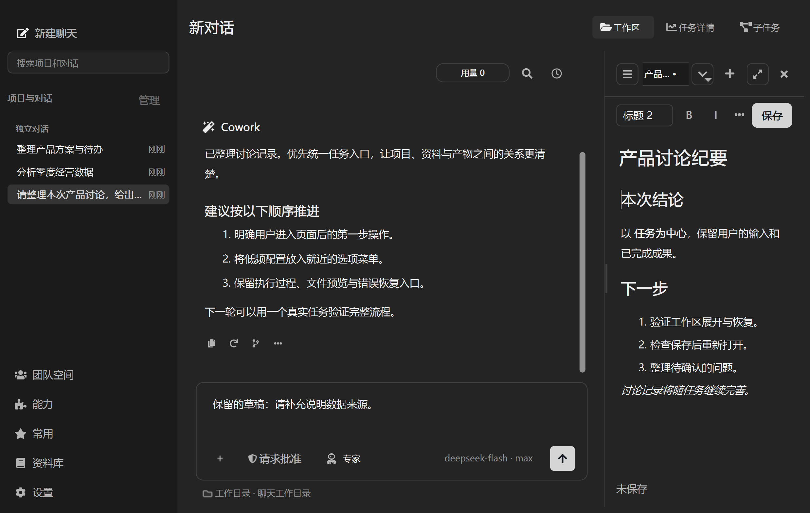
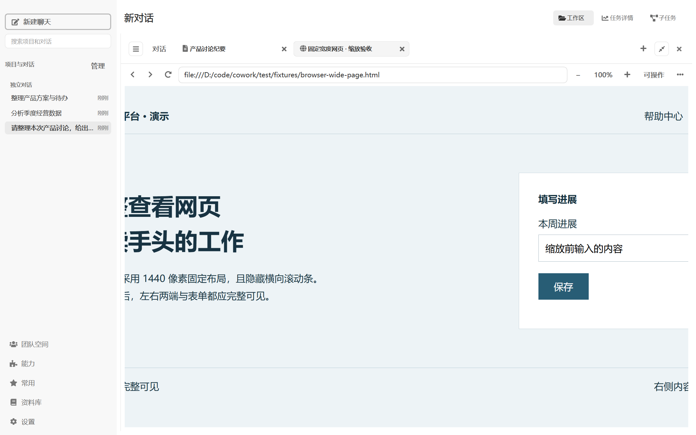

# 工作区展开与写作页验证

2026-10-31。实现范围为紧凑网页工具栏、工作区展开与固定对话标签，以及保存为 Markdown 的写作页。

## 已验证行为

- 展开、切换对话标签、返回工作区、恢复原栏宽；消息区和输入区保持同一控件，输入和页面内容保留。
- 中文标题／正文、标题层级、加粗、斜体、组合格式、列表、链接和 Markdown 字面字符的保存往返；纯文本粘贴、撤销／重做、`Ctrl+B`、`Ctrl+S`。
- 首次命名创建文件、同名保护、非法名称、写入失败、外部修改冲突、关闭时保存／放弃／取消、保存期间继续输入及恢复副本错误反馈。
- 退出检查覆盖写入线程已结束但界面回调尚未消费的窗口；回调更新文件路径与保存基线后才允许最终恢复快照。
- 页面按会话隔离，保存后原位绑定文件，恢复后可继续编辑；可切换回原有预览和源码编辑。未保存页面不进入模型文件上下文，切到对话标签时不将后台文件标为可见。
- 浏览器缩放、旧观察失效、接管、原生坐标点击、后台网页、终端及文件编辑回归。系统提示词、工具定义和稳定前缀保持不变，已有请求上下文测试通过。

主要测试入口：

```powershell
.venv/Scripts/python.exe -X utf8 -B -m pytest -q test/test_writing_pages.py test/test_browser_zoom.py test/test_browser_workbench.py test/test_browser_target_freshness.py
.venv/Scripts/python.exe -X utf8 -B -m pytest -q test/test_workspace_presentation.py test/test_conversation_drafts.py test/test_deliverable_editor_ui.py test/test_workbench_context.py test/test_child_window_lifecycle.py
.venv/Scripts/python.exe -X utf8 -B -m pytest -q test/test_writing_pages.py test/test_worker_lifecycle.py
```

窗口集成检查使用临时应用数据目录；WebEngine 集成组使用 `QT_QPA_PLATFORM=windows`、`QT_OPENGL=software`、`QTWEBENGINE_CHROMIUM_FLAGS=--disable-gpu`。离屏 WebEngine 批量运行曾发生 GPU context lost，改用原生 Windows 运行同组后通过。截图和测试不连接真实模型或外部账号。

## 截图与窗口检查

```powershell
.venv/Scripts/python.exe -X utf8 -B scripts/render_workspace_ui_screenshots.py --writing-pages --mode light --native
.venv/Scripts/python.exe -X utf8 -B scripts/render_workspace_ui_screenshots.py --writing-pages --mode dark --compact --scale 1.5 --native
```

Windows 系统缩放为 150%；浅色运行的 `QT_SCALE_FACTOR=1`、实测 DPR=1.5，深色窄窗口运行额外乘以 1.5、实测 DPR=2.25。不能将后者表述为单纯的 Windows 150%。原始指标见 [浅色记录](images/writing-pages/validation-light-1-windows.json)与[深色记录](images/writing-pages/validation-dark-1.5-windows.json)。

在构造前安装 `QEvent.Show` 审计，未发现意外顶层控件。主题预览及取消未写入保存的主题配置。中文通过原生 `QInputMethodEvent` 提交并验证撤销；尚未覆盖人工操作系统输入法候选窗口。正常退出走既有保存队列，恢复内容测试通过；未做断电或强制终止进程验证。







## 已有测试问题

`test_file_workbench_question_navigator.py::FileWorkbenchTest::test_preferred_overlay_height_tracks_visible_workspace_rows` 期望目录高度随行数增长，实际差值为 0。用 `HEAD` 中原始 `_file_navigator_preferred_height` 在同一夹具复现；夹具没有提供该方法读取的 `file_source_stack`。本次未修改该目录逻辑或夹具，不声明全仓测试通过。
