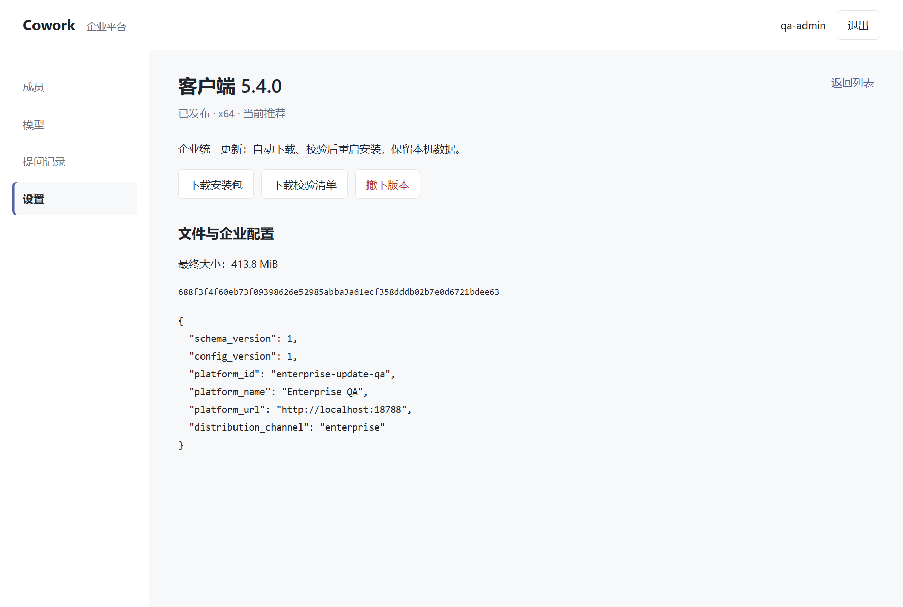

# Cowork 企业平台

文档适用版本：**5.4.2**

企业平台集中管理账号、企业模型、Skill、MCP、专家、聊天审计、团队空间和客户端分发。员工在桌面使用企业资源，也可以继续配置自己的模型。桌面使用方法见[用户手册](../../docs/user-guide.md#企业账号与团队空间)。

`web/platform/` 是可独立复制的部署单元，由 FastAPI、PostgreSQL、同源静态页面和业务文件目录组成：

| 路径 | 职责 |
| --- | --- |
| `server/` | 认证、模型网关、能力发布、聊天审计、团队空间、分发及命令入口 |
| `ui/` | 平台管理页面 |
| `compose.yaml` | Linux 服务、数据库与 HTTPS 代理 |
| `compose.http.yaml` | Linux 内网 HTTP 端口映射 |
| `compose.local.yaml` | Windows 本机 Docker 启动配置 |

部署顺序是选择环境、准备服务与数据库、初始化账号和模型、分发客户端，最后安排备份与升级。桌面包与企业中心离线包是两个交付物：更新桌面版本不会自动升级中心。

| 部署场景 | 阅读入口 |
| --- | --- |
| Windows 本机或离线交付 | [Windows Docker](#windows-本机-docker-启动) |
| Linux 服务器与 HTTPS 或内网 HTTP | [Linux 部署](#linux-部署) |
| 反向代理子路径或原生进程 | [其他部署方式](#子路径与原生进程部署) |
| 服务已经启动 | [初始化与成员管理](#初始化与成员管理) |
| 给员工发布桌面包 | [客户端分发](#客户端分发) |
| 备份、升级与诊断 | [日常运维](#日常运维) |

## Windows 本机 Docker 启动

源码部署先在此目录执行 `docker compose --env-file .env.local -f compose.local.yaml build platform`（首次尚无 `.env.local` 时使用 `docker build -t cowork-enterprise:local .`）。离线部署使用下节生成的完整交付包。随后执行：

```powershell
powershell -NoProfile -ExecutionPolicy Bypass -File .\start-local.ps1
```

脚本首次生成 `.env.local`，以后复用原配置。打开 `http://localhost:8788/app`，按页面创建首位平台管理员。

离线包启动前校验 `deployment.json` 中的文件摘要及导入镜像 ID，再固定使用该包的镜像；失败不会改用旧镜像。只有旧 `images.tar` 而没有部署清单的包会被拒绝。`-VerifyOnly` 只校验文件并导入、核验镜像，不启动服务或写入业务数据。

### 构建离线部署包

在仓库根目录执行，要求 Docker Desktop Linux 引擎已启动、Python 环境已准备，且本机已有 `postgres:17` 镜像（首次可执行 `docker pull postgres:17`）：

```powershell
.\.venv\Scripts\python.exe -X utf8 -B scripts/package_enterprise.py
powershell -NoProfile -ExecutionPolicy Bypass -File .\dist\enterprise-docker\start-local.ps1 -VerifyOnly
```

产物为 `dist/enterprise-docker/` 与 `dist/cowork-enterprise-docker.zip`。打包从当前源码快照重新构建服务镜像，逐文件比对镜像中的源码，检查数据库版本及 Electron 分发能力，然后导出镜像、源码、启动脚本和校验清单。镜像标签包含应用版本及源码摘要；不复用可变的旧 `cowork-enterprise:local` 标签，不自动升级已有 PostgreSQL 镜像。

打包只放行部署源码，排除 `.env.local`、密钥、业务数据和缓存；交付目录含本机配置或未知文件时拒绝覆盖。生产环境配置、数据库和文件卷不进入分发包。

## Linux 部署

将整个部署目录复制到服务器，例如 `/opt/cowork-platform/`。准备 Docker Compose、认证和模型服务。HTTPS 部署使用企业域名和受客户端信任的证书。以下命令均在部署目录执行：

```bash
cp .env.example .env
chmod 600 .env
mkdir -p certs
# 将证书与私钥放到 certs/tls.crt、certs/tls.key
docker compose build platform
docker compose run --rm --no-deps platform python -m server generate-key
```

把生成的加密密钥和部署参数填入 `.env`：

| 配置 | 含义 |
| --- | --- |
| `POSTGRES_PASSWORD`、`COWORK_DATABASE_URL` | 数据库密码和连接地址；DSN 中特殊字符使用 URL 编码 |
| `COWORK_HOST`、`COWORK_PUBLIC_URL` | 访问域名及公共基础地址 |
| `COWORK_PLATFORM_ID`、`COWORK_PLATFORM_NAME` | 固定平台标识与显示名称 |
| `COWORK_ENCRYPTION_KEY` | 模型密钥与认证凭据加密密钥 |
| `COWORK_LOGIN_PROVIDER` | 员工默认登录来源，可由网页配置覆盖 |
| `COWORK_SESSION_SECONDS` | 会话期限，默认 8 小时 |
| `COWORK_MAX_MODEL_CONCURRENCY` | 模型并发配置，默认 64 |
| `COWORK_CLEANUP_SECONDS` | 到期审计记录清理间隔，默认 60 秒 |
| `COWORK_MAX_SPACE_FILE_BYTES`、`COWORK_MAX_SPACE_BYTES` | 团队空间单文件及空间容量配置 |

启动服务：

```bash
sh start.sh
```

启动会检查数据库迁移。随后打开 `/app` 初始化管理员，配置认证、模型与成员授权。

### 使用内网 IP 和 HTTP 端口

在可信内网部署时，可以在 `.env` 中填入服务器实际的 IPv4 地址和员工可访问的端口，例如：

```dotenv
COWORK_HOST=192.168.1.50
COWORK_HTTP_PORT=8788
COWORK_ALLOW_PLATFORM_HTTP=1
```

沿用上面的数据库、平台标识和加密密钥配置，跳过证书步骤，执行 `sh start.sh --http`。此模式按 IP 和端口生成 `COWORK_PUBLIC_URL`，在此地址发布服务。请用 `http://192.168.1.50:8788/app` 初始化并管理平台。企业客户端封装时也使用这个地址。HTTP 会明文传输账号和请求，仅在可信内网使用。

已部署的平台切换访问方式时，先用原启动配置停止服务，保留原数据库卷、平台标识与加密密钥。切换后重新生成并分发企业客户端包。

## 子路径与原生进程部署

子路径可配置为 `COWORK_PUBLIC_URL=https://企业域名/cowork`。代理统一处理此前缀，并检查对应的登录、静态资源和下载地址。

原生部署在独立 Python 3.12 环境执行：

```bash
python -m pip install -r requirements.txt
python -m server migrate
python -m server serve --host 127.0.0.1 --port 8080
```

配置相同的 `COWORK_*` 变量并指定绝对路径 `COWORK_DATA_DIR`。使用 systemd 等管理单进程服务，在前方配置 HTTPS 代理。

## 初始化与成员管理

1. 首次打开网页，填写平台管理员账号、密码及确认密码。
2. 在“设置 → 添加认证来源”选择平台账号密码、OIDC、OAuth2 或 LDAP。
3. 外部认证保存草稿并完成测试登录后启用；平台账号密码可直接保存启用。
4. 在“客户端统一登录方式”选择员工入口。
5. 在“模型”保存连接参数、测试并启用，再到“成员”分配模型及默认模型。

平台管理员通过网页登录页的独立入口登录。成员页提供角色管理、模型分配和账号状态操作。企业能力在发布后分配给全员或指定成员。

## 企业能力与聊天审计

在“企业能力”选择对应标签页，创建草稿、测试、发布，再分配给成员。

- **Skill** 上传 ZIP。包内需有 `SKILL.md`，可附带 `references/`、`scripts/` 和 `assets/` 下的文本文件。
- **专家** 上传 ZIP。包内包含 `expert.json`、`prompt.md` 和 1–8 个 `skills/<目录名>/SKILL.md`。导入会创建或更新包内的 Skill 草稿并关联给专家。先发布并授权这些 Skill，再发布、授权专家。专家也可关联已存在的 Skill 和 MCP，或指定默认企业模型。
- **MCP** 通过表单填写 Streamable HTTP 服务地址和允许调用的工具。使用 Bearer 认证时，由员工在桌面企业 MCP 标签页给该服务配置凭据。

Skill 和专家的上传页提供可直接导入的示例模板。包内文件使用 UTF-8 文本，压缩前和压缩后均有 4 MiB 上限。

配置测试检查表单、脚本语法和所关联的能力。验证 MCP 是否可达、凭据是否有效及实际工具结果时，请让一名获授权的成员在桌面发起一次测试任务。员工发送消息时选定本轮使用的已发布版本。更新版本供后续轮次使用。停用或撤销授权会阻止之后的模型和工具调用，员工可以查看已有聊天和成果。

“审计”中的聊天请求记录以成员和聊天为单位保存最近一次符合规则的请求，保留 30 天。连续对话更新同一条记录。请求中已有的文字上下文随之保存。审计副本省略认证凭据和内嵌文件数据，超过 4 MiB 时保留记录信息并标明正文未保存。管理操作独立保留 90 天。

管理员可选择记录使用自配模型的企业任务请求，默认关闭，从后续任务生效。个人任务使用自配模型时仍按个人使用规则运行。

### 平台账号密码

选择“平台账号密码”认证来源后，进入“管理员工账号”，创建账号、姓名与初始密码，再分配模型。账号列表提供姓名修改、停用和重设密码。员工在桌面点击“登录企业账号”，在平台网页登录后回到客户端。

### OIDC 与命令行导入

网页初始化是常规入口。已有自动部署流程也可在空平台配置 `COWORK_BOOTSTRAP_PROVIDER`、`COWORK_BOOTSTRAP_SUBJECT`，导入认证来源，让对应企业账号完成首次管理员初始化。

创建权限为 `600` 的本地 `bootstrap-auth.json`，例如：

```json
{
  "id": "company-sso",
  "name": "企业统一认证",
  "mode": "oidc",
  "enabled": true,
  "config": {
    "issuer": "https://identity.example.internal",
    "discovery_url": "https://identity.example.internal/.well-known/openid-configuration",
    "client_id": "cowork-platform",
    "pkce": "S256"
  },
  "secrets": {"client_secret": "由身份平台提供"}
}
```

执行导入并启动：

```bash
docker compose up -d database
docker compose run --rm platform python -m server migrate
docker compose run --rm -T platform python -m server import-auth - < bootstrap-auth.json
sh start.sh
```

在身份平台注册回调地址 `https://企业域名/auth/callback/company-sso`。完成首次登录后，通过网页管理认证来源，移除初始化配置和导入文件。

### OAuth2 与 LDAP 参数

OAuth2 来源使用 `mode: "oauth2"`。在表单和高级配置中填写 `authorize_url`、`token_url`、`userinfo_url`、`client_id`、`pkce`，客户端密钥放入 secrets。

按身份服务契约设置客户端认证方式 `client_auth`、令牌请求编码 `token_encoding`、`include_redirect_uri`、用户信息请求方法及令牌传递位置。身份字段使用 `subject_token_path`、`name_path`、`email_path`，业务状态通过 `error_field`、`success_values` 映射。

LDAP 使用 `mode: "ldap"`，填写 `host`、`port`、`tls`（`ldaps` 或 `starttls`）、`base_dn`、`user_filter`（如 `(uid={username})`）、`identity_attribute`（如 `entryUUID`），按需配置 `bind_dn` 和容器内 `ca_file`。查询密码保存为 `secrets.bind_password`。

## 客户端分发

分发目标为 Windows x64 Electron 客户端，按企业发行身份提供推荐版本；账号、模型授权和团队空间独立于客户端发行格式。

先构建标准桌面 ZIP，再由中心校验、封装为企业包，最后由管理员发布推荐。源码版本号、本地构建和员工可下载的推荐版本应分别核对。

Windows 标准客户端按[构建说明](../../docs/technical-design.md#构建与发布)生成 ZIP 和 `latest-desktop-windows-x64.json` 更新清单（也可使用显式生成的审计报告）。平台管理员执行：

1. 在“设置 → 客户端分发”新建发布，填写程序版本，上传 Electron 标准 ZIP 和同次构建的更新清单。
2. 点击“校验并生成企业包”，等待可下载状态。
3. 下载核对后发布，并设置为推荐版本。
4. 将生成的企业 ZIP 分发给员工。员工完整解压后打开 `deepseek-cowork.exe`，点击“登录企业账号”即可进入企业登录页。

也可点击“从 GitHub 导入最新版”：中心读取正式 Release 的新版工作台清单，从固定版本标签下载标准 ZIP，验证并生成企业包。导入过程可取消，失败保留原因；完成后停在待发布状态，仍需管理员下载核验并发布推荐。

平台把服务器地址写入 EXE 同目录的 `enterprise_connection.json`，员工首次打开时直接使用该地址。封装后重新计算 ZIP 大小和 SHA-256。管理员及员工下载页同时提供对应企业 ZIP 的“下载校验清单”，离线更新时将两者放在同一目录。

后续升级只需管理员重复上传、校验和发布推荐版本。企业客户端通过包内地址自动检查和下载，员工可在桌面“设置 → 更新与关于”手动检查，整个更新过程无需登录企业账号或打开平台网页。个人包继续从个人更新渠道检查更新，登录企业账号后也可以使用获授权的企业资源。

当前只有 Windows x64 Electron 一个推荐版本。客户端启动约 15 秒后检查，之后每 24 小时检查，自动下载高于当前版本的推荐包；员工确认“重启并更新”后才安装。安装前重新确认推荐记录有效，已有任务须先结束。企业源失败不切换公共源。撤下只阻止新的在线下载和安装，不卸载已安装版本；离线副本无法确认撤回状态。后台目前不提供强制升级、设备清单或全员安装回执。

Qt 客户端已停止支持，旧安装不能沿用原更新入口。首次使用当前企业版须下载、完整解压并运行 Electron 企业包；本产品不维护 Qt 到 Electron 的自动迁移流程。



## 团队空间与数据库

团队空间提供计划、成员、资料、成果和动态，员工在桌面执行任务并选择发布内容，网页用于管理和阅读共享对象。操作见[用户手册](../../docs/user-guide.md#企业账号与团队空间)。

`platform.schema_version` 记录已完成的数据库迁移。结构版本 5 增加企业能力及聊天审计表，保留成员、模型、团队空间、业务文件和 Electron 发布记录。结构版本 4 开始只支持 Electron 分发，旧 Qt 记录保留但停止分发。执行入口为：

```bash
docker compose run --rm platform python -m server migrate
```

文件保存在 `COWORK_DATA_DIR/team-space-files`，使用同一业务文件卷。平台信息接口 `/api/v1/platform-info` 提供能力声明。

## 日常运维

### 状态与日志

Linux 部署更新代码后，使用原启动参数再次运行 `sh start.sh`。HTTPS 部署使用以下命令查看状态和日志。HTTP 部署在 `docker compose` 后加上 `-f compose.yaml -f compose.http.yaml`。

```bash
docker compose ps
docker compose logs --tail=100 platform
docker compose stop
```

健康检查 `/healthz` 返回实际数据库结构版本。`/api/v1/platform-info` 提供客户端分发、企业能力和聊天审计的可用性，以及通过交付脚本构建的镜像版本和源码摘要。管理页面显示客户端处理状态及记录清理状态。

### 业务备份

业务数据库备份排除聊天请求快照和历史提问正文，避免正文随备份延长保存。停止写入后备份业务文件卷，独立保管加密密钥。

```bash
docker compose exec -T database pg_dump -U cowork -d cowork -Fc --exclude-table-data=questions --exclude-table-data=chat_audit_requests > cowork-business.dump
```

开发测试入口统一维护在[技术文档](../../docs/technical-design.md#开发与测试)。
### Windows 本机启停与升级

以下命令在 Windows 部署目录执行，沿用 `.env.local` 与 `compose.local.yaml`。

停止与再次启动：

```powershell
docker compose --env-file .env.local -f compose.local.yaml stop
powershell -NoProfile -ExecutionPolicy Bypass -File .\start-local.ps1
```

服务端代码升级时，先构建镜像，再停止应用并完成业务备份，然后启动新服务：

```powershell
docker compose --env-file .env.local -f compose.local.yaml build platform
docker compose --env-file .env.local -f compose.local.yaml stop platform
docker compose --env-file .env.local -f compose.local.yaml up -d --no-deps --wait platform
```

离线升级时将新包解压到新目录，把原 `.env.local` 原样复制过去；停止原平台并按“日常运维”备份后，运行新包 `start-local.ps1`。保持 Compose 项目名、卷名、账号库和加密密钥一致。回退到较早版本时，应配套恢复升级前的数据库和文件卷。
